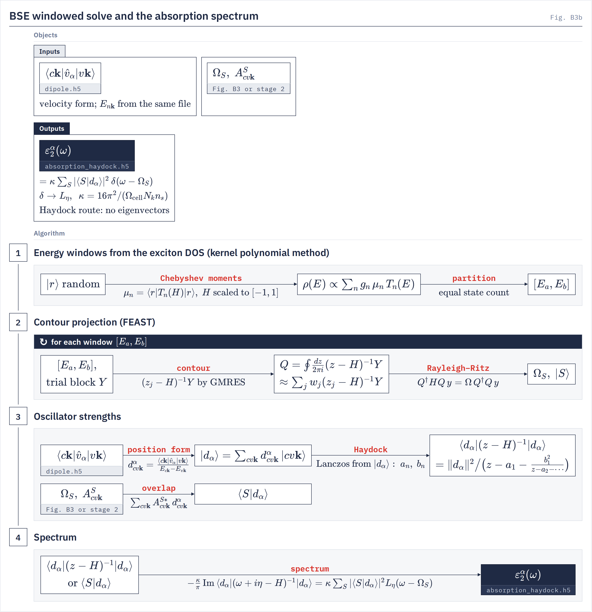

# The FEAST route

`bse.bse_feast` The contour-projection eigensolver of `bse.bse_jax`, kept off the main BSE pages.
{: .page-summary }

This page is unlisted. It collects what the BSE pages used to say about the FEAST route, which the owner removed from the visible manual on 2026-10-21. Since 2026-10-21 the route runs only with `--feast`; before that it was the command-line default. Without `--tda` it solves the full problem, and with the default RPA kernel $D + w_x V$ it never builds $W$. It prints Ritz values only and writes no file. It refuses unless every in-window Ritz pair has a residual below `--feast-tol-mev` (`GATE feast_converged`). A FEAST flag without `--feast` refuses.

## Overview {: #overview }

!!! treatment in-progress "feast · Contour projection in KPM windows · --feast"
    A KPM density of states splits the spectrum into windows of equal state count; FEAST projects each window by shifted GMRES at contour nodes and prints Ritz values per window. Missing: eigenvector output, `--eqp` (refused on this route), and user windows (`--feast-window1/2` have no effect).

    ```bash
    python -m bse.bse_jax -i gw.in --feast --tda --bse
    ```


## Method {: #method }

**Contour projection** <span class="status in-progress">In progress</span>

For each KPM window $[E_a, E_b]$, a trial block is filtered by a contour integral of the resolvent, then Rayleigh–Ritz.

Each resolvent is applied by shifted GMRES (`--gmres-max-iter`, `--gmres-tol`) at `--feast-n-quad1` then `--feast-n-quad2` nodes, two FEAST iterations. Without `--tda` the conjugate nodes are added.

$$
Q = \oint \frac{dz}{2\pi i}(z - H)^{-1} Y \approx \sum_j w_j (z_j - H)^{-1} Y, \qquad Q^\dagger H Q\, y = \Omega\, Q^\dagger Q\, y \tag{4.2}
$$

Subspace
:   contour-filtered block, per window

```bash
python -m bse.bse_jax -i gw.in --feast --tda --bse
```


<figure class="flowchart" markdown>
[](../../assets/figures/b3b.png)
<figcaption><strong>Fig. B3b.</strong> Energy windows from the KPM density of states (stage 1), the FEAST contour projection per window (stage 2), oscillator strengths by the Haydock recursion or by overlap with eigenvectors (stage 3), and the spectrum, which both routes give as the same Lorentzian sum (stage 4).</figcaption>
</figure>

## Keywords {: #keywords }

Optional
{: .kw-group }

### `--feast` {: .kw data-type="flag" data-default="off" }
Selects the FEAST route. It cannot be combined with `--lanczos` or `--kpm-dos`.

### `--feast-tol-mev` {: .kw data-type="float" data-default="0.01" }
Every in-window Ritz pair's residual $\lVert Hx - \Omega x\rVert$ must be below this, in meV, before any value is reported (`GATE feast_converged`). Out-of-window pairs are leakage and are not tested.

### `--feast-iter` {: .kw data-type="int" data-default="2" }
FEAST subspace iterations.

### `--feast-n-lanczos` {: .kw data-type="int" data-default="10" }
FEAST route. Minimum Lanczos steps for the spectral bounds; the bound Lanczos runs adaptively up to 50.

### `--feast-buffer` {: .kw data-type="float" data-default="0.05" }
FEAST route. Fractional buffer on the upper spectral bound.

### `--feast-n-quad1`, `--feast-n-quad2` {: .kw data-type="int" data-default="4, 8" }
FEAST route. Contour nodes in the first FEAST iteration and in later ones.

### `--feast-quadrature` {: .kw data-type="enum" data-default="ellipse" }
FEAST route. Contour rule: trapezoid on an ellipse of aspect 0.2, or a Zolotarev rational filter.

`ellipse` `zolotarev`
{: .kw-values }

### `--feast-ritz-count` {: .kw data-type="int" data-default="4" }
FEAST route. Ritz values reported per window.

### `--gmres-max-iter`, `--gmres-tol` {: .kw data-type="int, float" data-default="10, 1e-2" }
FEAST route. Shifted-GMRES iterations and relative tolerance per contour node.

### `--gmres-seed` {: .kw data-type="int" data-default="0" }
FEAST route. Seed of the start block and of the KPM window estimate.

### `--gmres-fp32` {: .kw data-type="flag" data-default="off" }
FEAST route. Shifted solves in single precision.

### `--feast-window1`, `--feast-window2` {: .kw data-type="eV pair" data-default="—" }
FEAST route. Accepted, without effect: the driver always derives the windows from KPM.

### `--feast-units-ev-per-ry` {: .kw data-type="float" data-default="13.6056980659" }
FEAST route. Ry-to-eV factor of the report.

