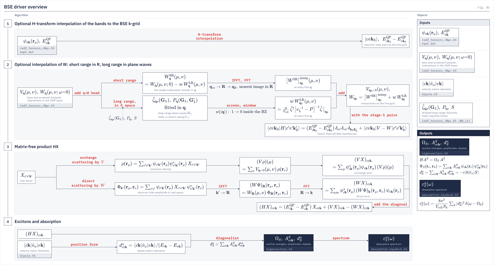

# BSE driver

`bse.bse_jax` Optical excitons from the Bethe–Salpeter equation on the ISDF tensor file from GW.
{: .page-summary }

<div class="workflow-map" data-driver="bse" data-page="overview"></div>

Solves the Bethe–Salpeter equation for $\bQ = 0$ excitons in the transition basis $|cv\bk\rangle$, with the static screened interaction from the GW run. It is the last stage of the workflow; the absorption spectrum $\varepsilon_2(\omega)$ comes from its companion entry point `bse.absorption_haydock`.
{: .lead }

<div class="glance" markdown>

Invoke
:   `python -m bse.bse_jax -i gw.in`; spectrum: `python -m bse.absorption_haydock`
Reads
:   GW input file, ISDF tensor file `isdf_tensors_<N_mu>.h5`, `WFN.h5`, centroid table, `eqp1.dat`, `dipole.h5`

Writes
:   `bse.out`, `eigenvalues*.dat`, `eigenvectors.h5`, `absorption_eh.dat`, `absorption_noeh.dat`; `absorption_haydock.h5`, `absorption_haydock_b{1,2,3}_eh.dat`

Hamiltonian
:   Tamm–Dancoff (the default) or full, with the coupling block (`full_bse = true`); the spinor kernel on a spinor WFN, `spin_singlet` (default) or `spin_triplet` on a non-spinor one ([Kernel and Hamiltonian](#kernel))

Solver
:   Davidson · Lanczos · thick restart · dense full BSE · Haydock

</div>

## What it computes {: #what }

<div class="stages" markdown>

1. **Optional interpolation of bands and interactions to the BSE k-grid**
   Read $\psi_{n\bk}(\br_\mu)$, $E^{\mathrm{QP}}_{n\bk}$, $V_\bq(\mu,\nu)$ and $W_\bq(\mu,\nu;0)$ from the bundle and add the $\bq \to 0$ head. Under `kgrid_fine` the bands are carried to the fine grid $\bk_{\mathrm{fi}}$ by H-transform interpolation, and $W$ is split into a short-range part, smooth in $\bq$ and Fourier-interpolated, and a long-range part on the long-range plane waves $\bG_L$, the vectors at which $\bq+\bG\to0$. Their dressed coefficients $\tilde\zeta_{\bq\mu}(\bG_L)$ and polarizability $P_\bq$ are fitted in $\bq$, screened, switched off smoothly inside the zone, and evaluated at every fine $\bq$ (`w_head_densify = srlr`; [Theory](theory.md)).
2. **Matrix-free product $HX$**
   The Hamiltonian, Tamm–Dancoff or full ([below](#kernel)), is never stored. Each trial vector gets the diagonal $E^{\mathrm{QP}}_{c\bk} - E^{\mathrm{QP}}_{v\bk}$, the exchange term through $V_{\bq=0}$ and the direct term as a k-convolution with $W$.
3. **Eigensolve**
   The route selected on the command line returns exciton energies $\Omega_S$ and, on the default eigensolve route, amplitudes $A^S_{cv\bk}$ in `eigenvectors.h5`.
4. **Dipoles and spectrum**
   Velocity matrix elements from `dipole.h5` (`dipole_file`) are put in position form. The eigensolve stores per-state dipoles $d^\alpha_S$ and writes BerkeleyGW's `absorption_eh.dat` and `absorption_noeh.dat` from the computed states; `bse.absorption_haydock` (or `haydock = true`) computes $\varepsilon_2(\omega)$ by a continued fraction, without eigenvectors.

</div>

<figure class="flowchart" markdown>
[](../../assets/figures/b1.png)
<figcaption><strong>Fig. B1.</strong> The production route (the default TDA, screened kernel) in four stages: the bands optionally carried to the BSE k-grid by the H-transform; $W$ optionally carried there in two branches, the short-range part Fourier-interpolated through $\bR$ and the long-range part built on the long-range plane waves $\bG_L$, fitted in $\bq$, screened and windowed, then added and assembled into the Tamm–Dancoff Hamiltonian; the matrix-free product $HX$, with the exchange (top) and direct (bottom) branches; the eigensolve and the spectrum. The Objects cards name the file each quantity comes from or goes to.</figcaption>
</figure>

!!! note
    Every setting is an input key in the GW input file, under BerkeleyGW's absorption.x name where the meaning is the same; BerkeleyGW's `key value` and bare-flag lines are accepted. The defaults are BerkeleyGW's: TDA and the screened kernel. The spectrum of the computed states is `absorption_eh.dat`; the full spectrum comes from the Haydock recursion.

## Running {: #run }

Run in the GW run directory, against the GW input file. Exactly one `isdf_tensors_*.h5` may sit there or in its `tmp/`.

=== "Local"
    ```bash
    # input keys in the -i input file: number_val_bands_fine = 4, number_cond_bands_fine = 8, number_eigenvalues = 10
    uv run python -m bse.bse_jax -i gw.in
    ```
=== "Perlmutter"
    ```bash
    # input keys in the -i input file: number_val_bands_fine = 4, number_cond_bands_fine = 8, number_eigenvalues = 10
    srun -N 1 -n 4 --gpus-per-node=4 src/ffi/cpp/select_gpu.sh python -u -m bse.bse_jax -i gw.in
    ```
=== "Frontera"
    ```bash
    # copy config/frontera/templates/gw_dev.sbatch; change its python line to -m bse.bse_jax -i gw.in
    sbatch bse_dev.sbatch
    ```

A minimal production run: QP energies, eigenvectors with their dipoles, the spectrum of the computed states and the full Haydock spectrum. The keys go in the GW input file, after its own:

```ini
number_val_bands_fine = 4
number_cond_bands_fine = 8
eqp_corrections = eqp1.dat
number_eigenvalues = 20
write_eigenvectors = -1
dipole_file = dipole.h5
energy_resolution = 0.05
haydock
number_iterations = 200
```

```bash
python -m bse.bse_jax -i gw.in
```

To solve on a finer grid, add the fine-grid lines (BerkeleyGW's `WFN_fi` grid and its kgrid.x shift); the QP energies are then `eqp_co_corrections`:

```ini
kgrid_fine = 12 12 1
kgrid_fine_shift = 0.5 0.5 0
number_cond_bands_coarse = 16
eqp_co_corrections = eqp1.dat
w_head_densify = c1
```

Under `kgrid_fine` the dipoles are carried to the fine grid with the bands, so the run above works unchanged on that input file ([`kgrid_fine`](keywords.md#kgrid_fine)).

## Choosing a solver {: #solver }

Production runs use the default route, the eigensolve, and `kpm_dos = true` computes only the exciton density of states. On the TDA (the default) `solver` picks the iterative solver, Davidson by default; with `full_bse = true` the dense full-BSE solver runs. Expand a row for the method, its keys and its limits.

???+ treatment production "davidson · Block Davidson · TDA eigenpairs"
    Residual corrections preconditioned by the exact diagonal of $H$, on a block of the `number_eigenvalues` lowest roots plus `davidson_margin` margin roots. The solve stops when every reported root's residual is below `davidson_tol_mev` (0.01 meV) and refuses if the iteration cap comes first. The default solver since 2026-10-20.

    ```bash
    # input keys in the -i input file: number_eigenvalues = 10
    python -m bse.bse_jax -i gw.in
    ```

??? treatment supported "lanczos · Block Lanczos · TDA eigenpairs"
    Lanczos on the Tamm–Dancoff block $A$ with full CGS2 reorthogonalization. The lowest Ritz pairs of the tridiagonal (block-tridiagonal) projection are the excitons. It runs a fixed Krylov dimension and has no residual test.

    ```bash
    # input keys in the -i input file: solver = block_lanczos, number_eigenvalues = 10
    python -m bse.bse_jax -i gw.in
    ```

    **Note** Keep `lanczos_n_reorth -1` (full) for degenerate spinor spectra.

??? treatment supported "trlan · Thick-restart Lanczos · TDA eigenpairs"
    The same Krylov convergence from a basis capped at `trlan_m_max` slots, restarted from the lowest Ritz vectors. For production sizes where the full Krylov basis does not fit in memory.

    ```bash
    # input keys in the -i input file: solver = trlan, number_eigenvalues = 20
    python -m bse.bse_jax -i gw.in
    ```

??? treatment supported "dense · Full BSE, definite pencil · non-TDA eigenpairs"
    Builds $A$ and $B$ densely from the matvec and solves the Hermitian-definite pencil, returning paired $(X, Y)$. Limited to a transition dimension of 4096; reads only `number_eigenvalues` and the kernel flags.

    ```bash
    # input keys in the -i input file: full_bse = true, number_eigenvalues = 10
    python -m bse.bse_jax -i gw.in
    ```

    **Note** Refuses a $W$ that fails the $\bq \leftrightarrow -\bq$ reciprocity preflight.

??? treatment production "haydock · Continued fraction · absorption spectrum"
    `bse.absorption_haydock`, or `haydock = true` after the eigensolve: Lanczos from the dipole vector $|d_\alpha\rangle$, one recursion per Cartesian direction (or one along `polarization`), gives $\varepsilon_2(\omega)$ as a continued fraction, Lorentzian. Always the TDA kernel $D + w_x V - W$; needs no eigenvectors; the standalone driver needs at least two devices.

    ```bash
    # input keys in the -i input file: number_val_bands_fine = 4, number_cond_bands_fine = 8, highest_occupied_band = 26
    python -m bse.absorption_haydock -i gw.in
    ```

??? treatment supported "kpm · Kernel polynomial DOS · exciton density of states"
    `kpm_dos = true`: Chebyshev moments of $H$ with Jackson damping, written to `bse_dos_kpm.png` and `bse_dos_kpm.npz`. No eigenpairs.

    ```bash
    # input keys in the -i input file: kpm_dos = true
    python -m bse.bse_jax -i gw.in
    ```

## Kernel and Hamiltonian {: #kernel }

Three keys choose the operator on every route; the defaults are BerkeleyGW's.

| Keys | Hamiltonian | BerkeleyGW |
|---|---|---|
| none (default) | $A = D + w_x V - W$ | default TDA, `spin_singlet` (spinors: the spinor kernel) |
| `full_bse = true` | $\begin{pmatrix}A & B\\ -B^* & -A^*\end{pmatrix}$ | `full_bse` |
| `local_fields = true` | $D + w_x V$ (RPA kernel, $W$ never built) | `local_fields` |
| `spin_triplet = true` (non-spinor WFN) | $D - W$ ($w_x = 0$) | `spin_triplet` |

The exchange weight is $w_x = 2$ for the singlet of a non-spinor WFN (`spin_singlet`, the default), $0$ for its triplet (`spin_triplet`), and $1$ for a spinor WFN, which has one kernel: `spin_singlet` or `spin_triplet` there refuses. A collinear spin-polarized WFN refuses. The spin case changes only that scalar weight; every case runs the same matvec. `spinor` is an assertion checked against the WFN. The equations are on the [Theory](theory.md) page.

## Excitons on QSGW states {: #qsgw }

`eqp_corrections` replaces the diagonal energies only. ψ always comes from the ISDF tensor file, which holds the states of the GW input file's WFN. Two routes follow:

- **QSGW energies, DFT states.** Run the BSE on the self-consistent run's own bundle with `eqp_corrections = eqp1.dat`. A converged run on a route that stores W0 writes the final map's $W(0)$ there; a QSGW bundle without it is not rebuilt (`GATE bse_static_w_sc_state`).
- **QSGW states.** Run GW on the self-consistent run's `WFN_qp.h5` (`wfn_file = WFN_qp.h5`) and solve the BSE on that bundle without `eqp_corrections`, with `dipole_file = dipole_qsgw.h5`. `eqp_corrections` on a stamped `WFN_qp.h5` refuses, and so does a DFT `dipole.h5` with it (`GATE dipole_basis`).

A `WFN_qp.h5` written before 2026-09-30 from a WFN that stores both $\bk$ and $-\bk$ has broken rows; rewrite it with `python -m postprocess.rotate_wfn_to_qp WFN.h5 qp_wfn_rotations.h5`.

## Converging a spectrum {: #converge }

Measured accuracy and cost of the choices a production run makes:

| Choice | Measured |
|---|---|
| Haydock steps, `number_iterations` | CrI₃ 8×8×1 with SOC (bare $V$ as $W$) against a 500-state sum over states: 200 steps (the default) agree to $10^{-5}$ of max $\varepsilon_2$; 100 steps are 0.2–0.5 % off. |
| Sum over states from `eigenvectors.h5` | Converges slowly in peak height with the number of states. Compare spectra through `bse.absorption_haydock`. |
| Stored or rebuilt $W(0)$ | Against a stored tangential W0 on one bundle, the rebuild moved the ten lowest $\Omega_S$ by at most 0.0078 meV (MoS₂ 3×3) and 0.00002 meV (Si 4×4×4), and doubled the wall time (9.8 → 19.3 s, 10.5 → 20.3 s). |
| Matvec cost | CrI₃ 8×8×1 with SOC, 8 valence × 14 conduction bands, four A100-40GB: one Haydock step (three trials) 13.3 ms, 100 steps 1.28 s, 2159 MiB peak per rank. |

A downfolded bundle is validated by solving the same BSE on the parent and on the child ([downfold](../../utilities/downfold.md#mu-small)).

## Refusals {: #refusals }

!!! refuses
    - No `-i`; an unknown flag; an old flag ("`--n-val` is now input key `number_val_bands_fine`") or an old input key ("`bse_k_grid` is now `kgrid_fine`").
    - A key set on a route that does not read it (for example `number_eigenvalues` or `highest_occupied_band` with `kpm_dos = true`), or two route keys together.
    - `dipole_file` with `full_bse = true`; `spin_singlet`/`spin_triplet` on a spinor WFN; `spinor` that disagrees with the WFN; a collinear spin-polarized WFN.
    - `eqp_co_corrections` without `kgrid_fine`, `eqp_corrections` with it; a fine-grid key without `kgrid_fine`; `number_cond_bands_coarse` below `number_cond_bands_fine` (`GATE bse_window_outside_coarse`).
    - `--px`/`--py` not given together, not square, or not using every device.
    - No `isdf_tensors_*.h5`, or more than one, in the run directory and its `tmp/` (`GATE bse_restart_ambiguous`).
    - A bundle whose centroid hash, band window, $N_\mu$, parent rows or QP-state stamp does not match the input file and its WFN.
    - A bundle without stored W0 that cannot be rebuilt: no `G0_mu_nu`, a four-current bundle, a QSGW input file, or no WFN/centroid receipt.
    - A window edge inside a degenerate multiplet under `band_degeneracy = strict` (the default).
    - A window band outside the ζ-fit legs of the GW run (`BseWindowOutsideZetaTrainingError`).
    - `eqp_corrections` on a stamped QP WFN, or an `eqp1.dat` whose k blocks are not the WFN's irreducible wedge.
    - A `dipole.h5` whose `basis` stamp differs from the WFN's.
    - `kgrid_fine` with an axis smaller than the coarse grid; `w_head_densify = legacy`; `srlr` without `W0_lr` in the bundle.
    - Full BSE above transition dimension 4096, or with a non-reciprocal $W$.
    - `bse.absorption_haydock` on fewer than two devices.
    - The environment variable `LORRAX_LANCZOS_REORTH` (retired).
