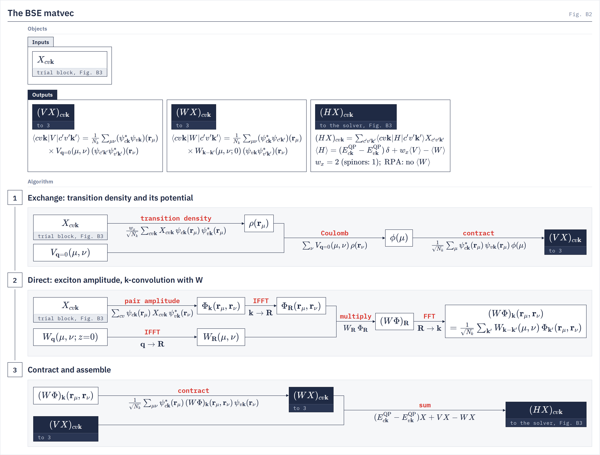
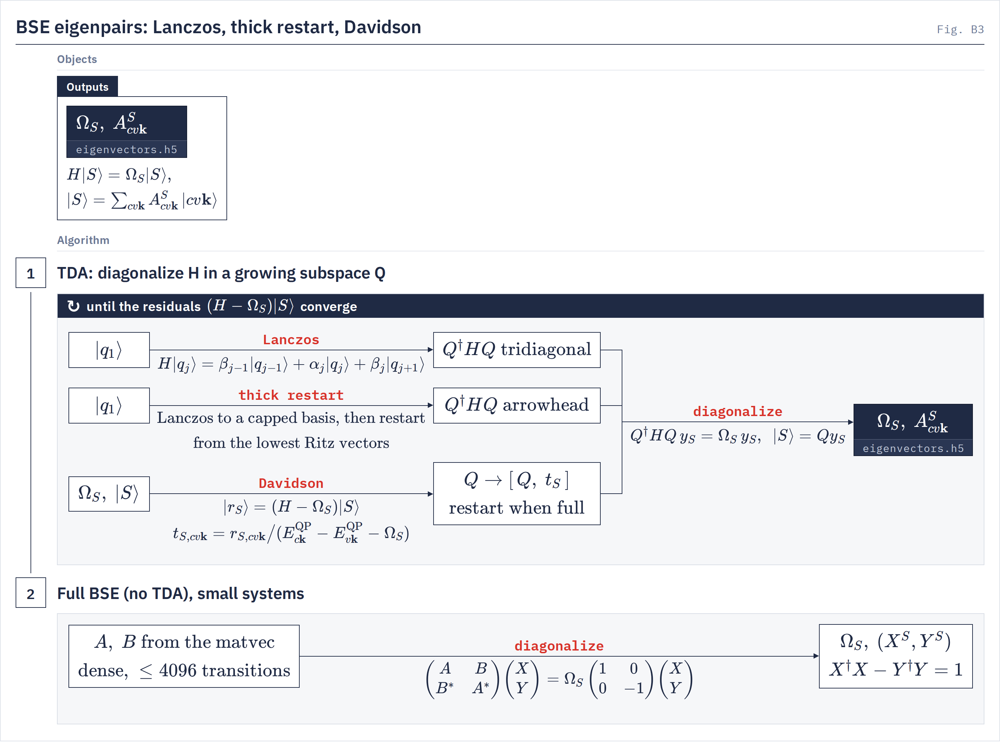

# Theory

`bse.bse_jax` The equations each stage of the BSE driver and `bse.absorption_haydock` evaluate.
{: .page-summary }

<div class="chain-map" data-driver="bse" data-page="theory"></div>

<div class="section-cards"></div>

## <span class="n">1</span> Bands and interactions on the BSE grid {: #grid }

Every BSE quantity is assembled from what the GW run left in the restart bundle: band values at the ISDF points, the band energies, $V_\bq(\mu,\nu)$ and the static $W_\bq(\mu,\nu;0)$. When the deck sets `kgrid_fine`, bands and $W$ are first carried from the GW grid $\bk_{\mathrm{co}}$ to the finer BSE grid $\bk_{\mathrm{fi}}$; below, $\bk$ always denotes a point of the grid the BSE runs on.
{: .intro }

### <span class="n">1.1</span> The transition window {: #grid-window }

`bse_loading.load_bse_data_from_restart_sharded`
{: .in-code }

The transition basis $|cv\bk\rangle$ pairs the $n_v$ highest occupied bands with the $n_c$ lowest empty ones around the occupied count $n_{\mathrm{occ}}$ (`highest_occupied_band`, else the WFN's `ifmax`):

$$
v \in [\,n_{\mathrm{occ}} - n_v,\; n_{\mathrm{occ}}\,), \qquad c \in [\,n_{\mathrm{occ}},\; n_{\mathrm{occ}} + n_c\,), \qquad N = n_c\, n_v\, N_k \tag{1.1}
$$

Every window band must lie in both band windows of the GW run's ζ fit, because the direct term reads $v v'$ and $c c'$ pair densities. $n_c$ and $n_v$ are padded to the device mesh with zero ψ and energies of $\pm 10^3$ Ry, so pad states decouple and are dropped on output.

!!! note
    A window edge inside a degenerate multiplet refuses under `band_degeneracy = strict`. `snap` widens the window outward; the widened window is what the run solves and what `eigenvectors.h5` records.

### <span class="n">1.2</span> Quasiparticle energies {: #grid-qp }

`restart_bundle.apply_eqp_corrections`
{: .in-code }

The bundle holds mean-field energies $E_{n\bk}$ on the full grid. `eqp_corrections` reads `eqp1.dat` on the irreducible wedge and unfolds it through the symmetry service, so for $\bk = S\bk_{\mathrm{irr}}$:

$$
E^{\mathrm{QP}}_{n\bk} = E^{\mathrm{QP}}_{n\bk_{\mathrm{irr}}} \quad (n \text{ in the file}), \qquad E^{\mathrm{QP}}_{n\bk} = E_{n\bk} \quad (\text{otherwise}) \tag{1.2}
$$

Only energies change; ψ always comes from the bundle. Without `kgrid_fine` the window is re-sliced on the corrected spectrum, since a QP shift can move the gap. With it, the QP energies enter the band interpolation of §1.3.

### <span class="n">1.3</span> Band interpolation {: #grid-bands }

`bse_densify._interpolate_bse_data_to_grid`
{: .in-code }

When `kgrid_fine` differs from the GW grid, one H-transform over the GW band window gives the window bands and their QP energies at every fine point:

$$
\big\{\psi_{n\bk_{\mathrm{co}}}(\br_\mu),\, E^{\mathrm{QP}}_{n\bk_{\mathrm{co}}}\big\} \;\longrightarrow\; \big\{\psi_{n\bk_{\mathrm{fi}}}(\br_\mu),\, E^{\mathrm{QP}}_{n\bk_{\mathrm{fi}}}\big\}, \qquad n \in [\,n_{\mathrm{occ}} - n_v,\; n_{\mathrm{occ}} + n_c\,) \tag{1.3}
$$

The method, its basis keys and its quality checks are on the [htransform](../../utilities/htransform.md#how) page. Each fine axis must be at least the coarse one; nesting is not required. The GW deck's `nval`, `ncond` and `number_bands` fix the interpolation window, and fewer than four conduction bands above the BSE window draw a warning.

### <span class="n">1.4</span> Static W, the q → 0 head and densification {: #grid-w }

`bse_head._inject_q0_head` · `bse_densify.make_w_densifier`
{: .in-code }

$W_\bq(\mu,\nu;0)$ is the bundle's stored W0 (a Dyson $W(0)$, or $V + W^c(0)$ of a tangential model), or, without one, a static Dyson rebuild on every call. The $\bq \to 0$ head enters as a rank-one term on the $\bq = 0$ tiles, with $g_0(\mu) = \zeta_{\bq=0,\mu}(\bG = 0)$; deck `vhead` and `whead_0freq` override the bundle's values:

$$
V_{\bq=0}(\mu,\nu) \mathrel{+}= \frac{V^{\mathrm{head}}}{\Omega_{\mathrm{cell}}}\, g_0^*(\mu)\, g_0(\nu), \qquad
W_{\bq=0}(\mu,\nu;0) \mathrel{+}= \frac{W^{\mathrm{head}}}{\Omega_{\mathrm{cell}}}\, g_0^*(\mu)\, g_0(\nu) \tag{1.4}
$$

On a densifying run the $W$ head is held back. Fourier interpolation through $\bR$ is exact on the coarse points and accurate where $W$ is analytic in $\bq$, but the head ($\sim 1/q^2$ in bulk) and the $G_z \neq 0$ plane waves of a slab are not. We therefore split $W = W^{\mathrm{SR}} + W^{\mathrm{LR}}$. The long-range part is known at any $\bq$, and only the smooth short-range part is interpolated,

$$
W_{\bq_{\mathrm{fi}}}(\mu,\nu;0) = \underbrace{\mathrm{FFT}_{\bR \to \bq_{\mathrm{fi}}}\,\mathrm{IFFT}_{\bq_{\mathrm{co}} \to \bR}\big[W_{\bq_{\mathrm{co}}} - W^{\mathrm{LR}}_{\bq_{\mathrm{co}}}\big]}_{[W^{\mathrm{SR}}]^{\mathrm{interp}}_{\bq_{\mathrm{fi}}}} + W^{\mathrm{LR}}_{\bq_{\mathrm{fi}}} \tag{1.5}
$$

With `w_head_densify = c1` (the default) the long-range part is the head alone, $W^{\mathrm{LR}}_\bq = h(\bq)\, g_0^*(\mu)\, g_0(\nu)/\Omega_{\mathrm{cell}}$, with $h(\bq) = \bar W_{00}\,s(\bq)/\langle s\rangle_{\Gamma_c}$ and $s(\bq) = v(\bq)/\big(1 - v(\bq)\,\bq\cdot S\cdot\bq\big)$ inside the coarse Γ cell $\Gamma_c$ and zero outside. Here $\bar W_{00}$ is the $W^{\mathrm{head}}$ of (1.4). With `srlr` it is $w(|\bq|)\,\tilde\zeta^\dagger_\bq D_\bq\tilde\zeta_\bq/\Omega_{\mathrm{cell}}$ with $D_\bq = [v_L^{-1} - P_\bq]^{-1}$, built from the ISDF coefficients $\zeta_{\bq\mu}(\bG_L)$ at the long-range plane waves $\bG_L$, dressed by the short-range local fields and fitted from the bundle's `W0_lr`. Γ keeps the `c1` head. Both routes, the plane waves $\bG_L$ and the window are derived on [Short- and long-range W](../../theory/w-range-splitting.md). Without `kgrid_fine` only the last transform, $W_\bR = \mathrm{IFFT}_{\bq\to\bR}W_\bq$, runs.

<figure class="flowchart" markdown>
[](../../assets/figures/b4.png)
<figcaption><strong>Fig. B4.</strong> Static $W$ for the BSE: the static $W$ and the polarizability in plane waves on the GW grid (stage 1), the Schur complement on the long-range plane waves (stage 2), and the fine-grid assembly with the $\bq = 0$ head (stage 3). With the default `w_head_densify = c1` only the head is held back ([Short- and long-range W §5](../../theory/w-range-splitting.md#c1)).</figcaption>
</figure>

### <span class="n">1.5</span> The exchange tile on the fine grid {: #grid-v }

`bse.vq_interp`
{: .in-code }

A $\bQ = 0$ exciton's exchange uses the single $\bq = 0$ tile. Its body is built from the centroids and the G-sphere and never sees the k-grid, so it is carried to the fine grid unchanged:

$$
V^{\mathrm{fi}}_{\bq=0}(\mu,\nu) = V^{\mathrm{co}}_{\bq=0}(\mu,\nu) \qquad (\texttt{head\_minibz\_average = false}) \tag{1.6}
$$

Only the head scalar depends on the grid. `head_minibz_average = true` rebuilds the tile with the fine grid's mini-BZ head (see [the q → 0 head](../../theory/q0-head.md#minibz)); at $\bQ = 0$ the head is annihilated by $\langle u_{c\bk}|u_{v\bk}\rangle = 0$ up to the ISDF residual.

## <span class="n">2</span> The BSE Hamiltonian {: #ham }

The Hamiltonian couples electron–hole pairs through the bare exchange $V$ and the statically screened direct interaction $W$. It is defined by its matrix elements in $|cv\bk\rangle$ and applied only as a product (§3).
{: .intro }

### <span class="n">2.1</span> Tamm–Dancoff Hamiltonian {: #ham-tda }

In the TDA, the default, the solvers diagonalize the resonant block:

$$
\langle cv\bk|H|c'v'\bk'\rangle = \big(E^{\mathrm{QP}}_{c\bk} - E^{\mathrm{QP}}_{v\bk}\big)\,\delta_{cc'}\delta_{vv'}\delta_{\bk\bk'} + w_x\,\langle cv\bk|V|c'v'\bk'\rangle - \langle cv\bk|W|c'v'\bk'\rangle \tag{2.1}
$$

With `local_fields = true` the $W$ term is dropped (the RPA kernel $D + w_x V$, BerkeleyGW's `local_fields`) and $W$ is never built.

### <span class="n">2.2</span> Kernel matrix elements {: #ham-kernel }

`bse_preconditioner.compute_pair_amplitude`
{: .in-code }

In the ISDF basis the exchange is a $\bq = 0$ product of transition densities, and the direct term couples $\bk$ to $\bk'$ through $W$ at momentum transfer $\bk - \bk'$:

$$
\begin{aligned}
\langle cv\bk|V|c'v'\bk'\rangle &= \frac{1}{N_k}\sum_{\mu\nu} M_{cv\bk}(\br_\mu)\, V_{\bq=0}(\mu,\nu)\, M^*_{c'v'\bk'}(\br_\nu), \qquad M_{cv\bk}(\br_\mu) = \sum_s \psi^*_{c\bk,s}(\br_\mu)\psi_{v\bk,s}(\br_\mu),\\
\langle cv\bk|W|c'v'\bk'\rangle &= \frac{1}{N_k}\sum_{\mu\nu}\sum_{ts} \big(\psi^*_{c\bk,t}\psi_{c'\bk',t}\big)(\br_\mu)\, W_{\bk-\bk'}(\mu,\nu;0)\, \big(\psi_{v\bk,s}\psi^*_{v'\bk',s}\big)(\br_\nu)
\end{aligned} \tag{2.2}
$$

$s$, $t$ are spinor components. $W$ is the charge-sector interaction, one $W$ for every spinor pair; a four-current bundle contributes its $W_{CC}(0)$.

### <span class="n">2.3</span> The full problem {: #ham-full }

`bse_ring_comm.build_bse_ring_matvec_full`
{: .in-code }

With `full_bse = true`, every route solves the full resonant–antiresonant problem, with $A$ the block of Eq. (2.1) and $B = w_x V^B - W^B$ the coupling block:

$$
\begin{pmatrix} A & B \\ -B^* & -A^* \end{pmatrix}\begin{pmatrix} X^S \\ Y^S \end{pmatrix} = \Omega_S \begin{pmatrix} X^S \\ Y^S \end{pmatrix}, \qquad X^{S\dagger}X^S - Y^{S\dagger}Y^S = 1 \tag{2.3}
$$

$A$ is Hermitian and $B$ complex-symmetric; the eigenvalues are real and come in $\pm\Omega_S$ pairs when $A \pm B$ are stable. $A$ is Hermitian only if $W_\bq = W^*_{-\bq}$, which the dense solver checks before building.

### <span class="n">2.4</span> Spin and spinor factors {: #ham-spin }

`bse_preconditioner.exchange_spin_weight`
{: .in-code }

A spin-restricted scalar run stores one of two degenerate spin channels per transition; a spinor run's pair amplitude already sums both components in $M$. The exchange weight is therefore:

$$
w_x = \begin{cases} 2 & n_{\mathrm{spinor}} = 1 \ \text{(singlet)} \\ 1 & n_{\mathrm{spinor}} = 2 \end{cases} \tag{2.4}
$$

On a non-spinor WFN the triplet kernel (`spin_triplet`) has no exchange, $w_x = 0$; a spinor WFN has the one kernel with $w_x = 1$. The same $n_{\mathrm{spinor}}$ enters the absorption prefactor (§5.3), read from the WFN.

## <span class="n">3</span> The matrix-free product HX {: #hx }

The solvers see $H$ only through its action on a block of trial vectors $X_{cv\bk}$. Exchange is a dense rank-$N_\mu$ product; the direct term is a k-convolution done by FFT, $O(N_k \log N_k)$ instead of $O(N_k^2)$.
{: .intro }

### <span class="n">3.1</span> Exchange {: #hx-x }

`bse_stack_matvec._make_v_term`
{: .in-code }

The trial vector becomes a transition density at the points, its Coulomb potential in the ζ basis, and a contraction back onto the transitions:

$$
\rho(\br_\mu) = \frac{w_x}{\sqrt{N_k}}\sum_{c'v'\bk'}\psi_{c'\bk'}(\br_\mu)\psi^*_{v'\bk'}(\br_\mu)\,X_{c'v'\bk'}, \quad
(V\rho)(\mu) = \sum_\nu V_{\bq=0}(\mu,\nu)\,\rho(\br_\nu), \quad
(VX)_{cv\bk} = \frac{1}{\sqrt{N_k}}\sum_\mu \psi^*_{c\bk}(\br_\mu)\psi_{v\bk}(\br_\mu)\,(V\rho)(\mu) \tag{3.1}
$$

The net factor is $w_x/N_k$, which reproduces the exchange of Eq. (2.2). It runs once per trial block, outside the per-trial loop.

### <span class="n">3.2</span> Direct term {: #hx-d }

`bse_stack_matvec._encode_T_A` · `_conv_decode`
{: .in-code }

The trial vector becomes an electron–hole amplitude in real space (electron at $\br_\mu$, hole at $\br_\nu$); the $\bk'$ sum against $W_{\bk-\bk'}$ is a convolution, done with unitary FFTs and $W_\bR$ formed once per solve:

$$
\Phi_{\bk}(\br_\mu,\br_\nu) = \sum_{cv}\psi_{c\bk}(\br_\mu)\,X_{cv\bk}\,\psi^*_{v\bk}(\br_\nu), \qquad
(W\Phi)_\bk = \mathrm{FFT}_{\bR\to\bk}\big[W_\bR(\mu,\nu)\,\Phi_\bR(\br_\mu,\br_\nu)\big] = \frac{1}{\sqrt{N_k}}\sum_{\bk'}W_{\bk-\bk'}(\mu,\nu)\,\Phi_{\bk'}(\br_\mu,\br_\nu) \tag{3.2}
$$

with $\Phi_\bR = \mathrm{IFFT}_{\bk\to\bR}\Phi_\bk$. The decode $(WX)_{cv\bk} = \frac{1}{\sqrt{N_k}}\sum_{\mu\nu}\psi^*_{c\bk}(\br_\mu)(W\Phi)_\bk(\br_\mu,\br_\nu)\psi_{v\bk}(\br_\nu)$ gives the net $1/N_k$ of Eq. (2.2). Spinor indices of $\Phi$ are summed implicitly.

<figure class="flowchart" markdown>
[](../../assets/figures/b2.png)
<figcaption><strong>Fig. B2.</strong> The Tamm–Dancoff matvec: exchange through the transition density and its potential (stage 1), direct term as a k-convolution of the real-space amplitude with $W_\bR$ (stage 2), and the contraction and assembly into $(HX)_{cv\bk}$ (stage 3). The Objects column gives the band-basis matrix elements each output applies.</figcaption>
</figure>

### <span class="n">3.3</span> Assembly {: #hx-sum }

`bse_stack_matvec.build_bse_stack_matvec`
{: .in-code }

The three terms add up to the product the solvers consume:

$$
(HX)_{cv\bk} = \big(E^{\mathrm{QP}}_{c\bk} - E^{\mathrm{QP}}_{v\bk}\big)X_{cv\bk} + (VX)_{cv\bk} - (WX)_{cv\bk} \tag{3.3}
$$

This stack matvec serves every TDA route and Haydock. The full problem of Eq. (2.3) uses the ring matvec, which applies $A$ and $B$ to the pair $(X, Y)$.

## <span class="n">4</span> Eigensolvers {: #solve }

Every eigenpair route diagonalizes $H$ projected onto a subspace $Q$ built from products $HX$; the routes differ in how $Q$ grows.
{: .intro }

### <span class="n">4.1</span> Krylov projection {: #solve-krylov }

`bse_lanczos.solve_bse_sharded`
{: .in-code }

Lanczos builds an orthonormal basis $Q = [q_1, \ldots, q_m]$ by the three-term recurrence, so $Q^\dagger H Q$ is tridiagonal; its eigenpairs give the Ritz pairs:

$$
H q_j = \beta_{j-1} q_{j-1} + \alpha_j q_j + \beta_j q_{j+1}, \qquad Q^\dagger H Q\, y_S = \Omega_S\, y_S, \qquad A^S = Q y_S \tag{4.1}
$$

Reorthogonalization is full CGS2 by default (`lanczos_n_reorth -1`); a narrower window produces ghost eigenvalues that spoil per-state oscillator strengths.

<figure class="flowchart" markdown>
[](../../assets/figures/b3.png)
<figcaption><strong>Fig. B3.</strong> BSE eigenpairs. Stage 1: the three TDA solvers diagonalize $H$ in a growing subspace $Q$ (Lanczos: tridiagonal; thick restart: arrowhead after a restart; Davidson: residual corrections). Stage 2: the dense full-BSE pencil for small systems.</figcaption>
</figure>

### <span class="n">4.2</span> Comparing the routes {: #solve-routes }

The tabs give each route's update or projection.

| Route | Flags | Hamiltonian | Returns | Limits |
|---|---|---|---|---|
| Davidson | default | TDA | $\Omega_S$, $A^S$ | memory $2m_{\max}$ vectors |
| Lanczos | `solver = block_lanczos` | TDA | $\Omega_S$, $A^S$ | Krylov memory $\propto$ `solver_max_iter` |
| Thick restart | `solver = trlan` | TDA | $\Omega_S$, $A^S$ | extra matvecs for the cap |
| Full BSE | `full_bse = true` | full | $\Omega_S$, $(X^S, Y^S)$ | $N \le 4096$, dense |

=== "Davidson"
    **Block Davidson** <span class="status production">Production</span>

    The default solver. Each step adds the preconditioned residual of every unconverged root and restarts when the basis reaches `davidson_m_max`. The block holds the `number_eigenvalues` lowest roots and `davidson_margin` margin roots above them, which are solved but not reported.

    The preconditioner is the exact diagonal of $H$ (`exact`, the default) or the transition energy (`bare`, shown below), and $\epsilon$ is `davidson_eps_shift`. The solve stops when every reported root's residual $\lVert r_S\rVert$ is below `davidson_tol_mev`, 0.01 meV by default.

    $$
    |r_S\rangle = (H - \Omega_S)|S\rangle, \qquad t_{S,cv\bk} = \frac{r_{S,cv\bk}}{E^{\mathrm{QP}}_{c\bk} - E^{\mathrm{QP}}_{v\bk} - \Omega_S + \epsilon}, \qquad Q \to [\,Q,\ t_S\,] \tag{4.2}
    $$

    Subspace
    :   residual corrections, optional Olsen projection

    ```bash
    python -m bse.bse_jax -i gw.in
    ```

=== "Lanczos"
    **Block Lanczos** <span class="status supported">Supported</span>

    The recurrence of Eq. (4.1), optionally with blocks of `block_size` vectors and an early exit on `lanczos_rtol`.

    Converges the extremal spectrum first, so the low-lying excitons and the spectrum shape come quickly.

    $$
    Q^\dagger H Q = T_m \ \text{(block-)tridiagonal}, \qquad m = \texttt{max\_lanczos\_iter} \tag{4.2}
    $$

    Subspace
    :   Krylov, full reorthogonalization

    ```bash
    # deck keys in the -i deck: solver = block_lanczos, number_eigenvalues = 10
    python -m bse.bse_jax -i gw.in
    ```

=== "Thick restart"
    **Thick-restart Lanczos** <span class="status supported">Supported</span>

    Lanczos to `trlan_m_max` vectors, then a restart from the `trlan_n_keep` lowest Ritz vectors.

    The projected matrix after a restart is an arrowhead; the convergence is Lanczos's, from bounded memory.

    $$
    Q^\dagger H Q = \begin{pmatrix} \Theta_{n_{\mathrm{keep}}} & s \\ s^\dagger & T \end{pmatrix} \tag{4.2}
    $$

    Subspace
    :   Krylov, capped and restarted

    ```bash
    # deck keys in the -i deck: solver = trlan
    python -m bse.bse_jax -i gw.in
    ```

=== "Full BSE"
    **Dense definite pencil** <span class="status supported">Supported</span>

    $A$ and $B$ are read off the full matvec column by column, and Eq. (2.3) is solved as a Hermitian-definite pencil.

    $K$ must be positive definite (a stable spectrum); the run refuses otherwise.

    $$
    \begin{pmatrix} A & B \\ B^* & A^* \end{pmatrix}\begin{pmatrix} X \\ Y \end{pmatrix} = \Omega_S \begin{pmatrix} 1 & 0 \\ 0 & -1 \end{pmatrix}\begin{pmatrix} X \\ Y \end{pmatrix} \tag{4.2}
    $$

    Subspace
    :   the whole transition space, $N \le 4096$

    ```bash
    python -m bse.bse_jax -i gw.in
    ```

### <span class="n">4.3</span> Exciton density of states and windows {: #solve-kpm }

`bse_kpm.run_kpm_dos`
{: .in-code }

With $H$ scaled to $[-1, 1]$ by Lanczos bounds, stochastic Chebyshev moments over $R$ random vectors give a Jackson-damped density of states, whose integral divides the spectrum into `kpm_window_count` windows of equal state count:

$$
\mu_n = \frac{1}{R}\sum_{r}\langle r|T_n(\tilde H)|r\rangle, \qquad \rho(E) \propto \sum_{n=0}^{M} g_n\,\mu_n\,T_n(\tilde E) \tag{4.3}
$$

`kpm_dos = true` stops here and writes the density of states.

## <span class="n">5</span> Dipoles and the absorption spectrum {: #abs }

The optical response needs the transition dipoles. In production the spectrum comes from the Haydock recursion, and eigenvectors with their dipoles give per-state strengths when they are wanted.
{: .intro }

### <span class="n">5.1</span> Velocity to position form {: #abs-dip }

`absorption_common.slice_dipole_to_bse_window`
{: .in-code }

`dipole.h5` holds velocity matrix elements, and the position form follows up to a constant phase,

$$
d^\alpha_{cv\bk} = \frac{\langle c\bk|\hat v_\alpha|v\bk\rangle}{E_{c\bk} - E_{v\bk}} = i\,\langle c\bk|\hat r_\alpha|v\bk\rangle \tag{5.1}
$$

The denominator uses the dipole file's own band energies, so `eqp_corrections` changes the Hamiltonian but not the dipoles. A `--skip-vnl` file, the momentum alone, corresponds to BerkeleyGW's `use_momentum` ([dipole utility](../../utilities/dipole.md#-skip-vnl)). Under `kgrid_fine` the dipoles are carried to the fine grid with the bands.

### <span class="n">5.2</span> Exciton dipoles {: #abs-ds }

`absorption_common.exciton_dipole_projections`
{: .in-code }

`dipole_file` contracts each written TDA eigenvector with the window's dipoles,

$$
d^\alpha_S = \sum_{cv\bk} A^S_{cv\bk}\, d^{\alpha*}_{cv\bk} = -i\,\langle 0|\hat r_\alpha|S\rangle \tag{5.2}
$$

Only $|d^\alpha_S|^2$ enters $\varepsilon_2$, and per-state dipoles exist for TDA states only.

### <span class="n">5.3</span> Spectrum {: #abs-eps }

`absorption_common.eps2_from_exciton_dipoles`
{: .in-code }

The imaginary part of the dielectric function is a Lorentzian-broadened sum over excitons,

$$
\varepsilon^\alpha_2(\omega) = \kappa\sum_S |d^\alpha_S|^2\, L_\eta(\omega - \Omega_S), \qquad L_\eta(x) = \frac{\eta/\pi}{x^2 + \eta^2}, \qquad \kappa = \frac{16\pi^2}{\Omega_{\mathrm{cell}}\, N_k\, n_{\mathrm{spin}}\, n_{\mathrm{spinor}}} \tag{5.3}
$$

with $N_k$ the BSE grid and $\eta$ = `energy_resolution`. For spinors $\kappa = 8\pi^2/(\Omega_{\mathrm{cell}} N_k)$.

### <span class="n">5.4</span> Haydock continued fraction {: #abs-haydock }

`absorption_haydock.haydock_recursion_block`
{: .in-code }

`bse.absorption_haydock` evaluates the same sum without eigenvectors. It runs a Lanczos recursion on the TDA Hamiltonian $D + w_x V - W$ from the dipole vector $|d_\alpha\rangle = \sum_{cv\bk} d^\alpha_{cv\bk}|cv\bk\rangle$, one per Cartesian direction, and keeps `--n-iter` coefficients $a_n$, $b_n$,

$$
\varepsilon^\alpha_2(\omega) = -\frac{\kappa}{\pi}\,\lVert d_\alpha\rVert^2\,\mathrm{Im}\,g^\alpha(\omega + i\eta), \qquad g^\alpha(z) = \cfrac{1}{z - a_1 - \cfrac{b_1^2}{z - a_2 - \cfrac{b_2^2}{z - a_3 - \cdots}}} \tag{5.4}
$$

### <span class="n">5.5</span> ε₁ and the joint density of states {: #abs-kk }

`absorption_common.kramers_kronig_eps1` · `jdos_from_transitions`
{: .in-code }

The output also carries $\varepsilon_1$, by a Kramers–Kronig integral over the computed grid, and the independent-particle spectrum,

$$
\varepsilon_1(\omega) = 1 + \frac{2}{\pi}\,\mathcal{P}\!\int \frac{\omega'\,\varepsilon_2(\omega')}{\omega'^2 - \omega^2}\,d\omega', \qquad
\varepsilon^{0,\alpha}_2(\omega) = \kappa\sum_{cv\bk}|d^\alpha_{cv\bk}|^2\,L_\eta\big(\omega - (E_{c\bk} - E_{v\bk})\big) \tag{5.5}
$$

## Notation {: #notation }

| Symbol | Meaning |
|---|---|
| $\bk_{\mathrm{co}}$, $\bk_{\mathrm{fi}}$; $N_k$ | GW and BSE k-grids; points of the BSE grid |
| $n_v$, $n_c$, $n_{\mathrm{occ}}$, $N$ | window bands; occupied count; transition dimension $n_c n_v N_k$ |
| $\br_\mu$, $\zeta_{\bq\mu}(\br)$, $N_\mu$ | ISDF points, interpolation vectors, their number |
| $V_\bq(\mu,\nu)$, $W_\bq(\mu,\nu;0)$, $W_\bR$ | bare and static screened interaction in the ζ basis; $W$ in real space |
| $W^{\mathrm{SR}}$, $W^{\mathrm{LR}}$, $h(\bq)$ | short- and long-range parts of $W$; the head model |
| $V^{\mathrm{head}}$, $W^{\mathrm{head}}$, $g_0(\mu)$ | $\bq \to 0$ heads; $\zeta_{\bq=0,\mu}(\bG=0)$ |
| $E_{n\bk}$, $E^{\mathrm{QP}}_{n\bk}$ | mean-field and quasiparticle energies |
| $M_{cv\bk}(\br_\mu)$, $\rho$, $\Phi$ | pair amplitude; transition density; real-space electron–hole amplitude |
| $A$, $B$, $X^S$, $Y^S$ | resonant and coupling blocks; resonant and antiresonant amplitudes |
| $w_x$ | exchange spin weight |
| $\Omega_S$, $A^S_{cv\bk}$ | exciton energies and TDA amplitudes |
| $d^\alpha_{cv\bk}$, $d^\alpha_S$ | transition and exciton dipoles |
| $\kappa$, $\eta$, $L_\eta$ | absorption prefactor; broadening; Lorentzian |
| $a_n$, $b_n$, $g^\alpha$ | Haydock coefficients and continued fraction |
| $\Omega_{\mathrm{cell}}$, $n_{\mathrm{spin}}$, $n_{\mathrm{spinor}}$ | cell volume; spin and spinor counts |

## References {: #refs }

1. M. Rohlfing and S. G. Louie, Phys. Rev. B 62, 4927 (2000).
2. G. Onida, L. Reining and A. Rubio, Rev. Mod. Phys. 74, 601 (2002).
3. J. Deslippe et al., Comput. Phys. Commun. 183, 1269 (2012).
4. R. Haydock, V. Heine and M. J. Kelly, J. Phys. C 5, 2845 (1972).
5. E. R. Davidson, J. Comput. Phys. 17, 87 (1975).
6. K. Wu and H. Simon, SIAM J. Matrix Anal. Appl. 22, 602 (2000).
7. E. Polizzi, Phys. Rev. B 79, 115112 (2009).
8. A. Weiße, G. Wellein, A. Alvermann and H. Fehske, Rev. Mod. Phys. 78, 275 (2006).
9. M. Shao, F. H. da Jornada, C. Yang, J. Deslippe and S. G. Louie, Linear Algebra Appl. 488, 148 (2016).
10. J. Lu and L. Ying, J. Comput. Phys. 302, 329 (2015).

