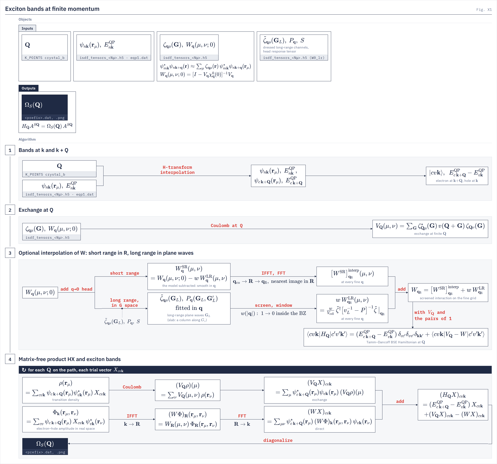

# exciton-bands driver

`bse.exciton_bands` Exciton dispersion $\Omega_S(\bQ)$ of the finite-momentum Tamm–Dancoff BSE along a path of $\bQ$.
{: .page-summary }

<div class="workflow-map" data-driver="exciton-bands" data-page="overview"></div>

Computes the lowest exciton energies $\Omega_S(\bQ)$ at every point of a high-symmetry path of exciton momenta $\bQ$, from one GW ISDF tensor file on a uniform $\bk$ grid. It runs after `gw.gw_jax` and is the finite-$\bQ$ sibling of the optical [`bse`](../bse/index.md) driver.
{: .lead }

<div class="glance" markdown>

Invoke
:   `python -u -m bse.exciton_bands -i cohsex.in` (input keys: `number_val_bands_fine = 4`, `number_cond_bands_fine = 4`, `number_eigenvalues = 6`)
Reads
:   input file with a `K_POINTS` path, `isdf_tensors_<N_mu>.h5`, `zeta_q.h5`, `WFN.h5`, `centroids_file`; optional `eqp1.dat`, `dipole.h5`

Writes
:   `<prefix>.dat`, `<prefix>.png`, `<prefix>.out`

Exchange at $\bQ$
:   `interp` · `refit` · `both` · `ongrid`

</div>

## What it computes {: #what }

<figure class="flowchart" markdown>
[](../../assets/figures/x1.png)
<figcaption><strong>Fig. X1.</strong> One run in four stages: conduction states at $\bk+\bQ$ by H-transform interpolation; the exchange $V_\bQ$; the static $W$, optionally interpolated in two branches as in Fig. B1, the short-range part Fourier-interpolated through $\bR$ and the long-range part built on the long-range plane waves $\bG_L$, fitted in $\bq$, screened and windowed; then the matrix-free product $H_\bQ X$ (exchange row above, direct row below), diagonalized once per path point.</figcaption>
</figure>

<div class="stages" markdown>

1. **Q path**
   The input file's `K_POINTS` block gives the path corners. Each segment is raised to at least `--q-per-segment` points (16).
2. **Conduction states at k + Q**
   One H-transform over the input file's band window gives $\psi_{c\,\bk+\bQ}(\br_\mu)$ and $E^{\mathrm{QP}}_{c\,\bk+\bQ}$ for every grid $\bk$ and every path $\bQ$. No shifted DFT run is needed.
3. **Kernels at Q**
   The exchange $V_\bQ(\mu,\nu)$ comes from the route `--vq-mode` selects. The direct $W_\bq(\mu,\nu;0)$ is the restart's, unchanged, because every momentum transfer $\bk-\bk'$ stays on the grid.
4. **Solve along the path**
   Block Lanczos over the production BSE matvec, one `lax.scan` over the whole $\bQ$ list, eigenvalues only. Rank 0 writes the table and the plot.

</div>

!!! note
    At finite $\bQ$ the $\bG=0$ term of $v(\bQ+\bG)$ is kept, so the longitudinal exciton branch is non-analytic at $\Gamma$: $\Omega_S(\bQ\to0)$ need not equal $\Omega_S(\Gamma)$. At exactly $\Gamma$ the optical $\bq=0$ tile and head are used.

## Running {: #run }

=== "Local"
    ```bash
    # input keys in the -i input file: number_val_bands_fine = 4, number_cond_bands_fine = 4, number_eigenvalues = 6
    uv run python -u -m bse.exciton_bands -i cohsex.in --vq-mode refit
    ```
=== "Perlmutter"
    ```bash
    # input keys in the -i input file: number_val_bands_fine = 4, number_cond_bands_fine = 4, number_eigenvalues = 6
    srun -n 4 python -u -m bse.exciton_bands -i cohsex.in --vq-mode refit
    ```
=== "Frontera"
    ```bash
    sbatch exciton_bands_dev.sbatch   # gw_dev.sbatch with "-m bse.exciton_bands ..." on its exec line
    ```

Run it in the GW run directory: the input file locates the one ISDF tensor file beside it or in `tmp/`. The device mesh is the run's square startup mesh. The input file is the GW input file plus a `K_POINTS` block. A minimal production input file for a bulk crystal:

```ini
[cohsex]
wfn_file        = WFN.h5
centroids_file  = centroids_frac_400.txt
sys_dim         = 3
nval            = 4
ncond           = 12

K_POINTS crystal_b
4
  0.000 0.000 0.000 16   #G
  0.500 0.000 0.500 16   #X
  0.375 0.375 0.750 16   #K
  0.000 0.000 0.000  1   #G
```

`nval` and `ncond` set the H-transform window. It must hold the BSE window (`number_val_bands_fine`, `number_cond_bands_fine`) with at least four conduction guard bands above it, and under the default `--refit-window zeta` it must be the GW run's ζ-fit window. The count on a corner's line is the number of steps from that corner to the next one, as in Quantum ESPRESSO's `crystal_b`, and the last corner's count is unused ([Q path](theory.md#path)).

## Choosing an exchange route {: #route }

`--vq-mode` selects where the off-grid exchange tile $V_\bQ$ comes from. The conduction states and $W$ are the same on every route. Details are on the [Theory](theory.md#exchange) page.

???+ treatment production "refit · per-Q ISDF refit · any dimension"
    A new ζ fit at each $\bQ$ from the H-transform states, contracted with the GW run's own Coulomb kernel. The off-grid route for bulk crystals. Certified against the stored tiles at the on-grid path points before any number is written.

    ```ini
    --vq-mode refit
    ```

    **Note** The default `--refit-window zeta` needs the input file's `nval`/`ncond` to reach exactly the GW run's ζ-fit window.

??? treatment production "interp · closed-form interpolant · slab only (default)"
    The coarse tiles split into a short-range part, interpolated on a lattice stencil, and a long-range part, fitted once by a polynomial model of the form factors. One dispatch per $\bQ$. Refuses a bundle not built as a slab (judged from its Coulomb stamp and the cell, not the input file) and IBZ-only ζ storage.

    ```ini
    --vq-mode interp
    ```

??? treatment supported "both · interp with refit spot checks · slab only"
    `interp` on the whole path plus `refit` at `--refit-points`, solved in the same scan. The refit rows go to the table and the per-level difference is printed. Use it to measure the interpolation error.

    ```ini
    --vq-mode both --refit-points 0,8,15,22,29
    ```

??? treatment supported "ongrid · stored tiles · exact on the grid only"
    The stored tile at $\mathrm{wrap}(-\bQ)$, with no model and no ζ. Refuses any $\bQ$ off the exchange-tile grid, so the path corners must lie on the grid and the floor must be lifted.

    ```ini
    --vq-mode ongrid --q-per-segment 1
    ```

## Refusals {: #refusals }

!!! refuses
    - An input file without `nval` and `ncond` (or `number_bands_protected`) or `centroids_file`, with one line per key (`centroids_file is required`).
    - An input file with no `K_POINTS` block. Add the path block.
    - No `isdf_tensors_*.h5` beside the input file or in its `tmp/`, or more than one. Leave exactly one.
    - A `centroids_file` that does not exist, or whose point count differs from the restart's $N_\mu$. Point it at the table the restart was built on.
    - A downfolded bundle with no `keep_idx`, or no readable parent centroid table. Re-run [downfold](../../utilities/downfold.md#parent_centroids_file) with `parent_centroids_file` set.
    - Any route but `ongrid` with no `zeta_q.h5` beside the restart. `interp` or `both` on a bundle whose Coulomb stamp is not `sys_dim = 2` (unstamped passes), on a cell that is not slab-separable or a $\bq$ grid that is not planar, or with IBZ-only `zeta_q.h5`. Use `refit` or `ongrid`.
    - `ongrid` with a $\bQ$ off the exchange-tile grid, or on a bundle with no stored exchange tensor.
    - `refit` on a bundle with no stored exchange tensor, or whose ζ provenance lacks the rank-truncated solve and its `zeta_rcond`.
    - `--refit-window zeta` with an input file window other than the GW run's ζ-fit window. `--refit-window bse` with an input file window outside it, with `--vq-mode` other than `refit`, or with no finite on-grid $\bQ$ on the path.
    - A refit whose on-grid tiles miss the stored ones by more than 5 % (relative), or whose on-grid eigenvalues miss the stored-tile eigenvalues by more than the `--cert-grade` tolerance (0.01 meV, or 1.0 meV).
    - `--head-minibz-average`, or the input file's `head_minibz_average = true`, with `--vq-mode refit`. A `dipole.h5` whose $\bk$ count differs from the BSE grid.
    - A BSE window edge inside a degenerate multiplet (`band_degeneracy = strict`), on the loaded window or on the H-transform conduction window.
    - A BSE conduction window that does not fit inside the input file's H-transform window. Raise `ncond`.
    - H-transform conduction energies at $\Gamma$ more than 0.05 Ry from the stored ones, or a conduction-subspace overlap below 0.5.
    - `eqp_corrections` on a QP wavefunction, or together with `kgrid_fine` densification. Remove `eqp_corrections`.
    - A `--w-coarse-grid` that does not divide the BSE grid, or on a downfolded bundle (`GATE srlr_downfold`). A restart without `W0_lr` under `--w-coarse-grid` or `kgrid_fine` (`GATE srlr_restart_channels`). `w_head_densify = c1` or `legacy`, and `--w-head-gamma-cell`.
    - `--q-per-segment` below 1.

