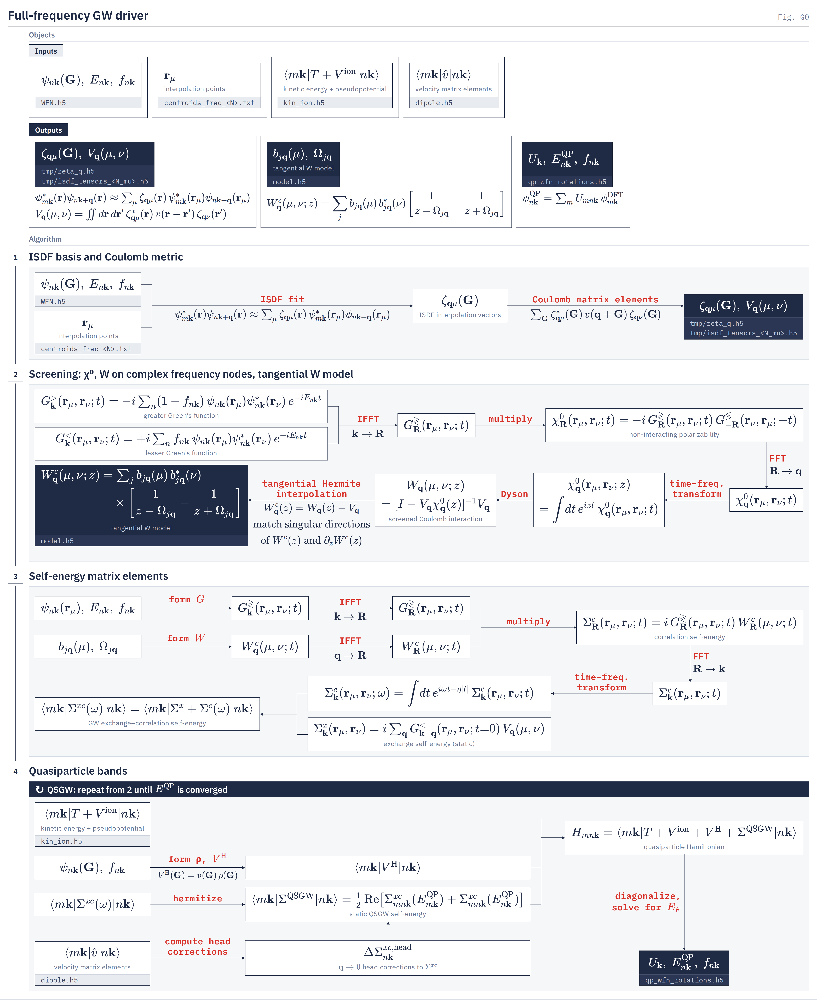
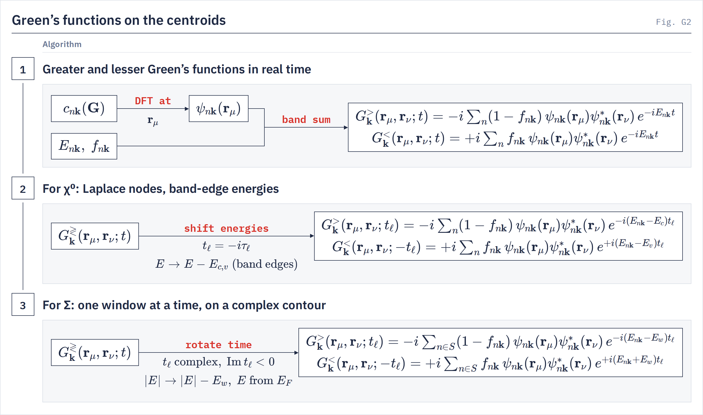
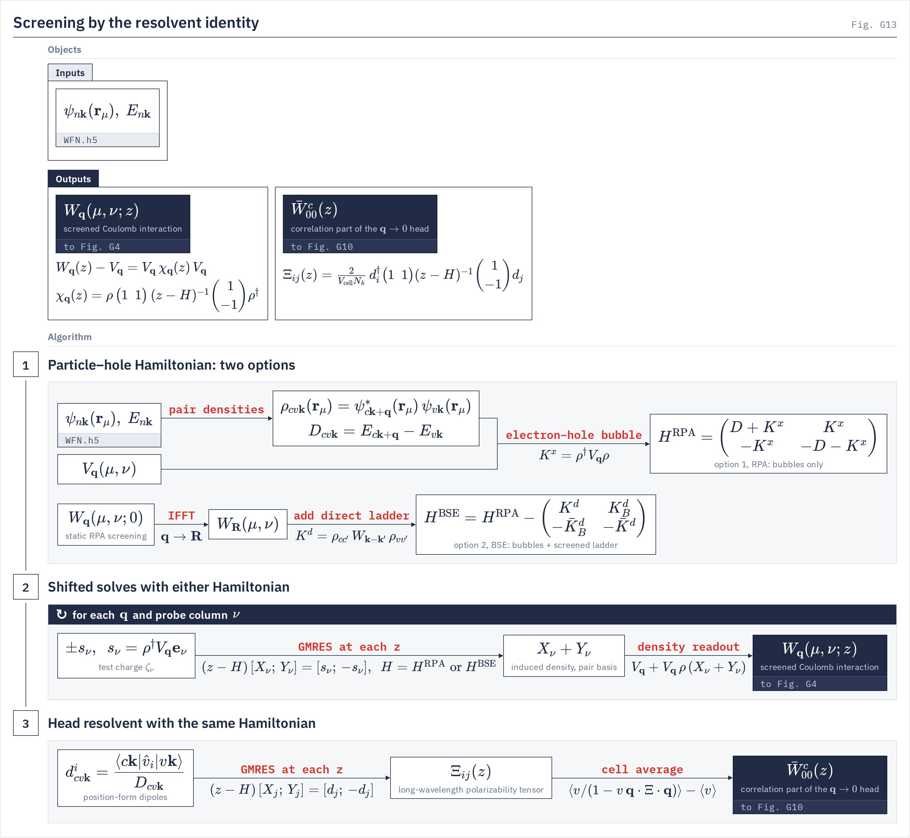
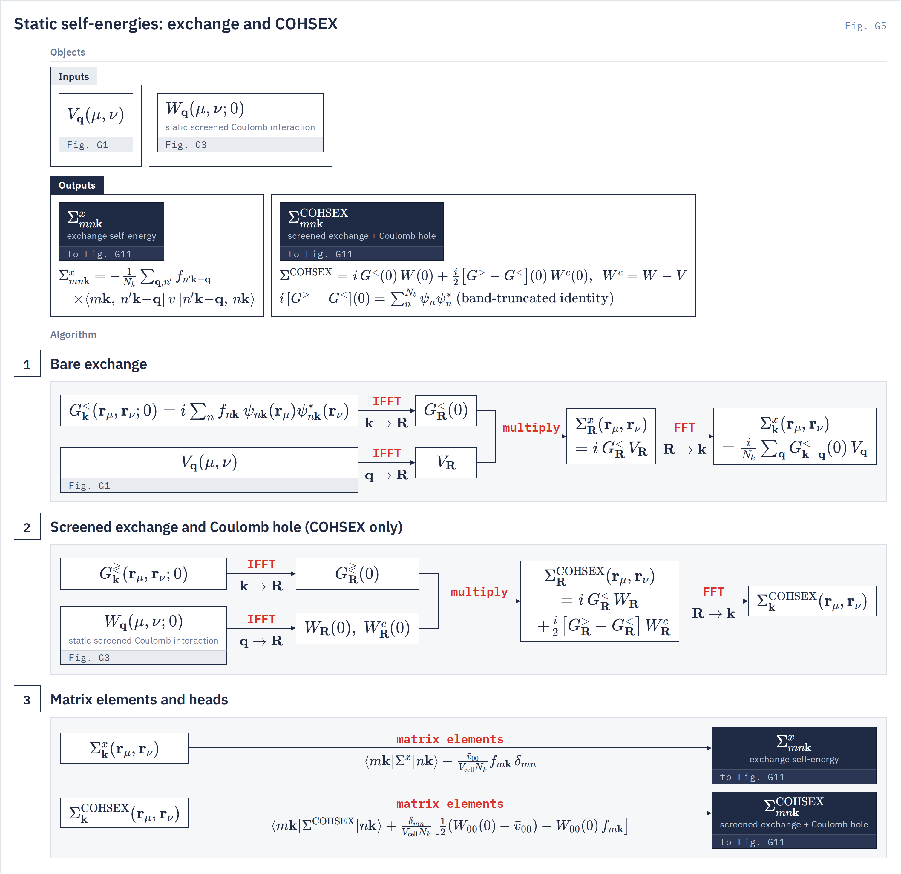
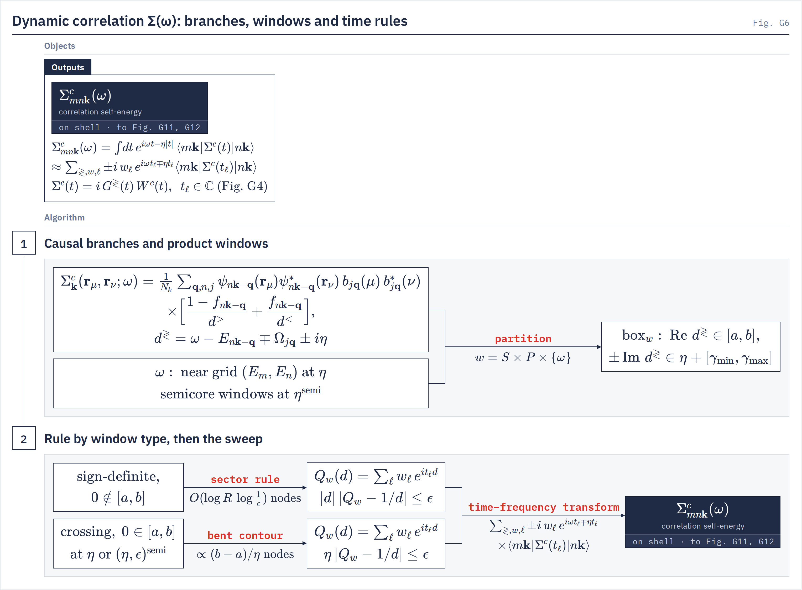

# Theory

`gw.gw_jax` The equations each stage evaluates.
{: .page-summary }

<div class="workflow-map" data-driver="gw" data-page="theory" data-treatment="tangential"></div>

<div class="section-cards"></div>

<figure class="flowchart" markdown>
[](../../assets/figures/g0.png)
<figcaption><strong>Fig. G0.</strong> The four stages of <code>gw.gw_jax</code> on the production route (tangential <i>W</i>), read left to right within a stage and top to bottom between stages; the loop strip on stage 4 is the QSGW cycle back to stage 2.</figcaption>
</figure>

## <span class="n">1</span> ISDF basis and Coulomb metric {: #isdf }

GW is carried out on a sketch of the pair densities. A pair density $\psi^*_{m\bk}\psi_{n\bk+\bq}$ lives on the whole real-space grid, and there is one for every band pair. LORRAX keeps only their values at $N_\mu$ interpolation points $\br_\mu$, far fewer than the grid points, and fits one set of interpolation vectors $\zeta_{\bq\mu}(\br)$ that rebuilds every pair density from those values. After the fit, $\chi^0$, $W$ and Σ are $N_\mu\times N_\mu$ matrices and every band sum is a matrix product; no band pair appears again.
{: .intro }

### <span class="n">1.1</span> Interpolating pair densities {: #isdf-pairs }

A pair density at momentum transfer $\bq$ is its values at the points times interpolation vectors that do not depend on the band pair:

$$
\psi^*_{m\bk}(\br)\,\psi_{n\bk+\bq}(\br) \approx \sum_\mu \zeta_{\bq\mu}(\br)\,\psi^*_{m\bk}(\br_\mu)\,\psi_{n\bk+\bq}(\br_\mu) \tag{1.1}
$$

The fit covers $m$ in the left window $L=[0,b_3)$ (every occupied band plus the Σ conduction window) and $n$ in the right window $R=[0,b_4)$ (every band the $\chi^0$ and Σ sums reach): both start at band 0, and together they hold the pairs that $\chi^0$ and Σ consume ([ISDF §1.2](../../theory/isdf.md#isdf-windows)). The points come from `centroid.kmeans_cli` ([centroids](../../utilities/centroids.md), [centroid selection](../../theory/centroid-selection.md)); this driver does not choose them.

### <span class="n">1.2</span> Fitting ζ {: #isdf-fit }

`isdf_fitting.fit_zeta_to_h5`
{: .in-code }

ζ is the least-squares solution of Eq. (1.1) over every $\bk$ and every band pair in the windows. Solving it as written, by forming every pair density on the full grid or taking an SVD of the pair-density matrix, is expensive. LORRAX never forms a pair density, and it does the fit in G space. $\psi_{n\bk}(\br_\mu)$ is a direct DFT of the `WFN.h5` coefficients $c_{n\bk}(\bG)$ at the centroids. The double band sum of the normal equations collapses into one band projector per window, $P^{X}_{\bk}(\br_\mu,\bG)=\sum_{n\in X}\psi_{n\bk}(\br_\mu)\,\overline{c_{n\bk}(\bG)}$, $X=L,R$, one GEMM over bands. The right-hand side is then accumulated directly on the ζ sphere, and the solve gives ζ in G space:

$$
Z_\bq(\br_\mu,\bG)=\frac{1}{N_k}\sum_{\bk}\big[P^{L}_{\bk}\,\overline{P^{R}_{\bk+\bq}}\big](\br_\mu,\bq+\bG),\qquad \zeta_{\bq\mu}(\bG)=\sum_\nu C^{+}_\bq(\br_\mu,\br_\nu)\,Z_\bq(\br_\nu,\bG) \tag{1.2}
$$

$C_\bq(\br_\mu,\br_\nu)$ is the same product with the second leg at $\br_\nu$. The $\bk$ sum is a convolution: IFFT $\bk\to\bR$, a product in $\bR$, FFT $\bR\to\bq$, for every $\bq$ at once. For $Z_\bq$ that product is taken on real-space planes, one batch of centroid rows at a time, and transformed straight back onto the ζ sphere. ψ and ζ are never on the full real-space grid. $C_\bq^{+}$ is a pseudo-inverse truncated at `zeta_rcond` (default `1e-8`) relative to the largest eigenvalue. The fit streams over batches of columns $\br_\mu$, so no full-grid array over all points is held at once, and uses the crystal symmetry to fit and store $\zeta_{\bq\mu}(\bG)$ only on the irreducible $\bq$ wedge, in `tmp/zeta_q.h5`. Conditioning, conjugation symmetry and accuracy: [ISDF and V(q)](../../theory/isdf.md).

<figure class="flowchart" markdown>
[](../../assets/figures/g1.png)
<figcaption><strong>Fig. G1.</strong> Band projectors in G space (stage 1) give the Gram matrix and the right-hand side $Z_\bq(\br_\mu,\bG)$ by two k-convolutions (stage 2); the pseudo-inverse solve, one G tile at a time, gives $\zeta_{\bq\mu}(\bG)$, which is contracted with the Coulomb kernel (stage 3).</figcaption>
</figure>

!!! note
    `tmp/zeta_q.h5` is reused when its fit provenance (WFN, band windows, cutoffs, FFT grid, effective `zeta_rcond`) and its centroid positions match the run ([Caches](dependencies.md#caches)). Equations and conditioning: [ISDF and V(q)](../../theory/isdf.md).

### <span class="n">1.3</span> Coulomb metric {: #isdf-v }

`v_q_g_flat`
{: .in-code }

The bare interaction in the ζ basis is one contraction in $\bG$ space per $\bq$:

$$
V_\bq(\mu,\nu)=\sum_{|\bq+\bG|^2\le E_\mathrm{cut}}\zeta^*_{\bq\mu}(\bG)\,v(\bq+\bG)\,\zeta_{\bq\nu}(\bG),\qquad v(\bq+\bG)=\frac{8\pi}{|\bq+\bG|^2} \tag{1.3}
$$

$E_\mathrm{cut}$ is `bare_coulomb_cutoff` (default: the WFN `ecutwfc`). $v$ is truncated according to `sys_dim` and averaged over the mini Brillouin zone at every $\bq\neq0$ (`mc_average_vcoul_body`, default `true`). The $\bq+\bG=0$ term is omitted from this sum; it is the head of §[4.3](#qp-head). $V_\bq$ is written to the ISDF tensor file `tmp/isdf_tensors_<N_mu>.h5`.

## <span class="n">2</span> Screened interaction and the tangential model {: #screening }

$\chi^0$ is a product of two Green's functions in time on the points $\br_\mu$. It is transformed only to the few complex frequencies the Σ treatment needs, $W$ follows from one Dyson solve per $\bq$ and frequency, and on the production route $W^c$ is condensed into one set of poles shared by every matrix element.
{: .intro }

### <span class="n">2.1</span> Green's functions on the points {: #scr-g }

`greens_function_kernel.build_G_tau`
{: .in-code }

The greater and lesser Green's functions are band sums with occupations $f_{n\bk}$:

$$
G^{>}_\bk(\br_\mu,\br_\nu;t)=-i\sum_n(1-f_{n\bk})\,\psi_{n\bk}(\br_\mu)\psi^*_{n\bk}(\br_\nu)\,e^{-iE_{n\bk}t},\qquad G^{<}_\bk(\br_\mu,\br_\nu;t)=+i\sum_n f_{n\bk}\,\psi_{n\bk}(\br_\mu)\psi^*_{n\bk}(\br_\nu)\,e^{-iE_{n\bk}t} \tag{2.1}
$$

The time-ordered $G(t)$ is $G^{>}(t)$ for $t>0$ and $G^{<}(t)$ for $t<0$. $G$ is never stored and never formed on the real-space grid: it is built at one time node at a time, on the points only, and transformed by IFFT $\bk\to\bR$.

<figure class="flowchart" markdown>
[](../../assets/figures/g2.png)
<figcaption><strong>Fig. G2.</strong> The real-time <i>G</i><sup>≷</sup> (stage 1) and the two forms the code evaluates: on imaginary Laplace nodes with band-edge energies for χ⁰ (stage 2), and on complex nodes one product window at a time for Σ (stage 3).</figcaption>
</figure>

### <span class="n">2.2</span> χ⁰ in real time {: #scr-chi }

`w_isdf.compute_chi0`
{: .in-code }

The independent-particle response is a product in $\bR$ at each time, the two orderings taking the two pairs of Green's functions:

$$
\chi^0_\bR(\br_\mu,\br_\nu;t)=-i\,G^{\gtrless}_\bR(\br_\mu,\br_\nu;t)\,G^{\lessgtr}_{-\bR}(\br_\nu,\br_\mu;-t),\qquad t\gtrless0 \tag{2.2}
$$

FFT $\bR\to\bq$ gives $\chi^0_\bq(\br_\mu,\br_\nu;t)$. Transformed to frequency, Eq. (2.2) is the band sum $\chi^0_\bq(z)=\sum_{\bk,mn}f_{m\bk-\bq}(1-f_{n\bk})\,\rho_{mn}(\br_\mu)\rho^*_{mn}(\br_\nu)\,2\Delta_{mn}/(z^2-\Delta_{mn}^2)$ with $\rho_{mn}=\psi^*_{m\bk-\bq}\psi_{n\bk}$ and $\Delta_{mn}=E_{n\bk}-E_{m\bk-\bq}$, at the cost of band GEMMs and lattice FFTs per time node instead of a transition-pair sum.

### <span class="n">2.3</span> Transform to complex frequency nodes {: #scr-tf }

`minimax_screening`
{: .in-code }

The time integral is replaced by a short sum over time nodes $t_\ell$ with weights $w_\ell(z)$, chosen so that the sum reproduces the frequency dependence of every transition $\Delta\in[E_g,\Delta_\mathrm{max}]$ at once:

$$
\sum_\ell w_\ell(z)\,e^{-i\Delta t_\ell}\approx\frac{2\Delta}{\Delta^2-z^2},\qquad \chi^0_\bq(\br_\mu,\br_\nu;z)=\int\!dt\,e^{izt}\,\chi^0_\bq(t)\approx-i\sum_\ell w_\ell(z)\,\chi^0_\bq(\br_\mu,\br_\nu;t_\ell) \tag{2.3}
$$

Which frequencies are requested depends on the treatment (§[3.5](#sig-treat)). On the tangential route the frequencies are batched: neighbouring $z$ share one set of complex time nodes, each with its own weights, so a batch costs about as many nodes as its hardest member, at most a few hundred. How the time nodes are chosen, and how each rule is fitted and its error controlled: [Time–frequency transforms](../../theory/time-frequency.md).

<figure class="flowchart" markdown>
[](../../assets/figures/g3.png)
<figcaption><strong>Fig. G3.</strong> A rule of time nodes per requested frequency (stage 1), χ⁰ accumulated in R space over the nodes (stage 2), then one FFT and the Dyson solve per q and frequency (stage 3).</figcaption>
</figure>

### <span class="n">2.4</span> Dyson equation {: #scr-w }

`screening.compute_screening_model`
{: .in-code }

At each $\bq$ of the irreducible wedge and each requested $z$:

$$
W_\bq(\mu,\nu;z)=\big[I-V_\bq\,\chi^0_\bq(z)\big]^{-1}V_\bq,\qquad W^c_\bq(z)=W_\bq(z)-V_\bq \tag{2.4}
$$

One LU per $\bq$ and $z$. `linalg = local` (default) solves whole matrices per rank when they fit the device budget and otherwise falls back to the block-distributed solve that `linalg = distributed` always uses ([Parallel algorithms §5.1](../../theory/parallel-algorithms.md#par-dense-dyson)). The static $W_\bq(0)$ is written to the ISDF tensor file for the BSE.

Under `screening_diagrams = w_bse` or `w_rpa_resolvent`, $W$ comes instead from the resolvent identity $W_\bq(z)-V_\bq=V_\bq\chi_\bq(z)V_\bq$ with the particle–hole Hamiltonian $H^\mathrm{RPA}$ (bubbles only) or $H^\mathrm{BSE}$ (plus the statically screened ladder), solved by GMRES at each $z$ (§[2.6](#scr-resolvent)). `w_bse` runs one-shot under COHSEX and GN-PPM (and [one other W model](../../theory/multipole-w.md#sigma)); `w_rpa_resolvent` under COHSEX and GN-PPM only ([`screening_diagrams`](keywords.md#screening_diagrams)).

<figure class="flowchart" markdown>
[](../../assets/figures/g13.png)
<figcaption><strong>Fig. G13.</strong> The resolvent route: the two particle–hole Hamiltonians (stage 1), shifted solves for each probe column (stage 2), and the head tensor from the same Hamiltonian (stage 3).</figcaption>
</figure>

### <span class="n">2.5</span> The tangential model: preferred full-frequency W {: #scr-sp }

`tangential_screening.screen_tangential_poles`
{: .in-code }

The tangential model is the preferred full-frequency treatment of $W$, and with the Godby–Needs plasmon pole one of the two production routes. The correlation part of $W$ is one set of real poles per $\bq$, shared by every matrix element:

$$
W^c_\bq(\mu,\nu;z)=\sum_jb_{j\bq}(\mu)\,b^*_{j\bq}(\nu)\left[\frac{1}{z-\Omega_{j\bq}}-\frac{1}{z+\Omega_{j\bq}}\right]\quad\Longleftrightarrow\quad W^c_\bq(\mu,\nu;t)=-i\sum_jb_{j\bq}(\mu)\,b^*_{j\bq}(\nu)\,e^{-i\Omega_{j\bq}|t|} \tag{2.5}
$$

$W^c$ and $\partial_zW^c=W\,\partial_z\chi^0\,W$ are sampled at the fixed supports of §[2.3](#scr-tf), and the exact moments fix the high-frequency tail. Each support keeps the action of $W^c$ on a few probe directions; the two-sided tangential Hermite interpolation conditions form a Loewner pencil, and its Ritz pairs give $\Omega_{j\bq}^2$ and $b_{j\bq}$. Nothing is fitted: the poles are real, the residues are positive semidefinite, and the static limit $W_\bq(0)=V_\bq-\sum_j2b_{j\bq}b^\dagger_{j\bq}/\Omega_{j\bq}$ is a model output. $W^c(t)$ is even in $t$, so one $W^c$ serves both orderings in Σ. The model is written to `tmp/mpa/<label>_tangential/model.h5`, with $b$ normalised as in [Tangential W model §2.1](../../theory/tangential-w.md#model-form), and rebuilt on every QSGW map. Supports, pencil and gates: [Tangential W model](../../theory/tangential-w.md).

### <span class="n">2.6</span> W from the particle–hole resolvent {: #scr-resolvent }

The correlation part of $W$ is a resolvent of the particle–hole Hamiltonian between pair potentials ([Analytic structure of W](../../theory/w-structure.md#resolvent)). Under `w_bse` and `w_rpa_resolvent` LORRAX evaluates that resolvent directly, by Krylov solves built from matrix-free products with $H^{\mathrm{BSE}}$ or $H^{\mathrm{RPA}}$. The formalism, its cost and its comparison with a dense kernel are on [Ladder vertex corrections](../../theory/ladder-w.md).

## <span class="n">3</span> Self-energy {: #sigma }

Σ splits into exchange, which needs only $V$, and correlation, which needs $W^c$. Every dynamic treatment hands its poles to the same correlation kernel: a product of $G$ and $W^c$ at complex time nodes, folded into $\Sigma^c(\omega)$ on the real axis.
{: .intro }

### <span class="n">3.1</span> Exchange {: #sig-x }

`cohsex_sigma.compute_sigma_x`
{: .in-code }

$\Sigma^x$ is the static product of the lesser Green's function at $t=0$ with $V$, as a $\bk$-convolution:

$$
\Sigma^x_\bk(\br_\mu,\br_\nu)=i\sum_\bq G^{<}_{\bk-\bq}(\br_\mu,\br_\nu;t{=}0)\,V_\bq(\mu,\nu)=-\sum_{\bq,n}f_{n\bk-\bq}\,\psi_{n\bk-\bq}(\br_\mu)\psi^*_{n\bk-\bq}(\br_\nu)\,V_\bq(\mu,\nu) \tag{3.1}
$$

The band sum runs over every band of the Σ sum with weight $f$. The head $-V^\mathrm{head}f_{m\bk}\delta_{mn}/(\Omega_\mathrm{cell}N_k)$ is added to the matrix elements (§[4.3](#qp-head)).

<figure class="flowchart" markdown>
[](../../assets/figures/g5.png)
<figcaption><strong>Fig. G5.</strong> The static self-energies: bare exchange (stage 1), screened exchange and Coulomb hole for COHSEX (stage 2), and their matrix elements with the q → 0 heads (stage 3).</figcaption>
</figure>

### <span class="n">3.2</span> Correlation in time {: #sig-c }

`ppm_tau_kernel`
{: .in-code }

$W^c_\bq(t)$ from the pole model and $G^{\gtrless}_\bk(t)$ are each transformed by IFFT to $\bR$ and multiplied, the ordering choosing the Green's function:

$$
\Sigma^c_\bR(\br_\mu,\br_\nu;t)=i\,G^{\gtrless}_\bR(\br_\mu,\br_\nu;t)\,W^c_\bR(\mu,\nu;t),\qquad t\gtrless0 \tag{3.2}
$$

FFT $\bR\to\bk$ gives $\Sigma^c_\bk(t)=i\sum_\bq G^{\gtrless}_{\bk-\bq}(t)\,W^c_\bq(t)$. A time node costs band GEMMs and lattice FFTs; no state-by-pole loop is formed.

<figure class="flowchart" markdown>
[](../../assets/figures/g4.png)
<figcaption><strong>Fig. G4.</strong> One time node of one product window: the two propagators (stage 1), their product in R space (stage 2), and the fold of the projected result into every frequency of the window (stage 3).</figcaption>
</figure>

### <span class="n">3.3</span> Time–frequency transform {: #sig-tf }

`sigma_box_plan`
{: .in-code }

The time-ordered transform with broadening $\eta$ gives, for a pole model, a sum over two causal branches:

$$
\Sigma^c_\bk(\br_\mu,\br_\nu;\omega)=\int\!dt\,e^{i\omega t-\eta|t|}\,\Sigma^c_\bk(t)=\sum_{\bq,n,j}\psi_{n\bk-\bq}(\br_\mu)\psi^*_{n\bk-\bq}(\br_\nu)\,b_{j\bq}(\mu)b^*_{j\bq}(\nu)\Big[\frac{1-f_{n\bk-\bq}}{d^{>}}+\frac{f_{n\bk-\bq}}{d^{<}}\Big],\quad d^{\gtrless}=\omega-E_{n\bk-\bq}\mp\Omega_{j\bq}\pm i\eta \tag{3.3}
$$

The states and poles are partitioned into product windows. Each window gets a rule $1/d^{\gtrless}\approx\sum_\ell w_\ell\,e^{it_\ell d^{\gtrless}}$ at complex $t_\ell$, and the matrix elements of Eq. (3.2) at $t_\ell$ are folded in with weights $\pm i\,w_\ell\,e^{i\omega t_\ell\mp\eta t_\ell}$. A window whose denominators keep one sign takes a sector rule with $O(\log)$ nodes; a window whose real part crosses zero takes a bent contour with nodes in proportion to its width over $\eta$ ([Time–frequency transforms §4](../../theory/time-frequency.md#windows) explains the split). Every rule is certified to `sigma_quadrature_eps` (default `1e-4`). $\eta$ is `sigma_regularization_ev` (default `0.25` eV), entered once, in the fold.

<figure class="flowchart" markdown>
[](../../assets/figures/g6.png)
<figcaption><strong>Fig. G6.</strong> The two causal branches of Σ<sup>c</sup>(ω) partitioned into product windows (stage 1), and the rule each window type takes before the sweep (stage 2).</figcaption>
</figure>

!!! note
    The same executor serves GN-PPM and HL-GPP: their elementwise residues $R_{j\bq}(\mu,\nu)$ and poles enter Eq. (3.3) in place of $b_{j\bq}(\mu)b^*_{j\bq}(\nu)$ and $\Omega_{j\bq}$. Treatment details: [frequency treatments](../../theory/frequency-treatments.md).

### <span class="n">3.4</span> Matrix elements {: #sig-me }

`sigma_dispatch.compute_sigma_xc`
{: .in-code }

The band matrix of Σ is a contraction with the orbitals at the points, $\langle m\bk|\Sigma|n\bk\rangle=\sum_{\mu\nu}\psi^*_{m\bk}(\br_\mu)\,\Sigma_\bk(\br_\mu,\br_\nu)\,\psi_{n\bk}(\br_\nu)$:

$$
\langle m\bk|\Sigma^{xc}(\omega)|n\bk\rangle=\langle m\bk|\Sigma^{x}+\Sigma^{c}(\omega)|n\bk\rangle \tag{3.4}
$$

By default $\Sigma^c$ is evaluated on shell: the sweep folds each node directly into the two slots $\Sigma^c_{mn\bk}(E_{m\bk})$ and $\Sigma^c_{mn\bk}(E_{n\bk})$, plus the band diagonal and its exact $\partial_\omega$. The whole frequency grid, $(n_\omega,n_k,n_b,n_b)$ at step `sigma_omega_step_ev`, is computed only under `sigma_omega_grid_debug = true`. The band-diagonal $\bq\to0$ head is added to $\Sigma^c$ before the reads (§[4.3](#qp-head)), and the $\Sigma^c$ band sum is extrapolated past `number_bands_sigma` (§[4.4](#qp-bx)).

### <span class="n">3.5</span> Frequency treatments {: #sig-treat }

`compute_mode` selects the model for $W^c$. `x_only` keeps $\Sigma^x$ alone.

| Treatment | Input file | $W$ evaluated at | Model for $W^c(z)$ | Limits |
|---|---|---|---|---|
| COHSEX | `cohsex` | $W(0)$ | static | Refuses metallic occupations |
| GN-PPM | `gn_ppm` | $W(0)$, $W(i\omega_p)$ | one pole per element | Refuses metallic occupations |
| HL-GPP | `hl_ppm` | $W(0)$, $W(\omega_p)$, real $\omega_p>\Delta_\mathrm{max}$ | one pole per element | Refuses metals and broken time reversal |
| Tangential | `tangential` | line and imaginary ladders, plus moments | real poles shared by all elements | — |

=== "COHSEX"
    **Static COHSEX** <span class="status supported">Supported</span>

    Screened exchange plus Coulomb hole, both from the static $W(0)$.

    The Coulomb hole uses the unit-weight Green's function over the Σ band sum, $i[G^{>}-G^{<}](t{=}0)=\sum_n\psi_n\psi_n^*$, a band-truncated identity, so it converges with the band count. No frequency integral is done and no band extrapolation applies.

    $$
    \Sigma^\mathrm{COHSEX}_\bk(\br_\mu,\br_\nu)=\sum_\bq\Big\{i\,G^{<}_{\bk-\bq}(0)\,W_\bq(\mu,\nu;0)+\tfrac{i}{2}\big[G^{>}_{\bk-\bq}(0)-G^{<}_{\bk-\bq}(0)\big]\,W^c_\bq(\mu,\nu;0)\Big\} \tag{3.5}
    $$

    W evaluated at
    :   $W(0)$

    Model
    :   static

    Frequency
    :   none

    ```ini
    compute_mode = cohsex
    ```

=== "GN-PPM"
    **Godby–Needs plasmon pole** <span class="status supported">Supported</span>

    One pole per matrix element, from $W^c$ at zero and at one imaginary frequency.

    No sum rule is assumed. An element whose $\mathrm{Re}\,\Omega^2$ is not positive and finite takes `ppm_invalid_mode` (default `static_limit`). On a time-reversal-broken input file the anti-Hermitian half of $W^c(i\omega_p)$ gives an odd residue, and the empty and occupied branches take different residues.

    $$
    W^c_\bq(\mu,\nu;z)=R_\bq(\mu,\nu)\left[\frac{1}{z-\Omega_\bq(\mu,\nu)}-\frac{1}{z+\Omega_\bq(\mu,\nu)}\right],\qquad \Omega^2=-z_p^2\,\frac{W^c(z_p)}{W^c(0)-W^c(z_p)},\qquad R=-\tfrac12\Omega\,W^c(0),\qquad z_p=i\omega_p \tag{3.5}
    $$

    W evaluated at
    :   $W(0)$, $W(i\omega_p)$, $\omega_p$ = `ppm_omega_p` (default `2.0` Ry)

    Model
    :   one real pole per element

    Frequency
    :   plasmon pole

    ```ini
    compute_mode = gn_ppm
    ppm_omega_p  = 2.0
    ```

=== "HL-GPP"
    **Hybertsen–Louie plasmon pole** <span class="status in-progress">In progress</span>

    The same one-pole algebra with a real probe above every transition, which reads the first frequency moment from the band-summed response.

    The body uses the GN fit at real $z_p=\omega_p$. The density f-sum rule enters only the $\bq\to0$ head, $\Omega_\mathrm{head}^2=\omega_\mathrm{pl}^2/[1-\epsilon^{-1}_{00}(0)]$. A probe at or below $\Delta_\mathrm{max}$ refuses, and the shared `2.0` Ry default refuses on most spectra: set `ppm_omega_p` above the largest χ⁰ transition.

    $$
    W^c_\bq(\mu,\nu;z)=R_\bq(\mu,\nu)\left[\frac{1}{z-\Omega_\bq(\mu,\nu)}-\frac{1}{z+\Omega_\bq(\mu,\nu)}\right],\qquad \Omega^2=-\omega_p^2\,\frac{W^c(\omega_p)}{W^c(0)-W^c(\omega_p)},\qquad \omega_p>\Delta_\mathrm{max} \tag{3.5}
    $$

    W evaluated at
    :   $W(0)$, $W(\omega_p)$

    Model
    :   one real pole per element; f-sum head

    Frequency
    :   plasmon pole

    ```ini
    compute_mode = hl_ppm
    ```

===+ "Tangential"
    **Tangential model** <span class="status production">Production</span>

    One set of real poles per $\bq$, shared by every matrix element, from samples of $W^c$ and $\partial_zW^c$ and the exact moments (§[2.5](#scr-sp)).

    It is the production $W$ for insulators and metals, one-shot and QSGW. The recipe tier is `sigma_w_accuracy` (default `production`). $\eta$ is applied once, by Σ; the poles themselves are undamped.

    $$
    W^c_\bq(\mu,\nu;z)=\sum_jb_{j\bq}(\mu)\,b^*_{j\bq}(\nu)\left[\frac{1}{z-\Omega_{j\bq}}-\frac{1}{z+\Omega_{j\bq}}\right],\qquad \Omega_{j\bq}>0 \tag{3.5}
    $$

    W evaluated at
    :   line ladder $\omega_a+ih$ and imaginary ladder $iu_a$, plus the moments at $z\to\infty$

    Model
    :   real poles shared by all elements

    Frequency
    :   full frequency

    ```ini
    compute_mode = tangential
    ```

## <span class="n">4</span> Quasiparticles {: #qp }

No QP equation is solved. A static Hermitian self-energy enters a full-matrix quasiparticle Hamiltonian in the DFT basis, which is diagonalized once (one-shot) or iterated to a fixed point (QSGW).
{: .intro }

### <span class="n">4.1</span> One-shot {: #qp-os }

`gw_jax._solve_qp_stage`
{: .in-code }

With `qp_solver = one_shot_dft` (what `auto` resolves to), $\Sigma^{xc}$ is read at the mean-field energies, Hermitized, and added to the one-body operator:

$$
\langle m\bk|\Sigma^\mathrm{QSGW}|n\bk\rangle=\tfrac12\,\mathrm{Re}\big[\Sigma^{xc}_{mn\bk}(E_{m\bk})+\Sigma^{xc}_{mn\bk}(E_{n\bk})\big],\qquad H_{mn\bk}=\langle m\bk|T+V^\mathrm{ion}+V^\mathrm{H}+\Sigma^\mathrm{QSGW}|n\bk\rangle \tag{4.1}
$$

$\mathrm{Re}$ is the Hermitian part, $(X+X^\dagger)/2$. $T+V^\mathrm{ion}$ is read from `kin_ion.h5`; $V^\mathrm{H}(\bG)=v(\bG)\rho(\bG)$ is built from the orbitals, with $\bG=0$ dropped. Diagonalizing gives $H_\bk=U_\bk\,\mathrm{diag}(E^\mathrm{QP}_\bk)\,U_\bk^\dagger$, written to `qp_wfn_rotations.h5`. The BerkeleyGW columns are diagonal and are not the eigenvalues of $H$: `eqp0.dat` holds $E^{(0)}_{n\bk}=\mathrm{Re}\,\langle n\bk|T+V^\mathrm{ion}+V^\mathrm{H}+\Sigma^{xc}(E_{n\bk})|n\bk\rangle$, and `eqp1.dat` holds $E_{n\bk}+Z_{n\bk}(E^{(0)}_{n\bk}-E_{n\bk})$ with $Z_{n\bk}=[1-\partial_\omega\mathrm{Re}\,\Sigma^c_{nn\bk}]^{-1}$ at $\omega=E_{n\bk}$, from the exact on-shell derivative.

<figure class="flowchart" markdown>
[](../../assets/figures/g11.png)
<figcaption><strong>Fig. G11.</strong> The static self-energy (stage 1), the quasiparticle Hamiltonian and its eigenpairs (stage 2), and the diagonal one-shot columns written to <code>eqp0.dat</code> and <code>eqp1.dat</code> (stage 3).</figcaption>
</figure>

### <span class="n">4.2</span> Quasiparticle self-consistency {: #qp-sc }

`sc_iteration.run_sc_driver`
{: .in-code }

With `qp_solver = self_consistent`, each map rotates the orbitals by the current eigenvectors and rebuilds stages 2–4 from them:

$$
\psi^\mathrm{QP}_{n\bk}=\sum_m U_{mn\bk}\,\psi_{m\bk},\qquad H'_{mn\bk}=\langle m\bk|T+V^\mathrm{ion}+V^\mathrm{H}[\psi^\mathrm{QP}]+\Sigma^\mathrm{QSGW}[\psi^\mathrm{QP},E^\mathrm{QP}]|n\bk\rangle \tag{4.2}
$$

The ζ basis and the points are kept. $\chi^0$, $W$, the pole model, Σ and $V^\mathrm{H}$ are rebuilt from $\psi^\mathrm{QP}$, $E^\mathrm{QP}$ and the new $E_F$, and $\Sigma^{xc}$ is read at each state's own $E^\mathrm{QP}$. Anderson mixing acts on $H$ (`sc_history_depth`, default `20`). The run stops when $\max|E^{\mathrm{out}}-E^{\mathrm{in}}|<$ `sc_tol_ev` (default `1e-4` eV) and refuses unconverged after `sc_max_iter` (default `30`) maps. Map 0 is the one-shot calculation. Windows, semicore and mixing: [quasiparticle self-consistency](../../theory/qsgw.md).

### <span class="n">4.3</span> The q → 0 head {: #qp-head }

`head_correction.HeadResolver`
{: .in-code }

At $\bq=0$ the Coulomb divergence multiplies a response that vanishes as $q^2$. The body of §§1–3 omits the $\bq+\bG=0$ element, and the head is carried as a separate scalar channel built from the long-wavelength response tensor:

$$
\chi_{00}(\bq,z)=q_a\,S_{ab}(z)\,q_b+O(q^3) \tag{4.3}
$$

$S_{ab}$ comes from the velocity matrix elements $\langle m\bk|\hat{\mathbf v}_a|n\bk\rangle$ in `dipole.h5`. Cell averages give $V^\mathrm{head}$ and $W^\mathrm{head}(z)$, which enter $\Sigma^x$, COHSEX and, as a closed-form band-diagonal pole sum, $\Sigma^c$. `head_correction = full` (the default) also folds the wings and the body. Under QSGW, `sc_head_update` sets how the head follows each map. Detail: [the q → 0 head](../../theory/q0-head.md).

### <span class="n">4.4</span> Band extrapolation {: #qp-bx }

`band_extrapolation`
{: .in-code }

The $\Sigma^c$ band sum of the dynamic treatments (GN-PPM, HL-GPP, tangential) is extrapolated past `number_bands_sigma` from three bracket sums, at 70, 85 and 100 % of it under the default bracket scheme (`use_band_extrapolation`, default `true`). The extrapolated $\Sigma^c$ is what the QP stage and every QSGW map read; one-shot runs keep the raw values in the `*_raw` columns of `sigma_diag.dat`. $\chi^0$ is not extrapolated. A run with `number_bands_sigma` below twice the occupied count refuses. Estimator and failure modes: [band extrapolation](../../theory/band-extrapolation.md).

## <span class="n">5</span> Four-current GW {: #four-current }

`bispinor = true` lifts the two-component spinors of `WFN.h5` to four components and lets the Dirac current, as well as the charge, source the interaction. `bispinor_gw` chooses which current terms are kept. Every term is classified by its order in $1/c$.
{: .intro }

### <span class="n">5.1</span> Carrier and interaction {: #fc-carrier }

`common.bispinor_init.lift_to_4spinor`
{: .in-code }

The small component follows from the large one by restricted kinetic balance, normalized so that the lift is an isometry (bands stay orthonormal, the density integrates to the electron count):

$$
\Psi_{n\bk}(\bG)=r(\bk+\bG)\begin{pmatrix}\psi_{n\bk}(\bG)\\ \tfrac{\alpha}{2}\,\boldsymbol\sigma\cdot(\bk+\bG)\,\psi_{n\bk}(\bG)\end{pmatrix},\qquad r=\Big(1+\tfrac{\alpha^2}{4}\lvert\bk+\bG\rvert^2\Big)^{-1/2} \tag{5.1}
$$

with $\alpha$ the fine-structure constant and $\bk+\bG$ in bohr⁻¹. Negative-energy states are absent (no-pair). The sources are $\rho_{mn}=\Psi^\dagger_m\Psi_n$ and $J^i_{mn}=\Psi^\dagger_m\alpha^i\Psi_n$, and in Coulomb gauge the bare interaction is

$$
D=\begin{pmatrix}v&0\\0&t\end{pmatrix},\qquad t_{ij}=-v\,\big(\delta_{ij}-\hat K_i\hat K_j\big),\qquad \mathbf K=\bq+\bG \tag{5.2}
$$

$t$ is the static transverse photon; its exchange is the Breit interaction. $t(\omega)$ is not built. As $\alpha\to0$ every current term vanishes and two-component GW is recovered.

### <span class="n">5.2</span> Order in 1/c {: #fc-order }

`gw.gw_config.BispinorGWMode`
{: .in-code }

Kinetic balance makes the transverse current $O(c^{-1})$ and the charge $O(1)$, so the polarization blocks are $\Pi_{00}=O(1)$, $\Pi_{0T},\Pi_{T0}=O(c^{-1})$, $\Pi_{TT}=O(c^{-2})$. Block inversion of $W=D+D\Pi W$, with $W_C=(v^{-1}-\Pi_{00})^{-1}$, gives the terms of Σ and what each route keeps:

| Term of Σ | Order | `bare_transverse` | `full_static_cohsex` | `full_tangential` |
|---|---|---|---|---|
| $\rho W_C\rho$ | $c^0$ | the run's treatment | static, or plasmon pole | full frequency |
| $J^T t J^T$ (bare transverse exchange $\Sigma^B$) and the direct fields | $c^{-2}$ | yes | yes | yes |
| $\rho W_C\Pi_{0T}tJ^T$ and reverse (mixed) | $c^{-2}$ | no | $\omega=0$ | yes |
| $\rho W_C\Pi_{0T}t\Pi_{T0}W_C\rho$ (mixed feedback) | $c^{-2}$ | no | `cohsex` only, $\omega=0$ | yes |
| $J^Tt[\Pi_{TT}+\Pi_{T0}W_C\Pi_{0T}]tJ^T$ (screened transverse) | $c^{-4}$ | no | $\omega=0$ | yes |

$\Sigma^B$ is static and is one exchange contraction in every treatment. With time reversal a static scalar potential induces no current, $\Pi_{T0}(\bq,0)=0$, so the terms `bare_transverse` drops are purely dynamical (the whole static screened-minus-bare current difference on MoS₂ 3×3 is $1.2\times10^{-8}$ eV). In a magnet $\Pi_{T0}(\bq,0)\neq0$: a scalar potential induces a spin density that carries a magnetization current, comparable to the spin part of $\Sigma^B$ in a half-metal.

### <span class="n">5.3</span> Routes {: #fc-routes }

| Material | `bispinor_gw` | Input file |
|---|---|---|
| time-reversal invariant | `bare_transverse` (default) | any `compute_mode` |
| magnet, half-metal, Hall or Chern state | `full_tangential` | `compute_mode = tangential`, `head_correction = no_local_fields` |
| static cross-check of current screening | `full_static_cohsex` | one-shot; `compute_mode = cohsex`, `gn_ppm` or `hl_ppm` (current blocks at $\omega=0$); `sys_dim = 2` with the head on |

`full_tangential` solves the four-current Dyson equation at each bank frequency and fits the CC, CT/TC and TT sectors as separate tangential models; only the CC sum is band-extrapolated. A bispinor QSGW run rebuilds $\rho$ and $\mathbf J$ on every map and refuses `density_self_consistent = false`. `sigma_diag.dat` splits $\Sigma^{xc}$ into `sigCC`, `sigCT` and `sigTT`. No Dirac–Coulomb–Breit reference yet certifies the absolute $\Sigma^B$.

## Notation {: #notation }

Equations are in real time $t$, time-ordered, at $T=0$ with $\hbar=1$: $\chi^0=-iGG$ and $\Sigma=iGW$ (Hedin). Energies are in Ry. Spin indices, the spin factor of $\chi^0$ and the $1/N_k$ of every $\bk$ and $\bq$ sum are left out of the equations; the code applies them in the Dyson solve, with unitary lattice FFTs. The code evaluates each time integral on imaginary or complex time nodes ([time–frequency transforms](../../theory/time-frequency.md)); the equations are the real-time physics those nodes discretize.

| Symbol | Meaning |
|---|---|
| $N_\mu$, $\br_\mu$ | number of ISDF interpolation points; the points |
| $\zeta_{\bq\mu}(\br)$, $\zeta_{\bq\mu}(\bG)$ | interpolation vectors, in real and reciprocal space |
| $L$, $R$ | left and right band windows of the ζ fit |
| $P^{X}_\bk$, $C_\bq$, $Z_\bq$ | band projector of window $X$; ζ-fit Gram matrix and right-hand side |
| $V_\bq(\mu,\nu)$, $v(\bq+\bG)$ | bare Coulomb in the ζ basis; the kernel $8\pi/\lvert\bq+\bG\rvert^2$ (Ry) |
| $f_{n\bk}$, $E_{n\bk}$, $E^\mathrm{QP}_{n\bk}$, $E_F$ | occupations; mean-field and QP energies; Fermi level |
| $G^{\gtrless}_\bk(\br_\mu,\br_\nu;t)$ | greater and lesser Green's functions on the points |
| $\chi^0_\bq(\br_\mu,\br_\nu;z)$ | independent-particle polarizability |
| $W_\bq(\mu,\nu;z)$, $W^c=W-V$ | screened interaction; its correlation part |
| $t_\ell$, $w_\ell$ | time nodes and weights of a rule |
| $b_{j\bq}(\mu)$, $\Omega_{j\bq}$ | tangential factor vectors (residue $b_{j\bq}b^\dagger_{j\bq}$) and poles |
| $R_{j\bq}(\mu,\nu)$, $\Omega_{j\bq}(\mu,\nu)$ | elementwise residues and poles (PPM) |
| $\omega_p$ | PPM probe frequency |
| $d^{\gtrless}$, $\eta$ | branch denominators of $\Sigma^c$; broadening |
| $\Sigma^x$, $\Sigma^c$, $\Sigma^{xc}$, $\Sigma^\mathrm{QSGW}$ | exchange, correlation, their sum, the static Hermitian operator |
| $T+V^\mathrm{ion}$, $V^\mathrm{H}$ | the `kin_ion.h5` operator; the Hartree potential |
| $H_\bk$, $U_\bk$ | QP Hamiltonian in the DFT basis; its eigenvectors |
| $S_{ab}(z)$, $V^\mathrm{head}$, $W^\mathrm{head}$ | long-wavelength response tensor; Coulomb and $W$ heads |
| $\Psi_{n\bk}$, $\alpha$, $\alpha^i$ | four-component state; fine-structure constant; Dirac matrices |
| $\rho$, $\mathbf J$, $J^T$ | charge and Dirac-current sources; transverse current |
| $t$, $\Pi_{IJ}$, $W_C$, $\Sigma^B$ | transverse photon; polarization blocks (0 charge, T current); charge-screened Coulomb; bare transverse exchange |

## References {: #refs }

1. L. Hedin, Phys. Rev. 139, A796 (1965).
2. A. L. Fetter and J. D. Walecka, Quantum Theory of Many-Particle Systems (McGraw-Hill, 1971).
3. M. S. Hybertsen and S. G. Louie, Phys. Rev. B 34, 5390 (1986).
4. R. W. Godby and R. J. Needs, Phys. Rev. Lett. 62, 1169 (1989).
5. D. A. Leon, C. Cardoso, T. Chiarotti, D. Varsano, E. Molinari and A. Ferretti, Phys. Rev. B 104, 115157 (2021).
6. D. A. Leon, A. Ferretti, D. Varsano, E. Molinari and C. Cardoso, Phys. Rev. B 107, 155130 (2023).
7. T. Kotani, M. van Schilfgaarde and S. V. Faleev, Phys. Rev. B 76, 165106 (2007).
8. J. Lu and L. Ying, J. Comput. Phys. 302, 329 (2015).
9. H. N. Rojas, R. W. Godby and R. J. Needs, Phys. Rev. Lett. 74, 1827 (1995).
10. M. Kaltak, J. Klimeš and G. Kresse, J. Chem. Theory Comput. 10, 2498 (2014).
11. M. Kim, G. J. Martyna and S. Ismail-Beigi, Phys. Rev. B 101, 035139 (2020).
12. C. Beattie and S. Gugercin, in Model Reduction and Approximation (SIAM, 2017).
13. J. Deslippe, G. Samsonidze, D. A. Strubbe, M. Jain, M. L. Cohen and S. G. Louie, Comput. Phys. Commun. 183, 1269 (2012).

