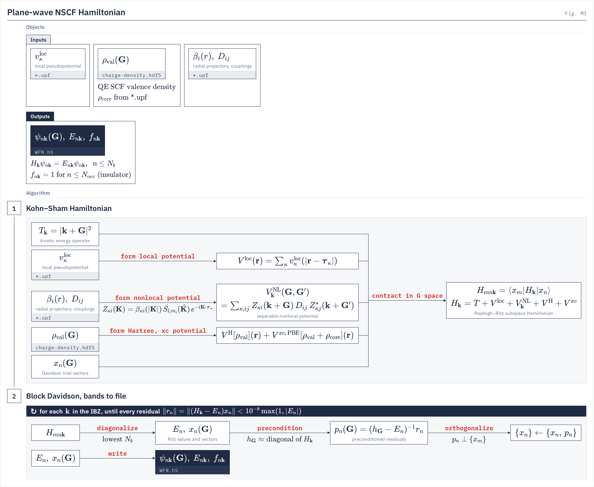

# NSCF driver

`psp.run_nscf` Kohn–Sham bands on a k-grid from a Quantum ESPRESSO SCF, written as `WFN.h5`.
{: .page-summary }

<div class="chain-map" data-driver="nscf" data-page="overview"></div>

Rebuilds the plane-wave Kohn–Sham Hamiltonian $H_\bk = T_\bk + V^{\mathrm{loc}} + V^{\mathrm{NL}}_\bk + V^{\mathrm H} + V^{xc}$ from a converged QE SCF density and solves it for $N_b$ bands at every k-point of the IBZ. It replaces the QE `nscf` + `pw2bgw.x` route and writes the `WFN.h5` that the centroids, dipole and kin-ion utilities and the GW driver read.
{: .lead }

<div class="glance" markdown>

Invoke
:   `python -m psp.run_nscf -i nscf.in`

Reads
:   deck, `<prefix>.save/data-file-schema.xml`, `<prefix>.save/charge-density.hdf5`, `*.upf`

Writes
:   `WFN.h5`; with `pseudobands = true`, also `WFN_pseudobands.h5`

High bands
:   Davidson only · `pseudobands`

</div>

## What it computes {: #what }

<div class="stages" markdown>

1. **Fixed potentials**
   Rebuild $V^{\mathrm{loc}}$ and $\rho_{\mathrm{core}}$ from the UPF files, $V^{\mathrm H}$ from the QE valence density, and $V^{xc}$ (PBE) from $\rho_{\mathrm{val}} + \rho_{\mathrm{core}}$. Built once; the density is never updated.
2. **k-grid**
   A Γ-centred Monkhorst–Pack grid reduced to the IBZ with the `.save` symmetry, and one G sphere $|\bk+\bG|^2 \le E_{\mathrm{cut}}$ per k-point.
3. **Block Davidson per k-point**
   The lowest $N_b$ eigenpairs of $H_\bk$, with the QE diagonal preconditioner. $H_\bk$ is applied, never stored, and one compiled solver serves every k-point.
4. **Write**
   Coefficients reordered to the QE G order and written with $E_{n\bk}$ and insulator occupations in BerkeleyGW layout. With `pseudobands = true`, a second file adds stochastic bands above the Davidson ones.

</div>

<figure class="flowchart" markdown>
[](../../assets/figures/m1.png)
<figcaption><strong>Fig. M1.</strong> Stage 1 forms the four terms of <i>H</i><sub><b>k</b></sub> from the UPF files and the QE valence density and contracts them with the Davidson trial vectors; stage 2 repeats diagonalize, precondition, orthogonalize at each k-point until every residual converges, then writes ψ<sub><i>n</i><b>k</b></sub>(<b>G</b>), <i>E</i><sub><i>n</i><b>k</b></sub> and <i>f</i><sub><i>n</i><b>k</b></sub> to <code>WFN.h5</code>.</figcaption>
</figure>

!!! note
    The driver checks nothing about the QE run it reads. $V^{xc}$ is always PBE and no magnetization term is built, so a `.save` from another functional, a hybrid, vdW or +U run, ultrasoft or PAW pseudopotentials, or a magnetic run gives the bands of a different Hamiltonian without a warning. Use it only for nonmagnetic, norm-conserving PBE insulators.

## Running {: #run }

=== "Local"
    ```bash
    PYTHONPATH=$LORRAX/src python -u -m psp.run_nscf -i nscf.in
    ```
=== "Perlmutter"
    ```bash
    srun -N 1 -n 4 --gpus-per-node=4 $LORRAX/src/ffi/cpp/select_gpu.sh python -u -m psp.run_nscf -i nscf.in
    ```
=== "Frontera"
    ```bash
    # no NSCF template: in a copy of config/frontera/templates/gw_dev.sbatch, replace the gw.gw_jax line with
    "$LORRAX_PY" -u -m psp.run_nscf -i "$LORRAX_INPUT"
    ```

k-points are distributed round-robin over processes, and rank 0 writes. A minimal production deck:

```ini
[nscf]
save_dir = ../scf/mos2.save
nbnd     = 200
kgrid    = 6 6 1
output   = WFN.h5
```

The QE SCF must be built with HDF5, so that the `.save` holds `charge-density.hdf5`. QE copies the UPF files into the `.save`, where the driver looks for them by default.

## Choosing the high-band treatment {: #treatment }

`pseudobands` decides whether the spectrum above the $N_b$ Davidson bands is filled. Expand a row for what each route writes and its limits.

???+ treatment supported "Davidson only · exact bands · default"
    The lowest $N_b$ bands at every k-point, each converged to `tol`. There are no unconverged buffer bands, so all $N_b$ must converge and the top band of a dense manifold sets the cost.

    ```ini
    nbnd = 200
    tol  = 1e-8
    ```

??? treatment in-progress "pseudobands · stochastic high bands · v2"
    After Davidson, Chebyshev–Jackson-filtered random vectors fill DOS-weighted energy windows above the protected Davidson bands, with a few Gauss-weighted pseudobands per window. Written to a separate `WFN_pseudobands.h5`; `WFN.h5` is unchanged. Details on the [Theory](theory.md#pseudobands) page.

    ```ini
    pseudobands = true
    pb_n_prot   = 120
    ```

    **Missing** No driver reads `WFN_pseudobands.h5`. The automatic protected count uses a Fermi level fixed at 0 Ry, so set `pb_n_prot` explicitly.

??? treatment in-progress "pseudobands · v1 stochastic + Ritz"
    The earlier algorithm, selected by any `pb_version` other than `2`. `pb_F` also sets the geometric window spacing, and `pb_n_prot` is ignored.

    ```ini
    pseudobands = true
    pb_version  = 1
    ```

??? treatment not-in-lorrax "QE nscf + pw2bgw.x · external"
    The route of [Inputs from DFT](../../using/inputs-from-dft.md), listed for comparison. Use it for metals, magnetic or non-PBE runs and ultrasoft or PAW pseudopotentials, none of which `psp.run_nscf` reproduces. Use it also for spin–orbit runs with fully relativistic pseudopotentials when the SCF ran on a different k set: `run_nscf` writes no QE schema, the SCF's does not bind, and `dipole` and `kin-ion` then refuse ([Dependencies](dependencies.md)).

## Complete-basis WFN: `psp.run_dense_h` {: #dense-h }

A sibling entry point builds the same Hamiltonian as a dense matrix on each $\bk$'s whole plane-wave sphere, diagonalizes it completely, and writes every band to a `WFN.h5` that keeps the source WFN's $\bk$ set, symmetry, G lists and occupations. Each rank solves whole $\bk$-points.

```bash
python -u -m psp.run_dense_h --save Si.save --wfn WFN.h5 -o WFN_complete.h5 --sys-dim 3
```

| Flag | Default | Meaning |
|---|---|---|
| `--save`, `--wfn`, `-o` | required | QE `.save` with `charge-density.hdf5`; the `WFN.h5` of the same run; the output |
| `--sys-dim` | required | 0, 2 or 3; 2 must match QE `assume_isolated = '2D'` |
| `--nbands` | $\min_\bk n_{\mathrm{spinor}} N_G(\bk)$, the complete basis | bands written; more refuses |
| `--pseudo-dir` | the `.save` | UPF files |
| `--memory-per-device-gb` | the device budget | lowers the budget |
| `--nc-gga-branch` | unset | `general`; required on a noncollinear magnetic run |

Unlike `psp.run_nscf` it checks the QE run before any heavy work and refuses (`[dense_h:<rule>]`) a functional other than PBE, a hybrid, vdW or +U term, a UPF that is not norm-conserving or was generated with another functional, collinear `nspin = 2`, a missing UPF or density, and a `--sys-dim` that disagrees with QE's truncation. Noncollinear magnetism is built ($B^{xc}\cdot\boldsymbol\sigma$). The eigensolve is $O(N^3)$ per $\bk$ with $N = n_{\mathrm{spinor}}\max_\bk N_G(\bk)$; the five $N\times N$ matrices it prices only warn when over the budget. Measured on four A100-40GB: Si 4×4×4 with SOC, $N \approx 1100$, 0.18 s per $\bk$ after the first round, 0.38 GB peak; magnetic Fe with SOC, $N \approx 1600$, 0.78 GB; eigenvalues within $6\times10^{-7}$ Ry of QE's.

Centroid pruning refuses a band window above half the plane-wave basis, $\tfrac12 n_{\mathrm{spinor}}\max_\bk N_G(\bk)$; for such a window run [`centroid.kmeans_cli`](../../utilities/centroids.md) with `--oversample 1.0`, which skips pruning.

## Refusals {: #refusals }

!!! refuses
    - Neither `-i` nor `--save` on the command line.
    - A deck with no `[nscf]` section.
    - No `data-file-schema.xml` in `save_dir`.
    - No `charge-density.hdf5` in `save_dir`. A QE build without HDF5 writes `charge-density.dat` instead; rebuild QE with HDF5.
    - QE `assume_isolated` other than `none` or `2D`.
    - A k-point whose Davidson solve reaches 100 iterations, stalls for 20 iterations or goes non-finite. Nothing is written; move `nbnd` off a degenerate cut or loosen `tol`.
    - `--no-davidson` without `pseudobands`.
    - Pseudobands-only mode without a deterministic `WFN.h5`, or with one whose spinor count, G spheres or `ngkmax` differ from this run, or that holds no band above the occupied ones.

    **Not refused.** These run to completion with a Hamiltonian other than the QE one: a non-PBE functional; hybrid, vdW or +U terms; ultrasoft or PAW UPF files (treated as norm-conserving); collinear `nspin = 2` (the header declares two spin channels and only the first is filled); noncollinear magnetization (no $B^{xc}$); metals (insulator occupations are written); a missing UPF file (its atoms are left out of $V^{\mathrm{loc}}$ and $V^{\mathrm{NL}}_\bk$); two species of one element with different UPF files (the last file in sorted order wins).

