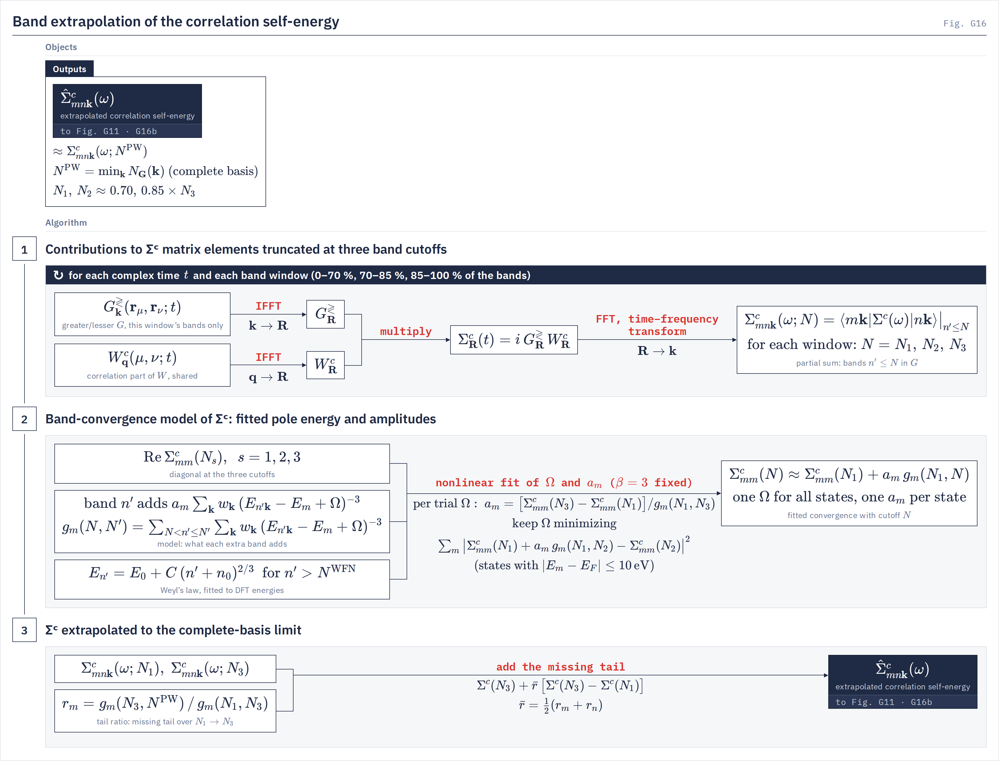

# Band extrapolation

`gw.band_extrapolation` The correlation self-energy extrapolated from three band cutoffs, computed in one pass, to the complete plane-wave basis.
{: .page-summary }

<div class="section-cards"></div>

<figure class="flowchart" markdown>
[](../assets/figures/g16.png)
<figcaption><strong>Fig. G16.</strong> One Σ<sup>c</sup> pass keeps the band sum of G truncated at three cutoffs (stage 1); a one-pole model of what each further band adds is fitted to their diagonals (stage 2) and summed to the complete basis to give the extrapolated $\hat\Sigma^c$ (stage 3). The arrow labelled "nonlinear fit" is a grid search in $\Omega$ with closed-form amplitudes (§4).</figcaption>
</figure>

## <span class="n">1</span> What is truncated {: #truncation }

The band sum in the Green's function of $\Sigma^c$ converges slowly with the number of empty bands. LORRAX corrects that one sum and leaves every other band count as the deck sets it.
{: .intro }

### <span class="n">1.1</span> The Green's-function band sum of Σᶜ {: #trunc-sum }

`gw.sigma_dispatch`
{: .in-code }

In the space-time form $\Sigma^c_\bR(t) = i\,G^{\gtrless}_\bR(t)\,W^c_\bR(t)$, $t\gtrless0$, the band index $n'$ runs inside $G^{\gtrless}$. Restricting it to $n'\le N$ defines the truncated self-energy:

$$
\Sigma^c_{mn\bk}(\omega;N) = \langle m\bk|\Sigma^c(\omega)|n\bk\rangle\big|_{n'\le N} \tag{1.1}
$$

The cutoff is an argument, not a superscript, because the superscript already carries the word label. The complete-basis limit is $\Sigma^c(\omega;N^{\mathrm{PW}})$, with $N^{\mathrm{PW}}$ the dimension of the plane-wave basis (§5.1).

### <span class="n">1.2</span> What is not extrapolated {: #trunc-scope }

$\Sigma^x$ sums over occupied bands only and has no empty-band tail. The $\chi^0$ band sum, and so $W$, stops at `number_bands_chi` and is never extended: the ISDF basis is fitted on pair densities of bands inside the band set, so a tail model for $\chi^0$ would put screening on pairs the basis never represented. $W$'s band truncation is converged by raising the band count.

!!! note
    With `use_band_extrapolation` on, the remaining dependence on the band count is $W$'s. Choose `number_bands` for $\chi^0$.

### <span class="n">1.3</span> Where it runs {: #trunc-where }

`band_extrapolation_is_consumable`
{: .in-code }

The pole-sum Σ executors consume it: `gn_ppm`, `hl_ppm` and scalar `mpa` (elementwise or shared pole), and both bispinor shared-pole routes, where only the charge–charge class of $\Sigma^c$ is extrapolated. Static stages (`cohsex`, `x_only`) and a bispinor MPA fit do not: on a static Coulomb hole the band limit anti-converges. An unset key disables itself there with a log line; an explicit `use_band_extrapolation = true` refuses unless another stage of the run consumes it.

### <span class="n">1.4</span> Other corrections of the same truncation {: #trunc-compare }

Two published corrections treat the same tail. Neither is in LORRAX.

| Correction | What replaces the missing bands | Frequency dependence of the tail | Status |
|---|---|---|---|
| Spectral shell (LORRAX) | a fitted one-pole model summed to $N^{\mathrm{PW}}$ | dynamical, from the fitted $\Sigma^c(\omega;N)$ | Production |
| Static remainder | closure-form static Coulomb hole minus its truncated value | static | Not in LORRAX |
| Extrapolar / effective energy | one average energy for all omitted bands, closure over the rest | from the effective energy | Not in LORRAX |
| None | nothing; $\hat\Sigma^c = \Sigma^c(N_3)$ | — | Supported |

=== "Spectral shell"
    **Pooled spectral shell** <span class="status production">Production</span>

    The default. Three truncated sums from one pass feed a band-convergence model with one shared pole energy and one amplitude per state; the model is summed to the complete basis.

    The extrapolated matrix is a real combination of two truncated matrices, so it stays Hermitian and keeps the imaginary part of $\Sigma^c$ (§5).

    $$
    \hat\Sigma^c = \Sigma^c(N_3) + \bar r\,\big[\Sigma^c(N_3)-\Sigma^c(N_1)\big] \tag{1.2}
    $$

    ```ini
    use_band_extrapolation = true
    ```

=== "Static remainder"
    **Modified static remainder** <span class="status not-in-lorrax">Not in LORRAX</span>

    The BerkeleyGW correction (Deslippe et al., 2013). The static COHSEX Coulomb hole is known in closed form; half of its difference from the band-truncated static value is added to the truncated dynamical Coulomb hole.

    $$
    \Sigma^{\mathrm{CH},\infty} = \Sigma^{\mathrm{CH},N} + \tfrac12\big(\Sigma^{\mathrm{COH},\infty} - \Sigma^{\mathrm{COH},N}\big) \tag{1.2}
    $$

    LORRAX adds no static remainder. Its `sigC_raw`, `eqp0_raw` and `eqp1_raw` columns hold $\Sigma^c(N_3)$ without any tail, for comparison with BerkeleyGW at the same band count.

=== "Extrapolar"
    **Extrapolar / effective energy** <span class="status not-in-lorrax">Not in LORRAX</span>

    Bruneval and Gonze (2008): all bands above $N$ are given one effective energy, so their sum collapses by closure, $\sum_{n'>N}\psi_{n'}\psi^*_{n'} = \delta - \sum_{n'\le N}\psi_{n'}\psi^*_{n'}$. The effective-energy technique of Berger, Reining and Sottile is the same idea.

=== "None"
    **No correction** <span class="status supported">Supported</span>

    `use_band_extrapolation = false` gives $\hat\Sigma^c = \Sigma^c(N_3)$, the truncated sum at `number_bands_sigma`.

    ```ini
    use_band_extrapolation = false
    ```

## <span class="n">2</span> Three cutoffs in one pass {: #brackets }

The band sum of $G$ is split into three consecutive windows contracted against the same $W^c$. The running sums are $\Sigma^c$ truncated at three cutoffs, at the cost of one pass.
{: .intro }

### <span class="n">2.1</span> Band windows {: #br-windows }

`gw.mpa.sector_sigma`
{: .in-code }

The windows are $(0,N_1]$, $(N_1,N_2]$ and $(N_2,N_3]$, with $N_3 =$ `number_bands_sigma`. At each complex time node one $G^{\gtrless}$ is built per window and multiplied by the same $W^c_\bR(t)$; the cumulative sums give

$$
\Sigma^c_{mn\bk}(\omega;N_s) = \sum_{s'\le s} \langle m\bk|\Sigma^c(\omega)|n\bk\rangle\big|_{N_{s'-1}<n'\le N_{s'}},\qquad s=1,2,3,\ \ N_0=0 \tag{2.1}
$$

$W^c$, the ISDF basis, the time quadrature and the evaluation energies are shared by the three windows. $\Sigma^c(N_3)$ equals the full-band $\Sigma^c$ to round-off.

### <span class="n">2.2</span> Placing the cutoffs {: #br-cuts }

`band_extrapolation.plan_band_brackets`
{: .in-code }

`band_extrapolation_bracket_scheme` sets $N_1$ and $N_2$. The default `total_fractions` takes 70 % and 85 % of the band sum:

$$
N_1 = \mathrm{round}(0.70\,N_3),\qquad N_2 = \mathrm{round}(0.85\,N_3) \tag{2.2}
$$

`conduction_fractions` takes the same fractions of the empty bands, $N_s = n_{\mathrm{occ}} + \mathrm{round}\big(f_s(N_3-n_{\mathrm{occ}})\big)$. `conduction_energy_midpoint` puts $N_1$ at half the empty bands and $N_2$ at the boundary nearest the k-averaged energy midpoint between $N_1$ and $N_3$. In every scheme the interior cuts then move to the nearest boundary that splits no degenerate multiplet (1 meV); with none available the least-degenerate boundary is used and logged.

!!! note
    $N_3 \ge 2n_{\mathrm{occ}}$ is required at startup: the sum must hold at least as many empty as occupied bands. Raising `number_bands_chi` does not lift this floor.

### <span class="n">2.3</span> What is stored {: #br-store }

`gw.ppm_sigma.BandCountCube`
{: .in-code }

The extrapolated matrix combines $\Sigma^c(N_1)$ and $\Sigma^c(N_3)$; $\Sigma^c(N_2)$ enters only through its diagonal in the fit. The sweep therefore keeps the full matrices at $N_1$ and $N_3$ and the band diagonal at $N_2$. On shell (the default) each keeps its on-shell pair and diagonal slots in place of an ω axis.

## <span class="n">3</span> The band-convergence model {: #model }

A band far above the Fermi level adds to $\Sigma^c$ a term set by its energy alone. One pole energy for the run and one amplitude per state describe every such term.
{: .intro }

### <span class="n">3.1</span> One high band {: #mod-band }

`band_extrapolation.SHELL_BETA`
{: .in-code }

A band $n' > N_1$ adds to the diagonal of state $m$:

$$
\delta\Sigma^c_{mm}(n') = a_m\sum_\bk w_\bk\,\big(E_{n'\bk} - E_m + \Omega\big)^{-\beta},\qquad \beta = 3 \tag{3.1}
$$

A high band is close to a plane wave of energy $E$. Its pair matrix element and $W^c$ each fall as $1/E$, and the empty-branch denominator of $\Sigma^c$ at $\omega = E_m$ is $(E_m - E_{n'\bk} - \Omega)^{-1}$, with $\Omega$ the pole energy of $W^c$ that the high bands see. Together these give $\beta = 3$, a state-independent pole energy, and the state entering only through $E_m$. The sign of the term sits in $a_m$.

### <span class="n">3.2</span> Shell sums {: #mod-shell }

`band_extrapolation._pooled_shell_grid`
{: .in-code }

Summing (3.1) over a shell of bands defines

$$
g_m(N,N') = \sum_{N<n'\le N'}\sum_\bk w_\bk\,\big(E_{n'\bk}-E_m+\Omega\big)^{-3},\qquad
\Sigma^c_{mm}(N) \approx \Sigma^c_{mm}(N_1) + a_m\,g_m(N_1,N) \tag{3.2}
$$

Every shell sum is evaluated on a Gauss compression of the shell's spectrum in $\log(E - E^{\mathrm{ref}})$, exact to about $10^{-16}$ relative; the cost is linear in the number of states.

!!! note
    $\beta$ is fixed. A free exponent absorbed part of $W$'s own band truncation (drifting to 4.25–5.25 with $W$ truncated at the same $N$) and toggled between grid points from one QSGW map to the next, which stalled the loop.

### <span class="n">3.3</span> High-band energies {: #mod-weyl }

`band_extrapolation.weyl_ladder_fit`
{: .in-code }

The shell sums need energies up to $N^{\mathrm{PW}}$, far above the $N^{\mathrm{WFN}}$ bands of `WFN.h5`. Past $N^{\mathrm{WFN}}$ the ladder follows Weyl's law for the eigenvalues of the Laplacian (number of levels $\propto E^{3/2}$ in three dimensions), the free-electron limit of high bands:

$$
E_{n'} = E_0 + C\,(n'+n_0)^{2/3},\qquad n' > N^{\mathrm{WFN}} \tag{3.3}
$$

$E_0$ and $C$ are fitted by linear least squares, and $n_0$ by a scan over $0,1,\dots,199$, to the k-averaged mean-field energies of the top 90 % of the WFN bands. The continued ladder is independent of $\bk$. Nothing in it is taken from $\Sigma$.

## <span class="n">4</span> Searching for Ω {: #fit }

$\Omega$ is found by a grid search; for each trial value the amplitudes follow in closed form. No iterative nonlinear solver is used.
{: .intro }

### <span class="n">4.1</span> The data {: #fit-data }

`ppm_pipeline._report_band_extrapolation`
{: .in-code }

The fit reads $\mathrm{Re}\,\Sigma^c_{mm}(N_s)$, $s = 1,2,3$, at each state's evaluation energy, with the $\bq\to0$ head added. The head does not depend on the cutoff and cancels from every difference. The evaluation energy is $E_m$ in a one-shot run and at QSGW map 0, and the map's read energy afterwards; the fit is redone on every map. The Weyl ladder always uses mean-field energies.

### <span class="n">4.2</span> Amplitudes in closed form {: #fit-amp }

For a trial $\Omega$, each amplitude reproduces the widest increment exactly:

$$
a_m(\Omega) = \frac{\Sigma^c_{mm}(N_3) - \Sigma^c_{mm}(N_1)}{g_m(N_1,N_3)} \tag{4.1}
$$

### <span class="n">4.3</span> The pooled grid search {: #fit-grid }

`band_extrapolation.fit_band_extrapolation_spectral`
{: .in-code }

The kept $\Omega$ is the grid point whose model best predicts the middle cutoff, pooled over the states within 10 eV of $E_F$:

$$
\Omega = \arg\min_{\Omega}\sum_{|E_m-E_F|\le 10\,\mathrm{eV}}\Big|\Sigma^c_{mm}(N_1) + a_m(\Omega)\,g_m(N_1,N_2) - \Sigma^c_{mm}(N_2)\Big|^2 \tag{4.2}
$$

The pool is closed over degenerate multiplets (0.1 meV); $E_F$ is set by `fermi_reference`. The grid runs from $\Omega^{\mathrm{lo}}$ to 40 eV in 2 eV steps, and the first minimum wins. The lower bound, taken over all requested states,

$$
\Omega^{\mathrm{lo}} = \max\Big(0,\ \max_m E_m - \min_\bk E_{N_1+1,\bk} + 2\ \mathrm{eV}\Big) \tag{4.3}
$$

keeps every pole of the model outside the band sum, so every state gets a tail and the result is continuous in the energies.

!!! note
    If no requested state lies within 10 eV of $E_F$, no $\Omega$ is fitted and $\hat\Sigma^c = \Sigma^c(N_3)$; the log says so.

## <span class="n">5</span> The extrapolated self-energy {: #extrap }

The fitted model, summed from $N_3$ to the complete basis, gives each state a tail ratio. The extrapolated matrix is a real, Hermiticity-preserving combination of two truncated matrices.
{: .intro }

### <span class="n">5.1</span> Tail ratio {: #ex-ratio }

`band_extrapolation.plane_wave_band_count`
{: .in-code }

The amplitude cancels from the ratio of the missing tail to the $N_1\to N_3$ increment:

$$
r_m = \frac{g_m(N_3,N^{\mathrm{PW}})}{g_m(N_1,N_3)},\qquad N^{\mathrm{PW}} = n_{\mathrm{spinor}}\min_\bk N_\bG(\bk) \tag{5.1}
$$

$N^{\mathrm{PW}}$ is the dimension of the plane-wave basis, where the band sum is complete. A run with $N_3 \ge N^{\mathrm{PW}}$ refuses: there is no tail to add.

### <span class="n">5.2</span> The combination {: #ex-combine }

`ppm_pipeline.extrapolate_sigma_body`
{: .in-code }

Each matrix element takes the pair-averaged ratio:

$$
\hat\Sigma^c_{mn\bk}(\omega) = \Sigma^c_{mn\bk}(\omega;N_3) + \bar r\,\big[\Sigma^c_{mn\bk}(\omega;N_3) - \Sigma^c_{mn\bk}(\omega;N_1)\big],\qquad \bar r = \tfrac12(r_m+r_n) \tag{5.2}
$$

The weights on $N_1, N_2, N_3$ are $(-\bar r,\,0,\,1+\bar r)$: real, symmetric in $m,n$ and summing to 1. $\hat\Sigma^c$ is therefore exactly Hermitian where $\Sigma^c$ is, Σ is extrapolated before it is diagonalized, and the real ratio carries $\mathrm{Im}\,\Sigma^c$ along. A multiplet that reorders against the mean field keeps one ratio.

$\hat\Sigma^c$ replaces $\Sigma^c(N_3)$ everywhere downstream: the $\bq\to0$ head is added to it, it is read on shell for $\Sigma^{\mathrm{QSGW}}$ and the one-shot energies ([quasiparticle self-consistency](qsgw.md)).

### <span class="n">5.3</span> What the extrapolation does not correct {: #ex-limits }

- $W$'s own band truncation (`number_bands_chi`).
- Under `ppm_invalid_mode = static_limit`, the static term of the invalid plasmon poles, which is folded into the first window as a constant and passes into $\hat\Sigma^c$ unextrapolated. The log bounds its omitted tail.
- The uncertainty envelope written beside $\hat\Sigma^c$ (0.15 and 0.25 of $|\hat\Sigma^c - \Sigma^c(N_3)|$ for p90 and p99) is inherited from the retired $1/N$ estimator and not re-derived for this model.

### <span class="n">5.4</span> Measured {: #ex-measured }

Si 4³, scalar, 25 Ry, one-shot shared-pole $W$, against the complete basis (536 bands); eqp0 errors over the 71 multiplet-closed states within ±10 eV of midgap (standard deviation / maximum / gap). With $W$ complete and $G$ truncated at $N$, which isolates the extrapolation:

| $N$ | No extrapolation | Extrapolated |
|---|---|---|
| 78 | 29.2 / 68 / −90 meV | 9.0 / 27 / −2.6 meV |
| 64–142 | — | std ≤ 12.6 meV, \|gap\| ≤ 10.7 meV |

Five cutoffs in place of three give the same numbers at $N=78$. With $W$ also truncated at $N$ (a production run), the extrapolation opens the gap by 13–23 meV; the remaining error is $W$'s ([GW driver](../drivers/gw/index.md#accuracy)). On the four-current route (Fe 4³, `full_shared_pole`, 36 bands) the CC tail moves eqp0 within $E_F\pm10$ eV by a median of 342 meV; extrapolating every class instead of CC alone changes eqp0 by at most 0.08 meV. The scalar model has been measured on silicon only.

## <span class="n">6</span> Keys and outputs {: #keys }

The keys below change what this page computes. Full entries are on the [GW input keywords](../drivers/gw/keywords.md) page. Defaults are read from the keyword schema (`src/gw/gw_config.py`).
{: .intro }

### <span class="n">6.1</span> Keys {: #keys-list }

| Key | Default | Role here |
|---|---|---|
| [`use_band_extrapolation`](../drivers/gw/keywords.md#use_band_extrapolation) | unset → `true` | Turns the extrapolation on; `false` gives $\hat\Sigma^c = \Sigma^c(N_3)$. |
| [`sigma_band_extrapolation`](../drivers/gw/keywords.md#sigma_band_extrapolation) | unset | Retired spelling of `use_band_extrapolation`; naming both with different values refuses. |
| [`number_bands_sigma`](../drivers/gw/keywords.md#number_bands_sigma) | `number_bands` | $N_3$; must be at least $2n_{\mathrm{occ}}$. |
| [`number_bands`](../drivers/gw/keywords.md#number_bands) | `100` | Sets `number_bands_chi` and `number_bands_sigma` together. |
| [`band_extrapolation_bracket_scheme`](../drivers/gw/keywords.md#band_extrapolation_bracket_scheme) | `total_fractions` | Placement of $N_1$, $N_2$ (§2.2). Naming it with the extrapolation off refuses. |
| [`band_extrapolation_estimator`](../drivers/gw/keywords.md#band_extrapolation_estimator) | `spectral_shell` | The only accepted value; `band_index_only` refuses by name. |
| [`fermi_reference`](../drivers/gw/keywords.md#fermi_reference) | `midgap` | $E_F$ of the 10 eV pool. |
| [`ppm_invalid_mode`](../drivers/gw/keywords.md#ppm_invalid_mode) | `static_limit` | Whether invalid plasmon poles leave an unextrapolated static term (§5.3). |
| [`sigma_omega_grid_debug`](../drivers/gw/keywords.md#sigma_omega_grid_debug) | `false` | Debug: extrapolates the whole Σ(ω) grid instead of the on-shell values. |

### <span class="n">6.2</span> Outputs {: #keys-out }

<div class="file-list" markdown>

`sigma_mnk.h5`
:   $\hat\Sigma^c$ in the Σ datasets, plus band diagonals `sigma_c_extrap_inf_kn_ev` ($\hat\Sigma^c_{mm}$), `sigma_c_extrap_last_kn_ev` ($\Sigma^c_{mm}(N_3)$), `sigma_c_extrap_sigma_kn_ev` (envelope) and attributes `pooled_omega_ev`, `band_counts`, `ladder_e0_ev`, `ladder_c_ev`, `ladder_n0`, `ladder_n_target`.

`sigma_diag.dat`
:   In a one-shot run, extra columns `sigC_raw`, `eqp0_raw`, `eqp1_raw` from $\Sigma^c(N_3)$ with no tail.

`gwjax.out`
:   The requested and snapped cutoffs, the Weyl fit, $\Omega$, the middle-point residual, and $\Sigma^c(N_s)$, $r_m$ and $\hat\Sigma^c$ at the band edges.

</div>

## Notation {: #notation }

| Symbol | Meaning |
|---|---|
| $\Sigma^c_{mn\bk}(\omega;N)$ | correlation self-energy with the band sum of $G$ truncated at $N$ |
| $\hat\Sigma^c$ | extrapolated correlation self-energy |
| $N_1, N_2, N_3$ | the three cutoffs; $N_3 =$ `number_bands_sigma` |
| $N^{\mathrm{WFN}}$, $N^{\mathrm{PW}}$ | bands in `WFN.h5`; dimension of the plane-wave basis |
| $n'$ | band summed in $G$ |
| $\Omega$, $a_m$, $\beta$ | model pole energy, per-state amplitude, exponent (3) |
| $g_m(N,N')$ | model shell sum over bands $N<n'\le N'$ |
| $E_0$, $C$, $n_0$ | Weyl-ladder parameters |
| $r_m$, $\bar r$ | tail ratio; its pair average |
| $w_\bk$ | k-point weight |

## References {: #refs }

1. J. Deslippe, G. Samsonidze, M. Jain, M. L. Cohen and S. G. Louie, Phys. Rev. B 87, 165124 (2013).
2. F. Bruneval and X. Gonze, Phys. Rev. B 78, 085125 (2008).
3. J. A. Berger, L. Reining and F. Sottile, Phys. Rev. B 82, 041103(R) (2010).
4. H. Weyl, Math. Ann. 71, 441 (1912).

