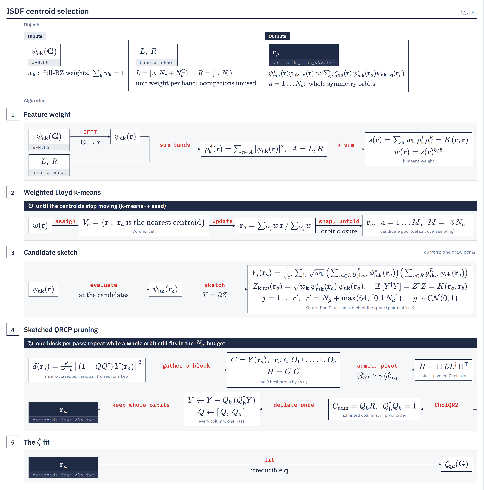

# Centroid selection

`centroid.kmeans_cli` How the ISDF interpolation points are chosen: weighted k-means on a pair-density weight, then column-pivoted QR on a Gaussian sketch, in whole symmetry orbits.
{: .page-summary }

## 1 What is optimized {: #cs-objective }

The points $\br_\mu$ must make the pair densities of the $\zeta$ fit linearly independent and well sampled. Both selection stages read one object, the positive pair-density Gram at $\bq = 0$, over the same band windows the fit uses; the pruning reads it through a random sketch.
{: .intro }

<figure class="flowchart" markdown>

<figcaption><strong>Fig. K1.</strong> Centroid selection. Stage 1 builds the k-means weight $w(\br)$, a power of the Gram diagonal; stage 2 runs weighted Lloyd iterations and closes the candidates under the crystal's symmetry; stages 3 and 4 sketch the pair densities on the candidates and keep whole orbits in blocks by their sketched residual until the $N_\mu$ budget is spent.</figcaption>
</figure>

### 1.1 The pair-density Gram {: #cs-gram }

`isdf.core.c_q_from_psi_sm`
{: .in-code }

Every pair $m \in L$, $n \in R$ at every $\bk$ defines a feature $\psi^*_{n\bk}(\br)\psi_{m\bk}(\br)$. Their Gram, with the full-zone k weights $w_\bk$, is:

$$
K(\br,\br') = \sum_\bk w_\bk \sum_{m\in L,\,n\in R} \psi_{m\bk}(\br)\psi^*_{n\bk}(\br)\;\overline{\psi_{m\bk}(\br')\psi^*_{n\bk}(\br')} \tag{1.1}
$$

Restricted to the points, $K(\br_\mu,\br_\nu)$ is the $\bq = 0$ Gram $C_{\bq=0}$ of the [ζ fit](isdf.md). On spinors the spinor indices are contracted open, as in the fit. Occupations never enter: every band in a window has unit weight.

### 1.2 The importance weight {: #cs-weight }

`centroid.sampling_metric.build_feature_metric_diagonal`
{: .in-code }

The weight is a power of the Gram diagonal, the squared norm of the feature row at each grid point:

$$
s(\br) = K(\br,\br) = \sum_\bk w_\bk\,\rho^L_\bk(\br)\,\rho^R_\bk(\br), \qquad \rho^A_\bk(\br) = \sum_{n\in A}|\psi_{n\bk}(\br)|^2, \qquad w(\br) = s(\br)^{P} \tag{1.2}
$$

with $P = 5/6$ (`--weight-power`; §2.2).

The product form holds for scalar wavefunctions; on spinors $s$ is the open-spin trace. The product is summed per k, not formed from separately k-summed densities. $s$ is symmetrized over the crystal's space group on the FFT grid. A pair adds weight only where both of its states have density, which is why the left window carries the Σ conduction bands as well as the occupied ones: an occupied-only left window gives a slab's vacuum almost no weight.

### 1.3 Band windows {: #cs-windows }

`centroid.production_output.prune_band_ranges`
{: .in-code }

The default window pair is $L = [0, N_v + N_c^\Sigma)$ and $R = [0, N_b)$: every occupied band plus the input file's `ncond` on the left, every band of the WFN on the right. Without an input file (`-i`) the Σ window is unknown and $L$ widens to $R$. The windows are written into the centroid file's header, and the GW run compares them with its own fit windows ([ISDF §1.2](isdf.md)).

The right window must reach the top of every band sum the centroid file will serve. A basis selected on a smaller window is wrong by electron-volts in $\Sigma^c$ while every upstream check passes ([ISDF §4.4](isdf.md)). The selector flags are on [centroids](../utilities/centroids.md).

!!! refuses
    - A window that drops an occupied band (a `--fit-window` not starting at band 0).
    - A window whose top band exceeds half the plane-wave basis, $0.5\,N_\bG^{\max} n_s$. Raise the cutoff or lower the band count.

## 2 Weighted k-means {: #cs-kmeans }

Lloyd's algorithm places $M$ candidate points where $w(\br)$ is large, on the periodic cell. It controls spatial coverage, not linear independence; the pruning of §3 supplies the latter.
{: .intro }

### 2.1 The Lloyd objective {: #cs-lloyd }

`centroid.kmeans_isdf.weighted_kmeans_jax`
{: .in-code }

With positions in fractional coordinates and the lattice metric $\mathsf G = AA^{\mathsf T}$ ($A$ has the lattice vectors as rows), Lloyd's iterations decrease:

$$
J(\{\br_a\}) = \sum_{\br} w(\br)\,\min_a \min_{\mathbf n\in\mathbb Z^3}\,(\br-\br_a+\mathbf n)^{\mathsf T}\,\mathsf G\,(\br-\br_a+\mathbf n) \tag{2.1}
$$

Each step assigns grid points to their nearest candidate under the minimum-image distance (the Voronoi cells $V_a$) and moves each candidate to the $w$-weighted mean of the unwrapped displacements in its cell. Seeding is k-means++; the loop stops when no candidate moves by more than $5\times10^{-3}$ Å, or after 200 steps.

### 2.2 Point density {: #cs-density }

For a smooth weight in 3-D, weighted quantization places points with asymptotic density:

$$
n(\br) \propto w(\br)^{3/5} = s(\br)^{3P/5} \tag{2.2}
$$

LORRAX uses $P = 5/6$, so the points follow the feature norm, $n \propto s^{1/2}$. The exponent changes only the Lloyd weight; the pruning sketch keeps unit band weights. Eq. (2.2) need not hold after snapping, orbit closure or pruning, or on a thin slab.

### 2.3 Snapping and orbit closure {: #cs-snap }

`centroid.kmeans_cli._snap_and_unfold`
{: .in-code }

Lloyd runs for $M = \lceil 3\,N_\mu \rceil$ candidates (`--oversample`, default 3). When the crystal has more than one spatial operation, it runs on $\lceil M/n_{\mathrm{sym}} \rceil$ orbit representatives; the representatives are snapped to the FFT grid first and then unfolded by the space group, so every orbit lands exactly on grid points. Without symmetry, duplicates after snapping are moved to nearby free grid points.

## 3 Sketched QRCP pruning {: #cs-prune }

The candidate pool is pruned to the point budget $N_\mu$ by column-pivoted QR on a Gaussian sketch whose expected Gram is Eq. (1.1), keeping the candidates that add the most new feature directions.
{: .intro }

### 3.1 The candidate sketch {: #cs-sketch }

`centroid.sketch_select.build_sketch_q0_via_loadwfns`
{: .in-code }

The orbitals are evaluated at the $M$ candidates $\br_a$ on every full-zone $\bk$. Let $Z$ be the pair matrix, rows $(\bk,m,n)$ and columns the candidates, with $Z^\dagger Z = K(\br_a,\br_b)$. Neither $Z$ nor $K$ is formed; the selector builds the Khatri–Rao Gaussian sketch $Y = \Omega Z$ of $r'$ rows,

$$
Y_j(\br_a) = \frac{1}{\sqrt{r'}}\sum_\bk \sqrt{w_\bk}\,\Big(\sum_{m\in L} g^L_{j\bk m}\,\psi^*_{m\bk}(\br_a)\Big)\Big(\sum_{n\in R} g^R_{j\bk n}\,\psi_{n\bk}(\br_a)\Big), \qquad g \sim \mathcal{CN}(0,1), \qquad \mathbb E\,[Y^\dagger Y] = K \tag{3.1}
$$

with $r' = N_\mu + \max(64, \lceil 0.1\,N_\mu\rceil)$ rows (`--sketch-rows`), against $M \approx 3N_\mu$ columns. On spinors the spinor index of the two factors is contracted, as in the fit. The draws depend on $\bk$, the row and `--seed`, not on the device mesh.

### 3.2 Blocked pivots {: #cs-pivots }

`centroid.sketch_select.sketch_block_select`
{: .in-code }

With $t$ directions kept, $Q$ their orthonormal basis, a Gaussian sketch keeps on average the fraction $(r'-t)/r'$ of a column's true residual. The selector therefore reads

$$
\hat d(\br_a) = \frac{r'}{r'-t}\,\big\|(1-QQ^\dagger)\,Y(\br_a)\big\|^2 \tag{3.2}
$$

which is unbiased, for a candidate the selection has not conditioned on, for the Schur-complement residual of the kept points $\br_\mu$:

$$
d(\br_a) = K(\br_a,\br_a) - \sum_{\mu\nu} K(\br_a,\br_\mu)\,[K^{-1}]_{\mu\nu}\,K(\br_\nu,\br_a) \tag{3.3}
$$

Each block gathers the columns $C$ of the $b$ best-scoring orbits (`--sketch-block`) and their Gram $H = C^\dagger C$. Orbits enter while their in-block score is at least $\gamma$ times the block's leading score ($\gamma$ = `--sketch-gamma`, 0.7) and they fit the budget; each member is pivoted by pivoted Cholesky on $H$, largest residual first. The block's directions are orthonormalized by CholQR2 and $Y$ is deflated once, $Y \leftarrow Y - QQ^\dagger Y$. With $b = 1$ this is sequential greedy pivoting on $\hat d$. A member below the floor $\sqrt{\epsilon}\,\max_a \|Y(\br_a)\|^2$ of the undeflated sketch, with $\epsilon$ the double-precision machine epsilon, is kept with its orbit but adds no direction.

### 3.3 Whole orbits {: #cs-orbits }

When the candidates form symmetry orbits, pruning admits orbits, never single points. Each orbit is scored by its mean residual $\langle \hat d \rangle_O$, admitted only if the whole orbit fits in the remaining point budget, and deflated by every member. The written count is therefore at most $N_\mu$, and the output stays orbit-closed.

!!! note
    Near-greedy pivoting maximizes successive residuals, not the smallest eigenvalue of the final Gram. The trace of the discarded residual is a loss in this training metric, not a bound in meV. Pruning a fixed pool cannot recover a region the k-means left empty, and a healthy $\bq = 0$ Gram does not certify every $C_\bq$ of the fit.

## 4 Rank and the target count {: #cs-rank }

The selector reports how many independent directions it certified and an estimate of the count the target accuracy needs. Both are written into the centroid file's header and `kmeans.out`.
{: .intro }

### 4.1 Pool rank {: #cs-pool-rank }

The rank is the number of pivots taken above the floor, read on the sketch by Eq. (3.2), printed as `pool rank=`. Two stops differ:

- `stop: pool spent`: no unpicked candidate is above the floor. The rank is that of the pool, a lower bound on the rank of the pair set; a larger pool can raise it.
- `stop: point budget`: the budget ran out while candidates still carried directions. The rank of the pair set is not measured, and the run warns `CentroidRankNotEstablished`.

Numerical rank deficiency is reported and never refuses.

### 4.2 Choosing N_μ {: #cs-target }

`centroid.production_output.rank_law_estimate`
{: .in-code }

The header also prints the rank-law estimate of the count for a 1 meV RMS error in $\Sigma^x$, with $L$ and $B$ the window widths (per Kramers pair on spinors):

$$
N_\mu \approx \tfrac12 \min\big(N_k L B,\; 445\,L^{0.107}B^{0.322},\; 0.97\,N_\bG(4E_{\mathrm{wfc}})\big) \tag{4.1}
$$

$N_kLB$ bounds the number of pair functions, and $N_\bG(4E_{\mathrm{wfc}})$ is the WFN's density sphere rescaled from `ecutrho` to $4E_{\mathrm{wfc}}$. The law and the measured error against $N_\mu/r$ are on [ISDF §4](isdf.md). The measured pool rank, from a large request with `stop: pool spent`, is preferred to the estimate.

## 5 Symmetry closure {: #cs-symmetry }

An orbit-closed point set lets the GW and BSE runs work on the irreducible k and q wedges. The selector closes the set under the crystal structure; the GW run checks the closure against the WFN.
{: .intro }

### 5.1 The atomic space group {: #cs-atomic-group }

`symmetry_maps.recover_atomic_space_group`
{: .in-code }

The selector recovers the spatial Seitz operations $\{R|\boldsymbol\tau\}$ that map the lattice onto itself and every atom onto one of the same species. The electronic density, magnetism, time reversal and the WFN's own symmetry table are not consulted: the points are a sampling set, closed under the decorated crystal. A magnetic WFN, whose group is a subgroup, sees a set closed under every operation it uses. `--no-symmetries` selects points without them.

### 5.2 What the GW run checks {: #cs-closure-check }

On load, the GW run measures whether each operation of the WFN's group permutes the points ([Symmetry](symmetry.md)). A set that is not closed runs, with a warning, on every k and q. Its ISDF tensor file stores every q (4.15× larger on a small Si BSE test input file), and on the 960-point Si test set $\Sigma$ spreads across a k star by 16.9 meV, against 0.7 meV on a closed set.

### 5.3 Current-density points {: #cs-current }

`--density-mode current` builds the weight and Gram from the three stacked Dirac-current features, $\sum_i |\Psi^\dagger_{m\bk}\alpha^i\Psi_{n\bk}|^2/\alpha_{\mathrm{FS}}^2$ in place of $|\psi^\dagger_{m\bk}\psi_{n\bk}|^2$, with unit band weights. The pruning sketches each component $Z_i(\br_a) = \langle\Psi^L(\br_a)|\alpha^i|\Psi^R(\br_a)\rangle$ with its own Gaussian draw, so $\mathbb E\,[Y^\dagger Y] = \sum_i Z_i^\dagger Z_i$. It writes `centroids_frac_<N>_current.txt` for `centroids_file_current`. The bispinor fit refuses a current set that is not orbit-closed.

## Notation

| Symbol | Meaning |
|---|---|
| $N_\mu$, $\br_\mu$ | point budget; the selected points |
| $M$, $\br_a$, $\br_b$ | candidate count $\lceil 3\,N_\mu\rceil$; candidate points |
| $L$, $R$ | left and right band windows; $N_v$, $N_c^\Sigma$, $N_b$ occupied, Σ conduction and total bands |
| $w_\bk$ | full-zone k weights, $\sum_\bk w_\bk = 1$ |
| $K(\br,\br')$ | positive pair-density Gram at $\bq = 0$ |
| $s(\br)$, $w(\br)$ | Gram diagonal; k-means weight $s^{P}$ |
| $P$ | Lloyd weight exponent, 5/6 |
| $\rho^A_\bk$ | window density, $A \in \{L,R\}$ |
| $\mathsf G$, $A$ | lattice metric $AA^{\mathsf T}$; lattice vectors as rows |
| $Z$, $Y$, $r'$ | pair matrix on the candidates; its Gaussian sketch; sketch rows |
| $t$, $Q$ | directions kept; their orthonormal basis in the sketch |
| $b$, $\gamma$ | orbits per block; in-block acceptance cut |
| $d(\br_a)$, $\hat d(\br_a)$, $\langle \hat d\rangle_O$ | Schur-complement residual; its sketched estimate; the mean over an orbit $O$ |
| $n_{\mathrm{sym}}$, $\{R\vert\boldsymbol\tau\}$ | number of spatial operations; a Seitz operation |

## References

1. K. Dong, W. Hu, and L. Lin, J. Chem. Theory Comput. 14, 1311 (2018).
2. A. Gersho, IEEE Trans. Inf. Theory 25, 373 (1979).
3. H. Harbrecht, M. Peters, and R. Schneider, Appl. Numer. Math. 62, 428 (2012).
4. J. Lu and L. Ying, J. Comput. Phys. 302, 329 (2015).

