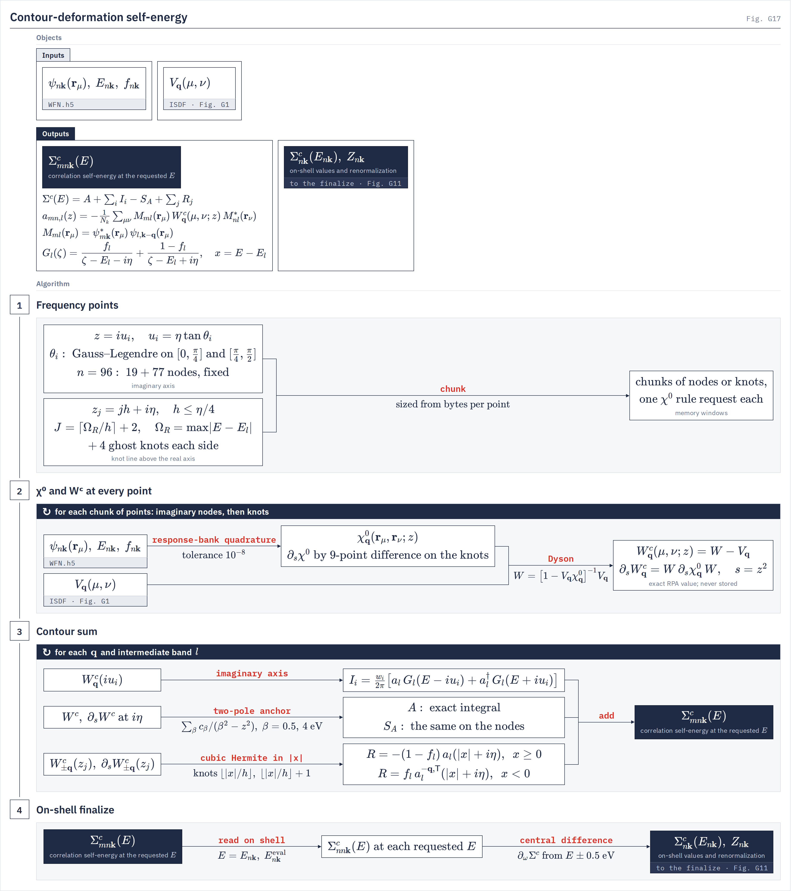

# Contour deformation

`gw.cd` The correlation self-energy integrated on the deformed contour: a quadrature on the imaginary axis plus the residues of the Green's-function poles, on the ISDF screened interaction $W(z)$ itself.
{: .page-summary }

<div class="section-cards"></div>

<figure class="flowchart" markdown>
[](../assets/figures/g17.png)
<figcaption><strong>Fig. G17.</strong> Stage 1 lays out the frequency points: a tan-mapped Gauss–Legendre rule on the imaginary axis and a uniform knot line $x_j+i\eta$ above the real axis, with four ghost knots at each end for the slope. Stage 2 evaluates $\chi^0$ at every point from the response bank's quadrature and solves Dyson for $W^c$ and, on the knots, $\partial_sW^c$. Stage 3 contracts $W^c$ with the pair densities into the imaginary-axis sum, the two-pole anchor and the real-axis residues, read by cubic Hermite interpolation in $\lvert x\rvert$. Stage 4 reads the cube at the on-shell energies and takes $Z$ from a central difference.</figcaption>
</figure>

## <span class="n">1</span> Overview {: #overview }

`sigma_frequency_integration = contour_deformation` evaluates $\Sigma^c(\omega)$ by deforming the frequency integral onto the imaginary axis and adding the residues it crosses. $W^c$ enters at each frequency point as the exact RPA value of the ISDF model, not as a pole model. Every other part of the dynamic-Σ path (η, the Fermi reference, occupations, the on-shell request and the finalize) is the one the pole-model treatments use.
{: .intro }

### <span class="n">1.1</span> Selecting the route {: #select }

`gw.gw_config._resolve_cd_inputs`
{: .in-code }

<span class="status in-progress">In progress</span> The route is used as a reference for the pole models and for comparisons with other codes. It needs four deck lines, because three of the defaults it cannot run with (`compute_mode = auto`, `head_correction = full`, `use_band_extrapolation = true`) are the parser's:

```ini
compute_mode                = mpa
sigma_frequency_integration = contour_deformation
head_correction             = off
use_band_extrapolation      = false
```

The first landing has four implementation limits, each a named refusal: no $\bq\to0$ head correction, `linalg = local` only, one η, and no band extrapolation. Without the head, Σ at Γ uses only the $\bq=0$ body of $V_\bq$ and $W_\bq$ ([The q → 0 head](q0-head.md)). The other `sigma_w_*` keys, the head-fit sampling keys and the pole-export keys refuse beside it, since this route builds no model of $W$.

!!! refuses
    - `sigma_frequency_integration` other than `pole_model` or `contour_deformation` (`GATE cd_enum`).
    - Any `cd_*` key without `contour_deformation` (`GATE cd_applicability`).
    - `compute_mode` other than `mpa`; `sigma_w_accuracy`, `sigma_w_support_sites_ev`, `write_w`, `write_poles` or any key of the [other W models](multipole-w.md#keywords) named; `screening_diagrams` other than `w_rpa` (`GATE cd_applicability`).
    - `head_correction` other than `off` (`GATE cd_head_unimplemented`); `linalg` other than `local` (`GATE cd_linalg_local`).
    - Band extrapolation on, including by default (`GATE cd_band_extrapolation_unimplemented`); a per-window η in `sigma_omega_patches_ev` (`GATE cd_single_eta`).
    - $h$ outside $(0,\eta/4]$ (`GATE cd_knot_step`); fewer than 5 imaginary nodes (`GATE cd_imaginary_nodes`).

### <span class="n">1.2</span> What is computed where {: #where }

`gw.cd.sigma.compute_sigma_c_cd_omega_grid`
{: .in-code }

The screening step does no work: it hands the Σ step $V_\bq$ and the CD keys, and writes no $W$ bank. The Σ step then runs the stages below, streaming $W$ in chunks of frequency points; $W(z)$ is never stored.

| Stage | Where | What |
|---|---|---|
| hand-off | `gw.screening.compute_screening_model` | `cd_stream` handle: $V_\bq$ on the $\bq$ wedge and the `cd_*` values |
| dispatch | `gw.sigma_dispatch._compute_mpa_sigma` | calls the CD body on the on-shell request's frequencies |
| geometry and sampling | `gw.cd.sigma`, `gw.cd.rule` | $\bk-\bq$ tables, file-wedge rows, imaginary rule, knot count (§[3](#imag), §[4](#real)) |
| χ⁰ rules | `gw.cd.chi0_rules` | one rule request per chunk of points (§[5](#chi0)) |
| exchange check | `gw.cd.sigma` kernel `sigma_x` | the CD pair densities must reproduce $\Sigma^x$ (§[6.1](#sigma-x)) |
| imaginary chunks | χ⁰ → Dyson → contraction | $\sum_iI_i$ of (2.3) |
| real chunks | χ⁰ with ghosts → FD-9 slope → Dyson pair → contraction | anchor and $\sum_jR_j$ of (2.3) |
| assembly | `gw.cd.sigma` | cube on the file wedge, unfolded to the full zone (§[6.3](#assemble)) |
| finalize | `gw.cd.sigma.cd_on_shell_body` | on-shell values and the finite-difference $Z$ (§[6.4](#on-shell)) |

## <span class="n">2</span> The contour {: #contour }

The self-energy is written as one analytic integral over the imaginary axis, a correction that removes its most sharply varying part, and a sum of real-axis residues. All energies are in Ry inside the code, and one η, `sigma_regularization_ev`, enters everywhere.
{: .intro }

### <span class="n">2.1</span> Matrix elements and the Green's function {: #contour-kernels }

`gw.cd.laws`
{: .in-code }

For the state pair $(m\bk,\,l\,\bk-\bq)$ the code works with the pair density on the ISDF points and the contraction of $W^c$ between two such densities,

$$
M_{ml}(\br_\mu)=\psi^*_{m\bk}(\br_\mu)\,\psi_{l,\bk-\bq}(\br_\mu),\qquad
a_{mn,l}(z)=-\frac{1}{N_k}\sum_{\mu\nu}M_{ml}(\br_\mu)\,W^c_\bq(\mu,\nu;z)\,M^*_{nl}(\br_\nu) \tag{2.1}
$$

with $x=E-E_{l,\bk-\bq}$ the distance of the evaluation energy from the intermediate state, $f_l$ its occupation, and the time-ordered propagator of state $l$ with the one broadening η,

$$
G_l(\zeta)=\frac{f_l}{\zeta-E_{l,\bk-\bq}-i\eta}+\frac{1-f_l}{\zeta-E_{l,\bk-\bq}+i\eta} \tag{2.2}
$$

$a^\dagger$ is the contraction of $W^c(z)^\dagger$ (conjugate and swap $m,n$). A second contraction $\tilde a$ of $W^c_{-\bq}(z)^{\mathsf T}$ serves the occupied residues (§[4.1](#real-which)), and $d=\partial_sa$, $s=z^2$, is the same contraction of $\partial_sW^c$.

### <span class="n">2.2</span> The decomposition {: #contour-terms }

`gw.cd.laws`
{: .in-code }

The code assembles $\Sigma^c_{mn,\bk}(E)$ from four sums over $\bq$ and $l$:

$$
\Sigma^c(E)=A(E)+\sum_iI_i(E)-S_A(E)+\sum_jR_j(E) \tag{2.3}
$$

$I_i$ is node $i$ of the imaginary-axis rule (§[3.1](#imag-rule)), $A$ the exact integral of a two-pole anchor fitted at $z=i\eta$ and $S_A$ the same anchor summed over the rule (§[3.2](#imag-anchor)), and $R_j$ the residues read from the knots $z_j=x_j+i\eta$ (§[4](#real)). The anchor terms cancel exactly in the limit of a converged rule; they move the steep part of the integrand near $u=0$ out of the quadrature.

(2.3) is the standard contour-deformation form, the imaginary-axis integral plus the residues of the Green's-function poles enclosed between the real and imaginary axes. The residue of state $l$ enters through its empty part when $x\ge0$ and its occupied part when $x<0$ (§[4.1](#real-which)), which is how $f_l$ and $1-f_l$ select the enclosed poles. *Inferred*: the code states the kernels, not the contour or the orientation of the deformation.

## <span class="n">3</span> The imaginary axis {: #imag }

One fixed Gauss–Legendre rule, mapped to $(0,\infty)$ by a tangent with scale η, carries the imaginary-axis integral. Its nodes do not adapt to the system: only η and the node count move them. A two-pole model fitted at $z=i\eta$ is integrated in closed form and subtracted from the node sum.
{: .intro }

### <span class="n">3.1</span> The tan-mapped Gauss–Legendre rule {: #imag-rule }

`gw.cd.rule.tan_mapped_gauss_rule`
{: .in-code }

With $n$ = `cd_imaginary_nodes`, the rule has two Gauss–Legendre panels in $\theta$, $\mathrm{round}(n/5)$ nodes on $[0,\pi/4]$ and the rest on $[\pi/4,\pi/2]$, and maps each node by

$$
u_i=\eta\tan\theta_i,\qquad w_i=w^{\mathrm{GL}}_i\,\frac{b-a}{2}\,\frac{\eta}{\cos^2\theta_i} \tag{3.1}
$$

where $[a,b]$ is the node's panel. The first panel therefore covers $u\in(0,\eta)$ and the second $(\eta,\infty)$. At the defaults ($n=96$, $\eta=0.25$ eV) the 19 + 77 nodes run from $7\times10^{-4}$ eV to $1.3\times10^{3}$ eV, with 67 nodes below 1 eV, 87 below 10 eV and 93 below 100 eV. Node $i$ contributes

$$
I_i(E)=\frac{w_i}{2\pi}\sum_{\bq l}\Big[a_l(iu_i)\,G_l(E-iu_i)+a_l(iu_i)^\dagger\,G_l(E+iu_i)\Big] \tag{3.2}
$$

so the two half-lines of $u$ share one $W^c$ evaluation through $W^c(\bar z)=W^c(z)^\dagger$ (*inferred*: the code carries $a$ and $a^\dagger$ by branch without stating the symmetry). The node count is padded to a whole number of chunks with copies of the last node at zero weight.

`cd_imaginary_nodes` = 96 → 192 moved $\Sigma^c$ by at most 0.019 meV on all 1664 Fe states (LORRAX `docs/input_reference.md`).

### <span class="n">3.2</span> The two-pole anchor {: #imag-anchor }

`gw.cd.laws.anchor_part`
{: .in-code }

At $u\to0$ the integrand of (3.2) varies on the scale η wherever $E$ sits near $E_{l,\bk-\bq}$. The code fits each contraction near the axis with two poles in $s=z^2$ at fixed energies,

$$
a_l(z)\simeq\sum_{\beta}\frac{c^{+}_{\beta}}{\beta^2-z^2},\qquad \beta\in\{0.5,\ 4.0\}\ \mathrm{eV} \tag{3.3}
$$

matching $a_l$ and $\partial_sa_l$ at $z=i\eta$, the first knot of the real line (§[4.2](#real-knots)); $c^-_\beta$ is the same fit of $a_l^\dagger$. The anchor term $A(E)$ is the integral of the model against the kernels of (3.2) over $u\in(0,\infty)$ in closed form; its odd part uses

$$
K(d,\beta)=\int_0^\infty\frac{u\,du}{(u^2+d^2)(u^2+\beta^2)}=\frac{\ln(\beta^2/d^2)}{2(\beta^2-d^2)} \tag{3.4}
$$

with the branch at $x=0$ fixed to $x\to0^+$. $S_A(E)$ is the same model summed over the nodes of §3.1, each node weighted by $1/(u_i^2+\beta^2)$, and is subtracted. The β values are module constants hashed into the recipe, not deck keys.

## <span class="n">4</span> Real-axis residues {: #real }

The residues need $W^c$ at every $\lvert E-E_{l,\bk-\bq}\rvert$ the requested energies reach. The code evaluates $W^c$ and its slope on a uniform knot line η above the real axis and interpolates each residue between the two knots that bracket it.
{: .intro }

### <span class="n">4.1</span> Which W, which energies {: #real-which }

`gw.cd.laws.hermite_coefficients`
{: .in-code }

The residue of state $l$ at energy $E$ reads $W^c$ at $z=\lvert x\rvert+i\eta$, with a weight set by the sign of $x$ and the occupation:

$$
R(E)=\sum_{\bq l}\begin{cases}-(1-f_l)\,a_l(\lvert x\rvert+i\eta), & x\ge0\\[2pt] \phantom{-(1-{}}f_l\,\tilde a_l(\lvert x\rvert+i\eta), & x<0\end{cases}\qquad x=E-E_{l,\bk-\bq} \tag{4.1}
$$

An empty part ($x\ge0$) reads the pair's own $W^c_\bq$; an occupied part ($x<0$) reads $\tilde a$, the contraction of $W^c_{-\bq}(\lvert x\rvert+i\eta)^{\mathsf T}$. Only $\mathrm{Re}\,z\ge0$ is ever evaluated: the transpose at $-\bq$ supplies the negative-frequency side, which is the particle–hole pairing $W_\bq(z)=W_{-\bq}(-z)^{\mathsf T}$ of [Tangential W (7.5)](tangential-w.md#pen-ordered) (*inferred*: the code states the rule, not the identity). $x=0$ belongs to the $x\ge0$ branch.

There are no θ-functions of $E_F$ in (4.1). The Fermi level enters through the occupations $f_l$, which are the fixed-$N$ occupation state on a metal and the step table on an insulator, floored at $10^{-14}$ ($f<10^{-14}\to0$, $1-f<10^{-14}\to1$), and through the evaluation energies, which the code receives relative to $E_F$ and shifts to absolute energies. A fractional $f_l$ contributes its empty share $1-f_l$ when $x\ge0$ and its occupied share $f_l$ when $x<0$.

### <span class="n">4.2</span> The knot line and its reach {: #real-knots }

`gw.cd.sigma.residue_reach_need`
{: .in-code }

The knots sit at $x_j=jh$, $j=0,\dots,J-1$, with $h$ = `cd_knot_step_ev` and

$$
J=\Big\lceil\frac{\Omega_R}{h}\Big\rceil+2,\qquad \Omega_R=\max\Big[\max_{l:\,f_l>0}\big(E_{l}-E_{\min}\big),\ \max_{l:\,f_l<1}\big(E_{\max}-E_{l}\big)\Big] \tag{4.2}
$$

$E$ runs over the requested frequencies and the own energies of the Σ window's rows (§[6.3](#assemble)), and $l$ over the bands of the Σ sum. $\Omega_R$ is the largest $\lvert x\rvert$ any live residue reads: occupied states from the lowest $E$, empty states from the highest. `cd_residue_reach_ev = auto` uses it; an explicit value below it refuses, so no residue is clipped. $h\le\eta/4$ is enforced because the Hermite law is certified there. Chunk 0 adds four ghost knots at $j=-4,\dots,-1$ and every chunk four more past its end for the slope (§4.3), and the knot count is padded to whole chunks with knots no residue reads.

At the defaults ($h=0.0625$ eV), a reach of 30 eV is 482 knots, each with a Dyson pair per irreducible $\bq$. `cd_own_energy_band_min` drops low window bands from the own-energy rows and so from $\Omega_R$; semicore rows otherwise set the reach (ZnO Zn 3s/3p: 123 eV, $J\approx1972$, per LORRAX `docs/input_reference.md`).

### <span class="n">4.3</span> Cubic Hermite in |x| and the slope {: #real-hermite }

`gw.cd.laws.real_knot`
{: .in-code }

A residue at $\lvert x\rvert$ reads only the knots $j=\lfloor\lvert x\rvert/h\rfloor$ and $j+1$, through the cubic Hermite interpolant of the value and its $x$-derivative:

$$
a(\lvert x\rvert)\simeq h_{00}(t)\,a_j+h_{01}(t)\,a_{j+1}+h\,h_{10}(t)\,a'_j+h\,h_{11}(t)\,a'_{j+1},\qquad t=\frac{\lvert x\rvert}{h}-j,\qquad a'_j=2z_j\,\partial_sa(z_j) \tag{4.3}
$$

with the standard Hermite basis $h_{00}=2t^3-3t^2+1$, $h_{10}=t^3-2t^2+t$, $h_{01}=-2t^3+3t^2$, $h_{11}=t^3-t^2$. The slope comes from $\partial_s\chi^0$, which is a 9-point central difference along the knot line,

$$
\partial_s\chi^0(z_j)=\frac{1}{2z_j}\,\frac{1}{h}\sum_{m=\pm1}^{\pm4}c_m\,\chi^0(z_{j+m}),\qquad c_{\pm1}=\pm\tfrac45,\ c_{\pm2}=\mp\tfrac15,\ c_{\pm3}=\pm\tfrac{4}{105},\ c_{\pm4}=\mp\tfrac{1}{280} \tag{4.4}
$$

and then $\partial_sW^c=W\,(\partial_s\chi^0)\,W$ from the Dyson pair (§[5.4](#chi0-dyson)). The four ghost knots on each side of a chunk roll from one chunk to the next, so $\chi^0$ is evaluated once per knot.

`cd_knot_step_ev` = 0.0625 → 0.03125 moved $\Sigma^c$ by at most 0.024 meV on the Fe semicore (LORRAX `docs/input_reference.md`).

### <span class="n">4.4</span> Banded residue rows {: #real-banded }

`gw.cd.sigma.residue_band_tables`
{: .in-code }

Because a residue reads two knots, a knot chunk needs only the $(\bk,l)$ rows some residue of that chunk reads. Before the stream, the host lists for each chunk and branch the live bands of every $(\bq,\bk)$ row, $E$ running over the requested frequencies and the own energies, with the two-knot stencil widened by one knot on each side so that a last-bit difference between host and device $\lvert x\rvert/h$ cannot drop a row. Table widths are padded to a multiple of 8 bands (`BAND_RUNG`) with dead bands, whose weights are exact zeros, so the result equals the dense contraction up to summation order. A chunk no residue reads is skipped. On Fe (64 $\bk$, 36 bands, 276 chunks) 35 % of the dense rows are contracted.

## <span class="n">5</span> χ⁰ and W at the CD points {: #chi0 }

$\chi^0$ at every imaginary node and every knot, ghosts included, comes from the tangential response bank's own time-domain quadrature ([Tangential W model §6.2](tangential-w.md#bank-times)), not from a sum over transitions with energy denominators. The rule is built per chunk of points, so each chunk's Green-pair sweep serves only its own points.
{: .intro }

### <span class="n">5.1</span> The point set and its windows {: #chi0-points }

`gw.cd.chi0_rules.cd_windows`
{: .in-code }

The CD points are $z=iu_i$ (imaginary chunks) and $z=x_j+i\eta$ (knot chunks: chunk 0 from $j=-4$ to its end plus four, every later chunk its four-ghost-shifted new knots), all with $\mathrm{Im}\,z>0$. Each chunk is one memory window and one rule request; a point repeated across windows (the padded imaginary nodes) belongs to the first. The chunk size is the `runtime.tiles` tile of the chunk's own bytes per point, $16n^2(2N_{q,\mathrm{irr}}+N_q)/P$ per node and $16n^2(5N_{q,\mathrm{irr}}+2N_q)/P$ per knot ($n$ the packed point count, $P$ the devices), or `cd_knot_chunk`; it is never a spectral grouping.

### <span class="n">5.2</span> The χ⁰ rules {: #chi0-rules }

`gw.cd.chi0_rules.build_rules`
{: .in-code }

Each node of a rule is one product of Green's functions on the ISDF points at a complex time $t_\ell$; the coefficients project every transition denominator onto those exponentials (the form of [Tangential W (6.2)](tangential-w.md#bank-times)). χ⁰ at a point is the value row of `response_bank.integrate_response_group` with `ordered=True`, the physical $\chi^0_\bq$. Which rule a window gets depends on where its points lie relative to the lowest transition $\Delta_{\min}$ of the response support:

| Window | Rule | Fallback |
|---|---|---|
| imaginary chunk on an insulator ($\lvert\mathrm{Re}\,z\rvert<\Delta_{\min}$ for every point) | ordered Laplace rule `minimax.response_laplace_rule` on $[\Delta_{\min},\Delta_{\max}]$, reference $\Delta_{\min}$: positive real times | a refused point takes the bank tree if its pencil has at most 20 000 samples, else the even-only rule if time reversal is authenticated, else refusal |
| knot chunk, or any chunk on a metal | `response_bank.response_quadrature` with the window as its request: `minimax.ResponseGroupTree`, node capacity `cd_chi0_rule_capacity` (default 1088; the bank's own is 192) | a window that does not fit is halved |

Both are accepted against the relative tolerance `cd_chi0_rule_tolerance` (default $10^{-8}$) divided by the occupation amplitude, on sampled errors as in the bank. The knot windows also pass a coefficient-mass gate,

$$
\mathrm{Im}\,p\sum_\ell\lvert c_\ell(p)\rvert\le\kappa_{\max},\qquad \kappa_{\max}=\max\!\big(5000,\ 10^{-2}\,\epsilon_{\mathrm{CD}}/\epsilon_{64}\big) \tag{5.1}
$$

so that rounding costs at most 1 % of the tolerance. The bank's own defaults are untouched.

!!! note
    On a metal, and on every knot window, the rules come from the bank's pencil, whose size grows like $(\Delta_{\max}-\Delta_{\min})/\eta$. On the ZnO 2503-band deck a knot window's pencil is 16 619 samples, about 44 GB of host memory, which is why the rules can be built ahead on a CPU node (§[5.5](#chi0-precompute)).

### <span class="n">5.3</span> Band windows {: #chi0-bands }

`gw.cd.chi0_rules.band_windows`
{: .in-code }

On a wide insulator the whole-interval knot rules can fail the sampled-error test, because a transition pole sits inside a $[\Delta_{\min},\Delta_{\max}]$ that is thousands of η wide. `cd_chi0_band_windows = auto` splits each knot window's pair space by band ranges. With $R=\max\lvert\mathrm{Re}\,z\rvert$ of the window and $m$ = `cd_chi0_remote_margin_ev`, $c$ is the first empty band whose lowest energy exceeds $E_{\mathrm{VBM}}+R+m$, and $s$ the number of leading occupied bands whose top lies below $E_{\mathrm{CBM}}-(R+m)$:

| Band window | Occupied × empty bands | Rule |
|---|---|---|
| crossing | $[s,N_{\mathrm{occ}})\times[N_{\mathrm{occ}},c)$ | closed-form imaginary-time rule `minimax.response_imaginary_rule` on its own interval, halved where it fails |
| remote valence | $[s,N_{\mathrm{occ}})\times[c,N_b)$ | Laplace rule on its own interval (even-only where refused on a time-reversal deck) |
| remote semicore | $[0,s)\times[N_{\mathrm{occ}},N_b)$ | as remote valence |

Every (occupied, empty) pair lies in exactly one window, so the windows' band weights partition $f(1-f)$ and their χ⁰ rows add to the whole window's. Every remote transition lies above $R+m$. A window whose points all have $\lvert\mathrm{Re}\,z\rvert<\Delta_{\min}$ (the imaginary chunks) keeps the whole-interval Laplace rule. Metals refuse `auto`.

### <span class="n">5.4</span> The Dyson pair {: #chi0-dyson }

`gw.cd.sigma.build_dyson_kernels`
{: .in-code }

With $H$ the Hermitian square root of $V_\bq$ and the code's prefactor $p=2/(\sqrt{N_q}\,n_{\mathrm{spin}}\,n_{\mathrm{spinor}})$, one batched LU per $(\bq,z)$ gives

$$
X=p\,H\chi^0H,\qquad W^c=H\,X(1-X)^{-1}H,\qquad W=W^c+HH,\qquad \partial_sW^c=W\,\big(p\,\partial_s\chi^0\big)\,W \tag{5.2}
$$

the response bank's own pair equations. Imaginary nodes need only $W^c$; knots need the pair. A negative eigenvalue of $V_\bq$ refuses. The Dyson step runs at the irreducible $\bq$; $W$ at the star members comes from `symmetry_maps.QirrOperator.unfold` with the general-operator `pair_transpose` rule, one $z$ at a time.

### <span class="n">5.5</span> Precomputing the rules {: #chi0-precompute }

`python -m gw.cd.chi0_rules`
{: .in-code }

A run with no `cd_chi0_rules_file` builds the rules in the job and writes `cd_chi0_rules.pkl` beside the deck. The run log prints the geometry arguments of the CLI on its `chi0 rule geometry` line, so the same rules can be built on a CPU node and given back with `cd_chi0_rules_file`:

```bash
python -m gw.cd.chi0_rules --wfn WFN.h5 --nocc N --nb-chi NB --b4-logical NB \
    --knots J --ndev P --nq-irr NQ --nk NK --n-packed N_MU --knot-chunk C \
    --imaginary-nodes 96 --eta-ev 0.25 --knot-step-ev 0.0625 --tolerance 1e-8 \
    --out cd_chi0_rules.pkl
```

`--windows imag:0,real:3,real:-1` builds a partial file and `--merge` joins partial builds. A loaded file is checked against this run's energies and occupations (as $\bk$-star-invariant hashes), tolerance, capacity, points, windows and band windows, and any mismatch refuses.

## <span class="n">6</span> Assembly, layout and finalize {: #assembly }

The contraction of $W$ with the pair densities runs on the file wedge of $\bk$, in parallel over $\bq$, into accumulators that every device holds whole. The cube is unfolded to the full zone and read at the on-shell energies.
{: .intro }

### <span class="n">6.1</span> The exchange check {: #sigma-x }

`gw.cd.sigma.sigma_x_identity_check`
{: .in-code }

Before any frequency work the CD kernels contract $V_\bq$ with occupied pair densities and compare the diagonal with the static route's $\Sigma^x$. A difference above $10^{-3}$ meV refuses (`GATE cd_sigma_x_identity`): it catches a wrong pair orientation, occupation table or $\bq$ weight. Measured: $3.3\times10^{-10}$ meV on Fe, $2.1\times10^{-11}$ meV on Si. The $\Sigma^x$ the run reports is the static route's.

### <span class="n">6.2</span> Streaming and parallel layout {: #layout }

`gw.cd.sigma.stream_cd_chunks`
{: .in-code }

Imaginary chunks run first, then knot chunks. Within a chunk the layout changes three times:

| Step | Layout |
|---|---|
| χ⁰ at the chunk's points | $[z,\bq_{\mathrm{irr}},\mu,\nu]$ on the face, $\mu$ on $x$, $\nu$ on $y$ |
| Dyson | $(\bq,z)$ flattened, whole $n\times n$ matrices per device, padded with zero rows to a multiple of $P$; local batched LU |
| unfold | per $z$ to the full zone, then face → $\bq$-parallel: $\bq$ padded on the face, then $x$ and $y$ moved onto $\bq$ in two all-to-alls |
| contraction | `shard_map` over $\bq$; per device its own $\bq$, a scan over band tiles of $l$ and over the chunk's $z$; increments reduced in rank order |

The wavefunctions enter as per-device pair slabs, $q$-sharded like $W$ and built once from the band carrier one band block at a time, so no device holds all of ψ. The real axis needs no $W_{-\bq}$ gather: the device holding $W_{\bq'}$ adds the $x\ge0$ residues of pair $\bq'$ and the $x<0$ residues of pair $-\bq'$. The staged face → $\bq$-parallel reshard avoids a fused pad-and-reshard that XLA replicated whole (82 GB per device on ZnO, $N_q=48$, $P=64$). The memory plan per phase, `cd_memory_plan`, is printed in the log and the receipt. The pole routes instead form products in $\bR$ space at time nodes ([Parallel algorithms](parallel-algorithms.md)); this route is a $\bq$-parallel contraction in the band basis.

### <span class="n">6.3</span> Assembly and symmetry {: #assemble }

`symmetry_maps.unfold_file_wedge_band_operator`
{: .in-code }

The accumulators hold $\Sigma^c_{mn}(E)$ for every requested frequency $E$, every file-wedge $\bk$ and every $(m,n)$ of the Σ window: $A$ and $-S_A$, $\sum_iI_i$ and $\sum_jR_j$ separately. Their sum is padded to the Σ band carrier and unfolded to the full zone with the `transpose` rule. Beside the full matrix the code accumulates the own-energy diagonal $\Sigma^c_{mm}(E_{m\bk})$ for the rows at or above `cd_own_energy_band_min`; it is written to `cd_sigma_own_energy.npz` with its three parts and is not read by the finalize (*inferred* from the writers). `LORRAX_CD_STAR_CERTIFICATE = N` computes $N$ non-identity star members directly and compares them with the unfolded cube.

### <span class="n">6.4</span> On-shell finalize {: #on-shell }

`gw.cd.sigma.cd_on_shell_body`
{: .in-code }

By default the body is evaluated on the on-shell request's frequencies, the sorted distinct union of its energy tables ($E_{n\bk}$ and the evaluation energies, measured from $E_F$), so every table entry is a sample of the cube. The finalize reads the pair and value slots at their entries without interpolation, refusing a lookup more than $10^{-9}$ Ry off. CD has no derivative accumulator, so the slope slot that feeds $Z$ is a central difference of the diagonal,

$$
\partial_\omega\Sigma^c_{nn}(E)\simeq\frac{\Sigma^c_{nn}(E+\delta)-\Sigma^c_{nn}(E-\delta)}{2\delta},\qquad \delta=0.5\ \mathrm{eV} \tag{6.1}
$$

with the probes interpolated linearly between the request's frequencies and clamped to their range; the log counts the clamped states. This is BerkeleyGW's `finite_difference_spacing` rule, where the pole routes use the exact derivative of their quadrature. Under `sigma_omega_grid_debug` the body is evaluated on the deck's ω grid instead. The result then passes through the one finalize every treatment shares ([GW theory](../drivers/gw/theory.md)).

## <span class="n">7</span> Broadening and regularization {: #broadening }

One η, `sigma_regularization_ev` (default 0.25 eV), plays every role. It is the $\pm i\eta$ of the propagator (2.2) in both the node and the anchor terms, the height of the knot line, so each residue reads $W^c(\lvert x\rvert+i\eta)$ and not $W^c$ on the real axis, the anchor point $z=i\eta$, and the scale of the imaginary rule (3.1). It also bounds the knot step, $h\le\eta/4$. A second η, per window in `sigma_omega_patches_ev`, refuses, because it would need a second knot line.

$\chi^0$ itself carries no broadening: it is evaluated at the complex points $z$, whose imaginary part is $u_i$ or η. Two further regularizations are fixed in the code: the occupation floor of $10^{-14}$ (§[4.1](#real-which)) and the anchor of §[3.2](#imag-anchor). Neither the minimax Σ certificate `sigma_quadrature_eps` nor `sigma_window_edge_factor` is read on this route (*inferred*: the CD consumer receives them in its options and does not use them).

## <span class="n">8</span> Checkpoint and resume {: #checkpoint }

`gw.cd.sigma.CdCheckpoint`
{: .in-code }

`cd_checkpoint = write` rewrites `tmp/cd_checkpoint.h5` after every completed chunk: the six replicated accumulators, the axis, the chunk index and the stage seconds. Rank 0 writes its own replica with serial h5py and publishes it by `os.replace`, so a kill mid-write leaves the previous chunk's file. `resume` continues after the last completed chunk of an authenticated checkpoint and then writes as `write`; a resume is never inferred from a file's presence, and an absent or foreign file is named and the run starts at chunk 0.

The identity holds the deck (comments, `cd_checkpoint` and `restart` dropped), the χ⁰ rule tolerance, capacity, node count and windows, the geometry, the ω grid hash, η, $h$, $J$, the node count and the chunk tiling, and a digest of the code that computes the accumulators. It does not hold the repository commit, which rides along as provenance, so a commit that changes only the assembly, the finalize or the output stage still resumes. On the real axis a resume re-runs only the χ⁰ calls that rebuild the ghost tail and reproduces the uninterrupted accumulators bit for bit on CPU.

`LORRAX_CD_STOP_AFTER = "imag:N,real:M,real_from:K"` turns a run into a timing probe: it stops after the stated chunks, writes `cd_stop_receipt.json` and finalizes no Σ.

## <span class="n">9</span> Comparison with other routes {: #compare }

The table below sets the CD route beside LORRAX's production treatment and beside BerkeleyGW's contour deformation. Yambo's and GreenX's implementations were not checked for this page.
{: .intro }

### <span class="n">9.1</span> Against the tangential W {: #compare-tangential }

| | Contour deformation (`gw.cd`) | Tangential W model ([page](tangential-w.md)) |
|---|---|---|
| $W^c$ | exact ISDF RPA value at each point | $K_\bq$ shared real poles, Ritz values of a Loewner pencil |
| Dyson solves | one per imaginary node and per knot (with ghosts), per irreducible $\bq$; hundreds | 18 to 40 supports |
| χ⁰ | response-bank rules per chunk window, tolerance $10^{-8}$, capacity 1088 | one bank rule over all supports, capacity 192 |
| Σ | band-space contraction, $\bq$-parallel, file wedge | time-node products in $\bR$, folded to frequency |
| $Z$ | ±0.5 eV central difference | exact derivative of the quadrature |
| head, band extrapolation | off (refused) | on |
| use | reference and comparisons | production |

On Si the tangential budget gives 0.80 meV QP RMS against a contour-deformation reference ([Tangential W model §7.9](tangential-w.md#ritz-count)).

### <span class="n">9.2</span> Against BerkeleyGW {: #compare-bgw }

BerkeleyGW's contour deformation is `frequency_dependence 2` with `frequency_dependence_method 2` in `epsilon.inp`, and `cd_integration_method` in `sigma.inp`. The decomposition is the same; the frequency sampling and the interpolation differ.

| | LORRAX `gw.cd` | BerkeleyGW CD |
|---|---|---|
| imaginary nodes | Gauss–Legendre under $u=\eta\tan\theta$, 96 by default, plus the analytic two-pole anchor | `number_imaginary_freqs` (default 15) at $\omega_i=\omega_p\,z_i/(1-z_i)$, $z_i=(i-1)/N$, $\omega_p$ = `plasma_freq` (default 2 Ry) |
| imaginary-axis integral | the rule's weights | `cd_integration_method`: piecewise constant (0, default), quadratic (2) or cubic Hermite (3) |
| real axis | knots $jh+i\eta$, $h\le\eta/4$ (0.0625 eV), up to the reach every residue needs | $\varepsilon^{-1}(\omega+i\eta)$ on a uniform grid of `delta_frequency` up to `frequency_low_cutoff` (default 10 eV), η = `broadening` (default 0.25 eV) |
| residue interpolation | cubic Hermite with the slope from $\partial_s\chi^0$ through Dyson | linear between grid points |
| residue past the grid | refused (`GATE cd_residue_coverage`) | warns, reads the last interval |
| residue weights | $-(1-f)$ for $x\ge0$, $f$ for $x<0$ | the same: the sign of $x$ and the occupation, with fractional weights under smearing |
| negative frequencies | $W_{-\bq}(z)^{\mathsf T}$ | the same $\varepsilon^{-1}(\lvert x\rvert)$ |
| χ⁰ | complex-time quadrature of the response bank | Adler–Wiser sum over transitions at each frequency |
| basis | $N_\mu$ ISDF points | plane waves below `epsilon_cutoff` |

## <span class="n">10</span> Keys, constants and outputs {: #keys }

The keys below change what this page computes; full entries are on the [GW input keywords](../drivers/gw/keywords.md#cd) page. Defaults are read from the keyword schema (`src/gw/gw_config.py`).
{: .intro }

### <span class="n">10.1</span> Keys {: #keys-list }

| Key | Default | Role here |
|---|---|---|
| [`sigma_frequency_integration`](../drivers/gw/keywords.md#sigma_frequency_integration) | `pole_model` | `contour_deformation` selects this route. |
| [`cd_imaginary_nodes`](../drivers/gw/keywords.md#cd_imaginary_nodes) | `96` | $n$ in (3.1); at least 5. |
| [`cd_knot_step_ev`](../drivers/gw/keywords.md#cd_knot_step_ev) | `0.0625` | $h$ in (4.2), $0<h\le\eta/4$. |
| [`cd_residue_reach_ev`](../drivers/gw/keywords.md#cd_residue_reach_ev) | `auto` | $\Omega_R$ in (4.2); an explicit value must cover it. |
| [`cd_knot_chunk`](../drivers/gw/keywords.md#cd_knot_chunk) | `0` | Points per chunk; 0 = the tile planner. |
| [`cd_band_tile`](../drivers/gw/keywords.md#cd_band_tile) | `0` | Bands of the $l$ sum per tile; 0 = the planner. Changes only the summation order. |
| [`cd_chi0_rule_tolerance`](../drivers/gw/keywords.md#cd_chi0_rule_tolerance) | `1e-8` | $\epsilon_{\mathrm{CD}}$ in (5.1). |
| [`cd_chi0_rule_capacity`](../drivers/gw/keywords.md#cd_chi0_rule_capacity) | `1088` | Node capacity of a knot window's rule. |
| [`cd_chi0_rules_file`](../drivers/gw/keywords.md#cd_chi0_rules_file) | empty | Precomputed rules (§[5.5](#chi0-precompute)). |
| [`cd_chi0_band_windows`](../drivers/gw/keywords.md#cd_chi0_band_windows) | `off` | `auto`: band windows (§[5.3](#chi0-bands)). |
| [`cd_chi0_remote_margin_ev`](../drivers/gw/keywords.md#cd_chi0_remote_margin_ev) | `4.0` | $m$ of §5.3. |
| [`cd_own_energy_band_min`](../drivers/gw/keywords.md#cd_own_energy_band_min) | `1` | First band of the own-energy rows and of the reach. |
| [`cd_checkpoint`](../drivers/gw/keywords.md#cd_checkpoint) | `off` | `write` or `resume` (§[8](#checkpoint)). |
| [`sigma_regularization_ev`](../drivers/gw/keywords.md#sigma_regularization_ev) | `0.25` | η everywhere (§[7](#broadening)). |
| [`compute_mode`](../drivers/gw/keywords.md#compute_mode), [`head_correction`](../drivers/gw/keywords.md#head_correction), [`use_band_extrapolation`](../drivers/gw/keywords.md#use_band_extrapolation) | `auto`, `full`, `true` | Must be `mpa`, `off`, `false`. |

### <span class="n">10.2</span> Constants {: #keys-constants }

No deck key reaches these; they are hashed into the checkpoint identity through the code digest.

| Constant | Value | Role |
|---|---|---|
| `BETA_EV` | 0.5, 4.0 eV | anchor poles (3.3) |
| `GH`, `FD9` | 4, the 9-point central stencil | ghosts and slope (4.4) |
| `HERMITE_STENCIL` | (0, 1) | knots a residue reads |
| `OCCUPATION_FLOOR` | $10^{-14}$ | occupation floor |
| `BAND_RUNG` | 8 | width rung of the banded tables |
| `SIGMA_X_IDENTITY_TOL_MEV` | $10^{-3}$ meV | exchange check |
| `CD_ON_SHELL_LOOKUP_RY` | $10^{-9}$ Ry | on-shell lookup |
| `CD_KAPPA_ROUNDING_SHARE`, `CD_FALLBACK_PENCIL_SIZE` | $10^{-2}$, 20 000 | mass gate (5.1), Laplace fallback |
| `Z_FINITE_DIFFERENCE_EV` | 0.5 eV | δ in (6.1) |

### <span class="n">10.3</span> Run-time refusals {: #keys-refusals }

!!! refuses
    - A live residue past the knot line (`GATE cd_residue_coverage`). Leave `cd_residue_reach_ev = auto` or raise it.
    - A point no χ⁰ rule certifies (`GATE cd_chi0_rule_unfit`, `GATE cd_chi0_rule`). Raise `cd_chi0_rule_capacity`, try `cd_chi0_band_windows = auto` or a larger margin.
    - A rules file built for another run (`GATE cd_chi0_rules_identity`) or a partial one (`GATE cd_chi0_rules_file`).
    - `cd_chi0_band_windows = auto` on a metal (`GATE cd_chi0_band_windows`).
    - Exchange check above $10^{-3}$ meV (`GATE cd_sigma_x_identity`); a negative eigenvalue of $V_\bq$ (`GATE cd_coulomb_psd`); a non-finite $\Sigma^c$ (`GATE cd_finite`).
    - `cd_own_energy_band_min` above the Σ window (`GATE cd_own_energy_band_min`); a mistyped `LORRAX_CD_STOP_AFTER` (`GATE cd_stop_after`).

### <span class="n">10.4</span> Outputs {: #keys-out }

Beside the deck, written by rank 0:

<div class="file-list" markdown>

`cd_sigma_receipt.json`
:   Recipe, η, $h$, $J$, reach, node counts, chunks and bytes per point, per-stage seconds, the exchange check, the symmetry certificate, the banded-table widths, the χ⁰ rule census, the memory plan and the checkpoint record.

`cd_sigma_own_energy.npz`
:   $\Sigma^c_{mm}(E_{m\bk})$ on the own-energy rows and its anchor, imaginary and real parts; $\Sigma^x$ of the CD kernels; the imaginary nodes and weights and the knots.

`cd_leak_ledger.csv`
:   Per chunk: seconds, device bytes in use, pool high-water and live arrays.

`cd_partial_imag.npz`, `cd_partial_anchor.npz`
:   The own-energy parts after the imaginary axis and after the anchor.

`cd_chi0_rules.pkl` (`.sha256`, `.census.csv`)
:   The χ⁰ rules built in the job, with one census row per rule group.

`tmp/cd_checkpoint.h5`
:   With `cd_checkpoint = write | resume` (§[8](#checkpoint)).

</div>

The standard Σ outputs follow from the shared finalize ([GW files](../drivers/gw/files.md)).

## Notation {: #notation }

| Symbol | Meaning |
|---|---|
| $M_{ml}(\br_\mu)$ | pair density $\psi^*_{m\bk}\psi_{l,\bk-\bq}$ on the ISDF points |
| $a_l$, $\tilde a_l$, $a^\dagger_l$ | contractions of $W^c_\bq$, $W^c_{-\bq}{}^{\mathsf T}$, $W^{c\dagger}_\bq$ between pair densities (2.1) |
| $x$ | $E-E_{l,\bk-\bq}$ |
| $f_l$ | occupation of the intermediate state |
| $G_l(\zeta)$ | time-ordered propagator of state $l$ with broadening η (2.2) |
| $u_i$, $w_i$, $n$ | imaginary nodes, weights, count |
| $\beta$, $c^\pm_\beta$ | anchor poles and coefficients |
| $x_j$, $h$, $J$, $\Omega_R$ | knots, step, count, reach |
| $s=z^2$ | squared frequency; $\partial_s$ |
| $H$, $p$ | square root of $V_\bq$; Dyson prefactor |
| $\Delta_{\min}$, $\Delta_{\max}$ | lowest and highest transition of the response support |
| $\epsilon_{\mathrm{CD}}$, $\kappa_{\max}$ | χ⁰ rule tolerance; coefficient-mass bound |
| $\eta$ | `sigma_regularization_ev` |
| $\delta$ | finite-difference spacing of $Z$ |

## References {: #refs }

1. L. Hedin, Phys. Rev. 139, A796 (1965).
2. R. W. Godby, M. Schlüter and L. J. Sham, Phys. Rev. B 37, 10159 (1988).
3. J. Deslippe, G. Samsonidze, D. A. Strubbe, M. Jain, M. L. Cohen and S. G. Louie, Comput. Phys. Commun. 183, 1269 (2012).

