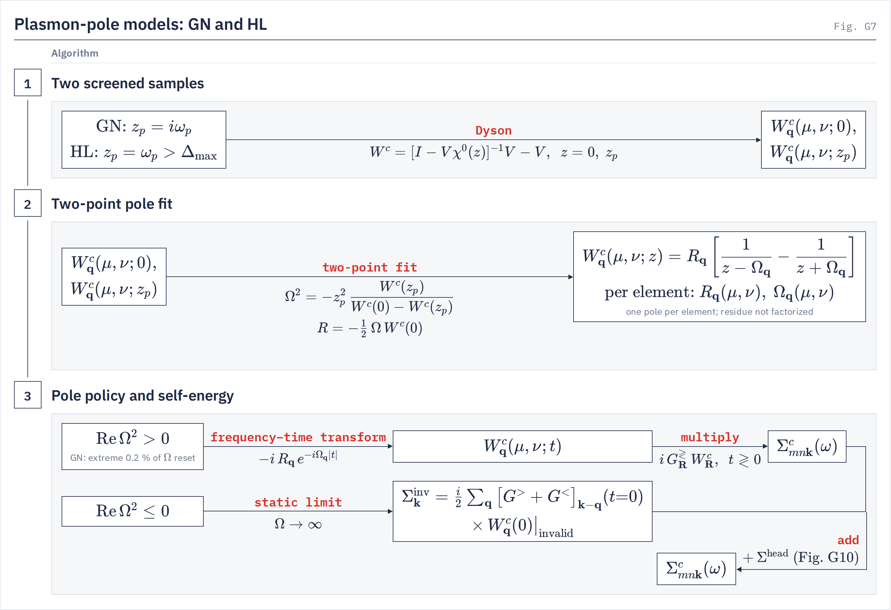

# Frequency treatments of Σ

`compute_mode` How each treatment models $W^c(\omega)$ and integrates $\Sigma^c$ over frequency.
{: .page-summary }

<div class="section-cards"></div>

## <span class="n">1</span> The common frame {: #frame }

Every treatment shares $\Sigma^x$, the $\bq\to0$ head and the quasiparticle step. A treatment fixes three things only: where $W$ is sampled, the model of $W^c(\omega)$ built from those samples, and how $\Sigma^c$ is evaluated from the model.
{: .intro }

### <span class="n">1.1</span> Σᶜ as a product in time {: #frame-time }

In real time, with time-ordered Green's functions, the correlation self-energy is a product of the Green's function and the correlation part of the screened interaction, convolved over the $\bk$ grid:

$$
\Sigma^c_{\bk}(\br_\mu,\br_\nu;t)=\frac{i}{N_k}\sum_{\bq}G^{\gtrless}_{\bk-\bq}(\br_\mu,\br_\nu;t)\,W^c_{\bq}(\mu,\nu;t),\qquad t\gtrless0 \tag{1.1}
$$

$G^{>}_{\bk}=-i\sum_n(1-f_{n\bk})\,\psi_{n\bk}\psi^*_{n\bk}\,e^{-iE_{n\bk}t}$ and $G^{<}_{\bk}=+i\sum_nf_{n\bk}\,\psi_{n\bk}\psi^*_{n\bk}\,e^{-iE_{n\bk}t}$, evaluated at the ISDF points $\br_\mu$. $W^c=W-V$ is carried in the $\zeta$ basis.

### <span class="n">1.2</span> Σᶜ of a pole model {: #frame-poles }

Every dynamic treatment writes $W^c$ as a sum of resonant and antiresonant poles, $W^c_\bq(\mu,\nu;z)=\sum_jR_{j\bq}(\mu,\nu)\big[(z-\Omega_{j\bq})^{-1}-(z+\Omega_{j\bq})^{-1}\big]$. For poles $\Omega_{j\bq}$ and residues $R_{j\bq}(\mu,\nu)$, the frequency integral of (1.1) is closed:

$$
\Sigma^c_{\bk}(\br_\mu,\br_\nu;\omega)=\frac{1}{N_k}\sum_{\bq,n,j}\psi_{n\bk-\bq}(\br_\mu)\psi^*_{n\bk-\bq}(\br_\nu)\,R_{j\bq}(\mu,\nu)\left[\frac{1-f_{n\bk-\bq}}{\omega-E_{n\bk-\bq}-\Omega_{j\bq}+i\eta}+\frac{f_{n\bk-\bq}}{\omega-E_{n\bk-\bq}+\Omega_{j\bq}-i\eta}\right] \tag{1.2}
$$

The treatments differ in the poles: one per matrix element (plasmon-pole models), or one real set shared by all elements, $R_j(\mu,\nu)=b_j(\mu)b^*_j(\nu)$ (tangential, [normalisation of $b$](tangential-w.md#model-form)). $\eta$ is `sigma_regularization_ev` (default 0.25 eV), applied once, by Σ. LORRAX never sums (1.2) directly; §6 gives the time-node quadrature it runs.

### <span class="n">1.3</span> Selecting a treatment {: #frame-select }

`gw_config.ComputeMode`
{: .in-code }

`compute_mode` names the treatment. It gives five routes:

| Input file | Treatment |
|---|---|
| `compute_mode = x_only` | exchange only |
| `compute_mode = cohsex` | static COHSEX |
| `compute_mode = gn_ppm` | Godby–Needs plasmon pole |
| `compute_mode = hl_ppm` | Hybertsen–Louie plasmon pole |
| `compute_mode = tangential` | tangential model (production) |

`compute_mode` defaults to `auto`, which reads the legacy keys: `use_ppm_sigma = true` gives `gn_ppm` (or `hl_ppm` when `ppm_model = hl`), otherwise `do_screened` gives `cohsex` or `x_only`. `auto` never selects `tangential`, so the production route names it in the input file. The key-by-key entry is on the GW keyword page: [`compute_mode`](../drivers/gw/keywords.md#compute_mode). Other W models are on [this page](multipole-w.md).

!!! note
    The material class is read from the WFN occupations. On a metal `cohsex`, `gn_ppm` and `hl_ppm` refuse; `compute_mode = tangential` is the production metal model. See [Metals §5](metals.md#refusals).

## <span class="n">2</span> Comparison {: #compare }

The table sets the treatments side by side; the tabs give each model, its samples and its input file lines. Sections 3–5 derive the models.
{: .intro }

### <span class="n">2.1</span> The treatments side by side {: #compare-table }

A "W solve" is one $\chi^0$ evaluation plus one Dyson solve $W=[1-V\chi^0(z)]^{-1}V$ at one frequency $z$, for every irreducible $\bq$:

| Treatment | $W$ sampled at | Model for $W^c(\omega)$ | W solves | Σᶜ from | Metals | Status |
|---|---|---|---|---|---|---|
| Exchange only | — | $W^c=0$ | 0 | — | runs | <span class="status supported">Supported</span> |
| COHSEX | $z=0$ | static | 1 | closed form at $t=0$ | refuses | <span class="status supported">Supported</span> |
| GN-PPM | $0$, $i\omega_p$ | one real pole per element | 2 | time nodes, one pole batch | refuses | <span class="status supported">Supported</span> |
| HL-GPP | $0$, real $\omega_p>\Delta_{\max}$ | one real pole per element | 2 | time nodes, one pole batch | refuses | <span class="status in-progress">In progress</span> |
| Tangential | 18–40 supports, plus $M_1$, $M_3$ | $K_\bq$ real poles shared by all elements | 18–40 | time nodes, all poles at once | runs | <span class="status production">Production</span> |
| CD | imaginary-axis rule, plus knots $x_j+i\eta$ | none: exact $W^c(z)$ at each point | $n$ + $J$ (hundreds) | imaginary-axis sum plus residues | runs | <span class="status in-progress">In progress</span> |
| AC | imaginary axis | Padé of $\Sigma^c(i\omega)$ | grid | — | — | <span class="status not-in-lorrax">Not in LORRAX</span> |

=== "Exchange only"
    **Exchange only** <span class="status supported">Supported</span>

    Bare exchange. No screening is computed and $\Sigma^c=0$.

    The QP Hamiltonian holds $\Sigma^x$ alone, so the result is Hartree–Fock on the mean-field orbitals. It runs on metals.

    $$
    \Sigma^x_{\bk}(\br_\mu,\br_\nu)=\frac{i}{N_k}\sum_{\bq}G^{<}_{\bk-\bq}(\br_\mu,\br_\nu;t{=}0)\,V_{\bq}(\mu,\nu) \tag{2.1}
    $$

    W evaluated at
    :   nowhere

    Model
    :   $W^c=0$

    Frequency
    :   none

    ```ini
    compute_mode = x_only
    ```

=== "COHSEX"
    **Static COHSEX** <span class="status supported">Supported</span>

    The static limit of (1.2): screened exchange plus a Coulomb hole, both from $W(0)$.

    One static W solve. Σ is a closed form at $t=0$, two $\bk$-convolutions per call, with no frequency axis (§3.2).

    $$
    \Sigma^{\mathrm{COHSEX}}=i\,G^{<}(t{=}0)\,W(0)+\tfrac{i}{2}\big[G^{>}-G^{<}\big](t{=}0)\,W^c(0) \tag{2.1}
    $$

    W evaluated at
    :   $z=0$

    Model
    :   static

    Frequency
    :   static

    ```ini
    compute_mode = cohsex
    ```

=== "GN-PPM"
    **Godby–Needs plasmon pole** <span class="status supported">Supported</span>

    One real pole per matrix element $(\bq,\mu,\nu)$, fixed by $W^c$ at zero and at one imaginary frequency.

    Two W solves. The poles go to the common Σ quadrature as one in-memory pole batch. On a time-reversal-broken input file the fit carries a second, odd residue (§4.4).

    $$
    W^c_{\bq}(\mu,\nu;z)=R_{\bq}(\mu,\nu)\left[\frac{1}{z-\Omega_{\bq}(\mu,\nu)}-\frac{1}{z+\Omega_{\bq}(\mu,\nu)}\right],\qquad z_p=i\omega_p \tag{2.1}
    $$

    W evaluated at
    :   $W(0)$, $W(i\omega_p)$, $\omega_p=$ `ppm_omega_p` (2 Ry)

    Model
    :   one pole per element

    Frequency
    :   plasmon pole

    ```ini
    compute_mode = gn_ppm
    ppm_omega_p  = 2.0
    ```

=== "HL-GPP"
    **Hybertsen–Louie plasmon pole** <span class="status in-progress">In progress</span>

    The same two-point fit with the probe on the real axis above every transition, so $\omega_p^2W^c(\omega_p)$ reads the first-moment ($f$-sum) coefficient from the band-summed response.

    Two W solves, the probe on the full zone. Missing: a default probe. `ppm_omega_p` defaults to the GN value 2 Ry, which lies inside the spectrum of most input files and refuses; set it above the largest $\chi^0$ transition.

    $$
    \Omega^2=-\omega_p^2\,\frac{W^c(\omega_p)}{W^c(0)-W^c(\omega_p)},\qquad \omega_p>\Delta_{\max} \tag{2.1}
    $$

    W evaluated at
    :   $W(0)$, $W(\omega_p)$ (real)

    Model
    :   one pole per element

    Frequency
    :   plasmon pole

    ```ini
    compute_mode = hl_ppm
    ppm_omega_p  = 200.0
    ```

=== "Tangential"
    **Tangential model** <span class="status production">Production</span>

    One set of real poles per irreducible $\bq$, shared by every matrix element, with one factor vector per pole. The poles are the Ritz values of a Hermitian pencil built from samples of $W^c$ and its exact high-frequency moments; nothing is fitted.

    18 to 40 W solves on a line above the real axis and a log-spaced imaginary ladder, each with its derivative at no second solve. Σ synthesizes $W^c(t)$ from every pole at each time node. It is the production route for insulators, metals and time-reversal-broken input files. Full page: [Tangential W model](tangential-w.md), with the normalisation of $b$ in [§2.1](tangential-w.md#model-form).

    $$
    W^c_{\bq}(\mu,\nu;z)=\sum_{j=1}^{K_\bq}b_{j\bq}(\mu)\,b^*_{j\bq}(\nu)\left[\frac{1}{z-\Omega_{j\bq}}-\frac{1}{z+\Omega_{j\bq}}\right],\qquad \Omega_{j\bq}>0 \tag{2.1}
    $$

    W evaluated at
    :   $z_a=\omega_a+ih$ and $z_a=iu_a$, plus $M_1$, $M_3$

    Model
    :   $K_\bq\le\lceil1.8N_\mu\rceil$ shared real poles

    Frequency
    :   full frequency

    ```ini
    compute_mode = tangential
    ```

=== "CD"
    **Contour deformation** <span class="status in-progress">In progress</span>

    The ω′ integral is rotated onto the imaginary axis, and the residues of the Green's-function poles that the rotation crosses are added from $W$ just above the real axis. LORRAX uses it as a reference for the pole models and for comparisons with BerkeleyGW and Yambo. Full page: [Contour deformation](contour-deformation.md).

    $W^c$ is the exact ISDF RPA value at every point, with no pole model: a tan-mapped Gauss–Legendre rule on the imaginary axis (96 nodes by default) with a two-pole anchor at $i\eta$, and a uniform knot line $x_j+i\eta$, $h\le\eta/4$, on which each residue is read by cubic Hermite interpolation. It runs with `head_correction = off` and without band extrapolation.

    $$
    \Sigma^c(E)=A(E)+\sum_iI_i(E)-S_A(E)+\sum_jR_j(E) \tag{2.1}
    $$

    W evaluated at
    :   $W(iu_i)$ on the rule, plus $W(x_j+i\eta)$ and $\partial_sW$ on the knots

    Frequency
    :   full frequency

    ```ini
    compute_mode                = mpa
    sigma_frequency_integration = contour_deformation
    head_correction             = off
    use_band_extrapolation      = false
    ```

=== "AC"
    **Analytic continuation** <span class="status not-in-lorrax">Not in LORRAX</span>

    $\Sigma^c$ is computed on the imaginary axis and continued to real frequencies by a Padé or other rational fit of $\Sigma^c(i\omega)$ itself. Listed for comparison.

    LORRAX never continues $\Sigma$. Its rational models are of $W^c$, and $\Sigma^c$ is integrated on the real axis from them (§6).

    $$
    \Sigma^c(i\omega_k)\ \xrightarrow{\ \text{Padé}\ }\ \Sigma^c(\omega+i\eta) \tag{2.1}
    $$

    W evaluated at
    :   $W(i\omega)$ on a grid

    Frequency
    :   continued

### <span class="n">2.2</span> Which treatment to use {: #compare-choose }

The tangential model is the default recommendation for every material. COHSEX and the plasmon-pole models are cheap insulator references.

| Situation | Treatment |
|---|---|
| production, insulator or metal | tangential |
| metal | tangential (GN, HL, COHSEX refuse) |
| time-reversal-broken insulator | tangential or GN-PPM (two-residue fit); HL refuses |
| time-reversal-broken metal | tangential with `head_correction = no_local_fields` |
| fast static estimate | COHSEX |

## <span class="n">3</span> Static treatments {: #static }

Exchange-only and COHSEX have no frequency axis. Both are closed forms at $t=0$, evaluated with the same $\bk$-convolution kernel as the dynamic routes.
{: .intro }

### <span class="n">3.1</span> Exchange {: #static-x }

`cohsex_sigma.compute_sigma_x`
{: .in-code }

Every treatment includes the Fock term. With $G^<(t{=}0)=i\sum_nf\psi\psi^*$ it is

$$
\Sigma^x_{\bk}(\br_\mu,\br_\nu)=\frac{i}{N_k}\sum_{\bq}G^{<}_{\bk-\bq}(\br_\mu,\br_\nu;0)\,V_{\bq}(\mu,\nu)=-\frac{1}{N_k}\sum_{\bq,n}f_{n\bk-\bq}\,\psi_{n\bk-\bq}(\br_\mu)\psi^*_{n\bk-\bq}(\br_\nu)\,V_{\bq}(\mu,\nu) \tag{3.1}
$$

The $\bq\to0$ head adds $-\bar v_{00}f_{m\bk}\delta_{mn}/(V_{\mathrm{cell}}N_k)$ to the matrix elements ([The q → 0 head §4.2](q0-head.md#sigma-x)). `compute_mode = x_only` stops here.

### <span class="n">3.2</span> Static COHSEX {: #static-cohsex }

`cohsex_sigma.compute_cohsex_sigma`
{: .in-code }

Take $\omega-E\to0$ in (1.2). With $W^c(0)=-\sum_j2R_j/\Omega_j$, each pole gives $(2f-1)R_j/\Omega_j$, and the poles sum to $-fW^c(0)+\tfrac12W^c(0)$. Adding $\Sigma^x$ turns $V$ into $W(0)$ in the occupied term, which gives

$$
\Sigma^{\mathrm{COHSEX}}_{\bk}=\underbrace{i\,G^{<}_{\bk-\bq}(0)\,W_{\bq}(0)}_{\text{SEX}}+\underbrace{\tfrac{i}{2}\big[G^{>}-G^{<}\big]_{\bk-\bq}(0)\,W^c_{\bq}(0)}_{\text{COH}},\qquad i\big[G^{>}-G^{<}\big](0)=\sum_{n}^{N_b}\psi_n\psi_n^* \tag{3.2}
$$

(sum over $\bq$ with $1/N_k$ implied). The Coulomb hole uses the unit-weight sum over the $N_b$ bands of the Σ band sum, a band-truncated identity, not the local $\delta(\br-\br')$ form; COH therefore converges with $N_b$.

<figure class="flowchart" markdown>
[](../assets/figures/g5.png)
<figcaption><strong>Fig. G5.</strong> Exchange (stage 1) and COHSEX (stage 2) as $\bk$-convolutions at $t=0$: IFFT to $\bR$, multiply, FFT back; stage 3 adds the band-diagonal heads to the matrix elements.</figcaption>
</figure>

The static $W(0)$ comes from the Laplace minimax rule for $1/\Delta$ ([Time–frequency transforms §7.1](time-frequency.md#static)).

## <span class="n">4</span> Plasmon-pole models {: #ppm }

GN-PPM and HL-GPP share one elementwise two-point fit and one Σ route. They differ only in where the second sample sits.
{: .intro }

### <span class="n">4.1</span> Two samples and the two-point fit {: #ppm-fit }

`minimax_screening.fit_gn_ppm_from_wc_pair`
{: .in-code }

From $W^c(0)$ and $W^c(z_p)$, each element $(\bq,\mu,\nu)$ gets one pole pair at $\pm\Omega$ that reproduces both samples:

$$
\Omega^2=-z_p^2\,\frac{W^c(z_p)}{W^c(0)-W^c(z_p)},\qquad R=-\tfrac12\Omega\,W^c(0),\qquad W^c(z)=R\left[\frac{1}{z-\Omega}-\frac{1}{z+\Omega}\right] \tag{4.1}
$$

The fit is elementwise: $\Omega_\bq(\mu,\nu)$ and $R_\bq(\mu,\nu)$ are separate numbers per element, and the residue is not factorized. An element is valid when $\mathrm{Re}\,\Omega^2$ is positive and finite; $\Omega=\sqrt{\mathrm{Re}\,\Omega^2}$.

<figure class="flowchart" markdown>
[](../assets/figures/g7.png)
<figcaption><strong>Fig. G7.</strong> The two plasmon-pole models: two screened samples (GN at $i\omega_p$, HL at a real $\omega_p$ above the spectrum), one elementwise two-point fit, then valid poles go to the time-node Σ and invalid ones to a static term.</figcaption>
</figure>

### <span class="n">4.2</span> Where the probe sits {: #ppm-probe }

`ppm_pipeline.compute_ppm_sigma_pipeline`
{: .in-code }

GN takes $z_p=i\omega_p$, a point where $W^c$ is smooth and real-symmetric, and needs no sum rule. HL takes a real $z_p=\omega_p$ above every transition $\Delta_{\max}$. As $\omega_p\to\infty$ the HL fit tends to the first-moment limit:

$$
\omega_p^2\,W^c(\omega_p)\ \xrightarrow{\ \omega_p\to\infty\ }\ 2\Omega R=-\Omega^2W^c(0) \tag{4.2}
$$

so the HL body reads the $f$-sum coefficient from the band-summed response, not from the electron density $\rho(\bG-\bG')$. The density enters only the head, $\Omega_h^2=\omega_{\mathrm{pl}}^2/[1-\epsilon^{-1}_{00}(0)]$ ([The q → 0 head §3.2](q0-head.md#poles-fit)). GN fits on the irreducible $\bq$ wedge; HL fits on the full zone, because a real-axis $W$ has no unfold rule. $\chi^0$ at each probe has its own Laplace rule ([Time–frequency transforms §7.2](time-frequency.md#probes)).

### <span class="n">4.3</span> Invalid poles and the GN tail policy {: #ppm-invalid }

`ppm_sigma._compute_invalid_static_sigma`
{: .in-code }

An element with $\mathrm{Re}\,\Omega^2\le0$ takes `ppm_invalid_mode` (default `static_limit`): the pole is dropped and its $\Omega\to\infty$ limit, a static COHSEX term on the masked $W^c(0)$, is added at every $\omega$:

$$
\Sigma^{\mathrm{inv}}_{\bk}=\frac{i}{2N_k}\sum_{\bq}\big[G^{>}+G^{<}\big]_{\bk-\bq}(t{=}0)\,W^c_{\bq}(0)\big|_{\mathrm{invalid}}=\frac{1}{2N_k}\sum_{\bq,n}(1-2f_n)\,\psi_n\psi_n^*\,W^c_{\bq}(0)\big|_{\mathrm{invalid}} \tag{4.3}
$$

`zero` drops the pole and adds nothing; `2ry` keeps the fallback pole `ppm_fallback_omega` (2 Ry). GN alone then replaces at most the lowest and highest 0.2 % of the valid pole frequencies with `ppm_fallback_omega` and recomputes their residues; HL keeps every fitted pole.

### <span class="n">4.4</span> Broken time reversal: the two-residue GN fit {: #ppm-odd }

`minimax_screening._gn_ppm_odd_residue`
{: .in-code }

When `SymMaps.trs_allowed` is measured false, $W^c(i\omega_p)=h_p+a_p$ has an anti-Hermitian, magnetization-odd part $a_p$. GN fits $\Omega$ and $R=-\tfrac12W^c(0)\Omega$ from the Hermitian part $h_p$ and fixes an odd residue from $a_p$:

$$
W^c(z)=\frac{R_+}{z-\Omega}-\frac{R_-}{z+\Omega},\qquad R_\pm=R\pm D,\qquad D=\frac{i\,a_p\,(\omega_p^2+\Omega^2)}{2\,\omega_p} \tag{4.4}
$$

$D$ is Hermitian, so both residues are. Empty-band branches of Σ consume $R_+$ and occupied-band branches $R_-$; with $D=0$ this is (4.1). HL cannot separate $R_+-R_-$ from a real-axis sample, where $W^c$ is Hermitian for any system, and refuses a time-reversal-broken input file.

!!! refuses
    - Metallic WFN occupations, for both models (`GATE gn_ppm_refuses_metals`, `GATE fractional_occupations_require_mpa`). Use `compute_mode = tangential`.
    - `compute_mode = hl_ppm` with `ppm_omega_p` at or below the largest $\chi^0$ transition (`GATE hl_ppm_probe_in_spectrum`). Raise `ppm_omega_p` above it.
    - `compute_mode = hl_ppm` on an input file whose measured time reversal is broken (`GATE hl_ppm_requires_measured_trs`). Use `gn_ppm` or the tangential model.

## <span class="n">5</span> The tangential model {: #tangential }

The production full-frequency treatment samples $W^c$ at complex frequencies away from the real axis and builds one pole set per $\bq$, shared by every matrix element.
{: .intro }

### <span class="n">5.1</span> One pole set per q {: #shared }

`gw.tangential_screening.screen_tangential_poles`
{: .in-code }

`compute_mode = tangential` keeps the $\chi^0$ and Dyson machinery and builds one Hermitian construction per $\bq$:

$$
W^c_{\bq}(\mu,\nu;z)=\sum_{j=1}^{K_\bq}b_{j\bq}(\mu)\,b^*_{j\bq}(\nu)\left[\frac{1}{z-\Omega_{j\bq}}-\frac{1}{z+\Omega_{j\bq}}\right],\qquad \Omega_{j\bq}>0 \tag{5.1}
$$

The samples sit on a line $z=\omega+ih$ placed by the crossing density of the requested states and on a log-spaced imaginary ladder; tangential samples and the exact moments $M_1$, $M_3$ fill a Loewner pencil whose Ritz pairs are the poles. Real poles, positive residues and the moments hold by construction, and the support count grows only as $\ln(1/\epsilon)$. Derivation, keys and constants: [Tangential W model](tangential-w.md), with the normalisation of $b$ in [§2.1](tangential-w.md#model-form).

!!! refuses
    - Under `compute_mode = tangential`: the keys of the [other W models](multipole-w.md#keywords) this route does not read, and, when `head_correction = off`, the head-fit sampling keys (`GATE tangential_unused_inputs`). Remove them.
    - The retired key `sigma_w_model`. Use `compute_mode = tangential`.

## <span class="n">6</span> Evaluating Σᶜ {: #sigma }

GN-PPM, HL-GPP and the tangential model reach one planner and one executor. The planner turns (1.2) into a sum over time nodes, one $\bk$-convolution per node, with no state–pole double sum.
{: .intro }

### <span class="n">6.1</span> One time node is one convolution {: #sigma-nodes }

`gw.mpa.sigma.compute_sigma_c_mpa_omega_grid`
{: .in-code }

Each denominator $d=\omega-E\mp\Omega\pm i\eta$ of (1.2) is a one-sided time integral, $1/d=-i\int_0^\infty e^{itd}\,dt$ on the empty branch ($\mathrm{Im}\,d>0$) and its mirror $1/d=-1/(-d)$ on the occupied one, replaced by a certified rule $Q(d)=\sum_\ell w_\ell e^{it_\ell d}\approx1/d$ at complex times. Over a product window of states $n\in S$ and poles $j\in P$ every term factors:

$$
\Sigma^{c}_{\bk}(\omega)\approx-\frac{1}{N_k}\sum_\ell w_\ell\,e^{\pm i\omega t_\ell}\sum_{\bq}G^{S}_{\bk-\bq}(\pm t_\ell)\,W^{c,P}_{\bq}(\pm t_\ell),\qquad W^{c,P}_{\bq}(\pm t)=-i\sum_{j\in P}R_{j\bq}\,e^{-i\Omega_{j\bq}t} \tag{6.1}
$$

with the upper sign and $G^S=G^>$ on the empty branch, the lower sign and $G^S=G^<$ on the occupied one. The summand is $i\Sigma^c_\bk(\pm t_\ell)$ of (1.1) restricted to the window, and only the scalar phase sees the output frequency; the code measures energies from a window reference $E^{\mathrm{ref}}$ and restores it in the same phase. The $\bq$ sum is an IFFT to $\bR$, a product, and an FFT back. The (window, node) pair count is the cost. The plasmon-pole routes (GN, HL) hold their poles as one resident batch. The tangential model synthesizes $W^c(t_\ell)$ from all its poles inside each node and pays each node once.

### <span class="n">6.2</span> Windows, boxes and the accuracy dial {: #sigma-boxes }

`gw.sigma_box_plan`
{: .in-code }

Each causal branch (empty or occupied, $\omega\ge0$ or $\omega<0$) is cut into at most four Cartesian products of states, poles and $|\omega|$, at edges set by $a=f_e\eta$ with $f_e=$ `sigma_window_edge_factor` (1.5). Each window's denominators fill a box in the complex $d$ plane, and its rule is certified on the box in one of two currencies:

$$
\text{crossing: }\ \sup_{\mathrm{box}}\eta_{\min}\,\big|Q(d)-1/d\big|\le\varepsilon,\qquad \text{sign-definite: }\ \sup_{\mathrm{box}}|d|\,\big|Q(d)-1/d\big|\le\varepsilon \tag{6.2}
$$

$\varepsilon$ is `sigma_quadrature_eps` (default $10^{-4}$), the only accuracy dial and the same on every route. Why the windows are cut this way, and what each costs, is on [Time–frequency transforms §4](time-frequency.md#windows); the rules (bent contour for crossing boxes, sector rule for sign-definite ones) are on [§9](time-frequency.md#sigma-boxes). A rule that does not certify refuses the run in planning, before the sweep.

### <span class="n">6.3</span> On-shell reads {: #sigma-onshell }

`ppm_accumulators.DeviceOmegaAccumulator`
{: .in-code }

Every node folds into the energies its consumers read, not into a frequency grid. The QSGW pair and the eqp diagonal take, per state,

$$
\Sigma^{c}_{mn\bk}(E_{m\bk}),\quad \Sigma^{c}_{mn\bk}(E_{n\bk}),\quad \frac{\partial\Sigma^{c}_{nn\bk}}{\partial\omega}\Big|_{E_{n\bk}} \tag{6.3}
$$

and the derivative is the exact $\omega$-derivative of the same quadrature, not a finite difference. `sigma_omega_grid_debug = true` (default `false`) folds onto the uniform `sigma_omega_step_ev` grid instead. The $\bq\to0$ head is added in closed form after the sweep ([The q → 0 head §4.3](q0-head.md#sigma-c)).

## Notation {: #notation }

| Symbol | Meaning |
|---|---|
| $N_\mu$, $\br_\mu$, $\zeta_{\bq\mu}(\br)$ | number of ISDF points; the points; interpolation vectors |
| $V_\bq(\mu,\nu)$, $W_\bq(\mu,\nu;z)$, $W^c=W-V$ | bare and screened interaction in the $\zeta$ basis; correlation part |
| $G^{\gtrless}_\bk(\br_\mu,\br_\nu;t)$ | greater and lesser Green's functions at the points |
| $E_{n\bk}$, $f_{n\bk}$ | band energies and occupations |
| $\Omega_{j\bq}$, $R_{j\bq}(\mu,\nu)$ | pole frequencies and residues of a pole model |
| $b_{j\bq}(\mu)$, $K_\bq$ | tangential factor vectors, $R_{j\bq}=b_{j\bq}b^\dagger_{j\bq}$; pole count |
| $z_p$, $\omega_p$ | plasmon-pole probe frequency; `ppm_omega_p` |
| $R$, $D$, $R_\pm$ | even and odd residues; branch residues $R\pm D$ |
| $\eta$ | Σ broadening, `sigma_regularization_ev` |
| $t_\ell$, $w_\ell$, $\varepsilon$ | Σ time nodes and weights; `sigma_quadrature_eps` |

## References {: #refs }

1. L. Hedin, Phys. Rev. 139, A796 (1965).
2. M. S. Hybertsen and S. G. Louie, Phys. Rev. B 34, 5390 (1986).
3. R. W. Godby and R. J. Needs, Phys. Rev. Lett. 62, 1169 (1989).
4. H. N. Rojas, R. W. Godby and R. J. Needs, Phys. Rev. Lett. 74, 1827 (1995).
5. J. Deslippe, G. Samsonidze, D. A. Strubbe, M. Jain, M. L. Cohen and S. G. Louie, Comput. Phys. Commun. 183, 1269 (2012).

