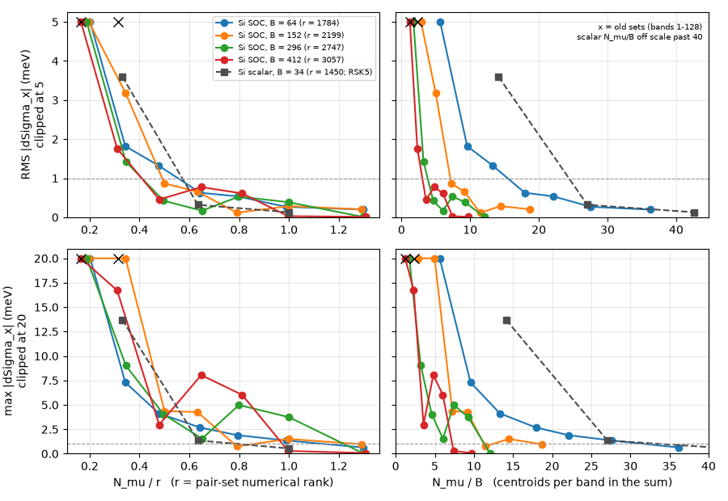
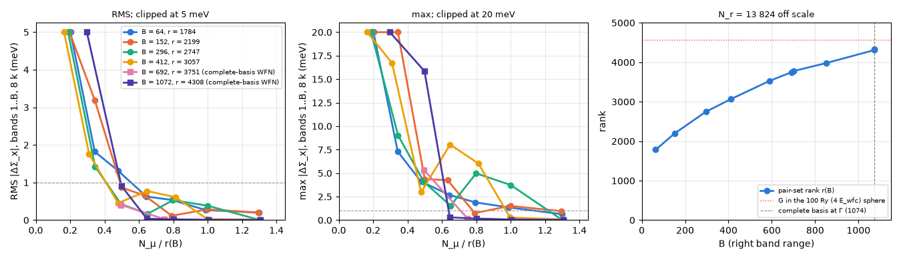

# ISDF and V(q)

`gw.isdf_fitting` Pair densities interpolated on $N_\mu$ real-space points, and the bare Coulomb interaction in that basis.
{: .page-summary }

## 1 Interpolating pair densities {: #isdf-pairs }

Every two-particle quantity in LORRAX is carried on $N_\mu$ interpolation points $\br_\mu$ instead of plane-wave pairs. A pair density is its values at the points times interpolation vectors $\zeta_{\bq\mu}(\br)$, fitted once per run.
{: .intro }

### 1.1 The interpolation ansatz {: #isdf-ansatz }

For momentum transfer $\bq$, the products of a left state $m$ at $\bk$ and a right state $n$ at $\bk+\bq$ are written as:

$$
\psi^*_{m\bk}(\br)\,\psi_{n\bk+\bq}(\br) \approx \sum_\mu \zeta_{\bq\mu}(\br)\,\psi^*_{m\bk}(\br_\mu)\,\psi_{n\bk+\bq}(\br_\mu) \tag{1.1}
$$

The points $\br_\mu$ are FFT-grid points read from `centroids_file` (default `centroids_frac.txt`). They are selected in closed orbits of the crystal's space group, so every operation permutes them ([Centroid selection](centroid-selection.md#cs-symmetry)), and the fit runs only on the irreducible $\bq$ (§2.5). The vectors $\zeta_{\bq\mu}(\br)$ do not depend on the bands, so one set serves χ⁰, $W$, $\Sigma^x$, $\Sigma^c$ and the BSE kernels.

### 1.2 Band windows {: #isdf-windows }

`gw.gw_init.zeta_fit_band_ranges`
{: .in-code }

The fit trains on $m \in L$ and $n \in R$, with $L = [0, b_3)$ every occupied band plus the Σ conduction window, and $R = [0, b_4)$ every band the χ⁰ and Σ sums reach. Both windows start at band 0, so every occupied product, each $|\psi_{n\bk}|^2$ among them, is fitted.

The top $b_4$ is the larger of `number_bands_chi` and `number_bands_sigma`. Sizing the basis by the smaller count would let the other sum consume pair densities the fit never saw. `zeta_nband` (default unset) narrows only the right window of the fit; the band sums keep their full range.

!!! refuses
    - `zeta_nband` outside $(b_1, b_4]$. It can only narrow the fit window.
    - A QP matrix that reaches past the left window $L$ of the fit (`assert_qp_matrix_fitted`).
    - A centroid file whose selection windows drop an occupied band. A file whose windows stop short of the fit windows, or that has no window header, only warns.
    - A window edge that cuts a degenerate multiplet, or a right edge at the last band of `WFN.h5`, whose closure cannot be checked. Move the band count to a clean edge, or add bands to `WFN.h5` ([Band counts](../using/inputs-from-dft.md#bands)).

## 2 The ζ fit {: #isdf-fit }

$\zeta$ is the least-squares solution of Eq. (1.1) over every $\bk$ and every pair in $L \times R$. The fit works in G space from start to finish: the band sums factor through projectors with one leg at the centroids and the other in $\bG$, the right-hand side is accumulated directly on the $\zeta$ sphere, and the solve gives $\zeta_{\bq\mu}(\bG)$. Neither $\psi$ nor $\zeta$ is ever put on the real-space grid.
{: .intro }

<figure class="flowchart" markdown>

<figcaption><strong>Fig. G1.</strong> The ζ fit and the bare Coulomb matrix. Stage 1 evaluates $\psi$ at the centroids from its plane-wave coefficients and forms the band projectors $P^X_\bk(\br_\mu,\bG)$ of the two windows $X=L,R$; stage 2 builds the Gram $C_\bq$ and the right-hand side $Z_\bq(\br_\mu,\bG)$ by k-convolution and solves for $\zeta_{\bq\mu}(\bG)$ one G tile at a time; stage 3 contracts $\zeta(\bG)$ with $v(\bq+\bG)$. The Objects block gives the implicit definition of each output.</figcaption>
</figure>

### 2.1 Normal equations {: #isdf-normal }

`isdf.core.c_q_from_psi_sm`
{: .in-code }

Write $\rho_{mn\bk}(\br) = \psi^*_{m\bk}(\br)\,\psi_{n\bk+\bq}(\br)$ for a training pair density, $\rho_{mn\bk}(\bq+\bG)$ for its plane-wave coefficients, and $c_{n\bk}(\bG)$ for those of $\psi_{n\bk}$ in `WFN.h5`. Minimizing the squared residual of Eq. (1.1) gives the normal equations $\sum_\nu C_\bq(\br_\mu,\br_\nu)\,\zeta_{\bq\nu}(\bG) = Z_\bq(\br_\mu,\bG)$, with the Gram matrix and the right-hand side:

$$
C_\bq(\br_\mu,\br_\nu) = \frac{1}{N_k}\sum_\bk\sum_{mn} \overline{\rho_{mn\bk}(\br_\mu)}\,\rho_{mn\bk}(\br_\nu), \qquad
Z_\bq(\br_\mu,\bG) = \frac{1}{N_k}\sum_\bk\sum_{mn} \overline{\rho_{mn\bk}(\br_\mu)}\,\rho_{mn\bk}(\bq+\bG) \tag{2.1}
$$

$C_\bq$ is Hermitian and positive semidefinite, and $Z_\bq$ is already in G space, so the solve gives $\zeta_{\bq\mu}(\bG)$ directly. No pair density is formed: the double band sum factors through one band projector per window, with one leg at the centroids and the other in G,

$$
P_\bk(\br_\mu,\bG) = \sum_n \psi_{n\bk}(\br_\mu)\,\overline{c_{n\bk}(\bG)}, \qquad \psi_{n\bk}(\br_\mu) = \frac{1}{\sqrt{N}}\sum_\bG c_{n\bk}(\bG)\,e^{i(\bk+\bG)\cdot\br_\mu} \tag{2.2}
$$

summed over $L$ for the first factor of the product and over $R$ for the second. $\psi$ at the centroids is a direct DFT of the coefficients, and $P_\bk$ is one GEMM over bands per window. $C_\bq$ is the same construction with the second leg at $\br_\nu$. On a spinor WFN the spinor indices of the two projectors are contracted open (§5.1).

### 2.2 The k sum as an FFT {: #isdf-kconv }

`isdf.zeta_mubatch.make_route_g_kernel`
{: .in-code }

Both sums over $\bk$ in Eq. (2.1) are correlations on the periodic $N_k$ grid. The code transforms each projector to the Born–von Kármán lattice, multiplies and transforms back:

$$
P_\bk \xrightarrow[\bk\to\bR]{\mathrm{IFFT}} P_\bR, \qquad
C_\bq = \mathrm{FFT}_{\bR\to\bq}\big[P^L_\bR\,\overline{P^R_\bR}\big] \tag{2.3}
$$

This costs $O(N_k\log N_k)$ per point pair instead of $O(N_k^2)$. For $Z_\bq$ the product of the two projectors is also a product in $\br$, a convolution in $\bG$. For each batch of centroid rows the code takes $P_\bk(\br_\mu,\bG)$ to real-space planes, multiplies inside the k-convolution, and transforms the product straight back onto the $\zeta$ sphere $|\bq+\bG|^2 \le E_\zeta$, where it accumulates $Z_\bq(\br_\mu,\bG)$. Only the rows of one batch are ever on real-space planes ([Parallel algorithms §3](parallel-algorithms.md#par-zeta)). Projectors are formed only at the k-points stored in `WFN.h5` and unfolded to the full grid on load ([Symmetry](symmetry.md)).

### 2.3 Conjugation closure {: #isdf-closure-conj }

`isdf.core.complete_ordered_pair_normal_equations`
{: .in-code }

The windows are asymmetric, and complex conjugation exchanges their roles: the $RL$ normal equations at $\bq$ are the conjugates of the $LR$ ones at $-\bq$. The fit solves the conjugation-closed set:

$$
C_\bq \leftarrow C_\bq + \overline{C_{-\bq}}, \qquad Z_\bq \leftarrow Z_\bq + \overline{Z_{-\bq}} \tag{2.4}
$$

This completes the training set when $L \neq R$. It is not a projection of $\zeta$, $V$ or $W$.

### 2.4 Conditioning {: #isdf-rcond }

`isdf.cplus.factor`
{: .in-code }

$C_\bq$ is nearly singular when $N_\mu$ exceeds the numerical rank of the pair densities, and an exact inverse then amplifies round-off without bound. The charge fit uses a rank-truncated pseudo-inverse. From $C_\bq = U\Lambda U^\dagger$ it keeps $\lambda > \epsilon_\zeta\,\lambda_{\max}$ per $\bq$, with $\epsilon_\zeta$ = `zeta_rcond` (default `1e-8`):

$$
C_\bq^{+} = B B^\dagger, \qquad B = U_{\mathrm{keep}}\,\Lambda_{\mathrm{keep}}^{-1/2}, \qquad \kappa_{\mathrm{eff}} = \lambda_{\max}/\lambda_{\min}^{\mathrm{kept}} \le 1/\epsilon_\zeta \tag{2.5}
$$

The cut is never placed inside a degenerate multiplet: it moves down and drops the whole block ([`LORRAX_SPECTRAL_CLOSURE`](../using/environment.md)). With an orbit-closed centroid set $C_\bq$ commutes with the point group, so a cut between blocks keeps $C_{S\bq}$ and $C_\bq$ related by the symmetry; a cut through a block would break the k-star identity of $W$ and $\Sigma$. Each run prints `[zeta rank_truncate]` with `n_keep`, `kappa` and the largest discarded eigenvalue per $\bq$. A cut that discards a direction at an achieved $\kappa_{\mathrm{eff}}$ above the certified $10^{8}$ prints `[rank-policy]` lines and refuses after the fit ([`LORRAX_RANK_POLICY`](../using/environment.md#lorrax_rank_policy)); reduce $N_\mu$ or raise `zeta_rcond`.

`zeta_rcond` has a deprecated environment twin, [`LORRAX_ZETA_RCOND`](../using/environment.md), which wins when set and is recorded in the fit provenance.

!!! note
    `zeta_rcond`, the WFN, the centroid table, the band windows, the cutoffs and the spinor count form the fit provenance stamped in `zeta_q.h5`; a rerun reuses the fit only when all of them match. `zeta_ridge` is retired: any nonzero value refuses.

### 2.5 Irreducible q {: #isdf-qirr }

`gw.qgrid_symmetry.resolve_qgrid_symmetry_tables`
{: .in-code }

When the centroid set is closed under the WFN's space group, $C_\bq$ is factored and $\zeta$ is fitted only on the irreducible $\bq$ wedge; $V_\bq$ is unfolded to the full grid by the centroid permutation and lattice-wrap phase ([Symmetry](symmetry.md)). Closure is a correctness condition, not an approximation. A set that is not closed is announced on rank 0 and the charge fit runs on every $\bq$.

## 3 Bare Coulomb in the ζ basis {: #isdf-v }

The interaction is assembled in G space from $\zeta$, one G tile at a time, while the fit runs. $\zeta(\br)$ on the full grid is never stored.
{: .intro }

### 3.1 V(q) {: #isdf-vq }

`isdf.zeta_mubatch.ZetaG.contract_v`
{: .in-code }

With $\zeta_{\bq\mu}(\bG)$ the coefficient of $e^{i(\bq+\bG)\cdot\br}$ in $\zeta_{\bq\mu}(\br)$, the bare Coulomb interaction in the $\zeta$ basis is:

$$
V_\bq(\mu,\nu) = \sum_{|\bq+\bG|^2 \le E_V} \zeta^*_{\bq\mu}(\bG)\, v(\bq+\bG)\, \zeta_{\bq\nu}(\bG), \qquad v(\bq+\bG) = \frac{8\pi}{|\bq+\bG|^2} \tag{3.1}
$$

$v$ is in Rydberg and supplied by the `vcoul` service, including the 2-D truncation for `sys_dim = 2`. $E_V$ = `bare_coulomb_cutoff` (default `ecutwfc`). The $\zeta$-first contraction is used because the algebraically equal $\overline{C^{+}}\,M_\bq\,\overline{C^{+}}$ has round-off growing as $\epsilon\,\kappa(C)^2$ instead of $\epsilon\,\kappa(C)$.

### 3.2 The solve by G tiles {: #isdf-gspace }

`isdf.zeta_mubatch._v_tile_kernel`
{: .in-code }

$Z_\bq(\br_\mu,\bG)$ is stored on the $\zeta$ sphere, and $C_\bq^{+}$ acts on the centroid index only. The solve is applied one G tile at a time, and each tile of $\zeta$ is contracted into Eq. (3.1) at once:

$$
\zeta_{\bq\mu}(\bG) = \sum_\nu C^{+}_\bq(\br_\mu,\br_\nu)\, Z_\bq(\br_\nu,\bG), \qquad |\bq+\bG|^2 \le E_\zeta \tag{3.2}
$$

$E_\zeta$ = `zeta_cutoff` (default `ecutwfc`, at most `ecutrho`). The fit runs in independent batches of centroids, because a row of $Z_\bq$ needs nothing from any other centroid. `zeta_q.h5` is written only when a consumer reads it (`write_restart_tensors`, ζ reuse).

!!! refuses
    - `bare_coulomb_cutoff` > `zeta_cutoff`: $V_\bq$ would read $\zeta$ outside its stored sphere. Raise `zeta_cutoff` or lower `bare_coulomb_cutoff`.
    - Either cutoff above `ecutrho`.

### 3.3 Head slots and the full zone {: #isdf-head }

`gw.v_q_g_flat.compute_all_V_q_g_flat`
{: .in-code }

On 3-D bulk with `mc_average_vcoul_body = true` (default), the G slot nearest $\bq+\bG = 0$ carries the mini-BZ average $\langle v \rangle$ instead of the point value. The $\zeta(\bG{=}0)$ column and these head slots are kept for the $\bq\to0$ head ([q → 0 head](q0-head.md)). $V_{-\bq} = \overline{V_\bq}$ holds for any mean field; it checks the fit, not time reversal.

## 4 Accuracy {: #isdf-accuracy }

The error of the ISDF basis is set by how $N_\mu$ compares with the numerical rank $r$ of the pair densities it must represent, and by whether the points were selected on those pair densities.
{: .intro }

!!! note "Measured"
    Si 4×4×4 with SOC, 25 Ry, 460-band NSCF, against a plane-wave $\Sigma^x$ with no ISDF; Perlmutter A100. A second system (Si scalar 4³) is shown beside it. Read the numbers as a calibration.

### 4.1 The pair-set rank {: #isdf-rank }

`centroid.pivoted_cholesky.point_granularity_rank`
{: .in-code }

$r(L,B)$ is the numerical rank of the positive pair-density Gram for left bands $1..L$ and right bands $1..B$: eigenvalues above $\sqrt{\epsilon}$ times the largest diagonal. The centroid selector prints it as `pool rank=`. On the Si complete-basis WFNs it follows one law (102 points, 5.6 % RMS log residual):

$$
r(L,B) \approx \min\big(445\,L^{0.107}B^{0.322},\; 0.97\,N_\bG(4E_{\mathrm{wfc}})\big), \qquad N_\mu(\text{RMS }\Sigma^x \le 1\text{ meV}) \approx 0.5\,r \tag{4.1}
$$

On a spinor WFN, $L$ and $B$ count Kramers pairs. While the window holds fewer than about 500 distinct pair functions, $r$ is that count. $r$ has no plateau: it grows until the right window reaches the complete basis, where it is 0.82–0.98 of the plane waves in the $4E_{\mathrm{wfc}}$ sphere. The law was fitted on one system at one cutoff; on Fe and Ni (80 Ry, spinor) the measured rank is 0.86–0.94 of it.

### 4.2 Error against N_μ / r {: #isdf-error }

Plotted against $N_\mu/r(B)$, the $\Sigma^x$ error curves for $B$ = 64 to 412 collapse onto one curve. Against $N_\mu/B$ they spread by 5×, so a rule stated in centroids per band is too few for small $B$ and too many for large $B$.

<figure class="flowchart" markdown>

<figcaption><strong>Fig. 4.1.</strong> RMS (top) and max (bottom) of $|\Delta\Sigma^x|$ over bands $1..B$ and 8 irreducible k, against $N_\mu/r(B)$ (left) and $N_\mu/B$ (right). Crosses are sets selected on a different pair set; grey squares are the scalar Si system.</figcaption>
</figure>

| Target | $N_\mu$ |
|---|---|
| $\Sigma^x$ RMS ≤ 1 meV | ≈ 0.5 $r$ |
| $\Sigma^x$ max ≤ 1 meV | ≈ 1.0–1.3 $r$ |
| $\Sigma^x$ max ≤ 0.1 meV | ≈ 1.3 $r$ (at $B$ = 296, 412) |

The valence window carries the largest error at every $N_\mu$, because valence–valence pairs dominate $|M|^2$ at small $\bq+\bG$. Past $r$, extra points add no direction: the rank saturates, and the solve of §2.4 drops the surplus.

### 4.3 Out to the complete basis {: #isdf-complete }

On a WFN holding every state of the 25 Ry sphere, the collapse in $N_\mu/r$ holds to $B$ = 1072, and $r$ reaches 0.95 of $N_\bG(4E_{\mathrm{wfc}})$. An all-band $\Sigma^x$ therefore needs $N_\mu \approx N_\bG(4E_{\mathrm{wfc}})$: the ISDF basis is then as large as the plane-wave density basis. ISDF compresses a truncated band sum; at $B$ = 64, $r = 0.39\,N_\bG(4E_{\mathrm{wfc}})$.

<figure class="flowchart" markdown>

<figcaption><strong>Fig. 4.2.</strong> RMS and max of $|\Delta\Sigma^x|$ against $N_\mu/r(B)$, with $B$ = 692 and 1072 from the complete-basis WFN (squares), and $r(B)$ up to the complete basis at Γ (right); the dotted line is the plane-wave count of the $4E_{\mathrm{wfc}}$ sphere.</figcaption>
</figure>

### 4.4 The selection window {: #isdf-selection-window }

A basis selected on a smaller pair set fails at any size, while every check upstream of $\Sigma^c$ passes. On MoS₂ 4×4×1 (30 Ry, 1024 bands) the same 897-point count re-selected on three pruning windows gives:

| Pruning window | Selection rank | eqp0 gap (eV) | eqp1 gap (eV) |
|---|---|---|---|
| `(0, 52)` | 630 / 897 | 0.364 | −0.364 |
| `(0, 256)` | 897 / 897 | 3.135 | 3.071 |
| `(0, 1024)` | 897 / 897 | 3.723 | 3.455 |

$\Sigma^x$ is unchanged and the retained rank of $C_\bq$ moves by 1.4 %: which points are selected decides, not how many directions the fit keeps. On Si (SOC, $B$ = 412) a 960-point set selected on bands 1–128 is off by 360 meV in $\Sigma^x$; 948 points selected on the $\Sigma$ pair set are off by 17 meV. The selector's default window is every conduction band in the WFN ([Centroid selection](centroid-selection.md)).

## 5 Spinors and four-current channels {: #isdf-spin }

Spin is carried inside the projectors, not as an extra centroid index. The four-current (bispinor) route fits three more $\zeta$ sets on their own centroids.
{: .intro }

### 5.1 Two-component spinors {: #isdf-spinor }

On a noncollinear WFN ($n_s = 2$) the projector keeps both spinor indices open, and the Gram contracts them:

$$
C_\bq(\br_\mu,\br_\nu) = \frac{1}{N_k}\sum_\bk \sum_{ab} P_{\bk,ab}(\br_\mu,\br_\nu)\,\overline{P_{\bk+\bq,ab}(\br_\mu,\br_\nu)}, \qquad P_{\bk,ab}(\br_\mu,\br) = \sum_n \psi_{n\bk a}(\br_\mu)\,\psi^*_{n\bk b}(\br) \tag{5.1}
$$

This is not the product of two scalar densities. A spinor window $(2L, 2B)$ has the rank of the scalar window $(L, B)$ to within 2 %.

### 5.2 Four-current channels {: #isdf-bispinor }

`gw.isdf_fitting.fit_zeta_to_h5`
{: .in-code }

With `bispinor = true`, each current channel $i = 1,2,3$ inserts its Dirac vertex on the spinor indices of both legs and is fitted separately, on the points of `centroids_file_current` (a `--density-mode current` centroid table, default unset). Its $C_\bq$ is a signed Gram, indefinite for the Cartesian $\alpha^2$ vertex, so it is solved by a pivoted LU with a fixed relative ridge of $10^{-12}\,\mathrm{tr}\,C_\bq/N_\mu$ instead of the rank truncation of §2.4.

!!! refuses
    - `bispinor = true` without `centroids_file_current`.
    - A current centroid set that is not orbit-closed under the WFN's space group: the current fit has no full-zone fallback. Regenerate it with the orbit-aware selector.

## Notation

| Symbol | Meaning |
|---|---|
| $N_\mu$, $\br_\mu$ | number of interpolation points; the points (FFT-grid centroids) |
| $\zeta_{\bq\mu}(\br)$, $\zeta_{\bq\mu}(\bG)$ | interpolation vectors; their coefficients on $e^{i(\bq+\bG)\cdot\br}$ |
| $L$, $R$ | left and right band windows of the fit, $[0,b_3)$ and $[0,b_4)$ |
| $\rho_{mn\bk}(\br)$ | training pair density $\psi^*_{m\bk}(\br)\psi_{n\bk+\bq}(\br)$ |
| $c_{n\bk}(\bG)$, $N$ | plane-wave coefficients of $\psi_{n\bk}$; FFT-grid size |
| $P_\bk(\br_\mu,\bG)$ | band projector $\sum_n \psi_{n\bk}(\br_\mu)\,\overline{c_{n\bk}(\bG)}$ over one window |
| $C_\bq(\br_\mu,\br_\nu)$, $Z_\bq(\br_\mu,\bG)$ | Gram and right-hand side of the fit |
| $C^{+}_\bq$, $\epsilon_\zeta$ | rank-truncated pseudo-inverse; its relative cut `zeta_rcond` |
| $V_\bq(\mu,\nu)$, $v(\bq+\bG)$ | bare Coulomb interaction in the $\zeta$ basis; the Coulomb kernel (Ry) |
| $E_V$, $E_\zeta$ | `bare_coulomb_cutoff`, `zeta_cutoff` (Ry) |
| $r(L,B)$ | numerical rank of the pair set $L \times B$ |
| $N_\bG(4E_{\mathrm{wfc}})$ | plane waves in the density sphere of radius $4E_{\mathrm{wfc}}$ |
| $N_k$, $\bR$ | number of k-points; Born–von Kármán lattice vectors |
| $n_s$, $a,b$ | spinor components; spinor indices |

## References

1. J. Lu and L. Ying, J. Comput. Phys. 302, 329 (2015).
2. W. Hu, L. Lin, and C. Yang, J. Chem. Theory Comput. 13, 5420 (2017).
3. K. Dong, W. Hu, and L. Lin, J. Chem. Theory Comput. 14, 1311 (2018).

