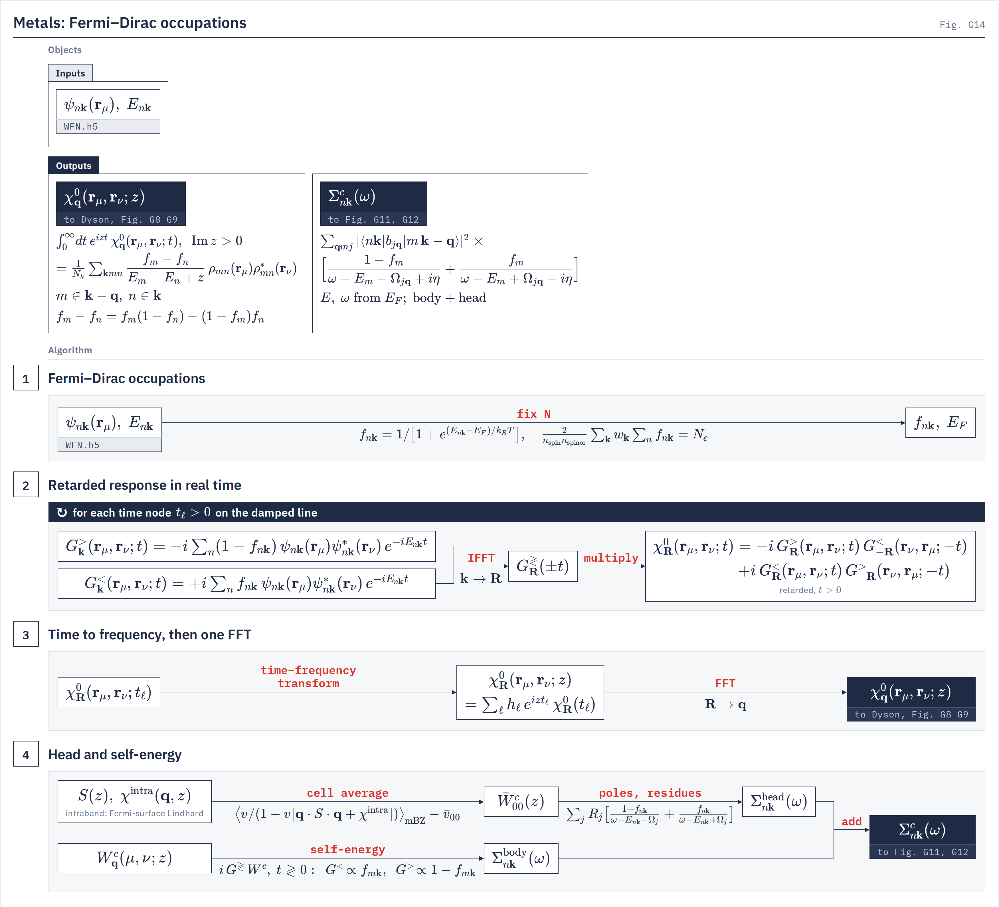

# Metals

`gw.efermi` Fermi–Dirac occupations in χ⁰, the q → 0 head and Σ, the intraband term, and what a metallic mean field refuses.
{: .page-summary }

<figure class="flowchart" markdown>

<figcaption><strong>Fig. G14.</strong> The fixed-N Fermi–Dirac occupations $f_{n\bk}$ enter every stage: as weights $1-f$ and $f$ on the greater and lesser Green's functions of the retarded response (stages 2–3), in the cell average of the head with its intraband term, and in the occupied and empty branches of Σ (stage 4). A partly filled band appears in both $G^>$ and $G^<$.</figcaption>
</figure>

## 1 Occupations {: #occupations }

A metal is recognized from the WFN occupations, not from a deck key. Its occupations are Fermi–Dirac at fixed electron number, and one occupation state reaches χ⁰, the head and Σ.
{: .intro }

### 1.1 Classifying the mean field {: #occ-class }

`gw_config.infer_material_class`
{: .in-code }

Any WFN occupation farther than $10^{-6}$ from an integer makes the run a metal; otherwise it is an insulator. No key sets the class, and every metal rule on this page follows from it.

### 1.2 Fermi–Dirac at fixed N {: #occ-fd }

`efermi.solve_smearing_occupations`
{: .in-code }

The occupations are Fermi–Dirac with $k_BT$ = `occ_smearing_width_ry`, and $E_F$ is solved by safeguarded bisection so that the electron count is fixed:

$$
f_{n\bk}=\frac{1}{1+e^{(E_{n\bk}-E_F)/k_BT}},\qquad \frac{2}{n_{\mathrm{spin}}n_{\mathrm{spinor}}}\sum_{\bk}w_\bk\sum_n f_{n\bk}=N_e \tag{1.1}
$$

`occ_smearing_width_ry` has no default and is required on a metal, because `WFN.h5` does not store the smearing; set it to the DFT `degauss` with `smearing = 'fd'` in Quantum ESPRESSO. At startup the solved table must reproduce the WFN's own ($N_e$ to $10^{-8}$, $\max\lvert\Delta f\rvert$ to $10^{-6}$). A metal also requires `fermi_reference = mp1_fixed_n` (default `midgap`); with Fermi–Dirac occupations the name means the fixed-N $E_F$. On an insulator both keys refuse.

The smearing family is not a key: metals are always Fermi–Dirac, and `occ_smearing_family` refuses by name (`GATE metal_occupations_fermi_dirac`).

### 1.3 Band supports {: #occ-support }

`efermi.band_in_occupation_window`
{: .in-code }

A band belongs to the occupied branch when $\lvert f\rvert\ge10^{-5}$ and to the empty branch when $\lvert1-f\rvert\ge10^{-5}$. For Fermi–Dirac this is:

$$
\lvert E_{n\bk}-E_F\rvert\le\ln(10^5-1)\,k_BT\approx11.5\,k_BT \tag{1.2}
$$

A partly filled band is in both supports. The same predicate cuts the χ⁰ sums and the Σ branches, for the one-shot and every self-consistent map; it has no key. A state that crosses the cut between maps moves Σ by about $10^{-5}$ of its term.

### 1.4 One state per map {: #occ-map }

Each QSGW map solves its occupations and $E_F$ from the spectrum of the Hamiltonian it was handed, and that one state reaches χ⁰, the head, the tangential recipe and Σ. $E_F$ is never mixed. The map $F[H]$ is then a function of $H$ alone, with $f$ and $E_F$ functions of $H$, and its fixed points are unchanged. The loop is on [Quasiparticle self-consistency §2.2](qsgw.md#om-occ).

### 1.5 Smeared occupations on an insulator {: #occ-insulator }

`occ_broadening` (default `0.0`, eV) is a different dial: the first-order Methfessel–Paxton width of the occupations in the smeared QSGW head of an insulator. A value above 0 refuses beside `occ_smearing_width_ry` (`GATE metal_sc_head_update_disabled`); a metal has one width, its $k_BT$.

## 2 Response with fractional occupations {: #response }

Every band near $E_F$ is both a hole and an electron state, and transition energies run continuously through zero. χ⁰ carries both through occupation weights on the two Green's functions.
{: .intro }

### 2.1 The occupation-weighted response {: #resp-chi }

`gw.w_isdf.compute_chi0_contour_fractional`
{: .in-code }

The response is the Adler–Wiser sum over all ordered band pairs. It is evaluated through the exact split $f_m-f_n=f_m(1-f_n)-(1-f_m)f_n$, one term per time ordering, with $m$ at $\bk-\bq$ and $n$ at $\bk$:

$$
\chi^0_\bq(\br_\mu,\br_\nu;z)=\frac{1}{N_k}\sum_{\bk mn}\frac{f_{m}(1-f_{n})-(1-f_{m})f_{n}}{E_{m}-E_{n}+z}\,\rho_{mn}(\br_\mu)\,\rho^*_{mn}(\br_\nu),\qquad \mathrm{Im}\,z>0 \tag{2.1}
$$

In real time the two terms are the retarded product $-i\,G^>_\bR(\br_\mu,\br_\nu;t)\,G^<_{-\bR}(\br_\nu,\br_\mu;-t)+i\,G^<_\bR(\br_\mu,\br_\nu;t)\,G^>_{-\bR}(\br_\nu,\br_\mu;-t)$ for $t>0$, with $G^>$ weighted by $1-f$ and $G^<$ by $f$. One time node costs two weighted single-band Green sums; no band-pair object exists.

!!! note
    The weights $f(1-f)$ vanish pointwise on the occupied–occupied and empty–empty blocks. The only cancellation left is in the Fermi shell, where each product is at most 1/4, so the time quadrature never discretizes a large cancellation.

### 2.2 The metal frequency plan {: #resp-plan }

`mpa.sampling`
{: .in-code }

The metal plan is the insulating two-line plan with the near line's first point moved from $z=0$ to:

$$
z_0=i\varpi_0,\qquad \varpi_0=2\times10^{-5}\ \mathrm{Ry} \tag{2.2}
$$

$\varpi_0$ is `mpa_metal_origin_shift_ry` (unset: $2\times10^{-5}$ Ry; refused on an insulator). It is a displacement off the zero-energy intraband transitions, not a broadening. `mpa_sampling_alpha` defaults to 2 on a metal and 1 on an insulator, concentrating the samples near zero. The rule bandwidth is $\max_{\mathrm{supp}(1-f)}E-\min_{\mathrm{supp}\,f}E$ over the supports of §1.3.

### 2.3 The origin and static rows {: #resp-origin }

`compute_chi0_direct_fractional`
{: .in-code }

A damped time rule at height $\varpi_0$ would need about $10^6$ nodes. The origin row is therefore the exact ordered-pair sum (2.1) at its literal coordinate $z_0$; its cost is quadratic in bands, so it serves one sample per fit. Static χ⁰ at $z=0$ (the static Γ body of the head) is the zeroth Matsubara frequency, whose factors $fe^{(E-E_F)\tau}$ and $(1-f)e^{-(E-E_F)\tau}$ stay in $(0,1]$, so a degenerate pair carries $-\partial f/\partial E$ without a divided difference:

$$
\lim_{E'\to E}\frac{f(E)-f(E')}{E'-E}=-\frac{\partial f}{\partial E}=\frac{f(1-f)}{k_BT} \tag{2.3}
$$

## 3 The intraband term and the metallic head {: #head }

A metal's long-wavelength limit depends on the order of limits. Taking $\omega\to0$ first gives Thomas–Fermi screening; taking $q\to0$ first gives a Drude term that diverges as $1/\omega^2$. Inside the Γ cell of the mini-BZ both meet, and the head resolves them sample by sample.
{: .intro }

### 3.1 The Drude tensor {: #head-drude }

`qsgw_head.head_drude_tensor_sharded`
{: .in-code }

With $\bar w_{nm}=(w_n+w_m)/2$ the tetrahedron weights of $\delta(E-E_F)$ (times $N_k$) and $C=2/(n_{\mathrm{spin}}n_{\mathrm{spinor}})$, the intraband response at $\lvert z\rvert\gg qu$ is $\bq\cdot D\cdot\bq/z^2$ with:

$$
D_{ab}=\frac{C}{V_{\mathrm{cell}}N_k}\sum_\bk\sum_{nm}\phi_{nm}\,\bar w_{nm}\,v^{a*}_{nm\bk}\,v^b_{nm\bk},\qquad \omega_{\mathrm{pl}}^2(\hat\bq)=8\pi\,\hat\bq\cdot D\cdot\hat\bq \tag{3.1}
$$

The velocities include the nonlocal pseudopotential ([Velocity operator](velocity-operator.md)). The pair sum runs over each degenerate multiplet, not only the diagonal, so $D$ is invariant under rotations inside a multiplet. Free electrons give $D=2n$, i.e. $\omega_{\mathrm{pl}}^2=16\pi n$ Ry². No fitted or experimental plasma frequency enters.

### 3.2 Intraband and interband shares {: #head-split }

`fermi_surface.intraband_pair_fraction`
{: .in-code }

A near-degenerate pair at the Fermi level is neither purely interband nor purely intraband on a finite grid. Each pair is split continuously by its two-band Padé share at the cell's Coulomb-weighted second moment $Q_{ab}$:

$$
\phi_{nm}=\frac{\epsilon^2_{nm}}{\Delta^2_{nm}+\epsilon^2_{nm}},\qquad
\epsilon^2_{nm}=\mathrm{tr}\,Q\,\big[\delta v\,\delta v^{\mathsf T}+4\,\mathrm{Re}\,v^*_{nm}v^{\mathsf T}_{nm}\big],\qquad \delta v=v_{mm}-v_{nn} \tag{3.2}
$$

The interband $S$ of [the q → 0 head](q0-head.md#s-tensor) keeps $1-\phi$ of each pair and the Fermi-surface term takes $\phi$; exact degeneracies ($\lvert\Delta\rvert<10^{-6}$ Ry) have $\phi=1$. The f-sum over $S+D$ is unchanged. Since $\epsilon^2\propto N_k^{-2/3}$, the cell-effective Drude tensor tends to the physical one as the grid is refined; the log prints both. A cell-effective $\omega_{\mathrm{pl}}$ is not a plasma frequency to compare with experiment.

### 3.3 The cell average and the Thomas–Fermi limit {: #head-tf }

`fermi_surface.FermiSurfaceIntraband`
{: .in-code }

In the cell average the Drude term $\bq\cdot D\cdot\bq/z^2$ is replaced, at every sample $\bq$, by the anisotropic Lindhard function of the computed band velocities, $\chi^{\mathrm{intra}}(\bq,z)$. At each plan frequency:

$$
\bar W^c_{00}(z)=\Big\langle\frac{v(\bq)}{1-v(\bq)\,\big[\bq\cdot S(z)\cdot\bq+\chi^{\mathrm{intra}}(\bq,z)\big]}\Big\rangle_{\mathrm{mBZ}}-\bar v_{00} \tag{3.3}
$$

$\chi^{\mathrm{intra}}$ is Drude for $\lvert z\rvert\gg qu$ and $-N_0$ at $z\to0$, with $N_0=\frac{C}{V_{\mathrm{cell}}N_k}\sum_{n\bk}w_{n\bk}$ the density of states at $E_F$ per volume, from the same tetrahedron table as $D$. The static slot is therefore Thomas–Fermi screening on top of the interband dielectric tensor:

$$
\bar W_{00}(0)=\Big\langle\frac{8\pi}{\bq\cdot\epsilon_\infty\cdot\bq+\kappa^2}\Big\rangle_{\mathrm{mBZ}},\qquad
\epsilon_\infty=1-8\pi S(0),\qquad \kappa^2=8\pi N_0 \tag{3.4}
$$

A folded head (`head_correction = full`) uses the folded $S(0)$ and the static fold's $\kappa^2$. The cell is statically screened at the plan's origin $z_0$, not $W=0$.

### 3.4 Head routes on a metal {: #head-routes }

The metallic head is bulk only: a `sys_dim = 2` metal refuses in the cell average. Both `head_correction = no_local_fields` (the direct head) and `full` (scalar decks) are admitted; a time-reversal-broken metal refuses `full` on the tangential route (`GATE tangential_head_ordered`): its static $z=0$ slot is not certified without time reversal. Every metallic head, including the frozen DFT head of `sc_head_update = off`, uses the fixed-N Fermi–Dirac state of §1. On a self-consistent run the per-map heads `dft_velocity` and `parallel_transport` require `sigma_w_model = tangential`.

## 4 Screening and Σ on a metal {: #sigma }

The production metal model is the tangential $W$ with occupation-weighted Σ branches. The head carries the same per-state occupations.
{: .intro }

### 4.1 The metal model of W {: #sigma-w }

A metal deck sets `compute_mode = mpa` and `sigma_w_model = tangential`. The default `sigma_w_model` is `mpa` (elementwise poles), which on a metal is a comparison route and refuses when time reversal is measured broken (`GATE mpa_ordered_metal`). The tangential bank carries the signed metallic weights through its occupation envelope ([Tangential W model §6.3](tangential-w.md#bank-accuracy)). The scalar head is fitted on the metal MPA plan of §2.2: the body's own grid on elementwise MPA, a plan of its own with the tangential Γ body evaluated on it under `tangential` ([The q → 0 head §3.1](q0-head.md#poles-samples)).

### 4.2 Occupation-weighted Σ branches {: #sigma-branches }

`gw.mpa.sigma._branches`
{: .in-code }

The causal branches keep their topology; their membership becomes a weight. With $\Sigma^c=iG^{\gtrless}W^c$ for $t\gtrless0$, the empty branch sums the bands of $\mathrm{supp}(1-f)$ at weight $1-f$ and the occupied branch those of $\mathrm{supp}\,f$ at weight $f$:

$$
\Sigma^c_{n\bk}(\omega)=\sum_{\bq mj}\lvert\langle n\bk|b_{j\bq}|m\,\bk-\bq\rangle\rvert^2
\Big[\frac{1-f_m}{\omega-E_m-\Omega_{j\bq}+i\eta}+\frac{f_m}{\omega-E_m+\Omega_{j\bq}-i\eta}\Big] \tag{4.1}
$$

Energies stay signed against the map's $E_F$, and a caller Fermi level inconsistent with it refuses. Exchange and SX use $G_{ij}=\mathrm{diag}(f)$; an electron-count mismatch above $10^{-8}$ refuses.

### 4.3 The head in Σ on a metal {: #sigma-head }

`compute_complex_pole_head_sigma_diag`
{: .in-code }

The head residues use per-state occupations, so a window straddling $E_F$ stays valid ([the q → 0 head §4](q0-head.md#sigma)). At the state's own energy every pole model gives:

$$
\Sigma^{c,\mathrm{head}}_{n\bk}(E_{n\bk})=\frac{\tfrac12-f_{n\bk}}{V_{\mathrm{cell}}N_k}\,\bar W^c_{00}(z\to0) \tag{4.2}
$$

On-shell energies and QSGW maps therefore see the static head of (3.4); the intraband shape moves $Z$ and off-shell values. The fit pins the sample nearest the origin, and Σ asserts that the head fit's stamped occupations equal the body's live state.

## 5 What refuses a metal {: #refusals }

Treatments and routes that assume a gap or integer occupations refuse a metallic mean field by name, before any compute.
{: .intro }

### 5.1 Treatments {: #ref-treatments }

| Route | On a metal | Gate |
|---|---|---|
| `compute_mode = x_only` | runs | — |
| `compute_mode = mpa`, `sigma_w_model = tangential` | production | — |
| `compute_mode = mpa`, `sigma_w_model = mpa` | runs if time reversal holds | `mpa_ordered_metal` |
| `compute_mode = gn_ppm` | refuses | `gn_ppm_refuses_metals` |
| `compute_mode = cohsex`, `hl_ppm` | refuses | `fractional_occupations_require_mpa` |
| `screening_diagrams = w_bse`, `w_rpa_resolvent` | refuses | `w_bse_insulators_only`, `w_rpa_resolvent_insulators_only` |
| `sc_head_update = interband_commutator` | refuses | `sc_head_interband_commutator_insulator_only` |

### 5.2 Deck conditions {: #ref-deck }

!!! refuses
    - No `occ_smearing_width_ry`, or a width ≤ 0. Set it to the DFT Fermi–Dirac $k_BT$.
    - `occ_smearing_family` named. Remove it; metals are always Fermi–Dirac.
    - `fermi_reference` other than `mp1_fixed_n`.
    - `occ_broadening > 0` beside `occ_smearing_width_ry`.
    - `sys_dim = 2`: the metallic head is bulk only.
    - `head_correction = full` on a time-reversal-broken metal, tangential route. Use `no_local_fields`.
    - A per-map velocity head (`dft_velocity`, `parallel_transport`) without `sigma_w_model = tangential`, or on a route with no metallic completion.
    - A `dipole.h5` built with another velocity operator, on every head route; one written for another WFN or band window, on the folded `full` head (`GATE dft_head_dipole_provenance`; the direct head only warns unless `LORRAX_SANITY=strict`, [The q → 0 head §1.4](q0-head.md#sources)). Rerun the [dipole utility](../utilities/dipole.md) after fixing the window.

## Notation {: #notation }

| Symbol | Meaning |
|---|---|
| $f_{n\bk}$, $E_F$, $k_BT$ | Fermi–Dirac occupation; fixed-N Fermi level; `occ_smearing_width_ry` |
| $C$ | $2/(n_{\mathrm{spin}}n_{\mathrm{spinor}})$, states per band |
| $\rho_{mn}(\br_\mu)$ | pair density $\psi^*_{m,\bk-\bq}(\br_\mu)\psi_{n\bk}(\br_\mu)$ |
| $z_0=i\varpi_0$ | shifted origin of the metal frequency plan |
| $w_n$, $\bar w_{nm}$ | tetrahedron Fermi-surface weights; their pair mean |
| $D_{ab}$, $\omega_{\mathrm{pl}}(\hat\bq)$ | Drude tensor; plasma frequency along $\hat\bq$ |
| $\phi_{nm}$, $Q_{ab}$ | intraband share of a pair; Coulomb-weighted second moment of the cell |
| $\chi^{\mathrm{intra}}(\bq,z)$ | anisotropic Fermi-surface Lindhard function |
| $N_0$, $\kappa^2$ | density of states at $E_F$ per volume; Thomas–Fermi wavevector squared |
| $\epsilon_\infty$ | interband dielectric tensor $1-8\pi S(0)$ |
| $b_{j\bq}$, $\Omega_{j\bq}$ | tangential vectors and poles of $W^c$ |

## References {: #refs }

1. J. Lindhard, K. Dan. Vidensk. Selsk. Mat.-Fys. Medd. 28, 8 (1954).
2. S. L. Adler, Phys. Rev. 126, 413 (1962).
3. N. Wiser, Phys. Rev. 129, 62 (1963).
4. H. N. Rojas, R. W. Godby and R. J. Needs, Phys. Rev. Lett. 74, 1827 (1995).
5. M. Kim, G. J. Martyna and S. Ismail-Beigi, Phys. Rev. B 101, 035139 (2020).
6. D. A. Leon, A. Ferretti, D. Varsano, E. Molinari and C. Cardoso, Phys. Rev. B 107, 155130 (2023).

