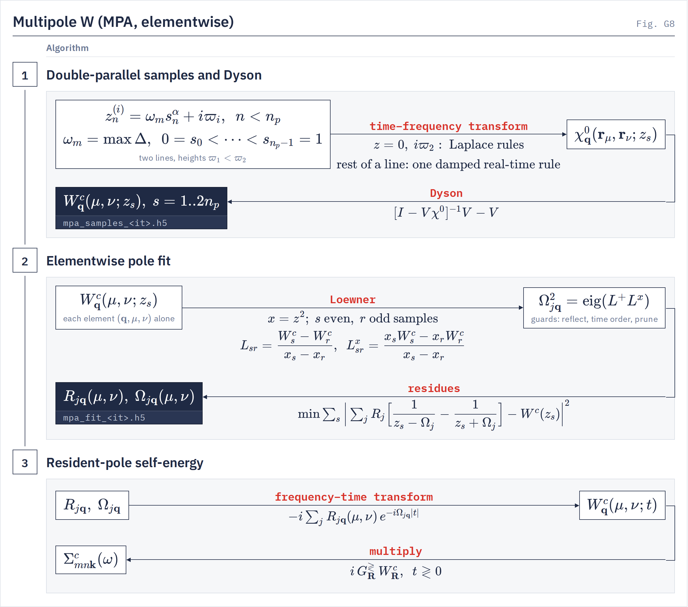

# The multipole W model

`gw.mpa` The elementwise multipole (MPA) fit of $W^c$, `compute_mode = mpa`, kept off the main GW pages.
{: .page-summary }

This page is unlisted. It collects what the GW and theory pages used to say about the multipole model of $W$, which the owner removed from the visible manual on 2026-10-22. The model fits $n_p$ complex poles to every matrix element of $W^c$ from $2n_p$ samples on two lines above the real axis (the multipole approximation of Leon *et al.* [1, 2]); it is the comparison model for the tangential model. Since 2026-10-22 the tangential model is its own value, `compute_mode = tangential`, and `compute_mode = mpa` selects the elementwise fit; the `sigma_w_model` key that used to choose between the two under `compute_mode = mpa` (default `mpa`) is retired ([below](#retired)). Two visible routes still use parts of this machinery: contour deformation runs under `compute_mode = mpa` and builds no fit ([Contour deformation](contour-deformation.md)), and the $\bq\to0$ head of the tangential model is fitted in the scalar multipole form on a double-parallel plan set by the first seven [keys](#keywords) of this page ([The q → 0 head §3](q0-head.md#poles)).

## Overview {: #overview }

!!! treatment supported "mpa · Elementwise multipole · full frequency"
    $n_p$ complex poles per matrix element (`mpa_n_poles`, default 8), fitted to $W^c$ at $2n_p$ points on two lines above the real axis. The comparison model for the tangential model.

    $$
    W^c_{\bq}(\mu,\nu;z)=\sum_{j=1}^{n_p}R_{j\bq}(\mu,\nu)\left[\frac{1}{z-\Omega_{j\bq}(\mu,\nu)}-\frac{1}{z+\Omega_{j\bq}(\mu,\nu)}\right],\qquad \mathrm{Im}\,\Omega_j\le0 \tag{1}
    $$

    ```ini
    compute_mode  = mpa
    mpa_n_poles   = 8
    ```

    **Note** Before 2026-10-22 the input file also read `sigma_w_model = mpa`, the key's default, so `compute_mode = mpa` alone already selected this route. Runs on metals; refuses a time-reversal-broken metal.

## The model {: #model }

`gw.mpa.model`
{: .in-code }

$n_p$ complex poles per matrix element, fitted to $W^c$ at $2n_p$ points on two lines parallel to the real axis (the multipole approximation of Leon *et al.*). $2n_p$ W solves, stored on disk frequency-major. The fit runs element by element; Σ runs each window once per resident batch of `mpa_pole_batch_size` poles (§[Σ](#sigma)).

The samples sit at $z_n=\omega_m s_n^\alpha+i\varpi_{1,2}$, with heights `mpa_varpi_near_ry` and `mpa_varpi_far_ry`. A Loewner pencil in $z^2$ gives the poles, then guards and a residue refit. Each pole keeps its damping in $W^c(t)$, with $\mathrm{Re}\,\Omega_{j\bq}>0$ and $\mathrm{Im}\,\Omega_{j\bq}\le0$.

W evaluated at
:   $z^{(i)}_n=\omega_ms_n^\alpha+i\varpi_i$, $i=1,2$, $n<n_p$

Model
:   $n_p$ poles per element, `mpa_n_poles` (8)

Frequency
:   full frequency

The rows of the [comparison table](frequency-treatments.md#compare-table) and the [GW theory table](../drivers/gw/theory.md#sig-treat) that this model used to fill:

| Treatment | $W$ sampled at | Model for $W^c(\omega)$ | W solves | Σᶜ from | Metals | Status |
|---|---|---|---|---|---|---|
| MPA | $2n_p$ points on two lines | $n_p$ complex poles per element | $2n_p$ (16) | time nodes, $\lceil n_p/4\rceil$ pole batches | runs; refuses time-reversal-broken metals | <span class="status supported">Supported</span> |
| Tangential (for comparison) | 18–40 supports, plus $M_1$, $M_3$ | $K_\bq$ real poles shared by all elements | 18–40 | time nodes, all poles at once | runs | <span class="status production">Production</span> |

Where the treatment table recommended it: on a metal the tangential model is production and MPA runs (GN, HL and COHSEX refuse); on a time-reversal-broken metal the tangential model runs with `head_correction = no_local_fields` and elementwise MPA refuses.

## The double-parallel samples {: #mpa-samples }

`gw.mpa.sampling.double_parallel_grid`
{: .in-code }

With $\omega_m=\max\Delta$ over the screening bands and $n_p$ nested fractions $0=s_0<\dots<s_{n_p-1}=1$, the samples sit on two lines:

$$
z^{(1)}_n=\omega_m s_n^{\alpha}+i\varpi_1,\qquad z^{(2)}_n=\omega_m s_n^{\alpha}+i\varpi_2,\qquad n=0,\dots,n_p-1 \tag{2}
$$

$\varpi_1=$ `mpa_varpi_near_ry` (0.2 Ry) and $\varpi_2=$ `mpa_varpi_far_ry` (2 Ry). On an insulator the first near point is $z=0$ exactly; on a metal it is $i\varpi_0$ with $\varpi_0=$ `mpa_metal_origin_shift_ry` ($2\times10^{-5}$ Ry when unset), a stability displacement, not a broadening. $\alpha=$ `mpa_sampling_alpha` defaults to 1 on an insulator and 2 on a metal. `mpa_sampling_schedule = nested` adds one point per line as $n_p$ grows and moves none. Each point's $\chi^0$ rule follows its analytic character: the static Laplace rule at $z=0$, the imaginary-axis rule at $i\varpi_2$, and one damped real-time rule shared by the rest of a line (§[χ⁰ on the lines](#mpa-lines)).

<figure class="flowchart" markdown>
[](../assets/figures/g8.png)
<figcaption><strong>Fig. G8.</strong> Elementwise MPA: $\chi^0$ and Dyson at the $2n_p$ double-parallel points, a Loewner pencil per element for the poles and one least-squares solve for the residues, then the pole batches enter the time-node Σ.</figcaption>
</figure>

## The elementwise pole fit {: #mpa-fit }

`gw.mpa.pade_fit.fit_mpa_poles`
{: .in-code }

Each element of $W^c$ on the $\bq$ wedge is fitted with $n_p=$ `mpa_n_poles` (default 8, allowed 1–16) poles. In $x=z^2$, with the even samples $s$ and odd samples $r$ as the two interpolation sides, the default `loewner` solver forms

$$
L_{sr}=\frac{W^c_s-W^c_r}{x_s-x_r},\qquad L^{x}_{sr}=\frac{x_sW^c_s-x_rW^c_r}{x_s-x_r},\qquad \Omega_j^2=\mathrm{eig}\big(L^{+}L^{x}\big) \tag{3}
$$

Guards follow in order: reflection when $\mathrm{Re}\,\Omega^2<0$, time order when $\mathrm{Im}\,\Omega^2>0$, then pruning of coincident, out-of-range and null poles. The residues come from one complex least-squares solve over all $2n_p$ samples, on the guarded poles when a guard fired. `companion` and `thiele` change only the pole identification. More poles are not monotonically better: raise $n_p$ only against held-out $W$ and QP energies.

## Metals and broken time reversal {: #mpa-metal }

`gw.mpa.model`
{: .in-code }

On a metal the near origin row $i\varpi_0$ is evaluated exactly by an ordered band-pair scan, because a damped rule at $\varpi_0$ needs about $10^6$ nodes; every other point uses the fractional-occupation contour, with the rule bandwidth taken from the occupation supports. On a time-reversal-broken insulator one ordered sweep also returns $\chi(-\bar z)$, and the fit adds an odd residue per pole:

$$
W^c(z)=\sum_j\left[\frac{R_{j,+}}{z-\Omega_j}-\frac{R_{j,-}}{z+\Omega_j}\right],\qquad R_{j,\pm}=R_j\pm D_j \tag{4}
$$

$\Omega_j$ and the even residue $R_j$ (the code's `B_p`) are fitted on $W_{\mathrm{even}}$ and $D_j$ by a fixed-pole least squares on $W_{\mathrm{odd}}$; empty branches consume $R_+$ and occupied branches $R_-$, as in [Frequency treatments (4.4)](frequency-treatments.md#ppm-odd). Elementwise MPA on a metal with broken time reversal refuses (`GATE mpa_ordered_metal`). The $\bq\to0$ head is fitted on the identical $z$ grid ([The q → 0 head §3](q0-head.md#poles)). Details: [Metals §2](metals.md#response).

On a metal, the default `sigma_w_model` was `mpa` (elementwise poles), a comparison route that refuses when time reversal is measured broken (`GATE mpa_ordered_metal`). The scalar head is fitted on the body's own grid on elementwise MPA ([Metals §2.2](metals.md#resp-plan) gives the metal plan).

| Route | On a metal | Gate |
|---|---|---|
| `compute_mode = mpa` (formerly with `sigma_w_model = mpa`) | runs if time reversal holds | `mpa_ordered_metal` |

In the [time-reversal consumer table](symmetry.md#sym-trs-consumers), the MPA fit carries a second, odd residue when time reversal is broken, like the GN-PPM fit, and elementwise MPA on a metal refuses a time-reversal-broken input file, like `hl_ppm`. On a magnetic input file ([Required DFT inputs](../using/inputs-from-dft.md)) the elementwise multipole fit carries that odd residue per pole and refuses on a metal. Multipole residues, like the tangential ones, use the transpose rule of [Symmetry](symmetry.md).

## χ⁰ on the sample lines {: #mpa-lines }

`minimax.damped_line_rule`
{: .in-code }

The elementwise MPA samples lie on lines $z=\omega+i\varpi$ [1]. Each line takes one positive Gauss–Legendre rule in real time, shared by its points:

$$
\frac{\Delta}{\Delta^2-z^2}=\int_0^\infty e^{izt}\sin(\Delta t)\,dt\approx\sum_i w_i\,e^{izt_i}\sin(\Delta t_i),\qquad t_{\max}=\frac{\ln(2/\varepsilon_\chi)}{\varpi},\quad w_i>0 \tag{5}
$$

Panels are 16 periods of the fastest frequency $\max\lvert\omega\rvert+\Delta_{\max}$ wide, at no fewer than $\pi/2$ nodes per period, with the Gauss–Legendre order capped at `minimax_max_nodes`. The $z=0$ sample takes the static rule and an insulator's $i\varpi_2$ the minimax rule of $\Delta/(\Delta^2+\varpi^2)$. A metal's origin sample, at a height of $2\times10^{-5}$ Ry, would need about $10^6$ nodes and is summed exactly over band pairs instead (§[samples](#mpa-samples)).

!!! refuses
    - A panel that needs a Gauss–Legendre order above `minimax_max_nodes` (`GATE damped_line_panel_order`).

The multipole sample lines are damped by their height, at least 0.2 Ry, so a resolution-limited real-time rule of the kind in [Time–frequency transforms §2.3](time-frequency.md#broadening) is practical there. In the [rules table](time-frequency.md#frame-keys) the multipole route adds two rows:

| Rule | Used for | Times | Accuracy key (default) and meaning | Node cap |
|---|---|---|---|---|
| minimax exponential sum ([§7.1](time-frequency.md#static)) | insulating MPA $z=0$ and $i\varpi_2$ | imaginary | [`minimax_target_error`](../drivers/gw/keywords.md#minimax_target_error) ($10^{-6}$ Ry⁻¹), absolute | [`minimax_max_nodes`](../drivers/gw/keywords.md#minimax_max_nodes) (64) |
| damped-line rule (above) | elementwise MPA line points | real | `minimax_target_error`, relative to $1/\varpi$ | `minimax_max_nodes` per panel order |

`minimax_target_error` is therefore also an absolute error in Ry⁻¹ for the insulating MPA $i\varpi_2$ sample and a relative one, against $1/\varpi$, for the MPA line samples; `minimax_max_nodes` is also the node cap of the insulating-MPA rules and the order cap of one panel of an MPA line rule.

## Σ on the multipole route {: #sigma }

`gw.mpa.sigma`
{: .in-code }

The same Σ executor serves GN-PPM, HL-GPP and elementwise MPA: their elementwise residues $R_{j\bq}(\mu,\nu)$ and poles enter the time-node quadrature of [GW theory (3.3)](../drivers/gw/theory.md#sig-tf) in place of $b_{j\bq}(\mu)b^*_{j\bq}(\nu)$ and $\Omega_{j\bq}$. The resident-pole routes (GN, HL, elementwise MPA) load poles in batches of `mpa_pole_batch_size` (default 4) and run a window once per batch that holds any of its poles; the plasmon-pole store is one batch. The tangential model synthesizes $W^c(t_\ell)$ from all its poles inside each node and pays each node once, while the elementwise multipole route repeats the whole node once per batch of poles ([Tangential W model §6.1](tangential-w.md#sig-synth)). On the fixed-rule routes (static, plasmon-pole and elementwise-MPA screening) with step occupations, the χ⁰ node loop is one `lax.scan` inside one compiled program ([Parallel algorithms](parallel-algorithms.md)).

Band extrapolation is consumed by scalar `mpa` as by the other pole-sum executors; a bispinor MPA fit does not consume it ([Band extrapolation](band-extrapolation.md)). Semicore states outside the requested set are read on the coarse windows of [Time–frequency transforms §8.3](time-frequency.md#win-coarse) on this route as on the tangential one. `screening_diagrams = w_bse` runs one-shot under elementwise `mpa` on a time-reversal-symmetric WFN, besides `cohsex` and `gn_ppm`; `w_rpa_resolvent` refuses it.

Under QSGW, the elementwise fit (`sigma_w_model = mpa` before 2026-10-22) is not identifiable from its 16 samples, so $\Sigma^c$ jumps by 10–20 meV between maps (map gain 14–18 on Si at 24 bands and 192 centroids): use the tangential model ([Quasiparticle self-consistency](qsgw.md)).

## The head on the multipole route {: #head }

On the elementwise MPA route the head is sampled on the body's $2n_p$ complex samples, with $n_p$ poles and the static sample exact, and `whead` is written at $0$. The head refuses a grid different from the body's, because head and body residues are summed in one Σ. The direct head resolver serves the exchange head of MPA runs, so `dipole.h5` must exist there too, although $\bar v_{00}$ does not depend on $S$. In the BSE, the screened head of an MPA run is the static $\bar W_{00}(0)$ only. Multipoint QSGW-MPA heads refuse the imposed head overrides `vhead`, `whead_0freq`, `whead_imfreq`.

### BerkeleyGW's q₀ emulation {: #bgw-q0 }

`bgw_metal_q0_treatment = bgw_q0shift` (default `exact`) takes $\bar v_{00}$ from the analytic inscribed sphere plus the outer Monte Carlo estimator, and the $W$ head from a finite shifted-$\bq_0$ Dyson row at `bgw_metal_q0_vector` (default `0 0 0.125`, reduced coordinates; nonzero and on the k grid). It requires `compute_mode = mpa` and `sys_dim = 3`, sets `mc_average_vcoul_body = false`, and the tangential head refuses it.

## Files {: #files }

| File | Input key | Produced by | Note |
|---|---|---|---|
| `tmp/mpa/mpa_fit_<label>.h5` | `mpa_fit_reuse_file` | an earlier GW run | A finalized elementwise-MPA fit, reused by a one-shot run. |

`mpa_fit_reuse_file` is among the relative paths that resolve against the run directory. `tmp/mpa/` also holds the elementwise-MPA sample and fit stores.

With `sigma_w_model = mpa` the elementwise fit writes `tmp/mpa/mpa_samples_<label>.h5` (`chi_qmunu_z`, `Wc_qmunu_z`, complex128[$n_\omega$, $N_q$, $N_\mu$, $N_\mu$]) and `tmp/mpa/mpa_fit_<label>.h5` (`Omega_p`, `B_p`, complex[$n_p$, $N_q$, $N_\mu$, $N_\mu$], and `fit_condition`, with `B_p` the residue $R_{j\bq}(\mu,\nu)$ itself), each stamped with its frequency grid, WFN and charge-ζ identity. A completed fit is write-once unless `mpa_overwrite_completed_artifacts = true`.

`sigma_mnk.h5`, `eqp_g0w0.dat` and the dynamic `sigma_diag.dat` blocks are written under `mpa` as under the other dynamic treatments. In the ISDF tensor file $n_\omega=1$ for `mpa`. `W0_qmunu` stays a placeholder, with no head scalars, under `mpa` with `sigma_w_model = mpa`; consumers refuse it, and no `W0_lr` is written ([Short- and long-range W](w-range-splitting.md)). Since 2026-10-22 a BSE on a restart written by the multipole route (`compute_mode = mpa`, `sigma_w_model = mpa`) refuses with `GATE bse_mpa_w0`: rerun GW with a static `compute_mode` (`cohsex`, `gn_ppm` or `hl_ppm`) and `write_restart_tensors = true`.

## Refusals {: #refusals }

!!! refuses
    - `mpa_n_poles` outside 1–16, `mpa_sampling_alpha` other than 1 or 2, line heights not $0<\varpi_1<\varpi_2$, `mpa_metal_origin_shift_ry` set on an insulator or not below $\varpi_1$.
    - Sample points that coincide in $x=z^2$. Change $n_p$ or the line heights.
    - Elementwise MPA on a metal with broken time reversal (`GATE mpa_ordered_metal`). Use the tangential model.
    - Under the tangential model: `mpa_pole_batch_size`, `mpa_fit_reuse_file`, `mpa_overwrite_completed_artifacts`, and, when `head_correction = off`, every MPA sampling key (`GATE tangential_unused_inputs`). Remove them.
    - `mpa_fit_reuse_file` without `compute_mode = mpa` and `qp_solver = one_shot_dft`.
    - `bgw_metal_q0_treatment = bgw_q0shift` with `sys_dim = 2`, without `compute_mode = mpa`, or beside an explicit `mc_average_vcoul_body = true`. 
    - A BSE on a restart written by this route (`GATE bse_mpa_w0`).

## Keywords {: #keywords }

Optional
{: .kw-group }

### `compute_mode = mpa` {: .kw data-type="enum value" data-default="—" }
Selects the elementwise multipole route. `compute_mode = auto` never selects it. A metal admits `mpa`, `tangential` and `x_only`. Contour deformation (`sigma_frequency_integration = contour_deformation`) also runs under it.

### `sigma_w_model` (retired) {: #retired .kw data-type="enum" data-default="retired" }
Chose the model of $W^c$ under `compute_mode = mpa`: `mpa` (the default, elementwise poles) or `tangential` (old spelling `shared_pole`). Retired on 2026-10-22: setting it refuses with "`sigma_w_model` is now `compute_mode = tangential` (or `compute_mode = mpa` for the elementwise model)".

**Multipole sampling**
{: #mpa }

These keys configure the elementwise MPA fit (`compute_mode = mpa`). Under `compute_mode = tangential` with the head on, the first seven set the sampling of the head fit and the last three refuse; with the head off all ten refuse (`GATE tangential_unused_inputs`).

### `mpa_n_poles` {: .kw data-type="int" data-default="8" }
Poles per matrix element, 1 to 16.

### `mpa_sampling_alpha` {: .kw data-type="int" data-default="1 insulator, 2 metal" }
Exponent of the nested sampling partition $\omega_n = \omega_m s_n^\alpha$.

`1` `2`
{: .kw-values }

### `mpa_sampling_schedule` {: .kw data-type="enum" data-default="nested" }
Continuation of the sampling above eight poles.

`nested` `leon`
{: .kw-values }

### `mpa_pole_solver` {: .kw data-type="enum" data-default="loewner" }
Pole identification method.

`loewner` `companion` `thiele`
{: .kw-values }

### `mpa_varpi_near_ry` {: .kw data-type="float" data-default="0.2" }
Height of the near complex sampling line, in Ry. Must be below `mpa_varpi_far_ry`.

### `mpa_varpi_far_ry` {: .kw data-type="float" data-default="2.0" }
Height of the far complex sampling line, in Ry.

### `mpa_metal_origin_shift_ry` {: .kw data-type="float" data-default="2e-5" }
Metal only: height of the first near-line sample, $z = i\cdot$shift, in Ry.

Refused on an insulator; must lie below `mpa_varpi_near_ry`.
{: .kw-details }

### `mpa_pole_batch_size` {: .kw data-type="int" data-default="4" }
Fitted-pole slabs resident during the MPA Σ, 1 to 8. Memory schedule only.

### `mpa_fit_reuse_file` {: .kw data-type="path" data-default="(empty)" }
A finalized MPA fit reused read-only, after authentication.

Requires `compute_mode = mpa` and `qp_solver = one_shot_dft`.
{: .kw-details }

### `mpa_overwrite_completed_artifacts` {: .kw data-type="bool" data-default="false" }
Permits replacing a completed MPA sample store or finalized fit.

**BerkeleyGW q₀ emulation**

### `bgw_metal_q0_treatment = bgw_q0shift` {: .kw data-type="enum value" data-default="exact" }
`bgw_q0shift` emulates BerkeleyGW's shifted $q_0$; it needs `compute_mode = mpa` and `sys_dim = 3`, and refuses an explicit `mc_average_vcoul_body = true`. Details [above](#bgw-q0).

### `bgw_metal_q0_vector` {: .kw data-type="string" data-default="0 0 0.125" }
Reduced coordinates of the shifted $q_0$ under `bgw_q0shift`. Three finite numbers, not all zero.

## Notation {: #notation }

| Symbol | Meaning |
|---|---|
| $n_p$, $\varpi_1$, $\varpi_2$, $\omega_m$, $\alpha$ | MPA pole count, line heights, line length, grading |
| $R_{j\bq}(\mu,\nu)$, $\Omega_{j\bq}(\mu,\nu)$ | elementwise residues and poles |
| $R_j$, $D_j$, $R_{j,\pm}$ | even and odd residues; branch residues $R\pm D$ |

## References {: #refs }

1. D. A. Leon, C. Cardoso, T. Chiarotti, D. Varsano, E. Molinari and A. Ferretti, Phys. Rev. B 104, 115157 (2021).
2. D. A. Leon, A. Ferretti, D. Varsano, E. Molinari and C. Cardoso, Phys. Rev. B 107, 155130 (2023).

