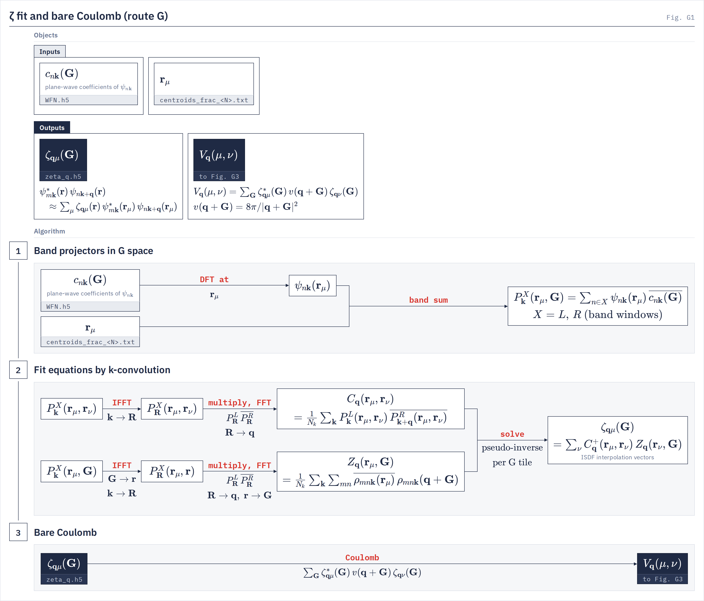
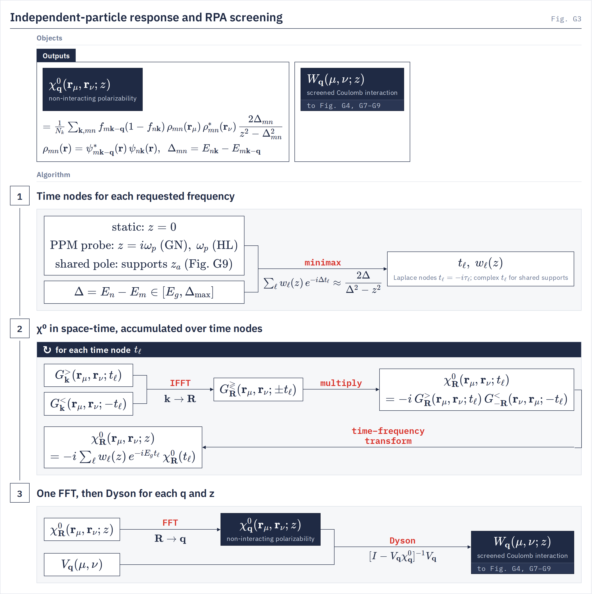
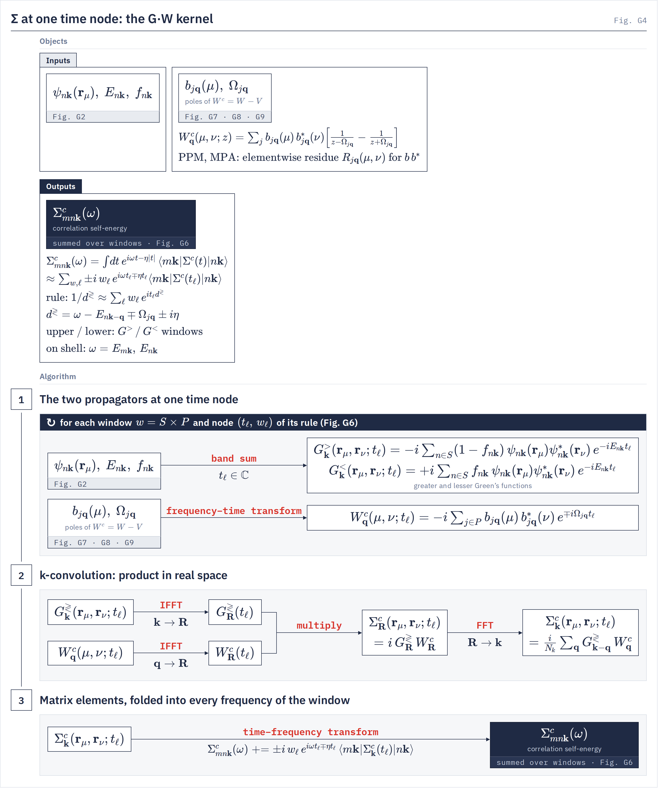

# Parallel algorithms

`runtime`, `isdf.zeta_mubatch`, `gw.w_isdf`, `gw.ppm_accumulators` How the work is laid out over devices, and the streaming procedures that set memory and cost.
{: .page-summary }

## 1 Process mesh and layouts {: #par-mesh }

Every driver runs on one square mesh of $P = p_x\times p_y$ devices, one process per device. Two-axis faces have leading storage proportional to $1/P$ at legal padded extents. Band-complete carriers scale as $1/\sqrt P$; padding, minimum tiles and replicated state set additional floors.
{: .intro }

### 1.1 The mesh {: #par-mesh-grid }

`common.collectives.resolve_mesh`
{: .in-code }

The run builds one mesh with axes `x` and `y`, $p_x = p_y = \sqrt{P}$, at startup. A device count that is not a perfect square refuses and names the two nearest square counts. A process that addresses more than one GPU at $P>1$ refuses (`GATE one_gpu_per_process`): SlabIO, NCCL and the distributed solvers assume one process per GPU.

### 1.2 Faces {: #par-mesh-faces }

`common.wfn_layout.psi_specs`
{: .in-code }

A two-index operator in the ζ basis or on the points, $V_\bq(\mu,\nu)$, $W_\bq(\mu,\nu;z)$, $G_\bk(\br_\mu,\br_\nu;t)$, is held as a face: the left index on `x`, the right on `y`, the $\bk$ or $\bq$ axis whole on every rank (`P(None,'x','y')`). The k axis is never split, because every k-convolution (§[2](#par-kconv)) needs whole columns.

The canonical orbitals $\psi_{n\bk}(\br_\mu)$ are held at the raw parent k-points, in two faces with bands on one mesh axis and centroids on the other, $2\cdot16\,n_{\mathrm{par}}n_sN_\mu N_b/P$ bytes per rank at the padded extents. Some contractions prepare a band-complete carrier for their call or scan, retaining all bands beside one centroid face; that term scales as $1/\sqrt P$. The sub-tile streams of §[2.3](#par-kconv-passes) price that prepared layout against a bounded face route.

### 1.3 Band sums as SUMMA {: #par-mesh-summa }

`distrib_la.panel_matmul`
{: .in-code }

A Green's function at one time node is a band GEMM on the faces, $G_\bk(t)=\psi\,\mathrm{diag}(w_n(t))\,\psi^\dagger$. It runs as a batched 2-D SUMMA: band panels of at most $N_b/p$ columns are all-gathered (left operand over `y`, right over `x`), every $\bk$ in one exchange per panel, and multiplied into the rank's own tile. Two panels are live; no reduction follows, and no rank holds all bands. The band weights scale each panel on its way into the all-gather, so no weighted copy of $\psi$ is made.

## 2 The k-convolution {: #par-kconv }

Every sum over $\bk$ of a product at $\bk$ and $\bk\pm\bq$ is evaluated as a product on the Born–von Kármán lattice. The ζ fit, $\chi^0$, $\Sigma$ and the BSE kernel share one implementation.
{: .intro }

### 2.1 IFFT, product, FFT {: #par-kconv-op }

`ffi.fft`
{: .in-code }

For two k-periodic operators on the same index pair:

$$
\sum_\bk \overline{A_\bk(\mu,\nu)}\,B_{\bk+\bq}(\mu,\nu) = \mathrm{FFT}_{\bR\to\bq}\Big[\,\overline{A_\bR(\mu,\nu)}\,B_\bR(\mu,\nu)\Big], \qquad A_\bR = \mathrm{IFFT}_{\bk\to\bR}\,A_\bk \tag{2.1}
$$

up to the normalization $1/N_k$. The cost is $O(N_kN_\mu^2\log N_k/P)$ per rank instead of $O(N_k^2N_\mu^2/P)$. Each column of $N_k$ values belongs to one rank, so no FFT is distributed. On NVIDIA GPUs one kernel loads a tile of columns, transforms, multiplies and transforms back in shared memory, reading each operand from device memory once; on other devices the same composition runs through XLA or the host FFT library, and a grid the fused kernel cannot hold takes that route with one warning.

| Use | Product in $\bR$ | Page |
|---|---|---|
| ζ fit, $C_\bq$ and $Z_\bq$ | band projectors $\overline{P^L_\bR}\,P^R_\bR$ | [ISDF](isdf.md#isdf-kconv) |
| $\chi^0$ at one time node | $G^{\gtrless}_\bR(t)\,G^{\lessgtr}_{-\bR}(-t)$ | [GW theory §2.2](../drivers/gw/theory.md#scr-chi) |
| $\Sigma^c$ at one time node | $G^{\gtrless}_\bR(t)\,W^c_\bR(t)$ | [GW theory §3.2](../drivers/gw/theory.md#sig-c) |
| BSE W term | trial vector times $W_\bR$ | [BSE theory](../drivers/bse/theory.md) |

### 2.2 Parents only, unfolded on the load {: #par-kconv-unfold }

`ffi.fft`
{: .in-code }

Every object is constructed only on the irreducible wedges: ψ, $G$ and the Σ band matrices at the parent k-points stored in `WFN.h5` ($k_{\mathrm{irr}}$), and ζ, $V_\bq$, $\chi^0_\bq$, $W_\bq$, the Dyson solve and the pole fits on the parent $\bq$ ($q_{\mathrm{irr}}$). The full $\bk$ grid exists only inside the k-convolution kernels. Each kernel reads its parent tiles and applies the symmetry as an index map on its load, before the IFFT: the centroid permutation, the lattice-wrap and translation phases, the spinor rotation, and conjugation on antiunitary rows. A convolution needs every point of the uniform grid, so its cost is unchanged. Its output is kept only at the parent rows, so no full-grid copy of any operand or result is ever stored. A full-grid copy would cost $N_k/n_{\mathrm{par}}$ times the parent bytes per time node; the unfold costs no extra pass.

| Kernel | Reads | Unfold on the load | Keeps |
|---|---|---|---|
| ζ fit, `make_fused_conv_kplane` | parent band projectors $P_{\bar\bk}(\br_\mu,\bG)$ | in G space: G-slot permutation, translation phase, spinor rotation, conjugation | $Z_\bq(\br_\mu,\bG)$ at parent $\bq$ |
| χ⁰ at one time node, `make_kconv_chi_unfold` (mathdx mode 11) | parent Green pair $G^{\gtrless}_{\bar\bk}(\br_\mu,\br_\nu;t)$ | centroid permutation, phases, spinor rotation, transposed partner on antiunitary rows | $\chi^0$ at parent $\bq$ after the forward transform |
| $W$ operand of Σ, `make_kfft_klead_unfold` (mode 9) | $W$ on the $\bq$ wedge | the same, for $W$ | the R-space operand, never the full-zone $W_\bq$ |
| Σ at one time node, `make_kconv_klead_unfold` (mode 7) | parent Green | the same, for $G$ | Σ at the parent k rows only |
| four-current Σ, `make_kconv_lorentz_unfold` (mode 8) | parent $G$ and the $W$ parent tile | the same, for both | Σ at the parent k rows |

CUDA runs each kernel as one fused nvidia-mathdx pass; ROCm runs the same modes through the k-box kernels where they fit; elsewhere the same composition runs in XLA. The operations and their transport are on [Symmetry](symmetry.md#sym-parent-k), and the table of where each stage runs is in [Symmetry §6.1](symmetry.md#sym-work). The wedges need an orbit-closed centroid set ([Centroid selection §5](centroid-selection.md#cs-symmetry)); a set that is not closed runs, with a warning, with every k its own parent and every q computed.

### 2.3 Row passes {: #par-kconv-passes }

`gw.subtile_stream.plan_windows`
{: .in-code }

Σ and the χ⁰ bank are linear in the left index $\mu$, so a rank's $(\mu_x,\nu_y)$ tile is processed in row passes: windows of $R$ local rows, each ending on a whole symmetry orbit of centroids so that the unfold stays local. $R$ is the most rows whose working set fits the fixed tile of §[6.2](#par-mem-tile). The passes run as one `lax.scan` over a table of windows, so the compiled program does not grow with the pass count. A short terminal window retains the compiled carrier width and masks its inactive rows. A fitting axis layout uses band-complete ψ for local Green GEMMs; the face layout streams bounded SUMMA panels instead.

## 3 The ζ fit in G space {: #par-zeta }

The fit forms the right-hand side $Z_\bq(\mu,\bG)$ directly on the ζ sphere, one batch of centroids at a time, and applies $C_\bq^{+}$ afterwards, one $\bG$ tile at a time. No pair density, no $\zeta(\br)$ and no accumulator over $\br$ is ever formed. The equations are on [ISDF and V(q)](isdf.md#isdf-fit).
{: .intro }

<figure class="flowchart" markdown>

<figcaption><strong>Fig. G1.</strong> The algebra of the fit: band projectors (stage 1), Gram and right-hand side by k-convolution and the solve (stage 2), and the Coulomb contraction in G space (stage 3). $Z_\bq(\br_\mu,\bG)$ lands on the ζ sphere and the solve gives $\zeta_{\bq\mu}(\bG)$ directly.</figcaption>
</figure>

### 3.1 Pair projectors, not pair densities {: #par-zeta-proj }

`isdf.pair_kernels`
{: .in-code }

The band sums of the normal equations collapse into one projector per window $X = L, R$, with one leg at a centroid and the other in $\bG$:

$$
\tilde P^X_{\bar\bk}(\br_\mu,\bG) = \sum_{n\in X}\psi_{n\bar\bk}(\br_\mu)\,\overline{c_{n\bar\bk}(\bG)}, \qquad Z_\bq(\br_\mu,\br) = \frac{1}{N_k}\sum_\bk P^L_\bk(\br_\mu,\br)\,\overline{P^R_{\bk+\bq}(\br_\mu,\br)} \tag{3.1}
$$

$c_{n\bar\bk}(\bG)$ are the plane-wave coefficients of `WFN.h5` at the parent $\bar\bk$. Forming $\tilde P$ is one GEMM over bands per window; the cost is linear in the band count and never touches a band pair.

### 3.2 One centroid batch {: #par-zeta-batch }

`isdf.zeta_mubatch.make_route_g_kernel`
{: .in-code }

$\overline{\psi(\bG)}$ of every parent is resident with its $\bG$ slots split over all $P$ ranks. A batch holds $b = P\,c$ centroids; rank $p$ owns $c$ of them, in whole symmetry orbits. Per batch:

1. **Values at the centroids.** $\psi_{n\bar\bk}(\br_\mu)$ for the batch, a partial DFT over each rank's $\bG$ slots and one all-reduce.
2. **Projectors.** $\tilde P^L$ and $\tilde P^R$ of Eq. (3.1) on the rank's $\bG$ slice: one local GEMM per window.
3. **To the owner.** One all-to-all moves each centroid's projectors from the $\bG$ split to its owner, who then holds every $\bG$ for its $c$ centroids.
4. **On the owner, local only.** The typed unfold from parents to the full $\bk$ grid, the FFT to real-space planes, the k-convolution of Eq. (2.1) for every $\bq$, the conjugation closure, the selection of the stored $\bq$, and the forward FFT onto the ζ sphere $|\bq+\bG|^2\le E_\zeta$.
5. **Store.** The rows $Z_\bq(\mu,\bG)$ leave for the Z store while batch $\beta+1$ runs.

Steps 1–3 run per chunk of parents, two collectives per chunk. Every FFT runs on the owner of whole $\mu$ rows, so none is distributed. The owner streams its plane axis in groups, and in blocks when one row's planes exceed the device. With `bispinor = true` the three current channels share steps 1–4 up to the k-convolution.

### 3.3 The Z store and the solve by G tiles {: #par-zeta-solve }

`isdf.zeta_mubatch.ZetaG.contract_v`
{: .in-code }

Each row of $Z_\bq(\mu,\bG)$ is written once to the Z store, $16\,Q\,N_\mu N_\bG/P$ bytes per rank, which never lives on the device: pageable host memory when it fits 0.8 of the node's available memory over its processes, otherwise a SlabIO scratch file beside the ζ file. Then every $\bG$ tile is read once, tile $t+1$ while tile $t$ is contracted, and for the charge channel:

$$
\zeta_\bq(\mu,\bG_t) = B_\bq\big(B_\bq^\dagger Z_\bq(\mu,\bG_t)\big), \qquad V_\bq(\mu,\nu)\mathrel{+}=\sum_{\bG\in t}\zeta^*_{\bq\mu}(\bG)\,v(\bq+\bG)\,\zeta_{\bq\nu}(\bG) \tag{3.2}
$$

with $B_\bq B_\bq^\dagger = C_\bq^{+}$ the rank-truncated factor of [ISDF §2.4](isdf.md#isdf-rcond), held as a face. The tile moves to the face, both products are distributed GEMMs, and $V_\bq$ accumulates in its final face layout, so no rank holds a whole $(\mu,\nu)$ matrix. ζ is written to `zeta_q.h5` in the same pass only when a consumer reads the file. The current channels instead keep a pivoted LU per $\bq$ on the $\bq$ owners.

### 3.4 Memory and cost {: #par-zeta-cost }

`gw.gflat_memory_model.plan_zeta_route_g`
{: .in-code }

The planner prints its choices as `ISDF μ-batch plan` in `gwjax.out`. Per rank, with $n_p$ raw parents, $n_b$ fit bands, $N_{G\psi}$ the ψ sphere, $N_\bG$ the ζ sphere and $N_r$ the FFT grid:

| Object or step | Bytes or work per rank | Lives |
|---|---|---|
| $\overline{\psi(\bG)}$ slice | $16\,n_pn_bn_sN_{G\psi}/P$ | whole fit, on device |
| $C_\bq^{+}$ factor | $16\,Q N_\mu^2/P$ | whole fit, on device |
| one batch | the largest of its three stages (projector exchange; unfold cylinder; plane groups) | per batch |
| Z store | $16\,Q N_\mu N_\bG/P$ | host or disk |
| finalize tile | $\le 6\cdot16\,\lceil Q/P\rceil N_\mu G_{\mathrm{tile}}$, kept below a quarter of the budget | per tile |
| projector GEMMs | $2\,n_pn_s^2N_\mu n_bN_{G\psi}/P$ MACs | summed over batches |
| projector all-to-all | $2\cdot16\,n_pn_s^2N_\mu N_{G\psi}/P$ bytes | summed over batches |
| owner FFTs and k-convolutions | $O\big(N_\mu N_kn_s^2N_r(\log N_r+\log N_k)/P\big)$ | summed over batches |

The batch takes every byte left after the resident terms; the parent chunk and the plane-group width take the fixed tile. No input key sizes the fit. When even the smallest batch (one orbit per owner, one plane per group) does not fit, the fit warns `memory over budget at zeta mu-batch` and runs that configuration; $\psi(\bG)$ is not streamed.

## 4 Time nodes one at a time {: #par-time }

$\chi^0$ and $\Sigma^c$ are evaluated as sums over time nodes ([Time–frequency transforms §3.2](time-frequency.md#frame-node)). Each node is built, used and discarded before the next: the Green's functions at that node, their product in $\bR$, and the fold of the result into every requested frequency with that node's weight. Memory scales with the number of outputs, never with outputs × nodes.
{: .intro }

<figure class="flowchart" markdown>

<figcaption><strong>Fig. G3.</strong> Stage 2 is the node loop of §4.1: per node $t_\ell$ the two Green's functions, their product in $\bR$, and the fold into $\chi^0_\bR(z)$ with weight $w_\ell(z)$; stage 3 is one FFT and the Dyson solve of §5.1.</figcaption>
</figure>

### 4.1 χ⁰ on a fixed rule {: #par-time-chi }

`gw.w_isdf._get_chi_minimax_kernel_fused`
{: .in-code }

On the fixed-rule routes (static and plasmon-pole screening) with step occupations, the node loop is one `lax.scan` inside one compiled program; finite occupations take a contour kernel with the same node structure ([metals](metals.md)). Per node $t_\ell$: the occupied and empty Green's functions at the raw parents, one band GEMM each; one fused k-convolution that unfolds both, transforms them to $\bR$, traces the spin indices of their product and adds it to every output frequency $z_o$:

$$
\chi^0_\bR(\br_\mu,\br_\nu;z_o) \mathrel{+}= \alpha_{\ell o}\,\chi^0_\bR(\br_\mu,\br_\nu;t_\ell), \qquad o = 1,\dots,n_{\mathrm{out}} \tag{4.1}
$$

with $\chi^0_\bR(t_\ell)$ the product of [GW theory Eq. (2.2)](../drivers/gw/theory.md#scr-chi). After the last node, one FFT $\bR\to\bq$ per output. The live set is the two parent Green tiles, $2\cdot16\,n_{\mathrm{par}}n_s^2N_\mu^2/P$ (twice that when complex node times need the conjugate-face partners), their SUMMA panels, and the accumulator, $16\,n_{\mathrm{out}}N_kN_\mu^2/P$, independent of the node count. The accumulator cannot be split over $\bq$, because the k-convolution needs the whole $\bk$ axis.

### 4.2 The shared-node response bank {: #par-time-bank }

`gw.response_bank.integrate_response_group`
{: .in-code }

On the tangential route every support sample of a group shares one set of complex time nodes ([Tangential W model §6.2](tangential-w.md#bank-times)). One Green pair per node serves every member's value and $\partial_s$ derivative and both particle–hole orientations. Per node the product is transformed to $\bq$ and only the rows of the $\bq$ batch and their $-\bq$ partners are kept; they are folded into each member with that member's forward and reverse weights. The carry is $[2\cdot\text{members},\,\bq,\,\mu_x,\,\nu_y]$; the node loop runs over the live nodes only, and the rank's rows run in the passes of §[2.3](#par-kconv-passes).

The group holds every sample when the carry fits the device. Otherwise the stream still runs once, with every sample, and each finished row pass goes to SlabIO's per-rank streamed tier (§[6.3](#par-mem-io)): host memory when the bank takes at most half the host budget, else one file per rank. Splitting the samples into device groups would re-run every Green pair per group; it is used only when the disk refuses the bank and on the full-k Green route.

### 4.3 Σᶜ by windows of nodes {: #par-time-sigma }

`gw.ppm_accumulators._device_window_runner`
{: .in-code }

Each product window ([GW theory §3.3](../drivers/gw/theory.md#sig-tf); why windows: [Time–frequency transforms §4](time-frequency.md#windows)) is one compiled program whose device loop runs the window's nodes; nothing returns to the host between nodes. Per node $t_\ell$:

1. **W at the node.** On the tangential route, $W^c_\bq(t_\ell)=b\,\mathrm{diag}(d_j(t_\ell))\,b^\dagger$ on the irreducible $\bq$ only, by the Green-builder GEMM from the resident pole factors ([Tangential W model §6.1](tangential-w.md#sig-synth)).
2. **Product per row pass.** $W^c$'s window rows are unfolded and transformed to $\bR$ on the load; the parent $G^{\gtrless}(t_\ell)$ of the window's rows is one local GEMM; the k-convolution of Eq. (2.1) forms $\Sigma^c_\bk(\br_\mu,\br_\nu;t_\ell)$ for the window's rows, which are projected on the bands at once.
3. **Fold.** The band matrix at the node is added to the on-shell slots with a per-state coefficient:

$$
\Sigma^c_{mn\bk}(\omega_{m\bk})\mathrel{+}=c_\ell(\omega_{m\bk})\,\langle m\bk|\Sigma^c_\bk(t_\ell)|n\bk\rangle, \qquad c_\ell(\omega) = p\,\alpha_\ell\,e^{-i(E_{\mathrm{ref}}-s\,\omega)t_\ell} \tag{4.2}
$$

and likewise at $\omega_{n\bk}$, on the band diagonal, and for the exact $\partial_\omega$; $s=\pm1$ is the branch and $p$ the window's prefactor. The total is $(2, N_k, N_b, N_b)$ plus diagonals; no history of $\Sigma^c(t)$ is kept, and a frequency grid $(n_\omega, N_k, N_b, N_b)$ exists only under `sigma_omega_grid_debug = true`. On CUDA the loop runs two nodes per trip, so one node's $W$ synthesis and exchange overlap the other's k-convolutions, when the paired program fits the budget.

<figure class="flowchart" markdown>

<figcaption><strong>Fig. G4.</strong> One node of §4.3: the two propagators at $t_\ell$ (stage 1), their product in $\bR$ (stage 2), and the fold of the band matrix into the window's frequencies (stage 3).</figcaption>
</figure>

## 5 Dense per-q linear algebra {: #par-dense }

Dense solves and eigensolves over a stack of $\bq$ (or parent) matrices have two plans: whole matrices per rank, or each matrix over the whole mesh. No plan uses a sub-mesh.
{: .intro }

### 5.1 The Dyson solve {: #par-dense-dyson }

`gw.w_isdf._dyson_route`
{: .in-code }

$W_\bq = [I - V_\bq\chi^0_\bq]^{-1}V_\bq$ for a stack of $Q$ matrices of size $N_\mu$:

- **Local** ([`linalg`](../drivers/gw/keywords.md#linalg) `= local`, default). The stack is resharded from faces to whole matrices, $\lceil Q/P\rceil$ per rank, each rank runs one dense LU per matrix, and $W$ returns to faces by two single-axis all-to-alls. Admitted when the whole matrices fit beside the faces:

$$
16N_\mu^2\big(3\lceil Q/P\rceil+2\big) + 48\,QN_\mu^2/P \le B \tag{5.1}
$$

- **Distributed** (`linalg = distributed`, or local not admitted). $A = I - V\chi^0$ is formed on the faces by SUMMA in $\bq$ blocks, and one batched call of the distributed LU (cuSOLVERMp on CUDA, ScaLAPACK on CPU, partial-pivot `native2d` on ROCm beyond its local room) solves the stack, every matrix over all $P$ ranks. The ROCm mesh algorithm retains local matrix/RHS faces and bounded panels; scalar pivot exchanges add latency, so the mesh route is a capacity choice.

The two plans agree to round-off. With $Q<P$ the local plan leaves $P-Q$ ranks idle; at one $\bq$ and large $N_\mu$ only the distributed plan holds a matrix. Each decision prints once as `route W Dyson …`.

### 5.2 The tangential constructor {: #par-dense-sp }

`gw.tangential_constructor`
{: .in-code }

The constructor reduces each irreducible $\bq$'s samples to poles ([Tangential W model §7.8](tangential-w.md#ritz)). Local rounds give one whole parent per rank and solve its pencil with local dense kernels; they are taken whenever the complete selection stack and a conservative pencil price fit the device, under either `linalg`. Otherwise the face route runs a batch of parents on the whole mesh with distributed GEMMs and eigensolves. A local round holds a whole parent's pencil per rank, so its peak does not fall with $P$; the face route is the path past that point.

### 5.3 BSE trial vectors {: #par-bse-seeds }

Davidson selects its lowest transition energies on the owned band tiles. Each rank contributes only its best candidates' energies and global indices; a stable energy/index ordering selects the requested unit vectors. The full transition-energy tensor and dense trial-vector bank are never assembled on a host. Random trial vectors share Lanczos's physical-shape Gaussian generator, are constructed in their output layout, and have exactly zero padding. This replaces the earlier NumPy random sequence, so the same public seed remains reproducible but can take a different convergence path.

The seed executable includes its final layout conversion in the memory price. A bounded cache reuses it across energy and seed updates with the same shapes, dtypes and shardings; it retains no wavefunction or energy arrays. This removes a setup memory floor; the subsequent matrix-free BSE products and subspace storage still determine the solve's capacity.

Subspace QR still gathers the reduced TSQR factors on each rank: for block width $m$, the stack has up to $Pm^2$ elements. The vector rows remain sharded, but unusually wide orthogonalization has this separate replicated floor. Distributed seeds and selected large-kernel controls do not establish an end-to-end capacity for an arbitrary 144-device calculation.

## 6 Memory and I/O {: #par-mem }

Stage planners share one per-device budget. Streamed loops use bounded tiles, and distributed bulk banks move to and from disk as per-rank hyperslabs. These leading storage terms do not bound the complete live set; see the [cluster memory guidance](../using/clusters.md#budget).
{: .intro }

### 6.1 The budget {: #par-mem-budget }

`lxkit.memory.resolve`
{: .in-code }

Let $L$ be the allocator's enforced limit where available. Otherwise it is the card's memory $M$ less the larger of observed outside usage and the platform's outside allowance. With pending provider contexts $O_{\mathrm{pend}}$ not already withheld from $L$, the platform's reserve fraction $r$, and the ordered-reduction transient $T_{\mathrm{ord}}$:

$$
B = (L-O_{\mathrm{pend}})(1-r)-T_{\mathrm{ord}} \tag{6.1}
$$

The default $T_{\mathrm{ord}}$ is 16 MiB. The minimum over processes is used, so every rank plans the same shapes. Outside allowances and reserve fractions are planning inputs, not constant physical peaks. A positive [`memory_per_device_gb`](../drivers/gw/keywords.md#memory_per_device_gb) can only lower $B$; a larger value warns and is ignored. The A100-40GB example is $B$ = 31.6 GB (`local`) under its default-model assumptions; the resolved report value takes precedence.

### 6.2 The fixed tile {: #par-mem-tile }

`runtime.tiles.tile_units`
{: .in-code }

A loop that streams over $\bk$, $\bq$, bands, centroids, samples or rows takes the most units whose bytes per rank fit 1 GiB. The count comes from the loop's shapes alone, never from free memory or the budget, so every rank compiles the same loop and results do not depend on the memory a run was given. Some planners still size from the budget: the ζ batch and $\bG$ tile, the response sample group and the tangential synthesis panels.

A price above the budget never refuses: the stage prints one `memory over budget at <stage>` warning, runs at its smallest size, and fails only if the device truly lacks the room. A compiled module larger than the whole card refuses before it runs (`GATE xla_rematerialization`).

### 6.3 Collective HDF5 I/O {: #par-mem-io }

`file_io.slab_io.SlabIO`
{: .in-code }

Bulk arrays ($V_\bq$, $W_\bq(0)$, ζ, the Z store, the tangential bank and model) are read and written by SlabIO through parallel HDF5: each rank reads and writes only its own hyperslab, and no array is gathered onto one rank or one host. The file holds the logical array; its bytes do not depend on the mesh that wrote it, so an ISDF tensor file written at one $P$ reads at another. Large writes are cut into row blocks of at most 64 MiB per rank written independently in file order; other layouts use two-phase collective I/O. One queue per process keeps every rank's collective HDF5 calls in the same order.

The per-rank streamed tier holds a bank that fits nowhere else: each rank writes and reads its own rows, in host memory or in one file per rank, and the tier is released within the map.

## Notation

| Symbol | Meaning |
|---|---|
| $P$, $p_x=p_y$ | devices (one process each); mesh side |
| $N_\mu$, $\mu$, $\nu$ | centroid count; left index (on `x`), right index (on `y`) |
| $N_k$, $n_{\mathrm{par}}$, $n_p$ | full-grid k-points; raw parent k-points held |
| $Q$ | stored $\bq$ of the ζ fit and the Dyson stack (the irreducible wedge when the grid is reduced) |
| $N_b$, $n_b$, $n_s$ | bands carried; bands in the fit windows; spinor components |
| $N_\bG$, $N_{G\psi}$, $N_r$ | ζ sphere, ψ sphere and FFT-grid sizes |
| $\tilde P^X_{\bar\bk}(\br_\mu,\bG)$ | band projector of window $X$ with one leg in G space |
| $b$, $c$ | centroids per ζ batch; per owner, $b = Pc$ |
| $B_\bq$ | factor of the charge fit, $B_\bq B_\bq^\dagger = C_\bq^{+}$ |
| $t_\ell$, $\alpha_{\ell o}$ | time node; its weight for output $o$ |
| $c_\ell(\omega)$, $s$, $p$ | Σ fold coefficient; branch sign; window prefactor |
| $B$, $M$, $O$ | per-device budget; card memory; bytes outside XLA's pool |
| $R$ | rows per pass of a sub-tile stream |

## References

1. R. A. van de Geijn and J. Watts, Concurrency: Pract. Exper. 9, 255 (1997).
2. J. Lu and L. Ying, J. Comput. Phys. 302, 329 (2015).

