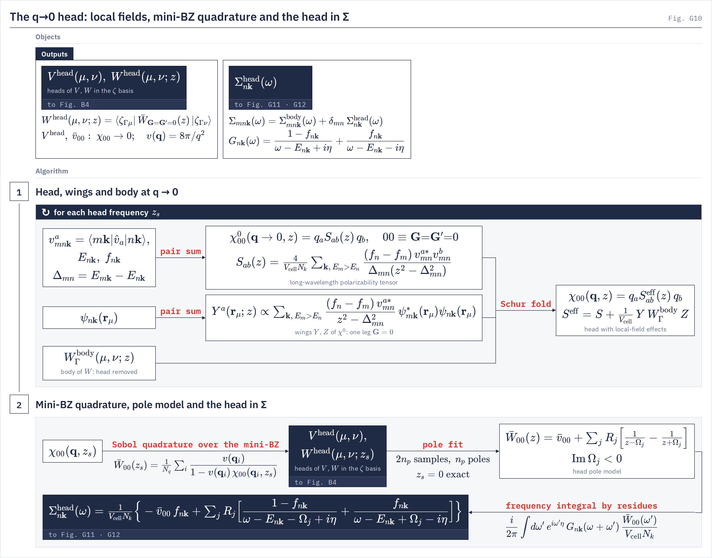

# The q → 0 head

`gw.head_correction` The singular long-wavelength element of $V$ and $W$, replaced by its mini-BZ cell average with local fields and added to Σ and the BSE.
{: .page-summary }

<figure class="flowchart" markdown>

<figcaption><strong>Fig. G10.</strong> Stage 1 builds the head of χ⁰ from velocity matrix elements and dresses it with local fields from the wings and the headless Γ body of $W$. Stage 2 averages the bare and screened kernels over the Γ cell of the mini-BZ, fits the screened average with a pole model and closes the frequency integral of Σ in closed form. The dark boxes are outputs: $V^{\mathrm{head}}$, $W^{\mathrm{head}}$ go to the BSE, $\Sigma^{\mathrm{head}}_{n\bk}$ to the QP solve.</figcaption>
</figure>

## 1 The long-wavelength response {: #response }

A finite k grid never samples $\bq+\bG=0$. The ζ-basis tiles $V_\bq(\mu,\nu)$ and $W_\bq(\mu,\nu;z)$ are built with that slot set to zero, and this channel supplies it. It is a scalar channel threaded through the GW driver, not a separate program.
{: .intro }

### 1.1 Head, wings and body {: #head-wings-body }

Write $00$ for $\bG=\bG'=0$. At $\bq\to0$ the response splits into the head $\chi^0_{00}$, the wings $\chi^0_{0\bG'}$ and $\chi^0_{\bG0}$, and the body $\chi^0_{\bG\bG'}$ with $\bG,\bG'\neq0$. The head vanishes as $q^2$ and the Coulomb kernel diverges as $1/q^2$, so their product is finite and depends on the direction of $\bq$:

$$
v(\bq)\,\chi^0_{00}(\bq\to0,z) = \frac{8\pi}{q^2}\,q_a S_{ab}(z)\,q_b , \qquad v(\bq)=\frac{8\pi}{q^2} \tag{1.1}
$$

Rydberg atomic units are used throughout: $\bq$ is Cartesian in bohr⁻¹ and $v$ is in Ry bohr³.

### 1.2 The polarizability tensor {: #s-tensor }

`gw.qsgw_head.head_s_tensor_sharded`
{: .in-code }

$S_{ab}(z)$ is the long-wavelength polarizability tensor, the Cartesian $q^2$ coefficient of $\chi^0_{00}$. It is a sum over every energy-ordered band pair, built from the velocity matrix elements $v^a_{mn\bk}=\langle m\bk|\hat v_a|n\bk\rangle$ of `dipole.h5`:

$$
S_{ab}(z)=\frac{4}{V_{\mathrm{cell}}N_k\,n_{\mathrm{spin}}n_{\mathrm{spinor}}}\sum_{\bk}\sum_{E_{m\bk}>E_{n\bk}}
\frac{(f_{n\bk}-f_{m\bk})\,v^{a*}_{mn\bk}\,v^{b}_{mn\bk}}{\Delta_{mn\bk}\big[(z+i\eta)^2-\Delta_{mn\bk}^2\big]},
\qquad \Delta_{mn\bk}=E_{m\bk}-E_{n\bk} \tag{1.2}
$$

$S$ is in 1/(Ry bohr²), so $v\,q_aS_{ab}q_b$ is dimensionless. The occupation difference is signed and there is no occupied-band boundary. Only the symmetric part of $S$ survives $q_aq_b$; producers that feed a Γ-cell solve remove the antisymmetric (Hall) part of a magnet.

The pair sum runs over the χ⁰ band manifold, up to `number_bands_chi` (default: `number_bands`). The broadening $\eta$ is `wcoul0_eta` (default `0.0`, Ry); leave it at zero for insulators. The velocity and its nonlocal commutator are on [Velocity operator](velocity-operator.md).

!!! note
    On a metal $S$ keeps only the interband share of each pair. The intraband (Drude) term and its Thomas–Fermi limit enter separately, sample by sample in the cell average: [Metals §3](metals.md#head).

### 1.3 Local fields: the Schur fold {: #schur }

`fold_cartesian_head_wings_sharded`
{: .in-code }

The wings $Y^a(\br_\mu;z)$ and $Z^b(\br_\nu;z)$ have one velocity leg and one pair-density leg $\psi^*_{m\bk}(\br_\mu)\psi_{n\bk}(\br_\mu)$. Eliminating the body from the bordered Dyson equation, against the headless Γ body $W^{\mathrm{body}}_\Gamma(\mu,\nu;z)$ (the Γ row of the Dyson solve, or the [tangential](tangential-w.md) store evaluated at Γ), gives the head with local fields:

$$
\chi_{00}(\bq,z)=q_aS^{\mathrm{eff}}_{ab}(z)\,q_b,\qquad
S^{\mathrm{eff}}_{ab}(z)=S_{ab}(z)+\frac{1}{V_{\mathrm{cell}}}\,Y^a(z)\,W^{\mathrm{body}}_\Gamma(z)\,Z^b(z) \tag{1.3}
$$

The product $Y W^{\mathrm{body}}_\Gamma Z$ is contracted over $(\mu,\nu)$. `head_correction` selects the policy:

| `head_correction` | Head response | Use |
|---|---|---|
| `full` (default) | $S^{\mathrm{eff}}$: $S$ folded once against $W^{\mathrm{body}}_\Gamma$ | production |
| `no_local_fields` | $S$ alone, no wings and no fold (the direct head) | metals on four-current decks; comparison |
| `off` | no head: $\bar v_{00}=\bar W_{00}=0$ | debugging brute-force k convergence |

Under `bispinor_gw = full_tangential` an unset `head_correction` resolves to `no_local_fields`, and an explicit `full` refuses. On a time-reversal-broken (ordered) tangential store `full` folds the signed Γ body $b\,D_+b^\dagger-[b\,D_-b^\dagger]^{\mathsf T}$, $D_\pm(z)=1/(z\mp\Omega)$, against wings summed over both orders of every band pair; on an ordered metal `full` refuses (`GATE tangential_head_ordered`) and `no_local_fields` is the route. The retired `do_G0` maps `false` to `off` and `true` to `full`. The four-current routes carry further Lorentz channels; this page covers the scalar charge head.

### 1.4 Where the head response comes from {: #sources }

`qsgw_head.build_dft_head_response`
{: .in-code }

Three producers return $S$ in the convention of (1.2). One-shot runs with `head_correction = full` build $S$, the wings and the fold from `dipole.h5` on the run's own occupations. The direct resolver serves `no_local_fields`, `x_only` and the exchange head of MPA and self-consistent runs; its source is `wcoul0_source` (default `s_tensor`, which reads `dipole.h5`). QSGW maps rebuild $S$ from the QP-rotated velocity when `sc_head_update` asks for it ([Quasiparticle self-consistency](qsgw.md)).

!!! note
    `dipole.h5` must exist on every route that reads the direct resolver, including the exchange head of an MPA run, although $\bar v_{00}$ does not depend on $S$. A `dipole.h5` built with another velocity operator, with or without the nonlocal commutator, refuses on every route (`GATE static_head_dipole_operator`, `GATE dft_head_dipole_provenance`). One written for another WFN or band window refuses on the folded `full` head (`GATE dft_head_dipole_provenance`); on the direct resolver it only warns, unless `LORRAX_SANITY=strict`. Rerun the [dipole utility](../utilities/dipole.md).

## 2 Mini-BZ cell averages {: #minibz }

The Γ sample of the k grid stands for a whole cell of the mini-BZ. The head replaces the missing slot by the average of the kernel over that cell, screening each sample before averaging.
{: .intro }

### 2.1 The averages {: #minibz-avg }

`gw.vcoul.compute_q0_averages_screened`
{: .in-code }

At each head frequency $z_s$ the bare and screened averages over the Γ Voronoi cell of the mini-lattice are:

$$
\bar v_{00}=\big\langle v(\bq)\big\rangle_{\mathrm{mBZ}},\qquad
\bar W_{00}(z_s)=\Big\langle\frac{v(\bq)}{1-v(\bq)\,\chi_{00}(\bq,z_s)}\Big\rangle_{\mathrm{mBZ}} \tag{2.1}
$$

Both are in Ry bohr³. Screening comes before averaging: $\langle v/(1-v\chi)\rangle\neq\bar v/(1-\bar v\langle\chi\rangle)$. On an insulator $\chi_{00}<0$ at $z=0$, so $\bar W_{00}(0)<\bar v_{00}$.

### 2.2 Bulk: Sobol cubature {: #minibz-bulk }

`vcoul.Bulk3D`
{: .in-code }

With `sys_dim = 3` the cell is sampled by scrambled Sobol points folded into the Γ Voronoi cell: $2^{18}$ points per replicate, 10 replicates, one draw shared by every frequency. With $N_q$ samples $\bq_i$:

$$
\bar W_{00}(z_s)\approx\frac{1}{N_q}\sum_i\frac{v(\bq_i)}{1-v(\bq_i)\,q_{i,a}S^{\mathrm{eff}}_{ab}(z_s)\,q_{i,b}} \tag{2.2}
$$

`head_minibz_average = true` (default `false`) adds the analytic Baldereschi–Tosatti sphere to $\bar v_{00}$ and widens the Voronoi fold from one to three shells. A BSE run must use the GW run's value. The sample and replicate counts are not deck keys.

### 2.3 Slabs: exact Wigner–Seitz cubature {: #minibz-slab }

`vcoul.Slab2D`
{: .in-code }

With `sys_dim = 2` (vacuum along $c$) the kernel is truncated at $z_c=L_z/2$. At $\bG=0$ and in-plane $\bq$:

$$
v(\bq)=\frac{8\pi}{q^2}\big(1-e^{-z_c q}\big)\;\xrightarrow{q\to0}\;\frac{8\pi z_c}{q} \tag{2.3}
$$

The integrand is a $1/q$ cusp, not a pole. Both averages of (2.1) run on the exact Wigner–Seitz polygon of the mini-lattice, cut into Γ-to-edge triangles with the Duffy map, whose Jacobian cancels the cusp, on a fixed 16/24/32-point Gauss–Legendre ladder. The call refuses when the 24→32 pair misses its tolerance. Sobol sampling is a named debug rule on a slab and is never selected. `head_minibz_average` refuses on a slab.

### 2.4 The heads in the ζ basis {: #zeta }

`apply_q0_head_rank1`
{: .in-code }

The head of $W$ in the ζ basis is the matrix element of the averaged $\bG=\bG'=0$ element between the Γ interpolation vectors:

$$
W^{\mathrm{head}}(\mu,\nu;z)=\langle\zeta_{\Gamma\mu}|\,\bar W_{00}(z)\,|\zeta_{\Gamma\nu}\rangle
=\frac{1}{V_{\mathrm{cell}}}\,\zeta^*_{\Gamma\mu}(\bG{=}0)\,\bar W_{00}(z)\,\zeta_{\Gamma\nu}(\bG{=}0) \tag{2.4}
$$

$V^{\mathrm{head}}(\mu,\nu)$ is the same expression with $\bar v_{00}$. The $1/V_{\mathrm{cell}}$ is the plane-wave normalization of the matrix element, so the stored scalars $\bar v_{00}$, $\bar W_{00}$ stay in Ry bohr³. These rank-1 tiles are what the BSE adds to $V_\Gamma$ and $W_\Gamma$ (§5). Σ uses the scalars directly (§4).

## 3 The head pole model {: #poles }

The correlation part of the head, $\bar W^c_{00}(z)=\bar W_{00}(z)-\bar v_{00}$, is sampled at the frequencies the Σ treatment asks for and fitted by a scalar pole model, so that its frequency integral in Σ closes analytically.
{: .intro }

### 3.1 Head frequencies {: #poles-samples }

The head is sampled on the body's frequency plan. Its samples, its model and the frequencies written to the restart bundle depend on `compute_mode`:

| Treatment | Head samples $z_s$ | Head model | `whead` written at |
|---|---|---|---|
| COHSEX | $0$ | static | $0$ |
| GN-PPM | $0$, $i\omega_p$ | one pole, two-point fit | $0$, $i\omega_p$ |
| HL-GPP | $0$ | one pole, f-sum rule | $0$, $\omega_p$ |
| MPA | the body's $2n_p$ complex samples | $n_p$ poles, static sample exact | $0$ |
| tangential | its own $2n_p$-point MPA plan, the tangential Γ body evaluated there | $n_p$ poles, static sample exact | $0$ |

$\omega_p$ is `ppm_omega_p` (default `2.0` Ry) and $n_p$ is `mpa_n_poles` (default `8`). The MPA samples lie on two lines $z_s=\omega_s+i\varpi$ with heights `mpa_varpi_near_ry` and `mpa_varpi_far_ry` (defaults `0.2`, `2.0` Ry). On the elementwise MPA route the head refuses a grid different from the body's, because head and body residues are summed in one Σ. Under `sigma_w_model = tangential` the body has no such grid: the head builds the same double-parallel plan from the `mpa_*` keys on the recipe's energy span, which is why those keys stay legal there while the head is on. The treatments themselves are on [Frequency treatments of Σ](frequency-treatments.md).

### 3.2 The fit {: #poles-fit }

`mpa.model.fit_head_samples`
{: .in-code }

The screened head takes the elementwise multipole form ([Frequency treatments §5.2](frequency-treatments.md#mpa-fit)) with scalar residues and complex poles:

$$
\bar W_{00}(z)=\bar v_{00}+\sum_jR_j\left[\frac{1}{z-\Omega_j}-\frac{1}{z+\Omega_j}\right],\qquad \mathrm{Im}\,\Omega_j<0 \tag{3.1}
$$

MPA and tangential runs fit $n_p$ poles to $2n_p$ samples, then re-solve the residues with the sample nearest $z=0$ as an equality constraint, because that sample alone fixes the on-shell head (§4.3). The negative imaginary parts of $\Omega_j$ are the time-ordered $i\eta$; no further broadening is added.

GN-PPM fits one pole to the two samples $0$ and $i\omega_p$. HL-GPP takes its pole from the f-sum rule, with $N_e$ the WFN electron count:

$$
\Omega_h^2=\frac{\omega_{\mathrm{pl}}^2}{1-\bar W_{00}(0)/\bar v_{00}},\qquad \omega_{\mathrm{pl}}^2=\frac{16\pi N_e}{V_{\mathrm{cell}}},\qquad R_h=-\tfrac12\bar W^c_{00}(0)\,\Omega_h \tag{3.2}
$$

`ppm_head_omega_h_ry` (unset by default, Ry) fixes $\Omega_h$ for both PPM treatments; $\bar W^c_{00}(0)$ is still computed and sets the residue. MPA does not read it.

## 4 The head in Σ {: #sigma }

In Σ the head is a band-diagonal, frequency-dependent shift with weight $1/(V_{\mathrm{cell}}N_k)$. Exchange and correlation heads have closed forms.
{: .intro }

### 4.1 Why the head is band-diagonal {: #sigma-diag }

The $\bG=0$ pair density $\langle m\bk|e^{i\bq\cdot\br}|n\bk\rangle$ tends to $\delta_{mn}$ as $\bq\to0$, so the missing slot couples only the band diagonal. Σ uses this exact $\delta_{mn}$ scalar route, not the rank-1 ζ tile of (2.4), which would carry the ISDF error of the $\bG=0$ pair density:

$$
\Sigma_{mn\bk}(\omega)=\Sigma^{\mathrm{body}}_{mn\bk}(\omega)+\delta_{mn}\,\Sigma^{\mathrm{head}}_{n\bk}(\omega) \tag{4.1}
$$

The Γ wings of $W$ (the $(\bG=0,\mu)$ blocks) are not reattached in Σ. Their leading term is odd in $\bq$ and vanishes in the cell average, so the omission is $O(1/N_k)$.

### 4.2 Exchange head {: #sigma-x }

`compute_static_head_terms`
{: .in-code }

With $\Sigma^x=i\sum_\bq G^<(t{=}0)\,V$, the head slot contributes:

$$
\Sigma^{x,\mathrm{head}}_{n\bk}=\frac{i\,G^<_{n\bk}(t{=}0)\,\bar v_{00}}{V_{\mathrm{cell}}N_k}=-\frac{\bar v_{00}\,f_{n\bk}}{V_{\mathrm{cell}}N_k} \tag{4.2}
$$

It is added with the static terms, before the correlation part.

### 4.3 Correlation head {: #sigma-c }

`_head_pole_sum`
{: .in-code }

Closing $\frac{i}{2\pi}\int d\omega'\,e^{i\omega'0^+}\,G_{n\bk}(\omega+\omega')\,\bar W_{00}(\omega')/(V_{\mathrm{cell}}N_k)$ by residues, with the pole model (3.1) and $G_{n\bk}(\omega)=\frac{1-f_{n\bk}}{\omega-E_{n\bk}+i0^+}+\frac{f_{n\bk}}{\omega-E_{n\bk}-i0^+}$, gives exchange and correlation in one expression:

$$
\Sigma^{\mathrm{head}}_{n\bk}(\omega)=\frac{1}{V_{\mathrm{cell}}N_k}\Big\{-\bar v_{00}f_{n\bk}
+\sum_jR_j\Big[\frac{1-f_{n\bk}}{\omega-E_{n\bk}-\Omega_j}+\frac{f_{n\bk}}{\omega-E_{n\bk}+\Omega_j}\Big]\Big\},\qquad \mathrm{Im}\,\Omega_j<0 \tag{4.3}
$$

$\omega$ and $E_{n\bk}$ are measured from $E_F$. On MPA and tangential runs the fitted widths $-\mathrm{Im}\,\Omega_j$ play the role of $\eta$; the plasmon-pole head takes $\Omega_h-10^{-6}i$ Ry. Neither uses `sigma_regularization_ev`, the body's $\eta$. At $\omega=E_{n\bk}$ the correlation part is $(\tfrac12-f_{n\bk})\,\bar W^c_{00}(0)/(V_{\mathrm{cell}}N_k)$ for any pole model, which is why the fit reproduces the static sample exactly. The pole sum is evaluated analytically and added to the Σ body at finalize, outside the body's frequency quadrature.

!!! note
    The code's MPA residue `B_p` is $R_j$. Its PPM `R_h` is the residue $R_h$ of (3.2), and its `B_h` is $2\Omega_hR_h=-\bar W^c_{00}(0)\,\Omega_h^2$.

### 4.4 Static COHSEX head {: #sigma-cohsex }

With `compute_mode = cohsex` the head terms are static and exact:

$$
\Sigma^{\mathrm{SX,head}}_{n\bk}=-\frac{\bar W_{00}(0)\,f_{n\bk}}{V_{\mathrm{cell}}N_k},\qquad
\Sigma^{\mathrm{COH,head}}_{n\bk}=\frac{\bar W_{00}(0)-\bar v_{00}}{2\,V_{\mathrm{cell}}N_k} \tag{4.4}
$$

Occupations that differ inside an exactly degenerate multiplet refuse, because a band-diagonal head would split the multiplet.

## 5 What the BSE receives {: #bse }

The BSE adds the head back into the Γ tiles of $V$ and $W$ instead of shifting band energies, because its kernel is not band-diagonal.
{: .intro }

### 5.1 Stored head scalars {: #bse-scalars }

`gw_output.persist_w0_and_head`
{: .in-code }

With `write_restart_tensors = true` (the default) the restart bundle `tmp/isdf_tensors_<N_mu>.h5` carries the head beside $W_0$:

| Dataset | Holds | Unit |
|---|---|---|
| `vhead` | $\bar v_{00}$ | Ry bohr³ |
| `whead` | $\bar W_{00}$ at `omega_grid` (§3.1), with attributes `head_correction`, `response_kind`, `head_source` | Ry bohr³ |
| `S_cart_head` | $S^{\mathrm{eff}}(0)$, attribute `convention = cartesian_q2_coefficient` | 1/(Ry bohr²) |

### 5.2 The rank-1 update {: #bse-rank1 }

`bse_head._inject_q0_head`
{: .in-code }

With $g_0(\mu)=\zeta_\Gamma(\mu,\bG{=}0)$ the BSE adds (2.4) at $z=0$ as rank-1 tiles:

$$
V_\Gamma(\mu,\nu)\mathrel{+}=\frac{\bar v_{00}}{V_{\mathrm{cell}}}\,g^*_0(\mu)\,g_0(\nu),\qquad
W_\Gamma(\mu,\nu;0)\mathrel{+}=\frac{\bar W_{00}(0)}{V_{\mathrm{cell}}}\,g^*_0(\mu)\,g_0(\nu) \tag{5.1}
$$

$V^{\mathrm{head}}$ is always added. The screened head is added only when a screened $W_0$ was loaded, and on MPA runs it is the static $\bar W_{00}(0)$ only. The BSE kernel, its densified grids (`w_head_densify`, default `c1`, which reattaches the head inside the coarse Γ cell from `S_cart_head`) and the exciton-band LT tensor are on the [BSE theory](../drivers/bse/theory.md) and [exciton-bands theory](../drivers/exciton-bands/theory.md) pages.

## 6 Imposed heads and BerkeleyGW {: #bgw }

BerkeleyGW computes $\varepsilon^{-1}$ at a small shifted $\bq_0$ and combines its head with the mini-BZ average of $v$. LORRAX has no $\bq_0$ calculation; three keys reproduce or impose the BerkeleyGW head for cross-code checks.
{: .intro }

### 6.1 Imposed head values {: #bgw-impose }

`resolve_head_override`
{: .in-code }

`vhead`, `whead_0freq` and `whead_imfreq` (all unset by default, Ry bohr³) replace $\bar v_{00}$, $\bar W_{00}(0)$ and the GN probe value $\bar W_{00}(i\omega_p)$. In BerkeleyGW terms:

$$
\bar v_{00}\;\leftrightarrow\;\texttt{vcoul}(\bq_0),\qquad \bar W_{00}(0)\;\leftrightarrow\;\bar v_{00}\,\varepsilon^{-1}_{00}(\bq_0,0) \tag{6.1}
$$

where `vcoul`($\bq_0$) is row 1 of BerkeleyGW's sigma-side table. An override applies only when the $W$ value for that frequency is also set. A GN deck that overrides the static head without `whead_imfreq` fits one computed and one imposed sample and logs `[head] MIXED HEAD`. `vhead` takes precedence over the restart value in the BSE. Multipoint QSGW-MPA heads refuse overrides.

### 6.2 BerkeleyGW's q₀ emulation {: #bgw-q0 }

`bgw_metal_q0_treatment = bgw_q0shift` (default `exact`) takes $\bar v_{00}$ from the analytic inscribed sphere plus the outer Monte Carlo estimator, and the $W$ head from a finite shifted-$\bq_0$ Dyson row at `bgw_metal_q0_vector` (default `0 0 0.125`, reduced coordinates; nonzero and on the k grid). It requires `compute_mode = mpa` and `sys_dim = 3`, sets `mc_average_vcoul_body = false`, and the tangential head refuses it.

### 6.3 The epshead source {: #bgw-epshead }

`wcoul0_source = epshead` replaces the direct head sample by an isotropic model fitted to BerkeleyGW's $\varepsilon^{-1}_{00}(\bq_0,0)$ from `eps0mat.h5`. It is static and reuses $\omega=0$ at every frequency. It serves only the direct resolver (§1.4); the folded head of a `full` run is built from `dipole.h5` regardless. A missing file refuses.

## Notation {: #notation }

| Symbol | Meaning |
|---|---|
| $00$ | the $\bG=\bG'=0$ element |
| $S_{ab}(z)$, $S^{\mathrm{eff}}_{ab}(z)$ | long-wavelength polarizability tensor; with local fields |
| $v^a_{mn\bk}$, $\Delta_{mn\bk}$ | velocity matrix elements; $E_{m\bk}-E_{n\bk}$ |
| $Y^a(\br_\mu;z)$, $Z^b(\br_\nu;z)$ | wings of χ⁰ (one leg at $\bG=0$) |
| $W^{\mathrm{body}}_\Gamma(\mu,\nu;z)$ | Γ body of $W$ with the head removed |
| $\bar v_{00}$, $\bar W_{00}(z)$, $\bar W^c_{00}$ | mini-BZ averages of $v$ and $W$ (Ry bohr³); $\bar W_{00}-\bar v_{00}$ |
| $V^{\mathrm{head}}(\mu,\nu)$, $W^{\mathrm{head}}(\mu,\nu;z)$ | heads of $V$ and $W$ in the ζ basis |
| $g_0(\mu)$ | $\zeta_\Gamma(\mu,\bG{=}0)$ |
| $R_j$, $\Omega_j$ | scalar residues and poles of the head model ($R_h$, $\Omega_h$ for a plasmon pole) |
| $z_c$ | slab truncation length, $L_z/2$ |
| $V_{\mathrm{cell}}$, $N_k$ | cell volume; number of k points |

## References {: #refs }

1. S. L. Adler, Phys. Rev. 126, 413 (1962).
2. N. Wiser, Phys. Rev. 129, 62 (1963).
3. A. Baldereschi and E. Tosatti, Phys. Rev. B 17, 4710 (1978).
4. M. S. Hybertsen and S. G. Louie, Phys. Rev. B 34, 5390 (1986).
5. R. W. Godby and R. J. Needs, Phys. Rev. Lett. 62, 1169 (1989).
6. S. Ismail-Beigi, Phys. Rev. B 73, 233103 (2006).
7. J. Deslippe, G. Samsonidze, D. A. Strubbe, M. Jain, M. L. Cohen and S. G. Louie, Comput. Phys. Commun. 183, 1269 (2012).
8. D. A. Leon, C. Cardoso, T. Chiarotti, D. Varsano, E. Degoli and A. Ferretti, Phys. Rev. B 104, 115157 (2021).
9. M. G. Duffy, SIAM J. Numer. Anal. 19, 1260 (1982).

