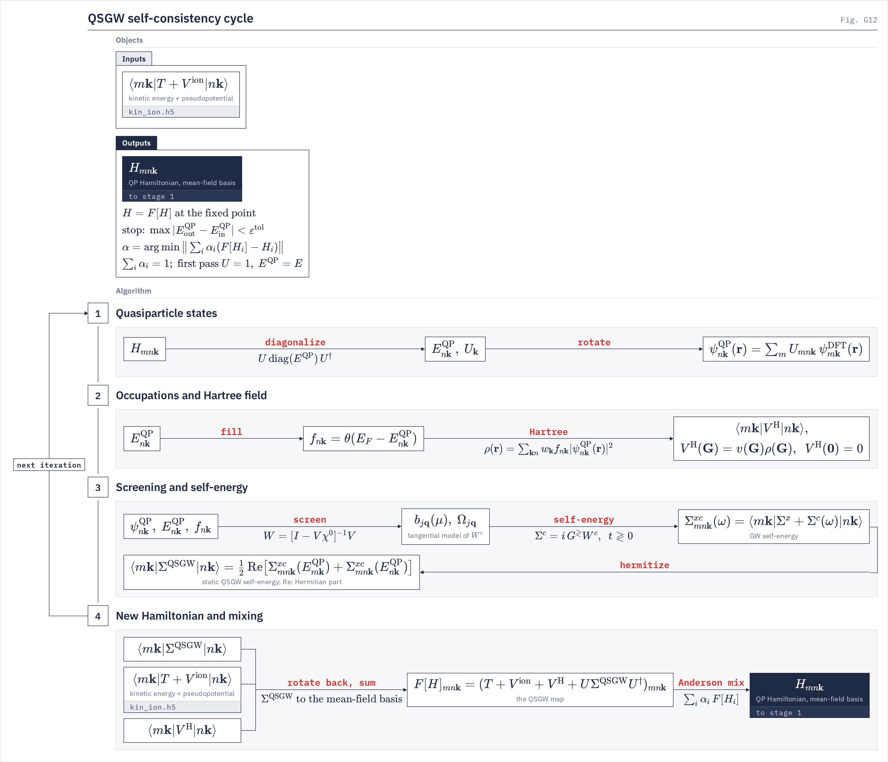
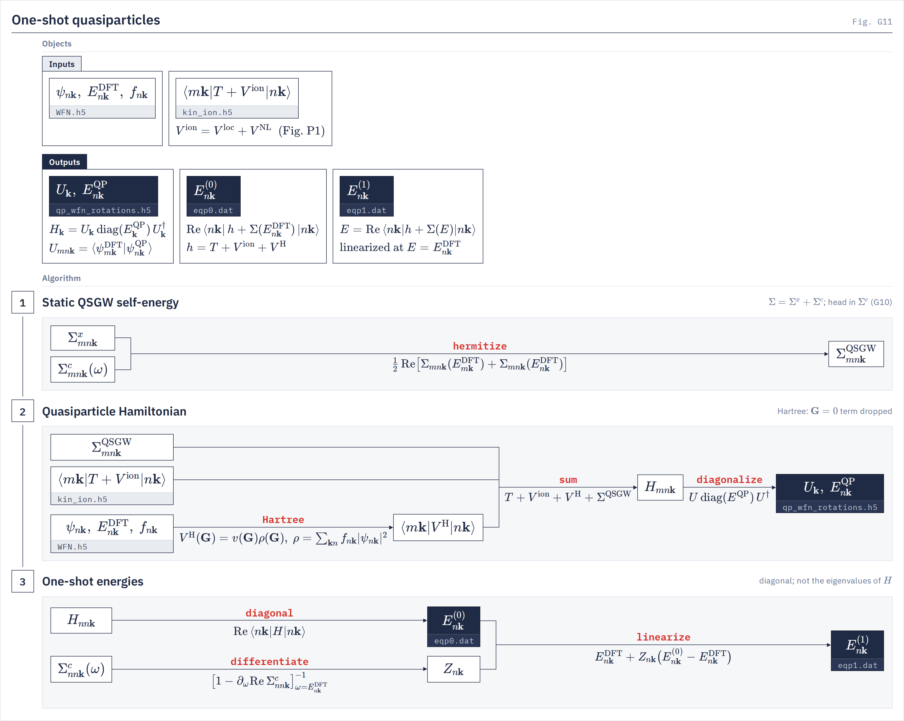

# Quasiparticle self-consistency

`gw.sc_iteration` The static Hermitian $\Sigma^{\mathrm{QSGW}}$ fed back into the quasiparticle Hamiltonian until the Hamiltonian reproduces itself.
{: .page-summary }

<figure class="flowchart" markdown>

<figcaption><strong>Fig. G12.</strong> One QSGW map. The QP Hamiltonian, held in the mean-field basis, is diagonalized and the orbitals rotated (1); occupations and the Hartree field follow from the new states (2); screening and the GW self-energy are rebuilt and hermitized into $\Sigma^{\mathrm{QSGW}}$ (3); the new Hamiltonian is assembled and Anderson-mixed into the next input (4). Re denotes the Hermitian part.</figcaption>
</figure>

## 1 The QSGW map {: #map }

QSGW replaces the energy-dependent $\Sigma(\omega)$ by a static Hermitian operator built from it, and looks for the Hamiltonian whose own orbitals and energies regenerate it. Select it with `qp_solver = self_consistent`.
{: .intro }

### 1.1 The static self-energy {: #map-sigma }

`qsgw_utils.build_qsgw_sigma_xc`
{: .in-code }

With $\Sigma^{xc} = \Sigma^x + \Sigma^c(\omega)$ in the basis of the current QP states, each element is read at the energies of both its states and the Hermitian part is kept:

$$
\langle m\bk|\Sigma^{\mathrm{QSGW}}|n\bk\rangle = \tfrac12\,\mathrm{Re}\big[\Sigma^{xc}_{mn\bk}(E^{\mathrm{QP}}_{m\bk}) + \Sigma^{xc}_{mn\bk}(E^{\mathrm{QP}}_{n\bk})\big] \tag{1.1}
$$

$\mathrm{Re}$ is the Hermitian part, $\tfrac12(M+M^\dagger)$, not the elementwise real part. This is the form of Kotani, van Schilfgaarde and Faleev. $\Sigma^c$ is the band-extrapolated $\hat\Sigma^c$ with the $\bq\to0$ head added ([band extrapolation](band-extrapolation.md)); it is evaluated on shell, at exactly these energies, unless `sigma_omega_grid_debug = true`, where it is interpolated on a sampled ω grid.

### 1.2 The quasiparticle Hamiltonian {: #map-h }

`sc_iteration.gw_iteration_map`
{: .in-code }

The Hamiltonian is held in the fixed mean-field basis, $H_{mn\bk} = \langle m\bk|H|n\bk\rangle$:

$$
H = T + V^{\mathrm{ion}} + V^{\mathrm H} + \Sigma^{\mathrm{QSGW}} \tag{1.2}
$$

$T + V^{\mathrm{ion}}$ is the `kin_ion.h5` operator ([kin-ion](../utilities/kin-ion.md)) and never changes. $V^{\mathrm H}$ and $\Sigma^{\mathrm{QSGW}}$ are rebuilt on every map. A fixed basis gives every iterate the same coordinates, so the differences and linear combinations the mixer forms are meaningful.

### 1.3 The fixed point {: #map-fixed }

One map is $F: H\mapsto F[H]$, and QSGW solves

$$
H = F[H] \tag{1.3}
$$

No renormalization factor $Z$ enters. Σ is read at the current energies, which at the fixed point are the QP energies, so the map's output solves the QP equation there. $F$ reads only $H$ and quantities fixed for the run: evaluating one $H$ twice returns the same $F[H]$ bit for bit.

## 2 One map {: #one-map }

Each map rotates the orbitals, refills them, rebuilds the Hartree field, screening and self-energy from the rotated states, and assembles the new Hamiltonian.
{: .intro }

### 2.1 Diagonalize and rotate {: #om-rotate }

`sc_iteration.qp_eigh`
{: .in-code }

The input is diagonalized and the mean-field orbitals of the QP matrix are rotated:

$$
H_\bk = U_\bk\,\mathrm{diag}(E^{\mathrm{QP}}_\bk)\,U_\bk^\dagger,\qquad \psi^{\mathrm{QP}}_{n\bk}(\br) = \sum_m U_{mn\bk}\,\psi_{m\bk}(\br) \tag{2.1}
$$

The rotation always starts from the mean-field orbitals, so no product of rotations accumulates round-off. Each state keeps the label of the mean-field band it overlaps most (a linear assignment at each $\bk$), so a level crossing never relabels a state.

### 2.2 Occupations and Fermi level {: #om-occ }

`sc_iteration._solve_occupation_state`
{: .in-code }

On an insulator $f_{n\bk} = \theta(E_F - E^{\mathrm{QP}}_{n\bk})$ with $E_F$ midway between the highest occupied and lowest empty level; under the live density the occupied set comes from a k-weighted step fill. On a metal each map solves fixed-$N$ Fermi–Dirac occupations of its own input spectrum ([metals](metals.md)). $E_F$ is a function of $H$ and is never mixed.

### 2.3 Hartree update {: #om-hartree }

`sc_iteration.rebuild_hartree_dft_basis`
{: .in-code }

The density is rebuilt from the rotated occupied orbitals and the Poisson equation solved in G space (Rydberg units):

$$
\rho(\br) = \sum_{\bk n} w_\bk\,f_{n\bk}\,\big|\psi^{\mathrm{QP}}_{n\bk}(\br)\big|^2,\qquad V^{\mathrm H}(\bG) = \frac{8\pi\,\rho(\bG)}{|\bG|^2},\quad V^{\mathrm H}(\mathbf 0) = 0 \tag{2.2}
$$

$\langle m\bk|V^{\mathrm H}|n\bk\rangle$ is contracted with the mean-field orbitals, so it enters (1.2) without rotation. The live density is on by default under `qp_solver = self_consistent`: `density_self_consistent` is switched on when the input file does not name it. An explicit `density_self_consistent = false` keeps the mean-field $V^{\mathrm H}$ on every map as an announced comparison mode. A bispinor input file builds $\rho$ and the Dirac current $J$ together and refuses the frozen field.

### 2.4 Screening and self-energy {: #om-sigma }

`sigma_dispatch.compute_sigma_xc`
{: .in-code }

$\chi^0 \to W \to \Sigma^c(\omega)$ and $\Sigma^x$ are rebuilt from $\psi^{\mathrm{QP}}$, $E^{\mathrm{QP}}$ and $f$ through the run's own frequency treatment, with $\Sigma^c = i\,G^{\gtrless}W^c$, $t\gtrless0$ ([GW theory](../drivers/gw/theory.md), [frequency treatments](frequency-treatments.md)). With the production tangential $W$, every map rebuilds the pole model from its own states ([Tangential W model](tangential-w.md)). The $\bq\to0$ head follows the map on the QP velocity chosen by `sc_head_update` ([the q → 0 head](q0-head.md), [velocity operator](velocity-operator.md)). The band-extrapolation fit is redone on every map. Each map costs one full $\chi^0\to W\to\Sigma$ evaluation.

### 2.5 Assembly {: #om-assemble }

$\Sigma^{\mathrm{QSGW}}$ is built in the QP basis and rotated back:

$$
F[H] = T + V^{\mathrm{ion}} + V^{\mathrm H} + U\,\Sigma^{\mathrm{QSGW}}U^\dagger \tag{2.3}
$$

The band classes of §3 are then applied: the frozen-core and semicore blocks, and the scissored tail.

## 3 Band classes {: #bands }

Only the QP matrix rotates. Bands above it complete the band sums with mean-field orbitals and a rigid shift.
{: .intro }

### 3.1 The QP matrix {: #bands-qp }

`gw_init.assert_qp_matrix_fitted`
{: .in-code }

The QP matrix is bands $[0,b_3)$. `number_bands_protected = M` sets $b_3 = M$ (every occupied band plus empty bands up to $M$); otherwise $b_3 = n_{\mathrm{occ}} + n_{\mathrm{cond}}$ with $n_{\mathrm{cond}}=$ `ncond`. Giving both forms refuses (`GATE band_request_forms`). Every state of the QP matrix keeps its full Σ row and column. $b_3$ must lie inside the ζ fit's left band range (`GATE qp_matrix_zeta_left`). $b_3$ is a convergence parameter: the occupied orbitals miss their admixture of tail bands.

### 3.2 The scissored tail {: #bands-tail }

`sc_iteration._fit_sum_band_tail`
{: .in-code }

Bands $[b_3,$ `number_bands`$)$ keep their mean-field orbitals and take one rigid shift per map, a weighted mean of the QP corrections of the empty states of the QP matrix:

$$
E_{n\bk} \to E_{n\bk} + \beta,\qquad
\beta = \frac{\sum_{\bk n} w_\bk u_{n\bk}\,(E^{\mathrm{QP}}_{n\bk} - E_{n\bk})}{\sum_{\bk n} w_\bk u_{n\bk}},\qquad u = \begin{cases}\min(Z,Z^{-1}) & Z>0\\ 0 & Z\le0\end{cases} \tag{3.1}
$$

The sum in $\beta$ runs over the empty states of the QP matrix whose Σ was read inside the ω grid. The weight keeps states on a satellite or near a pole of Σ from dragging the tail; $Z$ comes from the previous map, and map 0 uses unit weights.

### 3.3 Semicore and frozen core {: #bands-core }

`sc_iteration._pin_semicore_block_to_dft`
{: .in-code }

Occupied states below a band gap of at least 4 eV form the semicore class. Their Σ is read on held windows at a broadening of 5 eV, and with `sc_semicore = dft` (default) their block of $H$ stays at the mean-field block while their mixing with the other states is kept; `qp` lets them move with their own Σ. `sc_frozen_core_bands = N` (default 0) instead holds the lowest $N$ bands at their mean-field block with no coupling; they stay in every band sum.

The 5 eV read is what lets the semicore converge (at the input file η the Fe 3s $Z$ leaves $(0,1]$ from map 1 and the loop stalls), and it is a systematic error. Reading at $\eta_{\mathrm{semi}}$ smooths $\Sigma^c$ by a Lorentzian of width $\eta_{\mathrm{semi}}-\eta$; to first order the bias at the state's energy is

$$
\delta\,\mathrm{Re}\,\Sigma^c_{ss}(E_s)\approx(\eta_{\mathrm{semi}}-\eta)\,\mathrm{Im}\,\partial_\omega\Sigma^c_{ss}(E_s) \tag{3.2}
$$

by the Cauchy–Riemann relation $\partial_\eta\,\mathrm{Re}\,\Sigma^c=\mathrm{Im}\,\partial_\omega\Sigma^c$ of the occupied branch, analytic below the axis. A level that decays into a continuum is biased linearly in $\eta_{\mathrm{semi}}$ and an isolated level only through the curvature of $\mathrm{Re}\,\Sigma^c$. On AgI 6³ the 5 eV windows read $\mathrm{Re}\,\Sigma^c$ 2.19 eV low on Ag 4s, 0.66 eV on Ag 4p, 0.51 eV on I 4d and 1.25 eV on I 5s, against every state read at the input file η. The states within $E_F\pm1$ eV move by 3.6 / 15.9 meV (std / max) on Fe 4³ and 2.9 / 20.0 meV on MoS₂ 3×3. `sigma_omega_patches_ev` sets windows at a smaller η of their own. With the pin the semicore converges within 27 meV of its mean-field energies; under `qp` it lands 0.1–6 eV deeper (Fe 4³, MoS₂ 3×3). Freezing it with `sc_frozen_core_bands` drops its mixing with the valence, which matters on Fe 3s/3p and CrI₃ I 5s.

## 4 Mixing {: #mixing }

The map is accelerated by one-evaluation Anderson mixing of $H$. Plain or damped iteration is refused.
{: .intro }

### 4.1 Anderson type II {: #mix-anderson }

`mixing.acceleration.anderson_nojit`
{: .in-code }

The history holds the newest $m+1$ evaluated pairs $(H_i, f_i = F[H_i]-H_i)$, $m =$ `sc_history_depth` (20), and the next input is

$$
H_{n+1} = \sum_i \alpha_i\,F[H_i],\qquad \alpha = \arg\min_{\sum_i\alpha_i=1}\Big\|\sum_i\alpha_i f_i\Big\|_P \tag{4.1}
$$

$\alpha$ is real, because Hermitian matrices form a real vector space. The metric $P$ weights each $\bk$ row by the square root of its star size, so the norm is the sum over the full k grid. The first step is half a plain step, $H_1 = H_0 + f_0/2$; every later step is undamped. Two safeguards carry no tunable constant: the oldest differences are dropped until the Gram's condition number is at most $10^{12}$, and an evaluation worse than every residual in the window triggers one two-point secant step.

### 4.2 Why no linear mixing {: #mix-why }

On dense band manifolds the QSGW Jacobian has eigenvalues near $-3$ or below along cycle directions, so a plain fixed point 2-cycles and damping only shrinks the cycle. `sc_accelerator` accepts only `anderson` (`GATE sc_accelerator_anderson_only`), and `sc_mixing` other than its default refuses (`GATE sc_mixing_retired`).

## 5 Convergence {: #convergence }

The mixer has no stopping authority. The driver judges every evaluated input by its own output.
{: .intro }

### 5.1 The criterion {: #conv-crit }

`sc_iteration.protected_band_convergence`
{: .in-code }

With $E_{\mathrm{in}}$ the eigenvalues of $H$ and $E_{\mathrm{out}}$ those of $F[H]$, paired by sorted index and named by label, the run is converged when

$$
\max_{n\bk}\big|E^{\mathrm{QP}}_{\mathrm{out},n\bk} - E^{\mathrm{QP}}_{\mathrm{in},n\bk}\big| < \varepsilon^{\mathrm{tol}} \tag{5.1}
$$

over the states of the QP matrix (the scissored tail excluded), with $\varepsilon^{\mathrm{tol}} =$ `sc_tol_ev`. The default is $10^{-4}$ eV; the production input file uses $10^{-3}$ eV. The test is a maximum, not an RMS, and compares a map's output with its own input, not successive iterates. The loop returns that input with its own Σ, $W$ and head.

### 5.2 Stall and budget {: #conv-stall }

`sc_iteration._run_anderson`
{: .in-code }

The run is stalled when the label-free residual $r_n = \max_\bk\|P\,(F[H_n]-H_n)\,P\|_2$ has not improved by 10 % over the last 12 maps; both numbers are fixed. `sc_max_iter = N` (30) runs map 0 plus $N$ accelerated maps. A stalled or budget-exhausted run refuses with `GATE sc_fixed_point_not_converged` and writes no terminal QP result. From the second map on, the log prints the map gain $\max|\Delta\Sigma|/\max|\Delta E_{\mathrm{in}}|$; it is a diagnostic only.

### 5.3 Reading the log {: #conv-log }

`sc_iteration._record_sc`
{: .in-code }

Each map writes these lines to `gwjax.out`; none of them but the verdict decides anything.

| Line | Meaning |
|---|---|
| `SC convergence:` | Criterion (5.1), the worst state named, then two RMS figures that are not the test, then `CONVERGED`, `not converged` or `STALLED at floor, not converged`. |
| `SC matrix residual:` | $r_n$ of §5.2. `FLAG` when $\max\lvert\Delta E\rvert$ exceeds it: two different states were paired. |
| `SC map gain:` | Above 1, the map is not locally contracting at the named state. On a metal it stays above 1 at Fermi-crossing states, where exchange follows an occupation flip. |
| `SC window extension`, `SC window no-quasiparticle` | The Σ range grew past a state; a state with $Z\notin(0,1]$ at the previous map has no quasiparticle, never moves the range, and reads the off-range rule. |
| `SC fixed quadrature recompute:`, `SC W line sites re-planned`, `Response rule rebuilt at a held map` | A held rule or support moved. Each one changes $F$ between maps; re-plans on most maps stall Anderson. |
| `SC semicore Z` | $Z$ of the semicore states on their 5 eV windows; it should stay in $(0,1]$. |
| `fixed point NOT UNIQUE` | Only with `sigma_out_of_grid = static`: states within the jump $\Sigma(E)\to\Sigma(0)$ of a range edge have two fixed points, and the path picks one. Use `cover`. |
| `SC NOT CONVERGED` | Printed before the refusal: median $\lvert\Delta E\rvert$, then the bands with a state moving more than 20 meV, and by at least `sc_tol_ev`. |

A loop that stalls usually has one of two causes. Empty states far above $E_F$ on a metal, where $\mathrm{Re}\,\Sigma^c$ rises on shell, have $Z>1$ and a local gain near 1: end the QP matrix below them. Bands just below $b_3$ can stall at 5 meV to 0.12 eV while the states within ±10 eV of midgap are stable (Si 4³ SOC, $b_3\ge32$). A stalled run leaves `sc_seed/` to restart from (§7.2).

## 6 One-shot as the special case {: #one-shot }

The one-shot run is the first QSGW map, stopped after one evaluation. It is the default: `qp_solver = auto` resolves to `one_shot_dft`.
{: .intro }

<figure class="flowchart" markdown>

<figcaption><strong>Fig. G11.</strong> One-shot quasiparticles: $\Sigma^{\mathrm{QSGW}}$ at the mean-field energies (1), the QP Hamiltonian and its eigensystem (2), and the BerkeleyGW-style diagonal energies <code>eqp0</code>, <code>eqp1</code> (3).</figcaption>
</figure>

### 6.1 Map 0 {: #os-map0 }

`gw_jax._solve_qp_stage`
{: .in-code }

The initial carry is $H = \mathrm{diag}(E_{n\bk})$. Map 0 takes $E^{\mathrm{QP}} = E$ and $U = 1$ exactly instead of diagonalizing, so (1.1) is read at the mean-field energies and $V^{\mathrm H}$ is the mean-field density's:

$$
H^{(0)} = T + V^{\mathrm{ion}} + V^{\mathrm H} + \tfrac12\,\mathrm{Re}\big[\Sigma^{xc}_{mn\bk}(E_{m\bk}) + \Sigma^{xc}_{mn\bk}(E_{n\bk})\big] \tag{6.1}
$$

Its eigensystem is the one-shot $U$, $E^{\mathrm{QP}}$ in `qp_wfn_rotations.h5`. SC map 0 reproduces the one-shot bit for bit when no W-active state is semicore, so an SC run computes no separate one-shot.

### 6.2 Diagonal energies {: #os-eqp }

`eqp_bgw`
{: .in-code }

The one-shot also writes the BerkeleyGW diagonal columns, with $h = T + V^{\mathrm{ion}} + V^{\mathrm H}$ and $Z_{n\bk} = [1-\partial_\omega\mathrm{Re}\,\Sigma^c_{nn\bk}]^{-1}_{\omega=E_{n\bk}}$:

$$
E^{(0)}_{n\bk} = \mathrm{Re}\,\langle n\bk|h + \Sigma^{xc}(E_{n\bk})|n\bk\rangle,\qquad E^{(1)}_{n\bk} = E_{n\bk} + Z_{n\bk}\big(E^{(0)}_{n\bk}-E_{n\bk}\big) \tag{6.2}
$$

These are diagonal elements, not eigenvalues of $H^{(0)}$. In an SC run both `eqp0.dat` and `eqp1.dat` hold the SC eigenvalues instead (§7).

## 7 Outputs and restart {: #outputs }

A converged run writes its terminal files from the accepted map. Per-map files are diagnostics, not restart state.
{: .intro }

### 7.1 Terminal files {: #out-files }

`eqp0.dat`, `eqp1.dat`
:   Both hold the eigenvalues of $F[H]$ at the accepted map, tail scissor and semicore pin included, sorted per $\bk$ on the WFN wedge.

`qp_wfn_rotations.h5`
:   $U_\bk$, $E^{\mathrm{QP}}$, occupations and $E_F$ of the accepted map's input states: the basis its Σ, $W$ and head were built in.

`WFN_qp.h5`
:   The orbitals rotated by $U$, with $E^{\mathrm{QP}}$; written when `write_wfn_h5 = true` (default).

`sigma_diag.dat`
:   Diagonals on the fixed mean-field states; a diagnostic, not the SC spectrum. On a dynamic SC run evaluated on shell (the default) it omits the `sigC` and `sigXC` columns and names them in a `# omitted:` line: the on-shell $\Sigma^c$ has no mean-field-basis $\Sigma^c(E_{n\bk})$. They return under `sigma_omega_grid_debug = true`.

`dipole_qsgw.h5`
:   Velocity matrix elements $U^\dagger\hat{\mathbf v}\,U$ between QP states, on a velocity head.

`eqp0_iterNNNN.dat`
:   Each map's output energies, with the criterion, map gain and tail law in its comments.

`sc_seed/qp_wfn_rotations.h5`, `sc_seed/sc_checkpoint.h5`
:   Warm seed and Anderson checkpoint after each non-converged map.

A converged run on a route that keeps the static $W(0)$ writes it from the accepted map, so the [BSE driver](../drivers/bse/index.md) can run on the QSGW result.

### 7.2 Seeding and continuation {: #out-seed }

`sc_iteration.make_initial_state_from_qp_rotations`
{: .in-code }

`sc_initial_qp_rotations_file` imports an authenticated eigensystem as $H = U\,\mathrm{diag}(E)\,U^\dagger$ in the original mean-field basis, averaged over each $\bk$'s little group. With an `sc_checkpoint.h5` beside it that authenticates against the input file, WFN and band window, the run continues the Anderson trajectory at the checkpoint's map; otherwise it starts a new run from the seed. A charge QSGW run seeds a bispinor QSGW run on the same WFN.

## 8 Keys {: #keys }

Full entries are on the [GW input keywords](../drivers/gw/keywords.md) page. Defaults are read from the keyword schema (`src/gw/gw_config.py`).
{: .intro }

### 8.1 Keys that shape the loop {: #keys-list }

| Key | Default | Role here |
|---|---|---|
| [`qp_solver`](../drivers/gw/keywords.md#qp_solver) | `auto` → `one_shot_dft` | `self_consistent` runs QSGW; `fixed_point` refuses by name. |
| [`self_consistent`](../drivers/gw/keywords.md#self_consistent) | `false` | Retired alias for `qp_solver = self_consistent`. |
| [`density_self_consistent`](../drivers/gw/keywords.md#density_self_consistent) | `false`; on under SC when unnamed | Live $V^{\mathrm H}$ from the QP density (§2.3). |
| [`sc_tol_ev`](../drivers/gw/keywords.md#sc_tol_ev) | `1.0e-4` | Criterion (5.1), eV. |
| [`sc_max_iter`](../drivers/gw/keywords.md#sc_max_iter) | `30` | Accelerated maps after map 0. |
| [`sc_accelerator`](../drivers/gw/keywords.md#sc_accelerator) | `anderson` | The only accepted value. |
| [`sc_history_depth`](../drivers/gw/keywords.md#sc_history_depth) | `20` | Anderson history $m$. |
| [`sc_mixing`](../drivers/gw/keywords.md#sc_mixing) | `1.0` | Retired; any other value refuses. |
| [`number_bands_protected`](../drivers/gw/keywords.md#number_bands_protected) | unset | $b_3$ as a total band count (§3.1). |
| [`ncond`](../drivers/gw/keywords.md#ncond), [`nval`](../drivers/gw/keywords.md#nval) | `5`, `5` | `ncond` gives $b_3 = n_{\mathrm{occ}} + n_{\mathrm{cond}}$; `nval` sets the semicore floor. |
| [`sc_semicore`](../drivers/gw/keywords.md#sc_semicore) | `dft` | Semicore block pinned (`dft`) or moving (`qp`). |
| [`sc_frozen_core_bands`](../drivers/gw/keywords.md#sc_frozen_core_bands) | `0` | Lowest bands held at their mean-field block. |
| [`sc_head_update`](../drivers/gw/keywords.md#sc_head_update) | `off`; resolved when unnamed | QP velocity of the head on each map. |
| [`sc_on_ibz`](../drivers/gw/keywords.md#sc_on_ibz) | `true` | Carry on the star wedge of $\bk$. |
| [`sc_initial_qp_rotations_file`](../drivers/gw/keywords.md#sc_initial_qp_rotations_file) | empty | Seed (and continuation) file. |
| [`sc_dump_dir`](../drivers/gw/keywords.md#sc_dump_dir) | empty | Per-map $U$ and energy histories. |
| [`sigma_out_of_grid`](../drivers/gw/keywords.md#sigma_out_of_grid) | `cover` | How an energy off the Σ grid is read. |
| [`write_wfn_h5`](../drivers/gw/keywords.md#write_wfn_h5) | `true` | Writes `WFN_qp.h5`. |

## Notation {: #notation }

| Symbol | Meaning |
|---|---|
| $H_{mn\bk}$ | QP Hamiltonian in the mean-field basis |
| $F[H]$ | the QSGW map |
| $U_\bk$, $E^{\mathrm{QP}}_{n\bk}$ | QP eigenvectors and energies |
| $\psi_{n\bk}$, $E_{n\bk}$ | mean-field orbitals and energies |
| $\Sigma^{xc} = \Sigma^x + \Sigma^c$ | GW self-energy |
| $\Sigma^{\mathrm{QSGW}}$ | static Hermitian QSGW self-energy |
| $V^{\mathrm H}$, $\rho$ | Hartree potential; density |
| $f_{n\bk}$, $E_F$ | occupations; Fermi level |
| $b_3$ | top of the QP matrix |
| $\beta$, $u$, $Z$ | tail shift, its weight, QP renormalization factor |
| $\alpha_i$, $f_i$, $m$ | Anderson coefficients, residuals, history depth |
| $E^{(0)}$, $E^{(1)}$ | one-shot diagonal energies (`eqp0`, `eqp1`) |

## References {: #refs }

1. T. Kotani, M. van Schilfgaarde and S. V. Faleev, Phys. Rev. B 76, 165106 (2007).
2. M. van Schilfgaarde, T. Kotani and S. Faleev, Phys. Rev. Lett. 96, 226402 (2006).
3. D. G. Anderson, J. ACM 12, 547 (1965).
4. P. Pulay, Chem. Phys. Lett. 73, 393 (1980).
5. L. Hedin, Phys. Rev. 139, A796 (1965).

