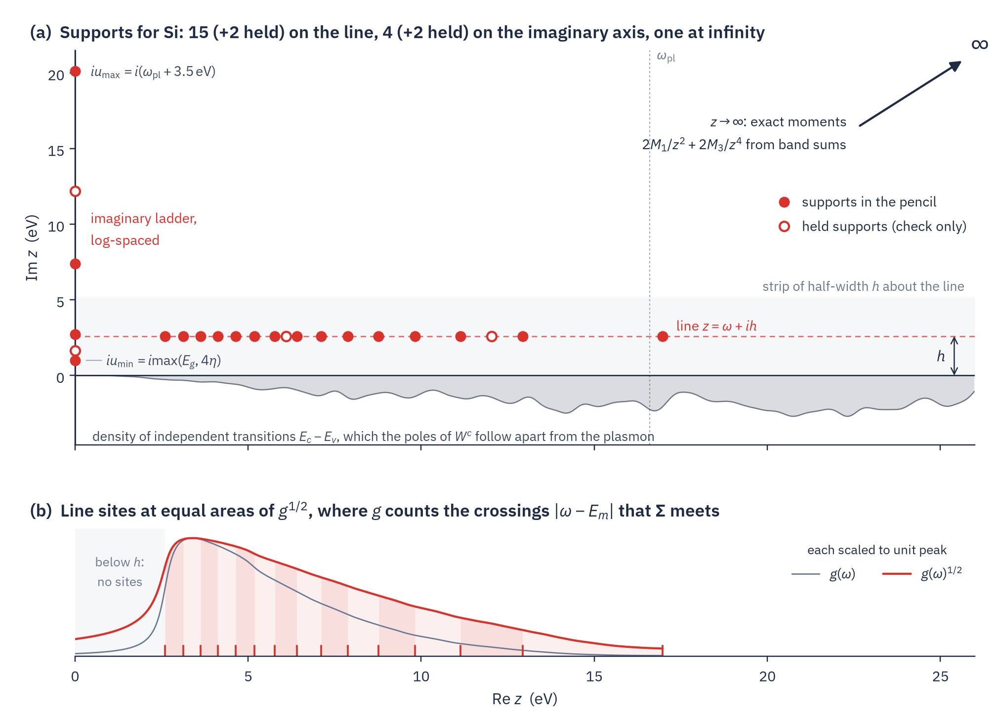
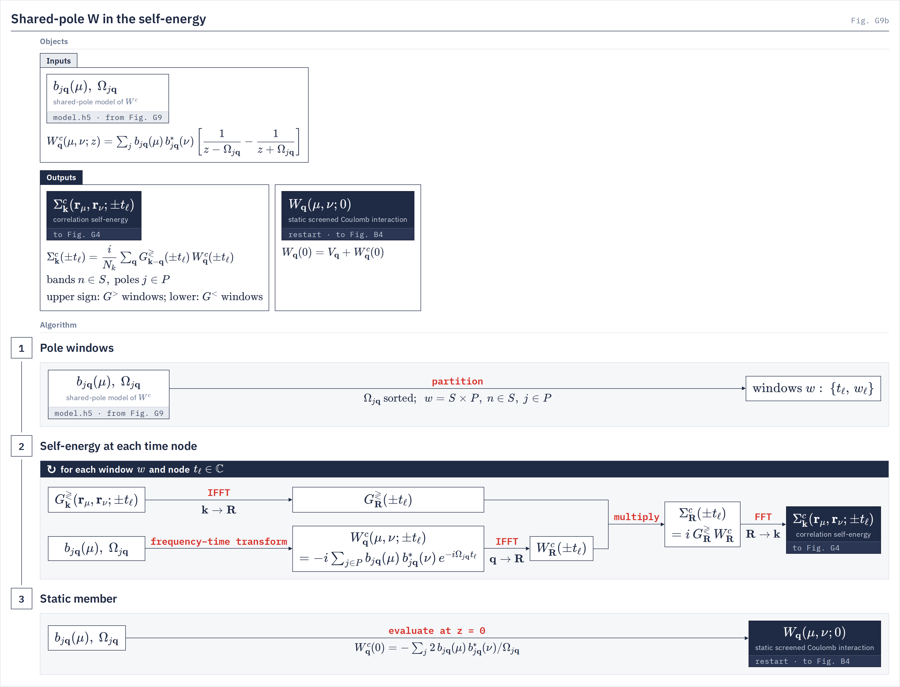
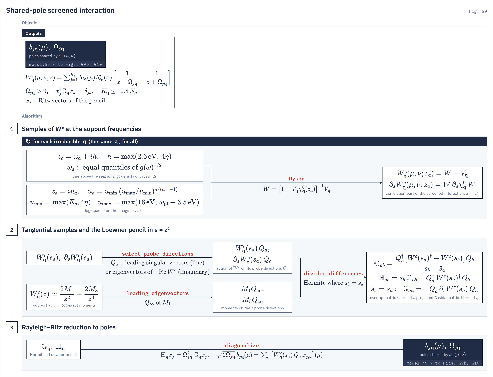

# Shared-pole W

The correlation part of W as one set of real poles, shared by every matrix element and built from a few dozen samples.
{: .page-summary }

<div class="section-cards"></div>

## <span class="n">1</span> W as a sum of poles {: #dyson }

The screened interaction is usually computed from the independent-particle response through a Dyson equation. It also has a closed form, with no inverse, in terms of the wavefunctions, their energies and the Coulomb interaction. That form is a sum of poles, and the rest of the page builds a small model of it.
{: .intro }

The density response $\chi$, the independent-particle response $\chi^0$ and the screened interaction are related by the Dyson equations

$$
\chi=\chi^0+\chi^0v\chi,\qquad W=v+v\chi v=\big[1-v\chi^0\big]^{-1}v,\qquad W^c=W-v \tag{1.1}
$$

With the pair densities $M_{mn\bk\bq}(\br)=\psi^*_{m\bk}(\br)\,\psi_{n\bk+\bq}(\br)$, the independent-particle response of [Time–frequency transforms (1.4)](time-frequency.md#conv-cost) is a single sum over ordered pairs of bands,

$$
\chi^0_\bq(\br,\br';z)=\sum_{mn\bk}M_{mn\bk\bq}(\br)\left[\frac{f_{m\bk}-f_{n\bk+\bq}}{z-(E_{n\bk+\bq}-E_{m\bk})}\right]M^*_{mn\bk\bq}(\br') \tag{1.2}
$$

in which the pairs $vc$ give the resonant transitions and the pairs $cv$ the antiresonant ones. These $2N_t$ transitions are also the basis of the RPA Hamiltonian, the Bethe–Salpeter Hamiltonian without its direct term,

$$
\begin{aligned}
\big(H_\bq\big)_{\substack{mn\bk\\m'n'\bk'}}&=\big(E_{n\bk+\bq}-E_{m\bk}\big)\,\delta_{\substack{mn\bk\\m'n'\bk'}}\\
&\quad+\big(f_{m\bk}-f_{n\bk+\bq}\big)\int d\br\,d\br'\,M^*_{mn\bk\bq}(\br)\,v(\br,\br')\,M_{m'n'\bk'\bq}(\br')
\end{aligned} \tag{1.3}
$$

whose eigenvalue problem is Casida's equation of linear-response theory [5, 6]. Its blocks between resonant and antiresonant pairs are the $A$, $B$, $-B^*$ and $-A^*$ of Casida's usual notation. Its eigenvalues $\Omega_S$ are the poles of $W^c$, and its eigenvectors $x_S$ give the residues [5–7],

$$
\begin{aligned}
W^c_\bq(\br,\br';z)&=\sum_S\mathrm{sgn}(\Omega_S)\,\frac{b_S(\br)\,b_S^*(\br')}{z-\Omega_S},\qquad b_S(\br)=\sum_{mn\bk}x_S^{mn\bk}\,\phi_{mn\bk\bq}(\br),\\
\phi_{mn\bk\bq}(\br)&=\int d\br'\,v(\br,\br')\,M_{mn\bk\bq}(\br')
\end{aligned} \tag{1.4}
$$

with $x_S$ normalized as $\sum_{mn\bk}(f_{m\bk}-f_{n\bk+\bq})\,|x_S^{mn\bk}|^2=\mathrm{sgn}(\Omega_S)$. Each RPA excitation gives one pole, whose residue is the outer product of the Coulomb potential $b_S$ of its transition density. For an insulator the $\Omega_S$ are real and nonzero, positive for resonant and negative for antiresonant excitations, and they range from about the smallest to about the largest transition energy, shifted by the exchange coupling. Written with the diagonal matrix $\sigma$ of occupation differences and the matrix $\phi$ of all the pair potentials, (1.4) is the resolvent $W^c_\bq(z)=\phi\,(z-H_\bq)^{-1}\sigma\phi^\dagger$.

$H_\bq$ is far too large to diagonalize, since GW sums over many empty bands. A single value $W^c(z)$ is cheap, however, because the Coulomb term of (1.3) has rank at most $N_\mu$, the number of points on which $v$ acts, and the Woodbury identity reduces $(z-H_\bq)^{-1}$ to the $N_\mu\times N_\mu$ Dyson solve (1.1). The rest of the page reduces the sum (1.4) to a few poles, using samples alone.

## <span class="n">2</span> The stored form {: #lehmann }

LORRAX keeps a small number of real poles in place of the $2N_t$ of (1.4). We first give the form it stores and then the form in $z^2$ that its construction uses.
{: .intro }

### <span class="n">2.1</span> Shared poles {: #model-form }

`file_io.shared_pole_store`
{: .in-code }

With time reversal each antiresonant pole at $-\Omega_S$ has the same factor $b_S$ as its resonant partner at $+\Omega_S$, and the two enter with opposite signs. LORRAX keeps $K_\bq\ll N_t$ such pairs, with poles $\Omega_{j\bq}>0$ and factor vectors $b_{j\bq}(\mu)$ on the $N_\mu$ ISDF points ([ISDF](isdf.md)), shared by every matrix element:

$$
\begin{aligned}
W^c_\bq(\mu,\nu;z)&=\sum_{j=1}^{K_\bq}b_{j\bq}(\mu)\,b^*_{j\bq}(\nu)\left[\frac{1}{z-\Omega_{j\bq}}-\frac{1}{z+\Omega_{j\bq}}\right]\\
&=\sum_{j=1}^{K_\bq}\frac{2\Omega_{j\bq}\,b_{j\bq}(\mu)\,b^*_{j\bq}(\nu)}{z^2-\Omega_{j\bq}^2}
\end{aligned} \tag{2.1}
$$

The static value follows as $W^c_\bq(0)=-\sum_j2\,b_{j\bq}b^\dagger_{j\bq}/\Omega_{j\bq}$, and the poles carry no width because the broadening $\eta$ is applied once, by Σ. Without time reversal the two factors differ, and §[7.7](#pen-ordered) gives the form LORRAX uses then.

### <span class="n">2.2</span> Casida's form in z² {: #model-structure }

With time reversal the antiresonant pairs coincide with the resonant ones after the relabelling $\bk\to-\bk-\bq$, and (1.2) becomes, for an insulator,

$$
\chi^0_\bq(\br,\br';z)=\sum_{vc\bk}M_{vc\bk\bq}(\br)\left[\frac{1}{z-\Delta_{vc\bk\bq}}-\frac{1}{z+\Delta_{vc\bk\bq}}\right]M^*_{vc\bk\bq}(\br')
$$

with $\Delta_{vc\bk\bq}=E_{c\bk+\bq}-E_{v\bk}$, so $\chi^0$ depends on $z$ only through $s=z^2$. Casida's equation then reduces to a Hermitian problem on the resonant pairs alone [5, 7], with the matrix $C_\bq=(A-B)^{1/2}(A+B)(A-B)^{1/2}$, which in the RPA is $\Delta^{1/2}(\Delta+2K)\Delta^{1/2}$ with $K$ the Coulomb integrals of (1.3) between resonant pairs, and which has the eigenvalues $\Omega_S^2$. With $\phi$ now the matrix of the resonant potentials $\phi_{vc\bk\bq}$,

$$
W^c_\bq(s)=2\,\phi\,\Delta^{1/2}\big(s-C_\bq\big)^{-1}\Delta^{1/2}\phi^\dagger \tag{2.2}
$$

and with the eigenvectors $e_S$ of $C_\bq$ the vectors $\sqrt2\,\phi\Delta^{1/2}e_S$ are the stored factors $\sqrt{2\Omega_S}\,b_S$. In $s$, $W^c$ is a sum of poles on $[\Omega^2_{\min},\Omega^2_{\max}]$ with positive semidefinite residues, so $-W^c$ is a matrix Stieltjes function of $-s$, and the expansion of (2.2) in $1/s$ gives the high-frequency moments,

$$
\begin{aligned}
W^c_\bq(z)&=\frac{2M_1}{z^2}+\frac{2M_3}{z^4}+\dots,\\
M_1&=\phi\,\Delta\,\phi^\dagger=\sum_S\Omega_S\,b_Sb_S^\dagger,\qquad M_3=\phi\,\Delta^{1/2}C_\bq\Delta^{1/2}\phi^\dagger=\sum_S\Omega_S^3\,b_Sb_S^\dagger
\end{aligned} \tag{2.3}
$$

where $2M_1$ is the $f$-sum coefficient. The time-ordered transform of (2.1) is even in $t$,

$$
W^c_\bq(\mu,\nu;t)=-i\sum_jb_{j\bq}(\mu)\,b^*_{j\bq}(\nu)\,e^{-i\Omega_{j\bq}|t|} \tag{2.4}
$$

which is the form Σ consumes (§6).

## <span class="n">3</span> Model reduction {: #reduction }

Equation (1.4) has millions of poles, far more than Σ can afford. Replacing a large resolvent by a small one is the subject of model reduction in linear systems theory, and we borrow its language and its methods [10].
{: .intro }

### <span class="n">3.1</span> W as a transfer function {: #red-transfer }

On the ISDF points, with $\phi$ the matrix of all $2N_t$ pair potentials $\phi_{mn\bk\bq}(\mu)$, (1.4) reads

$$
W^c_\bq(z)=\phi\,(z-H_\bq)^{-1}\sigma\phi^\dagger \tag{3.1}
$$

This is the transfer function of a linear system whose state matrix $H_\bq$ acts on a space of dimension $2N_t$, the order of the system. A potential applied at the $N_\mu$ points enters the transitions through the input matrix $\sigma\phi^\dagger$, evolves under $H_\bq$, and is read out as an induced potential through the output matrix $\phi$, and the triple $(\phi,H_\bq,\sigma\phi^\dagger)$ is called a realization of $W^c$. Model reduction seeks a realization $\phi_r(z-H_r)^{-1}\sigma_r\phi_r^\dagger$ of much lower order whose transfer function is close to $W^c$ where it is used. In our setting $H_\bq$ is never formed, but $W^c$ can be sampled at any complex $z$ for the price of one $\chi^0$ evaluation and one Dyson solve (§[6.2](#bank-times)), so only methods that work from samples apply.

### <span class="n">3.2</span> Methods {: #red-methods }

Moment matching fits the Taylor coefficients of the transfer function at a point. At $z=\infty$ these are the Laurent coefficients $\phi H^k\sigma\phi^\dagger$, whose first two nonzero ones are $2M_1$ and $2M_3$ of (2.3), and a Lanczos recursion on $H$ matches them stably [14]. The Lanczos–Haydock method for absorption spectra does this for the single element $\langle M|(z-H)^{-1}\sigma|M\rangle$ [8, 9], but $W$ has $N_\mu^2$ elements, and the recursion needs products with $H$. Balanced truncation comes with an error bound [15, 16] but needs Lyapunov solves in the full space. Rational Krylov projection restricts $H$ to the span of vectors $(z_a-H)^{-1}Br_a$, and the reduced model then interpolates $W$ at the shifts $z_a$ [12, 17]. Rational fitting, for example by the AAA algorithm [19], chooses poles and residues to match sampled values. The Loewner framework builds the reduced model from samples without a fit [11], and for exact data it reproduces the rational Krylov projection although it never touches $H$. We use it because it involves no nonlinear fit and, as §4.3 shows, it preserves the structure of (2.2).

### <span class="n">3.3</span> Why a small model suffices {: #red-small }

Σ uses $W^c$ only through sums over its poles weighted by $1/(\omega-E\mp\Omega\pm i\eta)$, which vary with $\Omega$ on the scale $\eta$. Poles closer together than $\eta$ therefore need not be resolved one by one, and the model only has to reproduce averages of the spectral measure of (2.2) over that scale. A model with real poles and positive residues, as §4.3 builds, is a quadrature of that measure, and samples at a height $h$ above $\eta$ fix those averages as long as the supports are spaced finely enough along the line. Away from the spectrum, as on the imaginary axis, the error of a rational approximation falls geometrically with the number of poles, and the count grows only as the logarithm of the spectral range [20, 21, 22]. Along a line at height $h$ it grows as the reach of the line divided by $h$ (§5). Neither count depends on the measure, so the number of transitions $N_t$ does not enter. Each pole carries a rank-one residue, so data of size $N_\mu\times N_\mu$ need of order $N_\mu$ poles, and LORRAX caps the count at $\lceil1.8N_\mu\rceil$. On Si that model reproduces quasiparticle energies from contour deformation to 0.80 meV RMS (§[7.9](#ritz-count)).

## <span class="n">4</span> The Loewner framework {: #loewner }

A large matrix is usually reduced by projecting it onto a few important directions, for example its leading singular vectors. We cannot do that with $H_\bq$, which is never formed. The samples give us something almost as useful. Each one is the action of the resolvent $(z-H_\bq)^{-1}$ on a known vector, read out through $\phi$. The Loewner framework [11, 10] uses these samples to build the projection of $H_\bq$ onto the space of such resolvent vectors, overlaps included, without forming any vector of the large space.
{: .intro }

### <span class="n">4.1</span> Samples as resolvent vectors {: #loewner-identities }

A sample of $W$ is an $N_\mu\times N_\mu$ matrix, and we keep only its action on a few directions, which keeps the reduced problem small and well conditioned. This is tangential interpolation [12]. A tangential sample is a small experiment on the screening. A potential pattern $r$ is applied at the ISDF points at the complex frequency $z$, and the induced potential $W(z)\,r$ is read out at every point, much as a network analyzer drives a circuit through a chosen combination of its ports [27]. Matching a whole sample would add $N_\mu$ states to the model at once, one per column, while each direction adds one [10]. In this language $\lambda_j$ and $r_j$ are the right data and $\xi_i$ and $\ell_i$ the left data. At right points $\lambda_j$ with column directions $r_j$, and at left points $\xi_i$ with row directions $\ell_i$, the samples are

$$
\begin{aligned}
W(\lambda_j)\,r_j&=\phi\,u_j, &\qquad u_j&=(\lambda_j-H)^{-1}\sigma\phi^\dagger r_j,\\
\ell_i\,W(\xi_i)&=\tilde u_i\,\sigma\phi^\dagger, &\qquad \tilde u_i&=\ell_i\,\phi\,(\xi_i-H)^{-1}
\end{aligned} \tag{4.1}
$$

The resolvent vectors $u_j$ and $\tilde u_i$ live in the space of all $2N_t$ transitions, and we never form them. Their overlaps and the matrix elements of $H$ between them nevertheless follow from the samples alone. The resolvent identities $(\xi-H)^{-1}-(\lambda-H)^{-1}=-(\xi-\lambda)(\xi-H)^{-1}(\lambda-H)^{-1}$ and $z(z-H)^{-1}=1+H(z-H)^{-1}$ give

$$
\begin{aligned}
\tilde u_i\,u_j&=-\frac{\ell_i\big[W(\xi_i)-W(\lambda_j)\big]r_j}{\xi_i-\lambda_j},\\
\tilde u_i\,H\,u_j&=-\frac{\ell_i\big[\xi_iW(\xi_i)-\lambda_jW(\lambda_j)\big]r_j}{\xi_i-\lambda_j}
\end{aligned} \tag{4.2}
$$

### <span class="n">4.2</span> The Loewner pencil {: #loewner-pencil }

The two divided differences of (4.2) are the two matrices of the framework [11]. The **Loewner matrix** $\mathbb L$ holds minus the overlaps of the resolvent vectors, and the **shifted Loewner matrix** $\mathbb L_s$ holds minus the matrix elements of $H$ between them,

$$
\mathbb L_{ij}=-\tilde u_i\,u_j,\qquad \mathbb L_{s,ij}=-\tilde u_i\,H\,u_j \tag{4.3}
$$

Because $\mathbb L$ holds overlaps, it allows the operations of an explicit basis. Its rank shows how many independent directions the samples span, and its eigenvectors orthogonalize them, all without the vectors themselves.

A matrix pencil is the linear family $\mathbb L_s-\theta\,\mathbb L$, and its eigenvalues are the values of $\theta$ at which it is singular, that is, the solutions of $\mathbb L_sx=\theta\,\mathbb Lx$. With $U$ the matrix of columns $u_j$ and $\tilde U$ the matrix of rows $\tilde u_i$, this equation reads $\tilde U(H-\theta)Ux=0$. It is the eigenvalue problem of $H$ projected onto the space of the resolvent vectors, a rational Krylov space [12, 17]. When the vectors span all $2N_t$ transitions, its eigenvalues are the poles of $W$. With fewer vectors they are the poles that space can represent best, and every new sample adds one vector to it. Once enough samples are taken, the rank of $\mathbb L$ equals the number of poles of the sampled function [11, 29]. $W^c$ has far more poles than we sample, so $\mathbb L$ never becomes singular, but its singular values fall off quickly, because a few poles already describe $W^c$ well at the supports (§3.3). We therefore take more samples than the model needs and cut the model where the singular values drop below a tolerance (§[7.9](#ritz-count)). The model built on the pencil,

$$
W_r(z)=\mathbb W\,(\mathbb L_s-z\,\mathbb L)^{-1}\,\mathbb V,\qquad \mathbb W=\big[W(\lambda_j)r_j\big]_j,\qquad \mathbb V=\big[\ell_iW(\xi_i)\big]_i \tag{4.4}
$$

reproduces every sample, $W_r(\lambda_j)r_j=W(\lambda_j)r_j$ and $\ell_iW_r(\xi_i)=\ell_iW(\xi_i)$ [11]. When a left point and a right point coincide, $\xi_i=\lambda_j$, the divided difference in (4.2) becomes the derivative $\ell_iW'(\lambda_j)r_j$, and the model then matches the derivative as well. This is **Hermite interpolation**, and LORRAX uses it at every support on the imaginary axis. Taken to its limit, with all the data as derivatives at a single point, the Loewner matrix becomes the Hankel matrix of Taylor coefficients. At $z=\infty$ those coefficients are the moments (2.3) on which the Lanczos–Haydock recursion of absorption spectra is built [29], so the Loewner construction is the many-point version of that familiar moment method.

### <span class="n">4.3</span> The Hermitian pencil in s {: #loewner-hermitian }

`gw.shared_pole_pencil.assemble_shared_pole_pencil`
{: .in-code }

LORRAX applies §4.2 to Casida's form (2.2), with $s=z^2$ in place of $z$, $C_\bq$ in place of $H$, and $\sqrt2\,\phi\Delta^{1/2}$ and its adjoint in place of $\phi$ and $\sigma\phi^\dagger$. Each support $z_a$ gives a right point $s_a=z_a^2$ with an $N_\mu\times r_a$ block of directions $Q_a$, taken from the sample itself (§[7.5](#pen-directions)). Because $W^c(\bar s)=W^c(s)^\dagger$, the same sample also gives the left point $\bar s_a$ with directions $Q_a^\dagger$, so $\tilde U=U^\dagger$ and the pencil is Hermitian. In the general framework the left and right points are chosen separately, and the poles are far more robust to noise when the two sets interleave than when they are separated [30]. Taking every left point as the conjugate of a right point removes that choice. It also makes $\mathbb G$ the Pick matrix of $-W^c(s)$, a Nevanlinna function of $s$, at the supports, the matrix whose positivity Fei, Yeh and Gull use to test that Matsubara data admit a positive spectral function [31]. LORRAX works with the negatives of the two Loewner matrices, which we call the **overlap matrix** $\mathbb G=-\mathbb L$ and the **projected Casida matrix** $\mathbb H=-\mathbb L_s$. In the language of linear systems, $U$ and $\tilde U$ are the generalized controllability and observability matrices of the data, and $\mathbb G$ and $\mathbb H$ are the matrices $E$ and $A$ of a realization built from the samples alone [28, 29]. With the blocks $U_a=\sqrt2\,(s_a-C_\bq)^{-1}\Delta^{1/2}\phi^\dagger Q_a$,

$$
\begin{aligned}
\mathbb G_{ab}&=U_a^\dagger U_b=\frac{Q_a^\dagger\big[W^c(s_a)^\dagger-W^c(s_b)\big]Q_b}{s_b-\bar s_a},\\
\mathbb H_{ab}&=U_a^\dagger C_\bq U_b=s_b\,\mathbb G_{ab}-Q_a^\dagger W^c(s_a)^\dagger Q_b
\end{aligned} \tag{4.5}
$$

$\mathbb G$ is a Gram matrix, so it is positive semidefinite. On the imaginary axis $s_a$ is real, so $s_b=\bar s_a$ for $a=b$, and that entry of $\mathbb G$ becomes $-Q_a^\dagger\,\partial_sW^c(s_a)\,Q_a$, the Hermite case of §4.2. Line supports add a second state at $\bar s_a$ from the same sample (§[7.6](#pencil)).

Finite supports alone always lose spectral weight. We write $B=\sqrt2\,\Delta^{1/2}\phi^\dagger$, so that (2.2) reads $W^c(s)=B^\dagger(s-C_\bq)^{-1}B$, and let $P$ be the orthogonal projector onto the span of the $U_a$. The model's $1/s$ coefficient is then $B^\dagger PB\preceq B^\dagger B=2M_1$, and the $f$-sum weight of (2.3) is underestimated in every direction. A support at $s=\infty$ removes this loss. The rescaled resolvent vector has a finite limit,

$$
s\,(s-C_\bq)^{-1}BQ_\infty=BQ_\infty+\frac{C_\bq BQ_\infty}{s}+\dots\;\longrightarrow\;U_\infty=BQ_\infty
$$

so infinity is a support like any other, and setting $(s-C_\bq)^{-1}\to1$ in the identities behind (4.5) gives its entries from the exact moments (2.3),

$$
\begin{aligned}
\mathbb G_{\infty b}&=Q_\infty^\dagger W^c(s_b)Q_b, &\qquad \mathbb H_{\infty b}&=s_b\,\mathbb G_{\infty b}-2(M_1Q_\infty)^\dagger Q_b,\\
\mathbb G_{\infty\infty}&=2Q_\infty^\dagger M_1Q_\infty, &\qquad \mathbb H_{\infty\infty}&=2Q_\infty^\dagger M_3Q_\infty
\end{aligned} \tag{4.6}
$$

with $\mathbb W_\infty=B^\dagger U_\infty=2M_1Q_\infty$. Because $PU_\infty=U_\infty$, the model's Laurent coefficients $B^\dagger PB$ and $B^\dagger PC_\bq PB$ agree with $2M_1$ and $2M_3$ in the probed directions, so one vector fixes two moments. This Gauss doubling makes the point at infinity a Hermite support whose two data are the first two Laurent coefficients, as an imaginary-axis support supplies a value and a derivative.

Both moments are band sums and need no Dyson solve. With $m_k=\sum_{vc\bk}\Delta^k_{vc\bk\bq}\,M_{vc\bk\bq}M^\dagger_{vc\bk\bq}$ over the pair densities on the $N_\mu$ points, the forms in (2.3) become

$$
M_1=V_\bq m_1V_\bq,\qquad M_3=V_\bq m_3V_\bq+2\,V_\bq m_1V_\bq m_1V_\bq
$$

which §[7.4](#bank) evaluates. The Coulomb kernel $K$ of $C_\bq$ drops out of the $f$-sum. It enters $M_3$ once, through the positive semidefinite second term, which raises the weight-averaged $\Omega_S^2$ above the bare transition energies. This is the depolarization, or plasma, shift.

Diagonalizing the pencil gives the poles and factors of (2.1),

$$
\begin{aligned}
\mathbb H\,x_j&=\Omega_j^2\,\mathbb G\,x_j,\qquad x_j^\dagger\mathbb Gx_k=\delta_{jk},\\
\sqrt{2\Omega_j}\,b_j&=\mathbb Wx_j=\sum_aW^c(s_a)\,Q_a\,x_{j,a}
\end{aligned} \tag{4.7}
$$

Equation (4.7) is the Rayleigh–Ritz problem of the positive definite $C_\bq$ on the space spanned by the $U_a$, so every $\Omega_j^2$ is real and lies inside $[\Omega_{\min}^2,\Omega_{\max}^2]$, and every residue is positive semidefinite. Rayleigh–Ritz on a rational Krylov space is a rational Gauss quadrature of the spectral measure of $C_\bq$ [21, 23], which is why so few supports reach high accuracy.

## <span class="n">5</span> Where the samples go {: #supports }

`gw.shared_pole_recipe.resolve_shared_pole_recipe`
{: .in-code }

The construction of §4 works for any supports, but its accuracy where Σ reads the model depends on their placement. LORRAX uses one support set for every irreducible $\bq$, chosen from the band energies, the requested states, $E_F$ and $\eta$ without reference to $W$ (Fig. 6.1).
{: .intro }

<figure class="flowchart" markdown>
[](../assets/figures/theory-sharedpole-supports.png)
<figcaption><strong>Fig. 6.1.</strong> Production supports for Si (4×4×4 k points, η = 0.25 eV, quasiparticles requested for the 4 occupied and 4 lowest empty bands). (a) Filled circles enter the pencil, open circles are held supports that only check the model, and the dotted line marks $\omega_{\mathrm{pl}}$. The grey profile is the density of transitions $E_c-E_v$, which the poles of $W^c$ follow. With time reversal $W^c$ is even in $z$, so $\mathrm{Re}\,z<0$ needs no samples. (b) The line sites divide the area under $g^{1/2}$, the square root of the crossing density, into equal parts.</figcaption>
</figure>

Most supports lie on a line $z_a=\omega_a+ih$ above the real axis, at the height $h=\max(2.6\ \mathrm{eV},\,4\eta)$. Σ meets $W^c$ through the denominators $\omega-E_m\mp\Omega$, so for a frequency $\omega$ at which a requested state is read, the poles that matter lie near the crossings $|\omega-E_m|$ with the levels $E_m$ between $E_F$ and $\omega$. The line sites follow the density $g$ of those crossings (§[7.1](#sup-line)). Since $W^c$ is analytic in a strip of half-width $h$ about the line, samples a spacing $\delta$ apart determine it to about $e^{-\pi h/\delta}$, as for the trapezoid rule in a strip, and this fixes the number of sites from the reach of the reads.

A second group lies on the imaginary axis, log-spaced from $\max(E_g,4\eta)$ up to the plasma frequency plus a margin. There $W^c$ is Hermitian, negative definite and smooth, and its Stieltjes form (2.2) makes log spacing natural, with a count that grows as the logarithm of the ladder's span (§[7.2](#sup-imag)). The last support is the point at infinity, where the moments $M_1$ and $M_3$ of (2.3), computed from band sums, enter the pencil through (4.6).

No support sits at $z=0$, so the static value $W^c(0)$, which the BSE reads, is an output of the model. For Si the rule gives 15 line sites and 4 imaginary ones, plus 4 held supports.

## <span class="n">6</span> Poles in time {: #time }

The pole form (2.1) is what lets Σ be evaluated in time, and the samples of $W^c$ at the supports are themselves computed in time. The time-node rules for both are derived on [Time–frequency transforms](time-frequency.md), and here we give only what is specific to the shared-pole model.
{: .intro }

### <span class="n">6.1</span> Synthesis at the Σ time nodes {: #sig-synth }

`gw.mpa.sigma.synthesize_shared_pole_parents`
{: .in-code }

Σ is evaluated in product windows, each a set of states times an interval $P$ of sorted poles, with its own time rule $\{t_\ell,w_\ell\}$ ([Time–frequency transforms §3](time-frequency.md#windows)). At each node of a window, $W^c$ is synthesized from the poles of the interval by (2.4) in one matrix product, and it enters the self-energy as a product in real space,

$$
\begin{aligned}
W^c_\bq(\mu,\nu;\pm t_\ell)&=-i\sum_{j\in P}b_{j\bq}(\mu)\,b^*_{j\bq}(\nu)\,e^{-i\Omega_{j\bq}t_\ell},\\
\Sigma^c_\bR(\br_\mu,\br_\nu;\pm t_\ell)&=i\,G^{\gtrless}_\bR(\br_\mu,\br_\nu;\pm t_\ell)\,W^c_\bR(\mu,\nu;\pm t_\ell)
\end{aligned} \tag{6.1}
$$

with the upper sign for $G^>$ windows and the lower for $G^<$. The synthesis costs $\mathcal O(N_\mu^2|P|)$ per node, while the Fourier transforms and the product with $G$ are paid once per node whatever the number of poles. The [elementwise multipole route](frequency-treatments.md#multipole) instead repeats the whole node once per batch of poles.

<figure class="flowchart" markdown>
[](../assets/figures/g9b.png)
<figcaption><strong>Fig. G9b.</strong> Σ from the shared-pole model. For each product window and time node $t_\ell$, $W^c_\bq(\pm t_\ell)$ is synthesized from the window's poles and multiplied by $G^{\gtrless}$ in $\bR$, and Fig. G4 folds the result into frequency; stage 3 evaluates the static $W_\bq(0)$ the BSE reads.</figcaption>
</figure>

### <span class="n">6.2</span> χ⁰ at the supports {: #bank-times }

`minimax.response_group_rules`
{: .in-code }

Each support needs $W^c(z_a)$ and its derivative from one Dyson solve (§[7.4](#bank)), and $\chi^0(z_a)$ is computed in time as on [Time–frequency transforms §4](time-frequency.md#response), with one set of complex times shared by every support. Each support gives a forward pole $p=z_a$ and a reverse pole $p=-\bar z_a$ in the upper half plane, and one set of times fits every pole and its square,

$$
\frac{1}{\Delta-p}\approx\sum_ic_i(p)\,e^{-(\Delta-\Delta_r)t_i},\qquad \frac{1}{(\Delta-p)^2}\approx\sum_ic'_i(p)\,e^{-(\Delta-\Delta_r)t_i},\qquad \mathrm{Re}\,t_i\ge0 \tag{6.2}
$$

for every transition energy $\Delta$ of the band window, with a reference energy $\Delta_r$. The times come from the common row space of the poles' Hankel matrices, and the coefficients from a least-squares projection per pole. A node is one product of Green's functions on the ISDF points, evaluated once, and it serves every support's value and derivative in both orientations, because the reverse rows read its complex conjugate.

### <span class="n">6.3</span> Accuracy of the bank rule {: #bank-accuracy }

`gw.response_bank.response_quadrature`
{: .in-code }

A set of times is accepted when every pole passes, on dense samples of the transition interval,

$$
\mathrm{Im}\,p\,\max_\Delta\Big|\sum_ic_i(p)\,e^{-(\Delta-\Delta_r)t_i}-\frac{1}{\Delta-p}\Big|\le\frac{\epsilon_{\mathrm{bank}}}{2A},\qquad \mathrm{Im}\,p\sum_i|c_i(p)|\le5000 \tag{6.3}
$$

where $\epsilon_{\mathrm{bank}}$ is the tier's `bank_rule_tolerance`, which is $10^{-8}$ in production, and $A\ge1$ is the occupation amplitude. The squared pole meets the same bound with the weight $(\mathrm{Im}\,p)^3/2|p|$, and both bounds are checked on samples but have not been proven. A group of supports that fails is retried with nodes on the imaginary time axis, at most 192 of them, and is then halved. With smeared occupations the reference is $\Delta_r=0$ and $0\le\mathrm{Re}\,t_i\le\beta$, the decay rate of the occupation tails, which is the inverse smearing temperature, and otherwise $\Delta_r=\Delta_{\min}$. Under self-consistency the rule is reused from map to map while its interval still holds (§[7.11](#bank-sc)).

!!! refuses
    - A single support whose pole cannot be fitted (`response exponential fit failed`). Use `sigma_w_accuracy = relaxed` or narrow the band window.

---

The remaining sections are reference material for readers who set or debug the construction.

## <span class="n">7</span> Reference: the construction as implemented {: #construction }

The construction runs once per irreducible $\bq$ after the ISDF fit and $V_\bq$, once per one-shot and once per map under self-consistency, in the three stages of Fig. G9.
{: .intro }

<figure class="flowchart" markdown>
[](../assets/figures/g9.png)
<figcaption><strong>Fig. G9.</strong> Stage 1 samples $W^c$ and its derivative at the support frequencies: a line above the real axis at equal quantiles of the square root of the crossing density, and a log-spaced imaginary ladder, the same $z_a$ for every $\bq$. Stage 2 keeps the action of $W^c$ on a few probe directions per support, and of the exact moments on the leading directions of $M_1$, and assembles the Loewner pencil $(\mathbb H,\mathbb G)$ in $s=z^2$. Stage 3 diagonalizes the pencil, whose Ritz pairs are the poles $\Omega_{j\bq}$ and factor vectors $b_{j\bq}(\mu)$ that go to `model.h5`.</figcaption>
</figure>

### <span class="n">7.1</span> Line supports {: #sup-line }

`gw.shared_pole_recipe.support_rule_line_sites`
{: .in-code }

The line sites sit at equal quantiles of $g(\omega)^{1/2}$, where $g$ is the $\eta$-broadened density of crossings. The power $1/2$ spreads sites into the sparse tail and is an empirical choice, with Σ on Si insensitive to it between 0.25 and 0.75. The count is the strip law of §5, clamped:

$$
\begin{aligned}
z_a&=\omega_a+ih,\\
g(\omega)&=\sum_{E}\ \sum_{m\bk:\ E_{m\bk}\ \text{between}\ E_F\ \text{and}\ E}\frac{\eta/\pi}{\big(\omega-\lvert E-E_{m\bk}\rvert\big)^2+\eta^2},\\
n_{\mathrm{line}}&=\max\!\Big(18-n_{\mathrm{im}},\ \min\Big(\Big\lceil\frac{(\Omega_R-h)\ln(4/\epsilon)}{\pi h}\Big\rceil,\ 40-n_{\mathrm{im}}-n_{\mathrm{held}}\Big)\Big)
\end{aligned} \tag{7.1}
$$

$E$ runs over the reads, each requested state's energy plus multiples of `sigma_omega_step_ev` within ±5 eV, and $\Omega_R=\max|E-E_F|$ is their reach. The requested states are set by `sigma_out_of_grid` (under `cover`, every active band above `sc_frozen_core_bands`), `sigma_omega_min_ev` and `sigma_omega_max_ev`. With $\epsilon=10^{-3}$ and $h=2.6$ eV the spacing $\pi h/\ln(4/\epsilon)$ is 0.98 eV. The sites run from $\max(h,\text{first spacing})$ to the largest crossing, and crossings at or below $h$ count as none. The clamp keeps at least 18 supports in the pencil, line and imaginary together, and at most 40 bank samples, held supports included, and where the two conflict the floor wins.

### <span class="n">7.2</span> Imaginary supports {: #sup-imag }

`gw.shared_pole_recipe.imaginary_sample_count`
{: .in-code }

The imaginary supports are geometric between a floor set by the gap and a ceiling above the plasma frequency, and their count is a rational-approximation count of the kind cited in §3.3, for the ratio $\kappa$ of the plasma ceiling to the floor:

$$
\begin{aligned}
z_a&=iu_a,\qquad u_a=u_{\min}\Big(\frac{u_{\max}}{u_{\min}}\Big)^{a/(n_{\mathrm{im}}-1)},\\
n_{\mathrm{im}}&=\max\!\Big(2,\ \mathrm{round}\Big[\frac{\ln(4\kappa)\,\ln(4/\epsilon)}{\pi^2}\Big]\Big),\qquad \kappa=\frac{\omega_{\mathrm{pl}}+3.5\ \mathrm{eV}}{u_{\min}}
\end{aligned} \tag{7.2}
$$

Here $u_{\min}=\max(E_g,4\eta)$ and $u_{\max}=\max(16\ \mathrm{eV},\,\omega_{\mathrm{pl}}+3.5\ \mathrm{eV})$, with $E_g=0$ on a metal. $\omega_{\mathrm{pl}}=\sqrt{4\pi n_e}$ in Hartree units, with $n_e$ the density of electrons in active bands, those whose top lies within 15 eV below $E_F$. The code writes the count as $\ln(16\kappa^2)\ln(4/\epsilon)/2\pi^2$, which is the same.

### <span class="n">7.3</span> Held supports, tiers and overrides {: #sup-held }

`gw.shared_pole_recipe.resolve_shared_pole_recipe`
{: .in-code }

Up to four held supports are evaluated with the bank and never enter the pencil. They are the line midpoints nearest 25 % and 65 % of the ladder, and the geometric midpoints $\sqrt{u_0u_1}$ and $\sqrt{u_{n-2}u_{n-1}}$ of the first and last imaginary pairs. They feed the `held_w` diagnostic and count toward the cap of 40 samples.

`sigma_w_accuracy = relaxed` replaces the line rule by 8 uniform sites on $[0,\max(\Omega_R,2h)]$ and the imaginary count by 2, for tests and fast scans. `sigma_w_support_sites_ev = "<line list> | <imaginary list>"` (eV) replaces both ladders with explicit sites, and an optional third field `| <height>` replaces $h$. The held supports, widths and gates are unchanged, a `WARNING -- DEBUG` banner announces the override, and the sites enter the recipe hash, so a model built on another ladder refuses on restart.

### <span class="n">7.4</span> Samples and moments {: #bank }

`gw.response_bank.produce_sample_bank`
{: .in-code }

With $s=z^2$, one Dyson solve per support gives the value and its derivative:

$$
\begin{aligned}
W_\bq(z_a)&=\big[1-V_\bq\chi^0_\bq(z_a)\big]^{-1}V_\bq,\qquad W^c_\bq(z_a)=W_\bq(z_a)-V_\bq,\\
\partial_sW^c_\bq(z_a)&=W_\bq(z_a)\,\partial_s\chi^0_\bq(z_a)\,W_\bq(z_a)
\end{aligned} \tag{7.3}
$$

The moments of (2.3) come from band sums rather than samples. Expanding $\chi^0_\bq(z)=\sum_pX_p/z^p$ and the Dyson series gives

$$
\begin{aligned}
2M_1&=V_\bq X_2V_\bq,\qquad 2M_3=V_\bq X_4V_\bq+V_\bq X_2V_\bq X_2V_\bq,\\
X_{2p}&=\sum_{\bk,mn}f_{m\bk-\bq}(1-f_{n\bk})\,2\Delta_{mn}^{2p-1}M_{mn}M_{mn}^\dagger
\end{aligned} \tag{7.4}
$$

with $M_{mn}(\br_\mu)=\psi^*_{m\bk-\bq}(\br_\mu)\psi_{n\bk}(\br_\mu)$ and $\Delta_{mn}=E_{n\bk}-E_{m\bk-\bq}$, summed over the bands of `number_bands_chi`. The code pairs $\bk-\bq$ with $\bk$ where §1 pairs $\bk$ with $\bk+\bq$, which relabels the same sum, and $X_{2p}=2M\Delta^{2p-1}M^\dagger$ in the notation of §2.2. The bank stores $\partial_sW^c$ as `dWc_ds` (Ry⁻¹). Its rule tolerance is the tier's `bank_rule_tolerance`, and `minimax_target_error` is not read on this route.

### <span class="n">7.5</span> Probe directions {: #pen-directions }

`gw.shared_pole_directions._select`
{: .in-code }

The directions $Q_a$ of each support are read from that support's own sample, and those of the moment state from $M_1$:

- line supports: the right singular vectors of $W^c_\bq(z_a)$ above $10^{-3}\sigma_{\max}$, at most $\lceil N_\mu/16\rceil$;
- imaginary supports: the leading $\lceil N_\mu/4\rceil$ eigenvectors of the Hermitian part of $-W^c_\bq(iu_a)$;
- the point at infinity: the leading $\lceil N_\mu/8\rceil$ eigenvectors of $M_1$.

A cut never splits a degenerate multiplet (relative tolerance $10^{-6}$), so a line support can exceed its cap, and directions below the eigensolver's resolution are dropped. Only the actions $W^c_\bq(z_a)Q_a$ and $\partial_sW^c_\bq(z_a)Q_a$ reach the pencil.

### <span class="n">7.6</span> The pencil as assembled {: #pencil }

`gw.shared_pole_pencil.assemble_shared_pole_pencil`
{: .in-code }

The code's `G` and `H` are $\mathbb G$ and $\mathbb H$ of (4.5) and (4.6). Each block is three matrix products. A line support adds a conjugate state at $\bar s_a$ whose directions are its own output $W^c(z_a)Q_a$, with output and action $W^c(z_a)^\dagger W^c(z_a)Q_a$ and $\partial_sW^c(z_a)^\dagger W^c(z_a)Q_a$, so it costs no sample. The confluent entry of (4.5) applies between a line support and its conjugate state and in the diagonal block of an imaginary support. The moment state needs only $Q_\infty$, $M_1Q_\infty$ and $M_3Q_\infty$, and no full moment matrix is kept.

### <span class="n">7.7</span> Broken time reversal {: #pen-ordered }

`gw.shared_pole_pencil.assemble_ordered_shared_pole_pencil`
{: .in-code }

When time reversal is measured broken, $W^c$ is no longer even in $z$ and the $s$ form (2.2) is lost. The construction then works in $z$ with a linear pencil whose two matrices play the roles of the Hermitian $\sigma H_\bq$ and the metric $\sigma$ of (1.3). This is §4.2 with the metric $\sigma$ kept, so $\mathbb G=U^\dagger\sigma U$ is indefinite. Every support gets a conjugate state and mirror states at $-z$ and $-\bar z$ read from the partner $-\bq$. The moment state needs the moments $M_0$ to $M_3$ of the expansion $W^c=\sum_n2M_nz^{-(n+1)}$, of which $M_0$ and $M_2$ vanish under time reversal, and the Gram keep cut is $10^{-7}$. Each $\bq$ stores positive poles only, and its negative side is the partner's positive side, transposed:

$$
W_\bq(z)-V_\bq=\sum_{j\in\bq}\frac{b_jb_j^\dagger}{z-\Omega_j}-\sum_{k\in-\bq}\frac{\bar b_k\,b_k^{\mathsf T}}{z+\Omega_k} \tag{7.5}
$$

The particle–hole pairing $W_\bq(z)=W_{-\bq}(-z)^{\mathsf T}$ then holds by storage, and the odd channel costs no extra storage. Under time reversal the partner's factors are $\bar b$ and (7.5) reduces to (2.1). Σ routes occupied branches to the partner at $-\bq$.

### <span class="n">7.8</span> Reduction to poles {: #ritz }

`gw.shared_pole_reduction.reduce_shared_pole_pencil`
{: .in-code }

The pencil is truncated to its well-conditioned span, whitened and diagonalized, which solves (4.7) stably. $\mathbb G$ is equilibrated by its diagonal, its eigendirections with $\gamma>10^{-8}\gamma_{\max}$ are kept up to the pole budget, the kept metric is whitened by a coupled Newton–Schulz iteration, $Z^\dagger\mathbb GZ=I$, and the Hermitian part of $Z^\dagger\mathbb HZ$ is diagonalized. Its eigenvalues are the $\Omega_{j\bq}^2$, and the factors are $\mathbb W$ applied to the Ritz vectors as in (4.7). Ritz values $\Omega^2\le10^{-6}$ Ry² are dropped while the dropped factor weight stays within $10^{-6}$ of the total, and beyond that the run refuses, so no weight is discarded silently.

### <span class="n">7.9</span> The pole count {: #ritz-count }

`gw.shared_pole_reduction._within_budget`
{: .in-code }

The pole count is a rank, set per $\bq$ by the smaller of the numerical rank of the equilibrated $\mathbb G$ and the budget:

$$
K_\bq=\min\Big(\#\big\{\gamma>10^{-8}\gamma_{\max}\big\},\ \lceil1.8\,N_\mu\rceil\Big) \tag{7.6}
$$

$K_\bq$ can sit a few below the budget where a multiplet straddles the cut. The budget keeps storage at $16N_\mu K_\bq$ bytes and the synthesis of (6.1) at $\mathcal O(N_\mu^2K_\bq)$ per node. On Si the budget gives 0.80 meV QP RMS against a contour-deformation reference and an uncapped store 0.29 meV (LORRAX `docs/theory/shared-pole-w-model.md` §6.3).

### <span class="n">7.10</span> Gates {: #ritz-gates }

`gw.shared_pole_gates`
{: .in-code }

Every model is checked before it is stored, and each gate row is written to the receipt with its value, threshold and verdict. Passivity is checked on the model in the Coulomb-whitened form,

$$
0\ \preceq\ -\mathrm{Re}\big[V_\bq^{-1/2}\,W^c_\bq(i\eta)\,V_\bq^{-1/2}\big]\ \preceq\ I \tag{7.7}
$$

where $\mathrm{Re}$ denotes the Hermitian part. The condition holds for the exact RPA $W^c$ with or without time reversal, and it is checked but never imposed. The full-matrix $M_1$ and $M_3$ defects only warn, above $2\times10^{-4}$ and $2\times10^{-3}$, and the held supports' defects are reported without a threshold.

!!! refuses
    - Gram validity: equilibrated $\gamma_{\min}/\gamma_{\max}<-10^{-7}$, or below the rounding floor (gate row `normalized_gram_validity`).
    - Passivity (7.7) violated beyond $10^{-10}$ below or $10^{-8}$ above, or a relative anti-Hermitian part above $10^{-10}$ (`passivity`).
    - Moment identity on the retained infinity states above $10^{-10}$ (`retained_subspace_moments`).
    - Non-finite factors or non-positive active poles (`finite_factors_poles`).
    - Dropped zero-Ritz weight above $10^{-6}$ (`zero_ritz_policy`).
    - Lost transpose symmetry at transpose-symmetric held samples, model relative defect above $10^{-8}$ (`model_reciprocity`).

### <span class="n">7.11</span> Under self-consistency {: #bank-sc }

`gw.shared_pole_recipe._held_line_sites`
{: .in-code }

Under `qp_solver = self_consistent` each map rebuilds the samples, directions and poles from its own states, but two things are held so that successive maps stay comparable. The imaginary ladder's envelope only widens, and while it holds, the line sites stay unless the support rule would move one by more than $\max(3\ \mathrm{meV},\,0.1\times$ the last SC residual$)$. A larger move or a larger count re-plans the line and is logged as `line_site_replan`. The bank's time rule (§6.2) is reused while the new transition interval lies inside the old one, the occupation envelope is no wider, the material class is unchanged and the supports are identical. Otherwise it is rebuilt on an interval padded by 4 eV, and the log names the failed test (`Response rule rebuilt at a held map`). A map whose model fits in half the device budget keeps it on the devices and writes no `model.h5`, unless an export asks for one. The loop itself is on [Quasiparticle self-consistency](qsgw.md).

## <span class="n">8</span> Reference: deck, keys and outputs {: #keys }

The keys below change what this page computes, and full entries are on the [GW input keywords](../drivers/gw/keywords.md) page. Deck energies are in eV and everything is in Ry internally.
{: .intro }

### <span class="n">8.1</span> Selecting the model {: #model-select }

`gw.shared_pole_screening.screen_shared_poles`
{: .in-code }

The production route needs both lines in the deck, because `sigma_w_model` defaults to `mpa` (the elementwise fit) and `compute_mode = auto` never selects `mpa`.

```ini
compute_mode  = mpa
sigma_w_model = shared_pole
```

<span class="status production">Production</span> for insulators, metals and time-reversal-broken decks. The other treatments and the comparison table are on [Frequency treatments](frequency-treatments.md#compare).

!!! refuses
    - `sigma_w_model` named with `compute_mode` other than `mpa` (`GATE shared_pole_applicability`). Set `compute_mode = mpa`.
    - `sigma_w_accuracy` or `sigma_w_support_sites_ev` named without `sigma_w_model = shared_pole` (`GATE shared_pole_applicability`).
    - `mpa_pole_batch_size`, `mpa_fit_reuse_file` or `mpa_overwrite_completed_artifacts` under `shared_pole`, and with `head_correction = off` also every MPA sampling key (`GATE shared_pole_unused_inputs`). Remove them.
    - `sigma_regularization_ev` not finite and positive (`GATE sigma_regularization`).

### <span class="n">8.2</span> The static member and other readers {: #sig-static }

`gw.mpa.sigma.shared_pole_static_wc`
{: .in-code }

The synthesis of (6.1) with the weight $-1/\Omega_j$ in place of the time factor gives one branch of $W^c_\bq(0)$, and the two branches add to the static value of §2.1. With `write_restart_tensors = true` (default) the restart bundle stores $W_\bq(0)=V_\bq+W^c_\bq(0)$ as `W0_qmunu` for the BSE, written by `screening.restart_static_w`. It is skipped, with a printed reason, on a metal, or under `head_correction = full` when there is no $\omega=0$ head sample. `write_poles = true` exports the stored factors with $\Omega^2$ and $K$, which is complete for any static-$W$ consumer. The $\bq\to0$ head reads the shared-pole body at Γ ([The q → 0 head](q0-head.md)), and on a time-reversal-broken store, metals included, it folds the signed body.

### <span class="n">8.3</span> Keys {: #keys-list }

| Key | Default | Role here |
|---|---|---|
| [`compute_mode`](../drivers/gw/keywords.md#compute_mode) | `auto` | Must be `mpa`; `auto` never selects it. |
| [`sigma_w_model`](../drivers/gw/keywords.md#sigma_w_model) | `mpa` | `shared_pole` selects this model. |
| [`sigma_w_accuracy`](../drivers/gw/keywords.md#sigma_w_accuracy) | `production` | Recipe tier, which sets every constant of §[8.4](#keys-recipe). `relaxed` also defaults an omitted `sigma_quadrature_eps` to `5e-4`. |
| [`sigma_regularization_ev`](../drivers/gw/keywords.md#sigma_regularization_ev) | `0.25` | $\eta$, which sets $h=\max(2.6\ \mathrm{eV},4\eta)$, $u_{\min}=\max(E_g,4\eta)$ and the width of $g$. |
| [`sigma_w_support_sites_ev`](../drivers/gw/keywords.md#sigma_w_support_sites_ev) | empty | Explicit line and imaginary sites and an optional height (§[7.3](#sup-held)). Debug. |
| [`sigma_omega_step_ev`](../drivers/gw/keywords.md#sigma_omega_step_ev) | `0.25` | Step of the reads within ±5 eV of each requested state. |
| [`sigma_out_of_grid`](../drivers/gw/keywords.md#sigma_out_of_grid) | `cover` | With `sigma_omega_min_ev` and `sigma_omega_max_ev`, the requested states whose reads place the line. |
| [`sigma_omega_min_ev`](../drivers/gw/keywords.md#sigma_omega_min_ev), [`sigma_omega_max_ev`](../drivers/gw/keywords.md#sigma_omega_max_ev) | unset | Σ window when `sigma_out_of_grid` is not `cover`. |
| [`sc_frozen_core_bands`](../drivers/gw/keywords.md#sc_frozen_core_bands) | `0` | Bands below it are not requested states. |
| [`number_bands_chi`](../drivers/gw/keywords.md#number_bands_chi) | `number_bands` | Band set of $\chi^0$ and of the moments $M_1$, $M_3$. |
| [`minimax_target_error`](../drivers/gw/keywords.md#minimax_target_error) | `1e-6` | Not read by this route; the bank uses `bank_rule_tolerance`. |
| [`sigma_quadrature_eps`](../drivers/gw/keywords.md#sigma_quadrature_eps) | `1e-4` | Σ window accuracy, not a $W$ parameter. |
| [`write_poles`](../drivers/gw/keywords.md#write_poles) | `false` | Exports $(\sqrt{2\Omega}\,b,\Omega^2,K)$ to `tmp/mpa/<label>_poles.h5`. |
| [`write_w`](../drivers/gw/keywords.md#write_w) | `false` | Dumps the whole sample bank to `tmp/mpa/<label>_w.h5`. Debug. |
| [`write_restart_tensors`](../drivers/gw/keywords.md#write_restart_tensors) | `true` | Stores `W0_qmunu` (§[8.2](#sig-static)) and registers a one-shot `model.h5` as a restart member. |
| [`restart`](../drivers/gw/keywords.md#restart_1) | `false` | One-shot: reuses a restart member of the same identity and skips bank, moments and construction. SC maps rebuild. |
| [`head_correction`](../drivers/gw/keywords.md#head_correction) | `full` | Γ head on the shared-pole body, which folds the signed body on a time-reversal-broken store. With the head on, the MPA sampling keys configure the head fit. |
| [`qp_solver`](../drivers/gw/keywords.md#qp_solver) | `auto` | `self_consistent` rebuilds the model every map (§[7.11](#bank-sc)). |
| [`bispinor_gw`](../drivers/gw/keywords.md#bispinor_gw) | `bare_transverse` | `full_shared_pole` builds charge, current and cross sector models from one photon bank, not covered here. |
| [`linalg`](../drivers/gw/keywords.md#linalg), [`memory_per_device_gb`](../drivers/gw/keywords.md#memory_per_device_gb) | `local`, `0.0` | Execution route and residence of bank and model, with no effect on the model. |

### <span class="n">8.4</span> Recipe constants {: #keys-recipe }

No deck key reaches the constants below. `sigma_w_accuracy` picks a column of the hashed recipe table `shared_real_pole_v1_r3b` (`RECIPE_VERSION = shared_real_pole_v1_r4`). The table hash enters the model identity, so a store built under another recipe refuses on restart.

| Constant | `production` | `relaxed` | Role |
|---|---|---|---|
| `height_floor_ev`, `height_eta_factor` | 2.6 eV, 4 | same | $h=\max(2.6\ \mathrm{eV},4\eta)$ |
| `support_density_power` | 0.5 | — | line sites at quantiles of $g^{1/2}$ |
| `support_read_pad_ev` | 5 eV | same | reads within ±5 eV of each requested state |
| `imaginary_count_epsilon` | $10^{-3}$ | — | $\epsilon$ in (7.1) and (7.2) |
| `plasma_margin_ev`, `imaginary_floor_max_ev` | 3.5 eV, 16 eV | same | $u_{\max}$ and $\kappa$ |
| `active_depth_ev` | 15 eV | same | bands counted in $n_e$ |
| `fitted_support_count`, `sample_cap` | 18, 40 | — | line-count clamp of (7.1) |
| `held_line_fractions` | 0.25, 0.65 | same | held line midpoints |
| `direction_cutoff` | $10^{-3}$ | $10^{-2}$ | line $Q_a$ singular-value cutoff |
| `line_direction_cap_fraction` | 1/16 | none | line $Q_a$ width cap |
| `imaginary_width_fraction` | 1/4 | 1/8 | imaginary $Q_a$ width |
| `infinity_width_fraction` | 1/8 | 1/16 | $Q_\infty$ width |
| `multiplet_relative_tolerance` | $10^{-6}$ | same | multiplet closure of every cut |
| `pole_budget_fraction` | 1.8 | none | $K_\bq\le\lceil1.8N_\mu\rceil$ |
| `normalized_gram_keep` | $10^{-8}$ | same | keep $\gamma>10^{-8}\gamma_{\max}$ |
| `zero_ritz_policy` | $10^{-6}$ Ry², $10^{-6}$ | same | drop $\Omega^2\le10^{-6}$ Ry² within the weight budget |
| `bank_rule_tolerance` | $10^{-8}$ | $10^{-7}$ | $\epsilon_{\mathrm{bank}}$ of (6.3) |

`relaxed` also replaces the line rule by 8 uniform sites and the imaginary count by 2 (§[7.3](#sup-held)).

### <span class="n">8.5</span> Outputs {: #keys-out }

Paths are under `tmp/mpa/`, and `<label>` is `oneshot`, or `sc_NNNN` for SC map NNNN.

<div class="file-list" markdown>

`<label>_shared_pole/model.h5`
:   Schema `lorrax.shared-real-pole.v1`: `factor` $[\bq,\mu,\text{comp},K_{\max}]$ complex128 $=\sqrt{2\Omega_{j\bq}}\,b_{j\bq}(\mu)$ in Ry$^{3/2}$, `poles2_ry2` $[\bq,K_{\max}]$ $=\Omega^2_{j\bq}$, `K` $[\bq]$ and `header_json` (identity, resolved recipe, `recipe_hash`, `support_top_ev`, `support_reads_ev`). Inactive columns hold $b=0$, $\Omega^2=1$ Ry². A $\bq$ costs $16N_\mu K_\bq$ bytes.

`<label>_shared_pole/*_receipt.json`
:   Bank, moment, constructor and head receipts, with every gate row's value, threshold and verdict.

`<label>_shared_pole/bank.h5`
:   Scratch on the file tier only: $W^c$, $\partial_sW^c$, the line panels, $M_1$, $M_3$. Deleted after construction unless `write_w = true`.

`<label>_poles.h5`
:   With `write_poles = true`: the $(\sqrt{2\Omega}\,b,\Omega^2,K)$ export, dataset `b[q,μ,spin,j]` a hard link to `factor`, so it too holds $\sqrt{2\Omega_{j\bq}}\,b_{j\bq}(\mu)$.

`<label>_w.h5`
:   With `write_w = true`: the whole sample bank, about 16 times the pole export. No consumer reads it.

</div>

## Notation {: #notation }

| Symbol | Meaning |
|---|---|
| $L$, $L^0$, $K$ | four-point polarizability, its independent-particle form $-iGG$, the RPA kernel (distinct from the pole count $K_\bq$) |
| $\alpha$, $\Delta_\alpha$, $\bar\Delta_\alpha$, $N_t$ | particle–hole transition; resonant and antiresonant energies; number of transitions |
| $M_{mn\bk\bq}$ | pair density $\psi^*_{m\bk}\psi_{n\bk+\bq}$; $vc$ resonant, $cv$ antiresonant |
| $\phi_{mn\bk\bq}$, $\phi$ | Coulomb potentials $vM$ of the pair densities; their matrix |
| $\sigma$, $H_\bq$, $K$ | occupation differences $\mathrm{diag}(f_{m\bk}-f_{n\bk+\bq})$; RPA Hamiltonian (1.3); Coulomb integrals between pair densities |
| $\Omega_S$, $x_S$, $M_S$, $b_S$ | RPA excitation energy, eigenvector, transition density, residue vector $vM_S$ |
| $s$, $C_\bq$ | $z^2$; Casida matrix $\Delta^{1/2}(\Delta+2K)\Delta^{1/2}$ with eigenvalues $\Omega_S^2$ |
| $N_\mu$, $\br_\mu$ | number of ISDF points; the points |
| $V_\bq(\mu,\nu)$, $W^c_\bq(\mu,\nu;z)$ | bare Coulomb and correlation part of $W$ on the ISDF points |
| $b_{j\bq}(\mu)$, $\Omega_{j\bq}$, $K_\bq$ | stored residue vectors (residue $b_{j\bq}b^\dagger_{j\bq}$, stored as $\sqrt{2\Omega_{j\bq}}\,b_{j\bq}$), poles, pole count |
| $M_1$, $M_3$, $X_p$ | high-frequency moments of $W^c$; coefficients of $\chi^0$ in $1/z$ |
| $C$, $B$ | output and input matrices of the transfer function (3.1) |
| $\xi_i$, $\ell_i$, $\lambda_j$, $r_j$, $\theta$ | left points and row directions; right points and column directions; pencil eigenvalue |
| $\mathbb L$, $\mathbb L_s$, $u_j$, $\tilde u_i$ | Loewner and shifted Loewner matrices; right and left resolvent vectors |
| $\mathbb G$, $\mathbb H$, $\mathbb W$ | overlap matrix $-\mathbb L$ and projected Casida matrix $-\mathbb L_s$ of the Hermitian pencil (code `G`, `H`); sampled actions |
| $z_a$, $Q_a$, $U_a$ | supports; their probe directions; rational Krylov blocks $\sqrt2\,(s_a-C_\bq)^{-1}\Delta^{1/2}\phi^\dagger Q_a$ |
| $h$, $\omega_a$, $u_a$ | line height; line and imaginary sites |
| $g(\omega)$, $\Omega_R$ | crossing density of the reads; reach of the reads from $E_F$ |
| $n_{\mathrm{line}}$, $n_{\mathrm{im}}$, $n_{\mathrm{held}}$, $\epsilon$ | support counts; sampling accuracy $10^{-3}$ |
| $\kappa$, $\omega_{\mathrm{pl}}$, $n_e$, $E_g$ | ladder ratio; plasma frequency; active electron density; gap |
| $\gamma$ | eigenvalues of the equilibrated $\mathbb G$ |
| $\eta$ | Σ broadening, `sigma_regularization_ev` |
| $t_\ell$, $w_\ell$, $P$ | Σ time nodes and weights; pole interval of a window |
| $p$, $c_i(p)$, $t_i$, $\Delta_r$ | bank pole of a support; its coefficients; complex time nodes; reference energy |
| $\epsilon_{\mathrm{bank}}$, $A$, $\beta$ | `bank_rule_tolerance`; occupation amplitude; decay rate of the occupation tails |

## References {: #refs }

1. L. Hedin, Phys. Rev. 139, A796 (1965).
2. G. Strinati, Riv. Nuovo Cimento 11, 1 (1988). doi:10.1007/BF02725962
3. G. Onida, L. Reining and A. Rubio, Rev. Mod. Phys. 74, 601 (2002). doi:10.1103/RevModPhys.74.601
4. R. M. Martin, L. Reining and D. M. Ceperley, *Interacting Electrons* (Cambridge University Press, 2016).
5. M. E. Casida, in *Recent Advances in Density Functional Methods, Part I*, edited by D. P. Chong (World Scientific, 1995), p. 155. doi:10.1142/9789812830586_0005
6. M. Grüning, A. Marini and X. Gonze, Comput. Mater. Sci. 50, 2148 (2011). doi:10.1016/j.commatsci.2011.02.021
7. M. Shao, F. H. da Jornada, L. Lin, C. Yang, J. Deslippe and S. G. Louie, SIAM J. Matrix Anal. Appl. 39, 683 (2018). doi:10.1137/16M1102641
8. L. X. Benedict and E. L. Shirley, Phys. Rev. B 59, 5441 (1999). doi:10.1103/PhysRevB.59.5441
9. D. Rocca, R. Gebauer, Y. Saad and S. Baroni, J. Chem. Phys. 128, 154105 (2008). doi:10.1063/1.2899649
10. A. C. Antoulas, C. A. Beattie and S. Gugercin, *Interpolatory Methods for Model Reduction* (SIAM, 2020). doi:10.1137/1.9781611976083
11. A. J. Mayo and A. C. Antoulas, Linear Algebra Appl. 425, 634 (2007). doi:10.1016/j.laa.2007.03.008
12. K. Gallivan, A. Vandendorpe and P. Van Dooren, SIAM J. Matrix Anal. Appl. 26, 328 (2004). doi:10.1137/S0895479803423925
13. S. Gugercin, A. C. Antoulas and C. Beattie, SIAM J. Matrix Anal. Appl. 30, 609 (2008). doi:10.1137/060666123
14. P. Feldmann and R. W. Freund, IEEE Trans. Comput.-Aided Des. 14, 639 (1995). doi:10.1109/43.384428
15. B. C. Moore, IEEE Trans. Autom. Control 26, 17 (1981). doi:10.1109/TAC.1981.1102568
16. K. Glover, Int. J. Control 39, 1115 (1984). doi:10.1080/00207178408933239
17. A. Ruhe, Linear Algebra Appl. 58, 391 (1984). doi:10.1016/0024-3795(84)90221-0
18. B. Gustavsen and A. Semlyen, IEEE Trans. Power Deliv. 14, 1052 (1999). doi:10.1109/61.772353
19. Y. Nakatsukasa, O. Sète and L. N. Trefethen, SIAM J. Sci. Comput. 40, A1494 (2018). doi:10.1137/16M1106122
20. V. Druskin, L. Knizhnerman and M. Zaslavsky, SIAM J. Sci. Comput. 31, 3760 (2009). doi:10.1137/080742403
21. S. Güttel, GAMM-Mitt. 36, 8 (2013). doi:10.1002/gamm.201310002
22. S. Massei and L. Robol, BIT Numer. Math. 61, 237 (2021). doi:10.1007/s10543-020-00826-z
23. G. López Lagomasino, L. Reichel and L. Wunderlich, Linear Algebra Appl. 429, 2540 (2008). doi:10.1016/j.laa.2008.04.047
24. M. S. Hybertsen and S. G. Louie, Phys. Rev. B 34, 5390 (1986). doi:10.1103/PhysRevB.34.5390
25. R. W. Godby and R. J. Needs, Phys. Rev. Lett. 62, 1169 (1989). doi:10.1103/PhysRevLett.62.1169
26. D. A. Leon, C. Cardoso, T. Chiarotti, D. Varsano, E. Molinari and A. Ferretti, Phys. Rev. B 104, 115157 (2021). doi:10.1103/PhysRevB.104.115157
27. S. Lefteriu and A. C. Antoulas, IEEE Trans. Comput.-Aided Des. 29, 14 (2010). doi:10.1109/TCAD.2009.2034500
28. A. C. Antoulas, S. Lefteriu and A. C. Ionita, in *Model Reduction and Approximation*, edited by P. Benner et al. (SIAM, 2017), p. 335. doi:10.1137/1.9781611974829.ch8
29. I. V. Gosea, C. Poussot-Vassal and A. C. Antoulas, in *Handbook of Numerical Analysis* 23 (Elsevier, 2022), p. 499. doi:10.1016/bs.hna.2021.12.015
30. M. Embree and A. C. Ionita, in *Realization and Model Reduction of Dynamical Systems* (Springer, 2022), p. 59. doi:10.1007/978-3-030-95157-3_4
31. J. Fei, C.-N. Yeh and E. Gull, Phys. Rev. Lett. 126, 056402 (2021). doi:10.1103/PhysRevLett.126.056402

