# Time–frequency transforms

How LORRAX evaluates the frequency convolutions of χ⁰ and Σ as sums over a small set of time nodes, and how those nodes are chosen.
{: .page-summary }

## 1 Frequency convolutions in GW {: #convolutions }

In the GW approximation the independent-particle response χ⁰ and the self-energy Σ are convolutions over frequency of the Green's function $G$ and the screened interaction $W$. We first write them in the canonical formalism (§1.1), evaluate them as sums over states and estimate the cost (§1.2), and then show how moving to time turns each convolution into a product and lowers the cost from quartic to cubic in system size (§1.3).
{: .intro }

### 1.1 The canonical formalism {: #conv-freq }

The two convolutions are [1]

$$
\begin{aligned}
\chi^0_\bq(\br,\br';\omega)&=-i\sum_\bk\int\frac{d\omega'}{2\pi}\,G_{\bk+\bq}(\br,\br';\omega+\omega')\,G_{\bk}(\br',\br;\omega'),\\
\Sigma_\bk(\br,\br';\omega)&=i\sum_\bq\int\frac{d\omega'}{2\pi}\,e^{i\omega'0^+}\,G_{\bk-\bq}(\br,\br';\omega+\omega')\,W_\bq(\br,\br';\omega')
\end{aligned} \tag{1.1}
$$

with the screened interaction $W_\bq(\omega)=\big[1-V_\bq\chi^0_\bq(\omega)\big]^{-1}V_\bq$ and its correlation part $W^c=W-V$. We omit the spin factor and the $1/N_k$ of the $\bk$ and $\bq$ sums. For a mean-field Hamiltonian with Bloch states $\psi_{n\bk}$, energies $E_{n\bk}$ and occupations $f_{n\bk}$, the time-ordered Green's function is

$$
G_\bk(\br,\br';\omega)=\sum_n\psi_{n\bk}(\br)\left[\frac{f_{n\bk}}{\omega-E_{n\bk}-i0^+}+\frac{1-f_{n\bk}}{\omega-E_{n\bk}+i0^+}\right]\psi^*_{n\bk}(\br') \tag{1.2}
$$

and every dynamic treatment in LORRAX writes $W^c$ in the same way, with poles $\Omega_{j\bq}$ and factors $b_{j\bq}$ ([Frequency treatments §1.2](frequency-treatments.md#frame-poles)),

$$
W^c_\bq(\br,\br';\omega)=\sum_jb_{j\bq}(\br)\left[\frac{1}{\omega-\Omega_{j\bq}+i0^+}-\frac{1}{\omega+\Omega_{j\bq}-i0^+}\right]b^*_{j\bq}(\br') \tag{1.3}
$$

**Both $G$ and $W^c$ are sums of poles.** The infinitesimal $i0^+$ places each pole on the side of the real axis that time ordering requires, occupied states and the antiresonant poles of $W^c$ above it, empty states and the resonant poles below it. No finite width enters until §2.3.

### 1.2 Sums over states in the plane-wave formalism {: #conv-cost }

Because $G$ and $W^c$ are sums of poles, the $\omega'$ integrals of (1.1) can be done by residues. With the transition energy $\Delta_{mn}=E_{n\bk+\bq}-E_{m\bk}$, the response becomes a sum over pairs of bands,

$$
\begin{aligned}
\chi^0_\bq(\br,\br';\omega)=\sum_{\bk mn}\;&\psi^*_{m\bk}(\br)\,\psi_{n\bk+\bq}(\br)\\
&\times\left[\frac{f_{m\bk}-f_{n\bk+\bq}}{\omega-\Delta_{mn}+i0^+\,\mathrm{sgn}\,\Delta_{mn}}\right]\psi^*_{n\bk+\bq}(\br')\,\psi_{m\bk}(\br')
\end{aligned} \tag{1.4}
$$

in which the pairs of an occupied $m$ and an empty $n$ are the resonant transitions and the reverse pairs the antiresonant ones. The correlation self-energy becomes a sum over states and poles, which with $E_m=E_{m\bk-\bq}$, $f_m=f_{m\bk-\bq}$ and $\Omega_j=\Omega_{j\bq}$ reads

$$
\begin{aligned}
\Sigma^c_\bk(\br,\br';\omega)=\sum_{\bq mj}\;&\psi_{m\bk-\bq}(\br)\,b_{j\bq}(\br)\\
&\times\left[\frac{f_m}{\omega-E_m+\Omega_j-i0^+}+\frac{1-f_m}{\omega-E_m-\Omega_j+i0^+}\right]b^*_{j\bq}(\br')\,\psi^*_{m\bk-\bq}(\br')
\end{aligned} \tag{1.5}
$$

Plane-wave codes evaluate these sums as written, and they are expensive. In (1.4), for each of the $N_k$ momentum transfers $\bq$ and each of the $N_k$ points $\bk$, all $N_vN_c$ valence–conduction pairs add an outer product to an object indexed by pairs of points $(\br,\br')$. At a fixed $\bk$ grid both the band counts and the number of points grow in proportion to the number of atoms $N$, so an $\mathcal O(N^2)$ object is assembled from $\mathcal O(N^2)$ band pairs and each frequency costs $\mathcal O(N^4)$. The same holds for (1.5), with the poles $j$ in place of the valence bands.

### 1.3 Products in time {: #conv-time }

`greens_function_kernel.build_G_tau`
{: .in-code }

We instead Fourier-transform to time, where each convolution is a product and that product separates the conduction and valence bands. A frequency denominator $1/(\omega-E_c+E_v)$ couples the two states, whereas its counterpart in time factorizes, $e^{-i(E_c-E_v)t}=e^{-iE_ct}\,e^{+iE_vt}$, so the cost falls from $N_cN_v$ pairs per frequency to $N_c+N_v$ bands per time node. With $X(\omega)=\int dt\,e^{i\omega t}X(t)$, the Green's function in time splits into an empty and an occupied part,

$$
G^>_\bk(\br,\br';t)=-i\sum_{c}\psi_{c\bk}(\br)\,\psi^*_{c\bk}(\br')\,e^{-iE_{c\bk}t},\qquad
G^<_\bk(\br,\br';t)=+i\sum_{v}\psi_{v\bk}(\br)\,\psi^*_{v\bk}(\br')\,e^{-iE_{v\bk}t} \tag{1.6}
$$

with $G=G^>$ for $t>0$ and $G=G^<$ for $t<0$. Each convolution in (1.1) then becomes a product at equal times,

$$
\begin{aligned}
\chi^0_\bq(\br,\br';t)&=-i\sum_\bk G^{\gtrless}_{\bk+\bq}(\br,\br';t)\,G^{\lessgtr}_{\bk}(\br',\br;-t),\\
\Sigma^c_\bk(\br,\br';t)&=i\sum_\bq G^{\gtrless}_{\bk-\bq}(\br,\br';t)\,W^c_\bq(\br,\br';t),\qquad t\gtrless0
\end{aligned} \tag{1.7}
$$

LORRAX evaluates $G^>$, a sum over the $N_c$ empty bands, and $G^<$, a sum over the $N_v$ occupied bands, as one matrix product each on the $N_\mu$ ISDF points ([ISDF](isdf.md)), and does the $\bk$ sum of (1.7) for every $\bq$ at once by Fourier transforms over the $\bk$ grid. With $N_\tau$ nodes the total cost is $\mathcal O\big(N_\tau\,N_kN_\mu^2\,(N_c+N_v+\log N_k)\big)$, which is cubic in system size because $N_\tau$ depends on the energy range but not on $N$ [3, 6].

Since the result is wanted at frequencies, we do the time integral by quadrature, as a weighted sum over nodes $t_i$,

$$
X(\omega)=\int dt\,e^{i\omega t}\,X(t)\;\approx\;\sum_i w_i(\omega)\,X(t_i) \tag{1.8}
$$

Every term of (1.4) and (1.5) is a pole $1/x$, with $x$ an energy difference, and $1/x$ is itself the time integral of an exponential. A time quadrature therefore amounts to fitting each $1/x$ by a short sum of exponentials $\sum_iw_ie^{-xt_i}$, where each node $t_i$ costs one product of the form (1.7). LORRAX needs two such transforms, one for χ⁰, built from $G\cdot G$, and one for Σ, built from $G\cdot W^c$. The difficulty is the number of nodes, which §2 estimates and §2.5 sets out how we reduce.

## 2 The problem {: #problem }

On the real frequency axis the time functions of (1.7) oscillate, at energies spread over hundreds of eV. We first describe the range of the poles (§2.1) and the usual way of avoiding the oscillations, on the imaginary axis (§2.2). We then introduce the real-axis prescription with a broadening that LORRAX uses for Σ and estimate what it costs (§2.3), collect the constraints each transform must meet (§2.4), and set out how we meet them (§2.5).
{: .intro }

### 2.1 The range of the poles {: #poles }

The poles of $G$ lie at the band energies, and a converged band sum for Σ reaches hundreds of eV above $E_F$. For Si, the full set of bands of a 25 Ry plane-wave basis spans 320 eV (Fig. 2.1), and the poles of $W$ extend the range further.

<figure class="flowchart" markdown>
[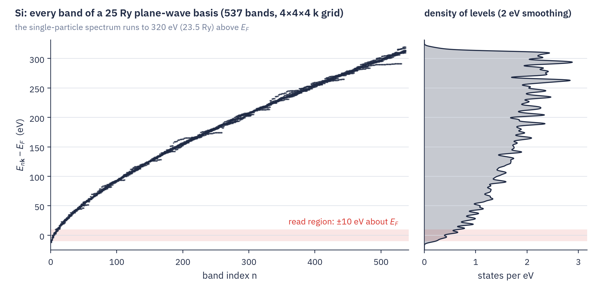](../assets/figures/theory-timefreq-si-spectrum.png)
<figcaption><strong>Fig. 2.1.</strong> Band energies of Si for all 537 bands of a 25 Ry plane-wave basis on a 4×4×4 k grid, measured from $E_F$ at midgap. The single-particle spectrum runs to 320 eV, while quasiparticle energies are read only in the shaded ±10 eV.</figcaption>
</figure>

### 2.2 Imaginary time, the usual approach {: #imag-time }

Most low-scaling GW codes evaluate the convolutions on the imaginary axis. At imaginary time $t=-i\tau$, with energies measured from $E_F$, all contributions to the Green's function decay exponentially, at rates $|E-E_F|$ set by their energies (Fig. 2.2b). This is the space-time method of Rojas, Godby and Needs [3], which Kaltak, Klimeš, Kresse and Liu developed into cubic-scaling RPA and GW [5, 6]. Minimax grids, quadratures built for decaying exponentials, need only tens of nodes and are tabulated for general use in the GreenX library [7]. Σ is then known only at imaginary frequencies, however, and must be continued analytically to the real axis by a Padé or other rational fit, which is most reliable near $E_F$ and less so away from it [4].

LORRAX uses imaginary and complex times for χ⁰, which is needed only at the few complex frequencies where $W$ is sampled, and then represents $W^c$ by poles fitted to those samples. For Σ we work on the real axis instead, so Σ needs no analytic continuation.

### 2.3 Real-axis prescription with broadening {: #broadening }

On the exact real axis each contribution $e^{-iEt}$ oscillates forever, and the time integrals do not converge. We therefore introduce a broadening $\eta$, which LORRAX applies once, in Σ, at 0.25 eV by default. It moves each pole a distance $\eta$ off the real axis (Fig. 2.2a), so that in real time each contribution oscillates at its energy and decays at the rate $\eta$. The three prescriptions of Fig. 2.2 differ in what happens in time. On the imaginary axis every contribution only decays, on the broadened real axis it oscillates and decays on the time scale $1/\eta$, and on the exact real axis it only oscillates.

<figure class="flowchart" markdown>
[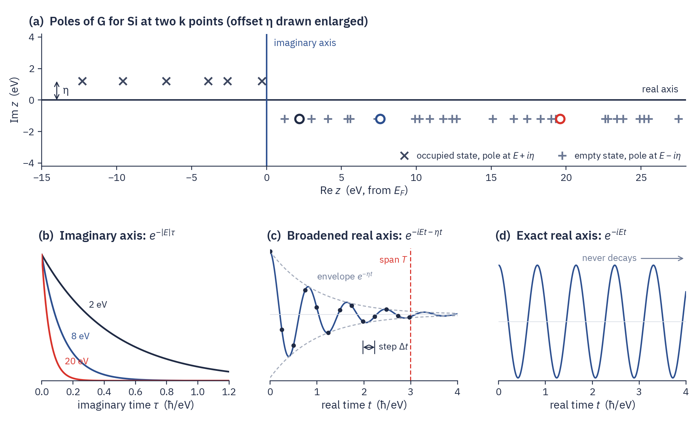](../assets/figures/theory-timefreq-prescriptions.png)
<figcaption><strong>Fig. 2.2.</strong> (a) Poles of $G$ for Si at two k points in the complex frequency plane, with the offset η drawn enlarged. (b)–(d) The poles in time on the three axes. On the imaginary axis each is a pure decay at its energy (b). On the broadened real axis it oscillates under the envelope $e^{-\eta t}$, here for $E$ = 8 eV and η = 1 eV, sampled at a step $\Delta t$ up to the span $T$ (c). On the exact real axis it oscillates without decay (d).</figcaption>
</figure>

In frequency, η turns every pole of Σ into a feature of width η, so a smaller η reveals more structure (Fig. 2.3).

<figure class="flowchart" markdown>
[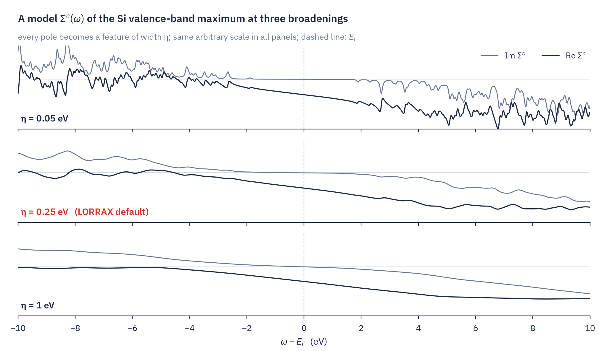](../assets/figures/theory-timefreq-broadening.png)
<figcaption><strong>Fig. 2.3.</strong> A model $\Sigma^c(\omega)$ for the Si valence-band maximum, built from the band energies of Fig. 2.1 and a model screened interaction, at η = 0.05, 0.25 and 1 eV, in arbitrary units on a common scale.</figcaption>
</figure>

On a time grid the broadening and the sampling together fix which frequencies can be represented (Fig. 2.2c). The broadening sets the span $T=\ln(1/\varepsilon)/\eta$, after which every contribution has decayed below the accuracy $\varepsilon$, and the time step $\Delta t$ sets the fastest oscillation that can be resolved, so a grid can only resolve frequencies between about $2\pi/T$ and $\pi/\Delta t$. Covering a bandwidth $B$, measured from mid-band, takes $\Delta t\le2\pi/B$, and a uniform grid then needs
{: #sampling-count }

$$
N\approx\frac{T}{\Delta t}=\frac{B}{\eta}\cdot\frac{\ln(1/\varepsilon)}{2\pi} \tag{2.1}
$$

nodes. At $\eta$ = 0.25 eV and $\varepsilon=10^{-4}$ this is 117 nodes for the ±10 eV read region, about 590 for a 100 eV bandwidth and about 2200 for the 370 eV spanned by the Σ denominators [10, 12]. Quasiparticle energies are read only within about ±10 eV of $E_F$, however, so we choose nodes that deliver the target accuracy there and, elsewhere, only the smooth contribution of distant states.

??? note "Derivation of (2.1) from the frequency side"
    The trapezoid rule with step $h$ for $\int f(\omega)\,d\omega$ makes an error equal to the sum of the Fourier transform of $f$ at times $2\pi k/h$, $k\ne0$ [9]. A peak of half-width $\eta$ has the transform $e^{-\eta|t|}$, so the error is about $e^{-2\pi\eta/h}$, and reaching $\varepsilon$ requires $h\le2\pi\eta/\ln(1/\varepsilon)$. Covering $B$ at that step gives (2.1).

### 2.4 The constraints {: #constraints }

Both transforms are designed against what is known before any node is chosen.

For Σ:

- Each term is an exponential $e^{-i(E\pm\Omega)t}$ damped by $\eta$, with $E$ a state energy and $\Omega$ a pole of $W^c$.
- The denominators span several hundred eV, from the lowest occupied state to the top of the band sum plus the largest pole.
- The result is needed only at the quasiparticle energies, about ±10 eV around $E_F$.
- The broadening is $\eta$ = 0.25 eV, or 5 eV for semicore states read far below $E_F$.
- The accuracy target is $\varepsilon_\Sigma=10^{-4}$, relative to $1/\eta$ near resonance and to $1/\lvert d\rvert$ far from it.

For χ⁰:

- Each term is an exponential in a transition energy $\Delta=E_c-E_v$ between the gap and the largest transition of the band window. It decays at imaginary times and is damped at the complex times used for the tangential supports.
- The result is needed at a few fixed frequencies, namely $z=0$, a plasmon-pole probe or the tangential supports.
- A gapped system needs no broadening on the imaginary axis, and on a sample line $z=\omega+i\varpi$ the height $\varpi$ acts as one.
- The accuracy target is an absolute $\varepsilon_\chi=10^{-6}$ Ry⁻¹, tighter on the tangential route.

The keys that set these numbers are collected in §[6](#frame).

### 2.5 Reducing the node count {: #approach }

A uniform grid that resolves η across the whole spectrum would cost thousands of nodes. We reduce the count with four ingredients.

1. Only the read region, about ±10 eV around $E_F$, needs the target accuracy (§2.3).
2. Once time is rotated off the real axis, the exponentials of $G(t)$ decay at rates that fill a known range. A rule fitted to that family, the minimax rule, needs a number of nodes that grows only with the logarithm of the range (§3).
3. Σ is split into product windows, so that most of its terms can be integrated as pure decays (below and §4).
4. χ⁰ is needed only at a few fixed frequencies, each with a rule of its own (§5).

The third ingredient follows from the form of the products in (1.7). $G^>(t)$ is a sum of exponentials $e^{-iE_mt}$ over states and $W^c(t)$ a sum of $e^{-i\Omega_j|t|}$ over poles, so their product is a sum of exponentials $e^{-i(E_m+\Omega_j)t}$, and each is the Fourier transform of one denominator $d=\omega-E_m-\Omega_j+i\eta$ of (1.5). Which rule a term needs depends on whether $d$ can vanish at a frequency where Σ is read (Fig. 2.4). If $E_m+\Omega_j$ lies inside the read region, $\mathrm{Re}\,d$ changes sign there and the term is **resonant**. Its time integral must follow the oscillation out to the decay time of η, as in §2.3. If $E_m+\Omega_j$ lies above every read frequency, $\mathrm{Re}\,d$ keeps one sign and the term is **sign-definite**. Rotating time off the real axis then turns it into a pure decay, which the rules of §3 integrate with a few nodes.

<figure class="flowchart" markdown>
[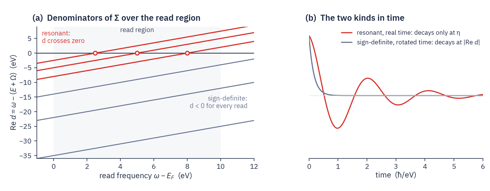](../assets/figures/theory-timefreq-crossing.png)
<figcaption><strong>Fig. 2.4.</strong> A schematic of the empty-state branch of Σ. (a) The denominators $d=\omega-(E+\Omega)$ against the read frequency. Terms with $E+\Omega$ inside the read region cross zero there (red), and the others stay negative for every read (grey). (b) A resonant term on the real time axis decays only at η, while a sign-definite term on the rotated time axis decays at $|\mathrm{Re}\,d|$.</figcaption>
</figure>

We therefore split each branch of Σ into windows, each a set of states times a set of poles, with its own time rule. For the empty-state branch, with "low" the states and poles below the highest read frequency plus a margin and "high" the rest,

$$
\begin{aligned}
G^>(t)\,W^c(t)=\;&\underbrace{G^>_{\mathrm{low}}(t)\,W^c_{\mathrm{low}}(t)}_{\text{resonant window}}+\underbrace{G^>_{\mathrm{high}}(t)\,W^c_{\mathrm{low}}(t)}_{\text{state tail, sign-definite}}\\
&+\underbrace{G^>(t)\,W^c_{\mathrm{high}}(t)}_{\text{pole tail, sign-definite}}
\end{aligned} \tag{2.2}
$$

and each window $w$ is integrated with its own nodes $t^{(w)}_i$ and weights $w^{(w)}_i$,

$$
\Sigma^c(\omega)\approx\sum_{\text{windows }w}\ \sum_i w^{(w)}_i(\omega)\,G^>_w\big(t^{(w)}_i\big)\,W^c_w\big(t^{(w)}_i\big) \tag{2.3}
$$

Each window is a product of a part of $G$ and a part of $W^c$, so every node still costs one product of the form (1.7). Only the resonant window needs a node count set by η, and that count follows the width of the read region instead of the whole spectrum (§4).

We develop the rules shared by both transforms in §3, then treat Σ before χ⁰ because its transform is the harder of the two.

## 3 Fitting a family of exponentials {: #exponentials }

The shared building block is a quadrature rule fitted to a family of decaying exponentials, the second ingredient of §2.5. We first turn oscillations into decays and write the transform as a sum of exponentials (§3.1–3.2), then compare generic rules with one built for the family (§3.3) and define that rule (§3.4).
{: .intro }

### 3.1 From oscillations to decays {: #exp-decays }

Rotating time into the imaginary or complex plane turns an oscillating term into a decay, as in Fig. 2.2b, and leaves a family of decays $e^{-xt}$ with $x$ an energy difference, such as a transition energy of χ⁰ or the distance of a Σ denominator from resonance. The rates fill a known range $[x_{\min},x_{\max}]$, which we call the **window**, with ratio $R=x_{\max}/x_{\min}$. For Si χ⁰, $x_{\min}$ is the gap and $x_{\max}$ the largest transition, and $R$ is of order $10^2$ to $10^4$.

### 3.2 One node, one product {: #frame-node }

Each pole $1/x$ is the time integral of one decay, and a rule replaces that integral by a weighted sum over nodes,

$$
\frac1x=\int_0^\infty e^{-xt}\,dt\;\approx\;\sum_{i=1}^{N}w_i\,e^{-xt_i},\qquad x_{\min}\le x\le x_{\max} \tag{3.1}
$$

Fig. 3.1 shows four weighted exponentials that add up to $1/x$. For χ⁰ at $z=0$, with $x=\Delta=E_c-E_v$, each term factorizes as $e^{-\Delta t_i}=e^{-(E_c-E_c^{\min})t_i}\,e^{-(E_v^{\max}-E_v)t_i}\,e^{-E_gt_i}$ into an empty and an occupied factor at the same node and a constant folded into the weight. Each node is therefore one product of the two Green's functions of (1.6), and the pair sum (1.4) becomes a sum over nodes.

<figure class="flowchart" markdown>
[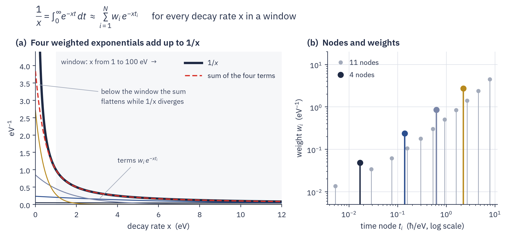](../assets/figures/theory-timefreq-transform.png)
<figcaption><strong>Fig. 3.1.</strong> (a) $1/x$ for decay rates in the window [1, 100] eV, and the four weighted exponentials $w_i e^{-x t_i}$ of the 4-node minimax rule, which add up to the dashed curve. Below the window the sum flattens while $1/x$ diverges, and with 8 or 11 nodes the sum is indistinguishable from $1/x$ at this scale. (b) The nodes and weights of the 4-node rule, coloured as in (a), and of the 11-node rule, on a logarithmic time axis.</figcaption>
</figure>

### 3.3 Generic rules need far more nodes {: #exp-generic }

Generic quadrature rules ignore the structure of the family. A uniform grid in $t$ must resolve the fastest decay, with a step of order $1/x_{\max}$, and last as long as the slowest, over a span of order $\ln(1/\varepsilon)/x_{\min}$, so it needs about $R\ln(1/\varepsilon)$ nodes. Gauss–Legendre on a span $[0,T]$ crowds its nodes toward $t=0$ and does better, but its node count still grows as a power of $R$, whereas a rule built for the family grows only as $\ln R$. On the window [1, 100] eV, reaching the default χ⁰ accuracy takes 11 nodes for that rule, about 70 for Gauss–Legendre and more than 1000 for a uniform grid (Fig. 3.2). The rule with this logarithmic growth is the minimax rule, which we define next.

<figure class="flowchart" markdown>
[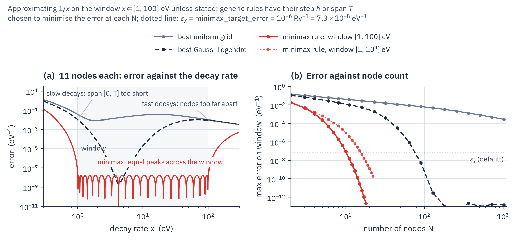](../assets/figures/theory-timefreq-laplace-error.png)
<figcaption><strong>Fig. 3.2.</strong> Approximating $1/x$ on the window [1, 100] eV, shaded in (a). (a) Error against the decay rate, 11 nodes per rule. (b) Largest error on the window against node count. The step $h$ of the uniform grid and the span $T$ of Gauss–Legendre on [0, T] are chosen to minimise the error at each N. The dotted line marks the default $\varepsilon_\chi$ = 10⁻⁶ Ry⁻¹.</figcaption>
</figure>

### 3.4 The minimax rule {: #exp-minimax }

`minimax.levelled.noncrossing_levelled`
{: .in-code }

The rule of Figs. 3.1 and 3.2 chooses its nodes and weights to minimise the largest error over the window:

$$
\min_{\{t_i,\,w_i\}}\ \max_{x_{\min}\le x\le x_{\max}}\ \Big|\sum_{i=1}^{N}w_i\,e^{-xt_i}-\frac1x\Big| \tag{3.2}
$$

The optimal rule has error peaks of equal height across the window (Fig. 3.2a). Because it is computed once on $[1,R]$ and rescaled by $x_{\min}$, the window ratio alone fixes its shape, and its node count grows as $\ln R\cdot\ln(1/\varepsilon)$ [8, 5, 7]. The nodes are evenly spaced in $\ln t$, because a decay $e^{-xt}$ lives on the time scale $1/x$ and every decade of $x$ needs the same number of nodes (Fig. 3.3).

<figure class="flowchart" markdown>
[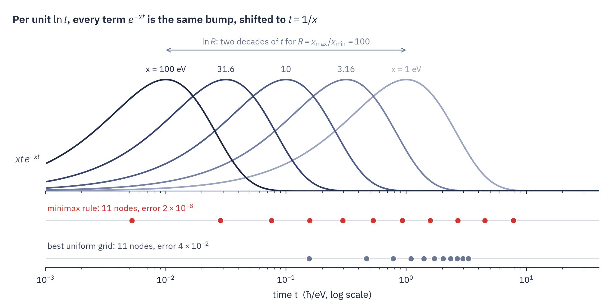](../assets/figures/theory-timefreq-exponentials.png)
<figcaption><strong>Fig. 3.3.</strong> Per unit $\ln t$ the terms of the window [1, 100] eV are identical bumps shifted to $t = 1/x$. The 11 minimax nodes spread evenly in $\ln t$, whereas a uniform grid with 11 nodes crowds into the slow end.</figcaption>
</figure>

LORRAX uses this rule for χ⁰ at $z=0$ (§[5](#response)). The Σ windows far from resonance, to which we turn next, use the sector rule, built on the same principle but with nodes placed by a formula of the window instead of by optimization (§[4.1](#win-kinds)).

## 4 The self-energy transform {: #windows }

The self-energy is evaluated in product windows, the third ingredient of §2.5, because its denominators $d=\omega-E\mp\Omega\pm i\eta$ come in two kinds that need different rules. We first separate the two kinds and the rules they take (§4.1), then describe the windows that sort the terms of Σ into them (§4.2) and what those windows deliver (§4.3).
{: .intro }

### 4.1 Near and far from resonance {: #win-kinds }

`minimax.analytic_box_rule`
{: .in-code }

At a complex time $t=\sigma-i\tau$ a term has magnitude $|e^{itd}|=e^{-\sigma\,\mathrm{Im}\,d\,+\,\tau\,\mathrm{Re}\,d}$. Far from resonance $\mathrm{Re}\,d$ keeps one sign, and when it is negative, rotating time to $t=-i\tau$ turns every term into a pure decay $e^{-|\mathrm{Re}\,d|\tau}$ (Fig. 4.1a), the family of §3. LORRAX uses the sector rule there, with log-spaced nodes placed by formula along the rotated direction, 8 of them for $\mathrm{Re}\,d$ from −112 to −1 eV. Near resonance $\mathrm{Re}\,d$ passes through zero and rotating time either way makes half the terms grow. The integrand must then be followed near the real time axis, where it oscillates and decays only at rate $\eta$ (Fig. 4.1b), and we are back to the sampling problem of §2.3.

<figure class="flowchart" markdown>
[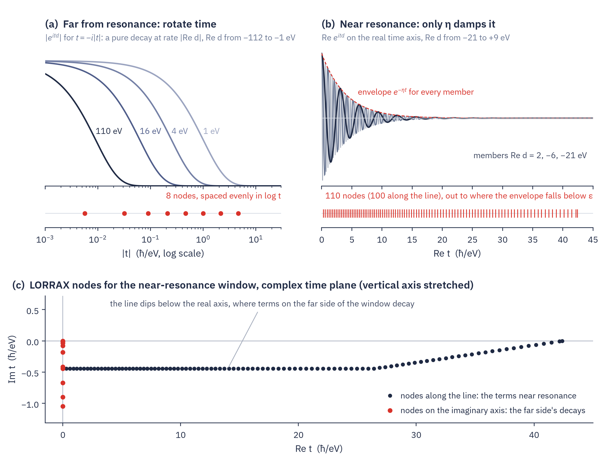](../assets/figures/theory-timefreq-sigma-kinds.png)
<figcaption><strong>Fig. 4.1.</strong> (a) Far from resonance, rotated time turns every denominator into a pure decay, and 8 nodes cover $\mathrm{Re}\,d$ from −112 to −1 eV. (b) Near resonance the terms oscillate and decay only at η, and LORRAX's rule for $\mathrm{Re}\,d$ from −21 to +9 eV takes 110 nodes. (c) Those 110 nodes in the complex time plane. Throughout, η = 0.25 eV and $\varepsilon_\Sigma$ = 10⁻⁴.</figcaption>
</figure>

LORRAX's construction matters most in the near-resonance window. A generic rule needs nodes in proportion to the window's full width over $\eta$, which by (2.1) is about 2200 for the 370 eV of a Σ branch. LORRAX's rule instead follows a line that dips slightly below the real time axis, where the terms on the far side of the window already decay, and completes them with a few nodes on the imaginary time axis (Fig. 4.1c). Its node count follows the window's narrow side, the part where $\omega$ lies above $E+\Omega$, which is set by the read region, so the rule takes 110 nodes instead of about 2200. The partition of §4.2 sorts the terms of Σ into windows of one kind or the other.

### 4.2 Product windows {: #win-products }

`gw.sigma_box_plan._state_products`
{: .in-code }

LORRAX partitions each causal branch of Σ into product windows, each a set of states × a set of poles × a set of output frequencies. A window must be a product, because only then does every node factor into one $G^>(t_i)$ or $G^<(t_i)$ and one $W^c(t_i)$. The partition puts every state and every pole lying above the read region, plus a margin of $1.5\,\eta$, into windows whose denominators keep one sign, and only the square of low states and low poles remains a near-resonance window (Fig. 4.2). The windows are fixed by the energies alone, before any time integral is done. The nearest precedent is the windowing of the complex-time shredded propagator method, which also separates sign-changing from sign-definite denominator pairs [11].

<figure class="flowchart" markdown>
[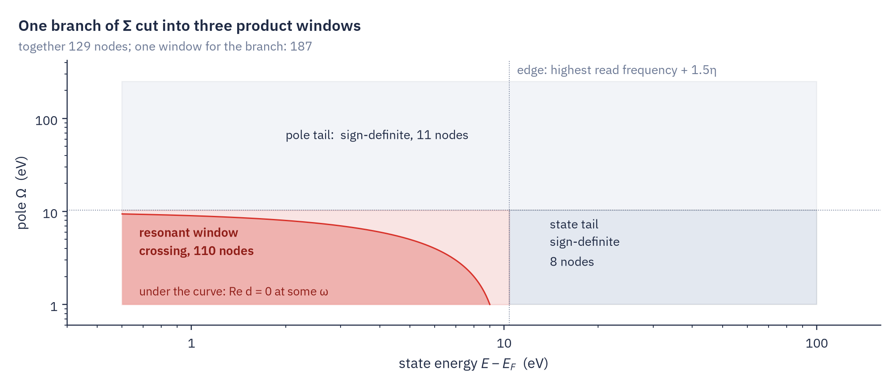](../assets/figures/theory-timefreq-windows.png)
<figcaption><strong>Fig. 4.2.</strong> The empty-state branch at ω ≥ E_F of an insulating example, with states at 0.6–100 eV, poles at 1–250 eV and reads up to ω = 10 eV, cut into three product windows. Only under the curve does $\mathrm{Re}\,d$ change sign for some read frequency.</figcaption>
</figure>

### 4.3 What the windows deliver {: #win-currency }

A near-resonance window can only be certified relative to the peak of $1/d$, which means an absolute error $\varepsilon_\Sigma/\eta$ on every term. For a term far from resonance this is a relative error of up to $\varepsilon_\Sigma|d|/\eta$, or 0.14 at $|d|$ = 350 eV. A sign-definite window, by contrast, guarantees a relative error $\varepsilon_\Sigma$ on each term at no extra cost (Fig. 4.3). The windows therefore mainly buy relative accuracy for the many distant terms, which make up the large smooth part of Σ, and do less for the node count. The three windows of Fig. 4.2 take 110 + 8 + 11 = 129 nodes, against 187 for one near-resonance window over the whole branch. A composite Gauss–Legendre rule in real time on the same branch needs about 4500 (Fig. 4.4), more than (2.1) predicts because it is less efficient than an ideal uniform grid.

<figure class="flowchart" markdown>
[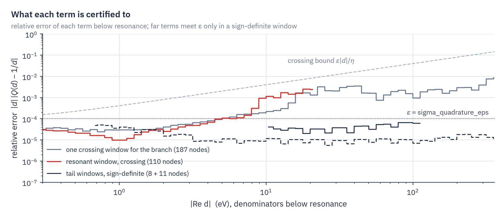](../assets/figures/theory-timefreq-windows-error.png)
<figcaption><strong>Fig. 4.3.</strong> Relative error of each term below resonance for the windows of Fig. 4.2, against one near-resonance window over the whole branch.</figcaption>
</figure>

<figure class="flowchart" markdown>
[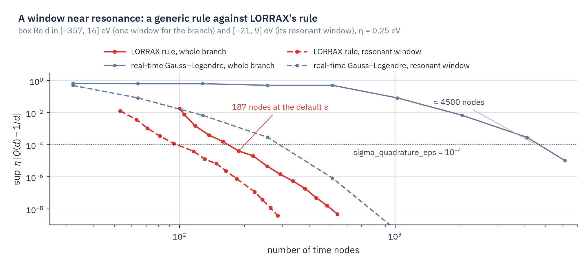](../assets/figures/theory-timefreq-sigma-error.png)
<figcaption><strong>Fig. 4.4.</strong> Peak-relative error of a near-resonance window against node count, for LORRAX's rule and for composite Gauss–Legendre in real time. The whole branch, with $\mathrm{Re}\,d$ from −357 to 16 eV, takes 187 nodes against about 4500, and its resonant window, from −21 to 9 eV, 110 against about 300. LORRAX takes the first rule on its ladder that passes its acceptance check, so its error at the default ε lies below ε.</figcaption>
</figure>

Semicore states far below the read region are read on coarse windows of their own, at a broadening of 5 eV (§[8.3](#win-coarse)).

## 5 The response transform {: #response }

As noted in §2.5, χ⁰ is needed only at a few fixed frequencies, and its rules follow from the samples LORRAX takes of $W$ ([Frequency treatments](frequency-treatments.md)). At $z=0$, which serves the static $W$, χ⁰ takes the minimax rule of §3 at imaginary times, with about ten nodes. A plasmon-pole probe on the imaginary axis takes a rule of the same kind, and a real-axis probe above every transition takes two of them. On the production tangential route all supports share one set of complex times, so each node is one Green-function product serving every sample. Details are in §[7](#laplace) and [Tangential W model §6.2](tangential-w.md#bank-times), and the node loop in [Parallel algorithms §4](parallel-algorithms.md#par-time).

---

The remaining sections are reference material for readers who set or debug the rules. They collect the keys, the individual rules and their acceptance tests.

## 6 Reference: rules and keys {: #frame }

Each consumer of a frequency kernel has its own rule, certified in its own error measure and set by its own key. No rule is stored across runs, and each is built in the process that needs it.
{: .intro }

### 6.1 Rules and keys {: #frame-keys }

`gw.minimax_config.MinimaxConfig`
{: .in-code }

| Rule | Used for | Times | Accuracy key (default) and meaning | Node cap |
|---|---|---|---|---|
| minimax exponential sum (§[7.1](#static)) | static $W(0)$ | imaginary | [`minimax_target_error`](../drivers/gw/keywords.md#minimax_target_error) ($10^{-6}$ Ry⁻¹), absolute | [`minimax_max_nodes`](../drivers/gw/keywords.md#minimax_max_nodes) (64) |
| GN probe rule (§[7.2](#probes)) | GN-PPM at $i\omega_p$ | imaginary | `minimax_target_error`, relative | fixed ceiling of 64 |
| two $1/y$ rules (§[7.3](#probes-hl)) | HL-GPP at real $\omega_p>\Delta_{\max}$ | imaginary, both signs | `minimax_target_error`, absolute | `minimax_max_nodes` |
| shared complex-time rule ([Tangential W model §6.2](tangential-w.md#bank-times)) | every tangential support | complex | [`sigma_w_accuracy`](../drivers/gw/keywords.md#sigma_w_accuracy): `bank_rule_tolerance` $10^{-8}$ (`production`) or $10^{-7}$ (`relaxed`) | 192 per shared set |
| sector rule or near-resonance rule (§[9](#sigma-boxes)) | every Σ window | complex | [`sigma_quadrature_eps`](../drivers/gw/keywords.md#sigma_quadrature_eps) ($10^{-4}$, or $5\times10^{-4}$ under `relaxed`) | none |

The Σ windows also read [`sigma_regularization_ev`](../drivers/gw/keywords.md#sigma_regularization_ev) (the broadening $\eta$, 0.25 eV) and [`sigma_window_edge_factor`](../drivers/gw/keywords.md#sigma_window_edge_factor) (the state edge $1.5\,\eta$). [`minimax_energy_reference`](../drivers/gw/keywords.md#minimax_energy_reference) (`midgap`) sets the energy zero of the static and probe χ⁰ rules, from which it cancels. It accepts `midgap`, `vbm`, `cbm` and `none` (aliases `raw`, `zero`), and any other value, including a number, refuses. The tangential route reads neither `minimax_target_error` nor `minimax_max_nodes`, although the static rule is still built on every screened route.

## 7 Reference: χ⁰ rules at fixed frequencies {: #laplace }

At $z=0$ and on the imaginary axis the χ⁰ kernel is a decaying exponential sum (§[3](#exponentials)) with real, positive times.
{: .intro }

### 7.1 The static rule {: #static }

`gw.minimax_screening.solve_laplace_minimax_interval`
{: .in-code }

The kernel $K_z(\Delta)=2\Delta/(z^2-\Delta^2)$ is $-2/\Delta$ at $z=0$. $1/\Delta$ is fitted by the minimax rule (3.2) on $[1,R]$ and rescaled, $\tau_i=\hat\tau_i/\Delta_{\min}$, $w_i=\hat w_i/\Delta_{\min}$, and the caller applies the factor $-2$. $\Delta_{\min}$ is the gap $E_c^{\min}-E_v^{\max}$, floored at the occupation smearing width when one is declared, and $\Delta_{\max}=E_c^{\max}-E_v^{\min}$ is taken over the union of the χ⁰ and Σ band windows. The solver returns the smallest $N$ that meets `minimax_target_error`. The log prints each rule as `Minimax static window: x=[…] Ry, R=…, nodes=…, fit_err~…`.

!!! refuses
    - A static rule that misses `minimax_target_error` at `minimax_max_nodes` nodes (`GATE minimax_node_cap`). Raise `minimax_max_nodes` or relax `minimax_target_error`.
    - A gapless χ⁰ window on this route (`GATE chi0_laplace_needs_gap`). A metal takes `compute_mode = tangential` (see [Metals](metals.md)).

### 7.2 The GN probe {: #probes }

`gw.minimax_screening.build_imag_probe_response_rule`
{: .in-code }

The GN-PPM probe $z=i\omega_p$ takes positive times fixed by the interval alone, from elliptic decay rates, and the weights of $\Delta/(\Delta^2+\omega_p^2)$ by one linear projection. The residual is checked at every $\Delta$ of the interval at relative tolerance `minimax_target_error`, and the degree starts at $\lceil\ln(16R)\ln(1/\varepsilon_\chi)/\pi^2\rceil$ and rises until the check passes, at most 64. A time-reversal-broken deck projects the odd target on the same times. The far-from-resonance Σ windows use the same time placement (§[9.3](#box-sector)).

!!! refuses
    - No certified probe rule through 64 nodes (`remote Ritz certificate failed through 64 nodes`). Narrow the band window or relax `minimax_target_error`.
    - Complex even or odd probe coefficients (`GATE gn_ppm_analytic_probe_real`).

### 7.3 The HL probe {: #probes-hl }

`gw.minimax_screening.build_real_quadrature`
{: .in-code }

A real probe above every transition splits the kernel into two denominators of fixed sign,

$$
\frac{\Delta}{\Delta^2-\omega_p^2}=\frac{1/2}{\omega_p+\Delta}-\frac{1/2}{\omega_p-\Delta},\qquad \omega_p>\Delta_{\max} \tag{7.1}
$$

each taking a static $1/y$ rule on its shifted interval, with the second entering at negated times. A real-axis sample carries only the even orientation, so HL-GPP refuses a time-reversal-broken deck ([Frequency treatments §4.4](frequency-treatments.md#ppm-odd)).

!!! refuses
    - `ppm_omega_p` at or below $\Delta_{\max}$ (`GATE hl_ppm_probe_in_spectrum`).

## 8 Reference: Σ windows {: #sigma-windows }

We give the partition of §4.2 in full, with the error bound it delivers, the acceptance tests of a window's rule and the semicore windows.
{: .intro }

### 8.1 The partition {: #win-partition }

`gw.sigma_box_plan._state_products`
{: .in-code }

Σ has four causal branches, $(\omega\ge E_F,\ \omega<E_F)\times$(empty, occupied). On the empty branch at $\omega\ge E_F$ and the occupied branch at $\omega<E_F$, $\mathrm{Re}\,d=\omega-(E+\Omega)$ can pass through zero. With energies measured from $E_F$ in each branch's direction, the state edge $a=f_e\eta$ ($f_e$ = `sigma_window_edge_factor`), the excursion $\delta\ge0$ (the furthest a state lies on the wrong side of $E_F$, zero on an insulator) and $\Lambda_h=\max\lvert\omega\rvert+a+\delta$ over the frequency half $h$, each branch is cut into at most four windows:

| Branch | Window | States $E$ | Poles $\mathrm{Re}\,\Omega$ | $\lvert\omega\rvert$ | Kind |
|---|---|---|---|---|---|
| crossing | resonant | $\le\Lambda_h$ | $(0,\Lambda_h]$ | all | near resonance |
| crossing | state tail | $>\Lambda_h$ | $(0,\Lambda_h]$ | all | sign-definite |
| crossing | pole tail | all | $>\Lambda_h$ | all | sign-definite |
| non-crossing | bulk | $>a$ | all | all | sign-definite |
| non-crossing | resonant | $\le a$ | $(0,a+\delta]$ | $<a+\delta$ | near resonance only if a state lies past $E_F$ |
| non-crossing | pole tail | $\le a$ | $>a+\delta$ | $<a+\delta$ | sign-definite |
| non-crossing | ω tail | $\le a$ | all | $\ge a+\delta$ | sign-definite |

Empty windows are dropped and windows are never merged. Because the windows partition the (state, pole, frequency) terms, one state's error obeys

$$
\lvert\delta\Sigma_n(\omega)\rvert\le\varepsilon_\Sigma\sum_{p\,\in\,\text{near}}\frac{\lvert M_{np}\rvert}{\eta}+\varepsilon_\Sigma\sum_{p\,\in\,\text{sign-definite}}\frac{\lvert M_{np}\rvert}{\lvert d_{np}\rvert} \tag{8.1}
$$

with $M_{np}$ the matrix element of one term, and no factor for the number of windows.

### 8.2 Design constraints {: #win-constraints }

`gw.sigma_box_plan._accept_rule`
{: .in-code }

A rule that breaks one of these constraints refuses the run in planning, before the sweep.

| Constraint | Requirement |
|---|---|
| Sign kept | A window's box is its extreme corners $\omega-(E+\Omega)$ padded by 2 % of its width, but an edge never moves more than 30 % of the way toward zero. |
| Bounded factors | At complex times the state and pole exponentials are evaluated separately. Each window measures them from its bounded end and refuses a rule under which either grows by more than $e^{30}$. |
| Round-off | The summed magnitude of the terms, $\rho\sum_i\lvert w_ie^{it_id}\rvert$ with $\rho=\eta$ near resonance and $\rho=\lvert d\rvert$ for sign-definite windows, stays under $83.3=5\times10^{-6}/6\times10^{-8}$, the executor's round-off budget over its per-term relative noise. |
| One error measure per run | A run uses one $\eta$ and one $\varepsilon_\Sigma$, and a self-consistent run that changes either refuses. |
| One edge per frequency half | $\Lambda_h$ is taken per half, because self-consistency grows only the upper half's support. |

### 8.3 Semicore windows {: #win-coarse }

`gw.qp_support.coarse_windows_plan`
{: .in-code }

The broadening sets the resolution a near-resonance window pays for. Occupied semicore states tens of eV below the read region would stretch the resonant windows down to them at the deck's $\eta$. On the tangential route (`compute_mode = tangential`) semicore states outside the requested set are read instead on coarse windows of their own, broadened by 5 eV, sampled every 2.5 eV and certified at $\max(\varepsilon_\Sigma,\,3\times10^{-3})$. `sigma_omega_patches_ev` accepts `lo:hi:eta` triples that replace these windows, each with its own $\eta$ at or above `sigma_regularization_ev`.

!!! refuses
    - A malformed or overlapping triple, a triple with $\eta$ below `sigma_regularization_ev`, or triples on a self-consistent run with no semicore states (`GATE sigma_coarse_window`). A one-shot whose semicore states are all requested warns and ignores them.

## 9 Reference: Σ denominator rules {: #sigma-boxes }

Each window needs $1/d$ on its box, with the rule $Q(d)=\sum_iw_ie^{it_id}$ built from the box and $\varepsilon_\Sigma$ alone. The occupied branch's box lies in the lower half plane and takes the conjugate rule.
{: .intro }

### 9.1 The trapezoid identity {: #box-trapezoid }

`minimax.analytic_box_rule`
{: .in-code }

For $\mathrm{Im}\,d>0$ and $\lvert\mathrm{Re}\,d\rvert<B_0$, $1/d$ splits exactly into a trapezoid rule of $1/d=-i\int_0^\infty e^{isd}\,ds$ at spacing $2\pi/B_0$ and a remainder:

$$
\frac1d=\frac{\pi}{B_0}\cot\frac{\pi d}{B_0}+\frac2{B_0}\int_0^\infty\frac{\sinh(td/B_0)}{e^t-1}\,dt,\qquad \frac{\pi}{B_0}\cot\frac{\pi d}{B_0}=-\frac{2\pi i}{B_0}\Big[\frac12+\sum_{k\ge1}e^{ik(2\pi/B_0)d}\Big] \tag{9.1}
$$

The trapezoid sum is the uniform grid of §2.3. The remainder is two decaying integrals on the imaginary time axes [9], each carried by a few Gauss nodes.

### 9.2 Near-resonance boxes {: #box-bent }

`minimax.crossing_nodes`
{: .in-code }

The nodes follow a contour bent into the lower half of the time plane. It consists of a short vertical leg on the imaginary axis that carries the decays of the box's wide side, a line at constant depth $c/(m\eta)$ below the real axis, where $m$ is the narrow side in units of $\eta$ and $c=4$, and a linear rise back to the real axis where every term has fallen below $\varepsilon_\Sigma/4$. Along the line the node density follows the largest $\lvert\mathrm{Re}\,d\rvert$ whose term is still alive. Past the leg this is the narrow side, so the count follows $m$. Two Gauss sets on the imaginary axes carry the remainder of (9.1). The depth keeps the narrow side's growth at $e^{c}$, under the round-off cap $\ln 83.3$, and a tall box, with strongly damped poles, uses a shallower bend. The constants and count laws are in the LORRAX repository's `docs/theory/minimax-quadrature.md` §7.

### 9.3 Sign-definite boxes {: #box-sector }

`minimax.sector_degree`
{: .in-code }

A box with $\mathrm{Im}\,d\ge\eta$ lies in an open sector of the upper half plane. Its times are those of §[7.2](#probes) for the rotated box, rotated back to the sector's axis, and its degree is estimated from the box's extent in $\ln\lvert d\rvert$, the $\ln R$ of §3.4. A rule that fails its check steps to $\max(n+1,\lceil1.1n\rceil)$ nodes, up to six times. No node is optimized.

### 9.4 Weights and acceptance {: #box-accept }

`minimax.analytic_box_rule`
{: .in-code }

The weights are one least-squares solve on the box boundary, with a ridge $0.05\,\varepsilon_\Sigma$. A rule is accepted when

$$
\begin{aligned}
&\sup_{d\in\partial\mathrm{box}}\rho(d)\,\Big\lvert Q(d)-\frac1d\Big\rvert\le\varepsilon_\Sigma,\qquad \sup_{d\in\partial\mathrm{box}}\rho(d)\sum_i\big\lvert w_ie^{it_id}\big\rvert\le83.3,\\
&\rho=\begin{cases}\eta_{\min}&\text{near resonance}\\ \lvert d\rvert&\text{sign-definite}\end{cases}
\end{aligned} \tag{9.2}
$$

A near-resonance miss raises the line density by 10 % and adds one node to the leg and to each image set, six times, then halves the bend twice. A rule depends only on the box and $\varepsilon_\Sigma$, so within a run it serves every later window whose box it contains.

!!! refuses
    - A window whose rule is not certified at `sigma_quadrature_eps` or not finite; the message names the window, box and kind. Split the window or keep it sign-preserving, rather than loosening `sigma_quadrature_eps`.
    - A rule above the round-off bound of (9.2), or factored growth above $e^{30}$.
    - $\eta\le0$, $\varepsilon_\Sigma\notin(0,1)$, or $\eta$ or $\varepsilon_\Sigma$ changed inside one self-consistent run.

## Notation {: #notation }

| Symbol | Meaning |
|---|---|
| $\eta$ | Σ broadening, `sigma_regularization_ev` |
| $\varepsilon_\Sigma$, $\varepsilon_\chi$ | `sigma_quadrature_eps`; `minimax_target_error` |
| $B$ | bandwidth: the range of energies a time function contains |
| $T$, $\Delta t$ | time horizon $\ln(1/\varepsilon)/\eta$; time step |
| $N_v$, $N_c$, $N_k$, $N_\mu$, $N_\tau$ | occupied and empty bands; k points; ISDF points; time nodes |
| $\Delta$ | transition energy $E_c-E_v$ |
| $x$, $[x_{\min},x_{\max}]$, $R$ | decay rate; the window of decay rates; $R=x_{\max}/x_{\min}$ |
| $t_i$, $w_i$ | time nodes and weights |
| $\Omega_{j\bq}$, $b_{j\bq}$ | poles and residue vectors of $W^c$ |
| $d$, $Q(d)$ | Σ denominator $\omega-E\mp\Omega\pm i\eta$; its rule |
| $a$, $\delta$, $\Lambda_h$ | state edge; wrong-side excursion; pole edge of frequency half $h$ |

## References {: #refs }

1. L. Hedin, Phys. Rev. 139, A796 (1965).
2. M. S. Hybertsen and S. G. Louie, Phys. Rev. B 34, 5390 (1986).
3. H. N. Rojas, R. W. Godby and R. J. Needs, Phys. Rev. Lett. 74, 1827 (1995).
4. D. Golze, M. Dvorak and P. Rinke, Front. Chem. 7, 377 (2019).
5. M. Kaltak, J. Klimeš and G. Kresse, J. Chem. Theory Comput. 10, 2498 (2014).
6. P. Liu, M. Kaltak, J. Klimeš and G. Kresse, Phys. Rev. B 94, 165109 (2016).
7. M. Azizi, J. Wilhelm, D. Golze, F. A. Delesma, R. L. Panadés-Barrueta, P. Rinke, M. Giantomassi and X. Gonze, Phys. Rev. B 109, 245101 (2024).
8. D. Braess and W. Hackbusch, IMA J. Numer. Anal. 25, 685 (2005).
9. L. N. Trefethen and J. A. C. Weideman, SIAM Rev. 56, 385 (2014).
10. F. Hüser, T. Olsen and K. S. Thygesen, Phys. Rev. B 87, 235132 (2013).
11. M. Kim, G. J. Martyna and S. Ismail-Beigi, Phys. Rev. B 101, 035139 (2020).
12. D. A. Leon, C. Cardoso, T. Chiarotti, D. Varsano, E. Molinari and A. Ferretti, Phys. Rev. B 104, 115157 (2021).

