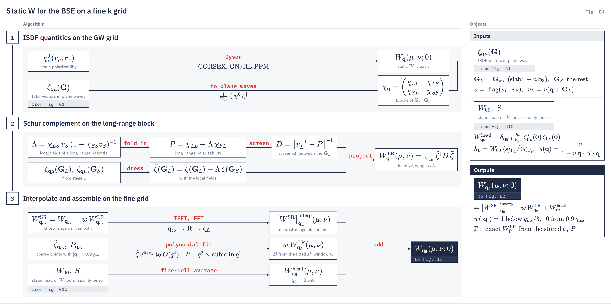
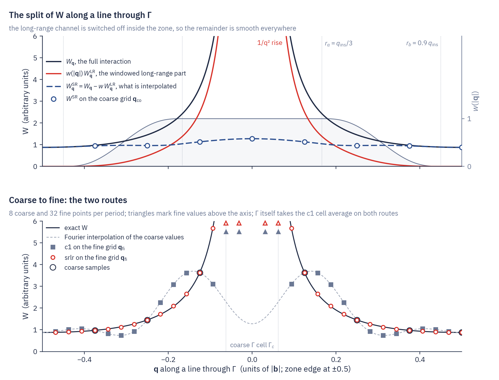

# Short- and long-range W

`w_head_densify = srlr` The static screened interaction carried from the GW grid to a finer BSE grid, with its long-range plane-wave part split off, evaluated at every fine q and added back.
{: .page-summary }

<div class="section-cards"></div>

<figure class="flowchart" markdown>
[](../assets/figures/b4.png)
<figcaption><strong>Fig. B4.</strong> Static $W$ for the BSE on a fine k grid. Stage 1 forms the static $W$ on the GW grid and the polarizability in plane waves, in blocks of the long-range vectors $\bG_L$ and the rest $\bG_S$. Stage 2 takes the Schur complement on the $\bG_L$ block, which gives the long-range polarizability $P$, the screened interaction $D$, the local-field factor $\Lambda$ and the long-range part $W^{\mathrm{LR}}$. Stage 3 Fourier-interpolates the short-range part, evaluates the fitted long-range part at every fine $\bq$, and adds the $\bq=0$ head. A tangential GW run has no split and supports only `c1`.</figcaption>
</figure>

## <span class="n">1</span> Overview {: #overview }

Exciton energies from the BSE usually need a denser k grid to converge than quasiparticle energies from GW. Codes reach the fine grid in different ways, and dual-grid schemes that interpolate the kernel matrix elements are common [3, 5]. LORRAX applies the BSE Hamiltonian to trial vectors without forming it, and this product needs only the static interaction $W_\bq(\mu,\nu;0)$ at every $\bq$ of the fine grid. We therefore interpolate $W$ itself in $\bq$, by a Fourier transform to the lattice vectors $\bR$ of the coarse grid's supercell and back. This is justified because $W_\bR(\mu,\nu)$ decays in real space, so beyond a cutoff distance it is insensitive to the size of the grid.
{: .intro }

$W$ contains a $1/q^2$ divergence in three-dimensional materials, and a $1/q$ divergence with cusps in the out-of-plane components in two, which a Fourier interpolation cannot reproduce. As is common in the phonon and electron–phonon literature [9–12], we separate the divergence off. The long-range part, which comes from the plane waves $\bq+\bG$ closest to the origin, is evaluated analytically at every fine $\bq$, and only the smooth short-range part is Fourier-interpolated,

$$
W_{\bq_{\mathrm{fi}}}(\mu,\nu)=\big[W^{\mathrm{SR}}\big]^{\mathrm{interp}}_{\bq_{\mathrm{fi}}}(\mu,\nu)+W^{\mathrm{LR}}_{\bq_{\mathrm{fi}}}(\mu,\nu) \tag{1.1}
$$

Both parts are written with the plane-wave coefficients $\zeta_{\bq\mu}(\bG)$ of the [ISDF](isdf.md) interpolation vectors, so the construction applies to any ISDF method. It has four steps.

- **The long-range plane waves $\bG_L$ (§2).** One vector in bulk, a short column along $G_z$ in a slab.
- **An exact split on the GW grid (§3).** Writing the Dyson equation in blocks of long- and short-range plane waves and taking the Schur complement on the long-range block separates $W$ into $W^{\mathrm{SR}}$ and $W^{\mathrm{LR}}$. $W^{\mathrm{LR}}$ contains the head and the wings of $W$.
- **Interpolation (§4).** The long-range part is fitted as a smooth function of $\bq$ and evaluated at every fine $\bq$, and the short-range part is Fourier-interpolated.
- **The head at Γ (§4.3).** The $\bq=0$ element, which no grid point samples, is added separately as a mini-BZ average from the [q → 0 head](q0-head.md).

Because the long-range part is subtracted on the coarse grid and added back on the fine grid, every coarse point is reproduced, and an error in its fit only changes how smooth the interpolated short-range part is. This route is selected by `w_head_densify = srlr`. The default, `c1`, treats only the head (§5). Fig. 1 compares the two on a one-dimensional sketch.

<figure class="flowchart" markdown>
[](../assets/figures/theory-wrange-split.png)
<figcaption><strong>Fig. 1.</strong> A schematic in arbitrary units, not a calculation. The upper panel shows $W_\bq$ along a line through $\Gamma$, its long-range part multiplied by the window $w(|\bq|)$ of §4.2 (grey, right axis), and the short-range part $W^{\mathrm{SR}}_\bq$ that is interpolated. The lower panel shows what each route puts on a four times finer grid. The `c1` points follow the Fourier interpolation of the coarse values, which contain the $1/q^2$ rise at their own $\bq$, and add a head only inside the coarse $\Gamma$ cell. The `srlr` points follow the exact curve. The sketch uses the exact long-range term, where LORRAX fits it in $\bq$ (§4.1).</figcaption>
</figure>

## <span class="n">2</span> The long-range plane waves {: #channels }

`vcoul.lr_channels`
{: .in-code }

The Coulomb kernel is the one $V$ is built with, in Ry bohr³,

$$
v^{\mathrm{3D}}(\bq+\bG)=\frac{8\pi}{|\bq+\bG|^2},\qquad
v^{\mathrm{2D}}(\bq+\bG)=\frac{8\pi}{|\bq+\bG|^2}\Big(1-e^{-z_c|\bq_\parallel+\bG_\parallel|}\cos G_z z_c\Big) \tag{2.1}
$$

where the slab kernel is the truncated kernel of Ismail-Beigi [4], with $z_c=\pi/b_{3z}$ half the cell height. Both are set to zero at $\bq+\bG=0$. We call $\bG_L$ the vectors at which this kernel diverges or has a cusp as $\bq\to0$, and $\bG_S$ all the others.

- **Bulk.** $\bG_L$ is the single vector $\bG_{\mathrm{ws}}(\bq)=\arg\min_\bG|\bq+\bG|$, which is $\bG=0$ inside the first zone.
- **Slab.** $\bG_L$ runs over the column $\bG_{\mathrm{ws}}+n\,\mathbf b_3$, $|n|\le n_z$. The head $G_z=0$ goes as $8\pi z_c/|\bq_\parallel|$, and each $G_z=n\,b_3\neq0$ is finite at $\bq=0$ but has a cusp there with slope $8\pi z_c(-1)^n/G_z^2$ in $|\bq_\parallel|$. The column keeps every $G_z^2$ below 1 Ry, and at least two shells, $n_z=\max\big(2,\lfloor 1\ \mathrm{bohr}^{-1}/|\mathbf b_3|\rfloor\big)$. On the MoS₂ reference cell that is $|n|\le3$.

Other values of `sys_dim` refuse. On a bulk input file with `mc_average_vcoul_body = true` (the default), $V$ uses the mini-BZ average of $v$ at $\bG_{\mathrm{ws}}$ for every $\bq\neq0$ ([ISDF §3.3](isdf.md#isdf-head)), and the long-range part uses the same average. A slab always uses the point kernel.

## <span class="n">3</span> The exact split on the GW grid {: #split }

The GW run computes the split beside its static Dyson solve, because the polarizability is available only there. We write the Dyson equation in blocks of long- and short-range plane waves, invert it on the long-range block, and then return to the ISDF basis.
{: .intro }

### <span class="n">3.1</span> Plane-wave blocks {: #rows }

`gw.lr_channels.read_channel_rows`
{: .in-code }

Within ISDF the static polarizability and the bare interaction have exact plane-wave forms in terms of the coefficients $\zeta_{\bq\mu}(\bG)$,

$$
\chi_\bq(\bG,\bG')=\frac{1}{V_{\mathrm{cell}}}\sum_{\mu\nu}\zeta_{\bq\mu}(\bG)\,\chi_\bq(\br_\mu,\br_\nu)\,\zeta^*_{\bq\nu}(\bG'),\qquad
V_\bq(\mu,\nu)=\frac{1}{V_{\mathrm{cell}}}\sum_\bG\zeta^*_{\bq\mu}(\bG)\,v(\bq+\bG)\,\zeta_{\bq\nu}(\bG) \tag{3.1}
$$

where $\chi_\bq(\br_\mu,\br_\nu)$ is the stored $\chi^0$ times the solve's prefactor $2/(\sqrt{N_k}\,n_{\mathrm{spin}}n_{\mathrm{spinor}})$. Splitting the plane waves into $\bG_L$ and $\bG_S$ gives the blocks

$$
\chi=\begin{pmatrix}\chi_{LL}&\chi_{LS}\\ \chi_{SL}&\chi_{SS}\end{pmatrix},\qquad
v=\begin{pmatrix}v_L&0\\ 0&v_S\end{pmatrix},\qquad
V_\bq(\mu,\nu)=V^{\mathrm{SR}}_\bq(\mu,\nu)+V^{\mathrm{LR}}_\bq(\mu,\nu) \tag{3.2}
$$

with $V^{\mathrm{LR}}$ the terms $\bG=\bG_L$ of the sum in (3.1) and $V^{\mathrm{SR}}$ the rest. The coefficients $\zeta_{\bq\mu}(\bG_L)$ are read from `zeta_q.h5`. A vector $\bG_L$ outside the stored ζ sphere refuses (`GATE lr_channel_in_sphere`), and so does a ζ file whose $\bq$ rows are not the solve's (`GATE lr_channel_q_rows`).

### <span class="n">3.2</span> The Schur complement {: #dressed }

`gw.lr_channels.dress`
{: .in-code }

The static interaction is $W=(1-v\chi)^{-1}v$. Inverting $1-v\chi$ on the long-range block, its Schur complement, separates $W$ exactly into a part screened by the short-range interaction alone and a long-range part,

$$
W=W^{\mathrm{SR}}+W^{\mathrm{LR}},\qquad
W^{\mathrm{SR}}=(1-v_S\chi)^{-1}v_S,\qquad
W^{\mathrm{LR}}=\Lambda^\dagger D\,\Lambda \tag{3.3}
$$

$$
P=\chi_{LL}+\chi_{LS}\,v_S\,(1-\chi_{SS}v_S)^{-1}\chi_{SL},\qquad
D=\big[v_L^{-1}-P\big]^{-1},\qquad
\Lambda=\Big(1\quad \chi_{LS}\,v_S\,(1-\chi_{SS}v_S)^{-1}\Big) \tag{3.4}
$$

Each piece has a direct reading. $P$ is the polarizability of the long-range plane waves with the short-range local fields folded in, the macroscopic polarizability of Adler and Wiser [1, 2, 13] in matrix form. $D$ is the screened interaction between the long-range plane waves, and in bulk, with one $\bG_L$, it is the screened head $v/(1-vP)=v/\varepsilon_M$. The second block of $\Lambda$ is the short-range field that a unit long-range potential induces, so $W^{\mathrm{LR}}$ is the screened long-range interaction together with the local fields it brings with it. In bulk, where $\bG_L$ is the single vector $\bG_{\mathrm{ws}}$, $W^{\mathrm{LR}}$ contains the head $D$ of $W$ in plane waves, which grows as $1/q^2$, the wings $D\Lambda$, which grow as $1/q$, and a correction $\Lambda^\dagger D\Lambda$ to the body that is finite but depends on the direction of $\bq$. The wings are therefore screened and interpolated together with the head, through the fit of $\tilde\zeta$ in §4.1. No term is dropped, and the approximations of the method come only later, in the fit of the long-range part between coarse points and in the interpolation of $W^{\mathrm{SR}}$.

In the ISDF basis the long-range part needs only the coefficients at $\bG_L$, each with the short-range local fields added,

$$
W^{\mathrm{LR}}_\bq(\mu,\nu)=\frac{1}{V_{\mathrm{cell}}}\sum_{\bG_L,\bG_L'}\tilde\zeta^*_{\bq\mu}(\bG_L)\,D_\bq(\bG_L,\bG_L')\,\tilde\zeta_{\bq\nu}(\bG_L'),\qquad
\tilde\zeta_{\bq\mu}(\bG_L)=\zeta_{\bq\mu}(\bG_L)+\sum_{\bG_S}\Lambda_\bq(\bG_L,\bG_S)\,\zeta_{\bq\mu}(\bG_S) \tag{3.5}
$$

The $S$ blocks span the whole plane-wave sphere and are never formed. The same $\tilde\zeta$ and $P$ follow in the ζ basis from three products with $N_L$ rows, using $(1-\chi V)^{-1}=1+\chi W$ and the Woodbury identity, with $\zeta\chi$ and $\chi\zeta^\dagger$ taken before the Dyson solve releases $\chi$ and $(\zeta\chi)W$ after it. $P$ is Hermitized. Since $\chi$ is negative definite at zero frequency, so is $P$, and if the ratio of its largest to its most negative eigenvalue exceeds $10^{-3}$ at any $\bq\neq0$ the run warns (`GATE lr_channels_negative_P`) and writes no `W0_lr`. The GW run itself continues. On MoS₂ 9×9 the measured ratio is $-9\times10^{-5}$. At $\Gamma$ the vector $\bG=0$ has $v=0$, since $V_{\bq=0}$ holds only the body, so it adds no long-range term there.

| Quantity | Shape per $\bq$ | Indices |
|---|---|---|
| $W_\bq$, $V^{\mathrm{SR}}_\bq$, $V^{\mathrm{LR}}_\bq$, $W^{\mathrm{SR}}_\bq$, $W^{\mathrm{LR}}_\bq$ | $(N_\mu,N_\mu)$ | ζ basis $(\mu,\nu)$ |
| $\chi_\bq(\br_\mu,\br_\nu)$ | $(N_\mu,N_\mu)$ | centroids |
| $\zeta_{\bq\mu}(\bG_L)$, $\tilde\zeta_{\bq\mu}(\bG_L)$ | $(N_L,N_\mu)$ | plane wave, ζ basis |
| $P_\bq(\bG_L,\bG_L')$, $D_\bq(\bG_L,\bG_L')$, $v_L$ | $(N_L,N_L)$ | plane wave, plane wave |

### <span class="n">3.3</span> What GW stores {: #w0lr }

`file_io.write_lr_channels_to_h5`
{: .in-code }

$\tilde\zeta$ and $P$ are written beside `W0_qmunu` in `tmp/isdf_tensors_<N_mu>.h5`, one row per $\bq$ of the W0 wedge, in the canonical centroid order. They cost $N_L N_\mu$ numbers per $\bq$.

| Dataset | Shape | Holds |
|---|---|---|
| `W0_lr/Ft` | $(n_{q,\mathrm{irr}},N_L,N_\mu)$ complex | $\tilde\zeta_{\bq\mu}(\bG_L)/\sqrt{V_{\mathrm{cell}}}$ |
| `W0_lr/P` | $(n_{q,\mathrm{irr}},N_L,N_L)$ complex | $P_\bq(\bG_L,\bG_L')$ (1/(Ry bohr³)) |
| `W0_lr/gvec` | $(n_{q,\mathrm{irr}},N_L,3)$ int | the vectors $\bG_L$ in crystal units, in that $\bq$'s frame |
| `W0_lr/v` | $(n_{q,\mathrm{irr}},N_L)$ | $v(\bq+\bG_L)$ (Ry bohr³), the value $V$ uses |
| `W0_lr/q_frac` | $(n_{q,\mathrm{irr}},3)$ | the wedge $\bq$, crystal |
| attributes | | `n_z`, `sys_dim`, `head_kernel`, `convention` |

## <span class="n">4</span> Interpolation to the fine grid {: #interp }

On the coarse grid we now have $W^{\mathrm{SR}}$ and the long-range arrays $\tilde\zeta$ and $P$. The polarizability is not available at the fine points, so each part has to be carried there by its own means. The long-range part depends on $\bq$ in a simple, nearly analytic way, and we fit it. The short-range part is smooth, and we Fourier-interpolate it. The BSE loader first unfolds `W0_lr` from the irreducible wedge to every $\bq_{\mathrm{co}}$ with W0's own symmetry tables.
{: .intro }

### <span class="n">4.1</span> The long-range part {: #fit }

`gw.lr_channels.fit_model`
{: .in-code }

Near $\Gamma$ both $\tilde\zeta$ and $P$ are smooth in $\bq$ once their known factors are removed, and we expand them about $\bq=0$. The fit is local. It uses only the coarse points inside the ball $|\bq|<0.9\,q_{\mathrm{ins}}$, with $q_{\mathrm{ins}}$ the inscribed radius of the zone, and the result is used only inside the window of §4.2, which vanishes at the same radius. Here $\bq$ means the shortest vector $\bq+\bG_{\mathrm{ws}}$, in-plane for a slab, which is unique inside the ball, so the umklapp at the zone boundary never enters the fit. Near the boundary $W$ is Fourier-interpolated whole.

Each coefficient $\tilde\zeta_{\bq\mu}(\bG_L)$ carries the Bloch phase $e^{-i\bq\cdot\br_\mu}$ of its centroid. With the phase removed, its Taylor series in $\bq$ is the expansion of the dressed ISDF vector in moments about $\br_\mu$, and LORRAX keeps terms up to fourth order in the components of $\bq$. This is the same expansion that gives the dipole and quadrupole terms of the long-range electron–phonon vertex [10, 14, 15], with the coefficients fitted to the coarse points instead of computed from Born charges and quadrupole tensors. $P$ vanishes as $q^2$ on the row and column of $\bG_{\mathrm{ws}}$, because the charge response starts at second order, and is fitted as that factor times a polynomial in $q^2$ of degree up to three, so its head runs from $q^2$ to $q^8$. The fit of $P$ depends on $|\bq|$ only. These orders are upper limits. The degree of the coefficient fit is lowered until the fit has at least twice as many points as coefficients, and the degree of $P$ in $q^2$ is at most one less than the number of distinct $|\bq|$ in the ball, so on a small grid both fits are of low order.

The head of $P$ is softly anchored to the [q → 0 head](q0-head.md#s-tensor), $P(\bG_{\mathrm{ws}},\bG_{\mathrm{ws}})\to\bar S\,q^2$ with $\bar S$ the mean diagonal of $\mathrm{Re}\,S$ over the periodic directions, and its wings start at $q^4$. On MoS₂ 9×9 at $|\bq|=0.101$ bohr⁻¹ the fitted head is $-0.2368$ against $-0.2393$ on a direct 12×12 grid. At each fine $\bq$ the fitted $P$ is screened with the exact kernel (2.1) and projected with the fitted coefficients,

$$
W^{\mathrm{LR}}_{\bq_{\mathrm{fi}}}(\mu,\nu)=\frac{1}{V_{\mathrm{cell}}}\sum_{\bG_L,\bG_L'}\tilde\zeta^*_{\bq_{\mathrm{fi}}\mu}(\bG_L)\,D_{\bq_{\mathrm{fi}}}(\bG_L,\bG_L')\,\tilde\zeta_{\bq_{\mathrm{fi}}\nu}(\bG_L'),\qquad
D_{\bq_{\mathrm{fi}}}=\big(1-v_L P_{\bq_{\mathrm{fi}}}\big)^{-1}v_L \tag{4.1}
$$

The log prints a short block when the interpolation runs: the coarse and fine grids, the size $N_L$ of $\bG_L$, the fit degrees and residuals, the window radii, and how many coarse and fine $\bq$ used the model and how many were skipped ($w=0$, interpolant only).

On the MoS₂ monolayer, 9×9 to 12×12:

```text
W interpolation (srlr): coarse 9x9x1 -> fine 12x12x1
  long-range subspace G_L: 7 plane wave(s) per q (G_z = -3..3)
  fit on 60 coarse q: F~ degree 4 (rel. residual 0.0748), P degree 3 in q^2 (rel. residual 0.0309)
  window w(q): 1 below 0.2022, 0 above 0.5460 bohr^-1 (q_ins 0.6067)
  model used at 60 of 81 coarse q and 108 of 144 fine q, Gamma exact; skipped (w = 0, interpolant only): 20 coarse q, 35 fine q
  head kernel point; S anchor restart head tensor (isdf_tensors_1198.h5)
```


### <span class="n">4.2</span> The short-range part {: #remainder }

`bse_densify.make_w_densifier`
{: .in-code }

The fit is accurate only near $\Gamma$, so the long-range part is switched off smoothly away from it. It is multiplied by a window $w(|\bq|)$ that is one below $q_{\mathrm{ins}}/3$, falls to zero at $0.9\,q_{\mathrm{ins}}$, and is continuous to second derivative. The windowed part is subtracted on the coarse grid and the same windowed part is added back on the fine grid, so nothing is lost. The window only decides where the fit is used, and outside it $W$ is analytic anyway. On MoS₂ 9×9 the window runs from 0.20 to 0.55 bohr⁻¹. The short-range part that is interpolated is

$$
W^{\mathrm{SR}}_{\bq_{\mathrm{co}}}(\mu,\nu)=W_{\bq_{\mathrm{co}}}(\mu,\nu)-w(|\bq_{\mathrm{co}}|)\,W^{\mathrm{LR}}_{\bq_{\mathrm{co}}}(\mu,\nu)\quad(\bq_{\mathrm{co}}\neq0) \tag{4.2}
$$

It is transformed to the coarse supercell by an inverse FFT over $\bq_{\mathrm{co}}$ and to the fine points by an FFT, and the long-range part is added back,

$$
W_{\bq_{\mathrm{fi}}}(\mu,\nu)=\big[W^{\mathrm{SR}}\big]^{\mathrm{interp}}_{\bq_{\mathrm{fi}}}(\mu,\nu)+w(|\bq_{\mathrm{fi}}|)\,W^{\mathrm{LR}}_{\bq_{\mathrm{fi}}}(\mu,\nu)\quad(\bq_{\mathrm{fi}}\neq0),\qquad
\big[W^{\mathrm{SR}}\big]^{\mathrm{interp}}_{\bq_{\mathrm{fi}}}=\mathrm{FFT}_{\bR\to\bq_{\mathrm{fi}}}\,\mathrm{IFFT}_{\bq_{\mathrm{co}}\to\bR}\,W^{\mathrm{SR}}_{\bq_{\mathrm{co}}} \tag{4.3}
$$

Between the two transforms, each lattice vector $\bR$ of the coarse supercell is placed, separately for each pair $(\mu,\nu)$, at the periodic image that brings $\br_\mu+\bR$ closest to $\br_\nu$, and shared equally between images that tie. This is the Wigner–Seitz convention of Wannier interpolation [8]. The result reproduces every coarse point, respects every symmetry of the centroid set, and returns the coarse grid unchanged when the two grids are equal. Each fine axis must be at least the coarse one, and the grids need not nest. The long-range part is added to $W$ as a rank-$N_L$ update in $W$'s own $(\mu,\nu)$ sharding, in blocks of $\bq$, so no second copy of the fine $W$ is formed.

### <span class="n">4.3</span> Γ and the head {: #head }

The fit is not evaluated at $\Gamma$. Both grids subtract and add the exact $W^{\mathrm{LR}}_\Gamma$ of (3.5) built from the stored arrays instead. In bulk it vanishes, because $\bG_{\mathrm{ws}}=0$ has $v=0$ there, and in a slab the odd $G_z$ shells have a finite kernel and contribute. The singular $\bG=0$ element, which the loader leaves out of the coarse $\Gamma$ tile whenever it densifies, is added separately as the head $h_{\mathrm{fi}}$ of §5 averaged over the fine $\Gamma$ cell,

$$
W_{\Gamma}(\mu,\nu)=\big[W^{\mathrm{SR}}\big]^{\mathrm{interp}}_\Gamma(\mu,\nu)+W^{\mathrm{LR}}_\Gamma(\mu,\nu)+\frac{h_{\mathrm{fi}}}{V_{\mathrm{cell}}}\,\zeta^*_{\Gamma\mu}(\mathbf 0)\,\zeta_{\Gamma\nu}(\mathbf 0) \tag{4.4}
$$

The long-range plane waves and the head describe the same singular element from two sides. In bulk, with $P(\bG_{\mathrm{ws}},\bG_{\mathrm{ws}})\approx\bar S\,q^2$, (4.1) reproduces the integrand that the head page averages over the mini-BZ, $8\pi/\big(q^2(1-8\pi\bar S)\big)$. In a slab it is $(8\pi z_c/q)\big(1+O(q)\big)$, and screening sets in only at finite $q$. $P$ already contains the local fields that the head page adds through its own Schur complement, and with `head_correction = full` the anchor $S$ is the folded tensor $S^{\mathrm{eff}}(0)$.

## <span class="n">5</span> The fine Γ head {: #c1 }

`gw.head_densify.build_fine_head_scalars`
{: .in-code }

The head $h_{\mathrm{fi}}$ of (4.4) is the fine-$\Gamma$ entry of the head scalars below. Until 2026-10-22 the same formula was also a model of its own, `w_head_densify = c1`, which held back only the $\Gamma$ head, Fourier-interpolated the coarse values at $\bq\neq0$ as they are, divergent element included, and added the head as a rank-one term at every fine point inside the coarse $\Gamma$ cell $\Gamma_c$. That model was removed; `srlr` keeps (5.1) at the fine $\Gamma$ only,

$$
W_{\bq_{\mathrm{fi}}}(\mu,\nu)=\big[W\big]^{\mathrm{interp}}_{\bq_{\mathrm{fi}}}(\mu,\nu)+\frac{h(\bq_{\mathrm{fi}})}{V_{\mathrm{cell}}}\,\zeta^*_{\Gamma\mu}(\mathbf 0)\,\zeta_{\Gamma\nu}(\mathbf 0),\qquad
h(\bq)=\bar W_{00}\,\frac{s(\bq)}{\langle s\rangle_{\Gamma_c}},\qquad
s(\bq)=\frac{v(\bq)}{1-v(\bq)\,\bq\cdot S\cdot\bq} \tag{5.1}
$$

$\bar W_{00}$ is the bundle's static head, or the input file's `whead_0freq`, and $s$ is the screened integrand of the [q → 0 head](q0-head.md#minibz-avg), evaluated at each fine $\bq\neq0$ and averaged over the fine cell at $\Gamma$. Points on the boundary of $\Gamma_c$ are shared with their neighbours by weight, and $h=0$ outside $\Gamma_c$. The ratio $\bar W_{00}/\langle s\rangle_{\Gamma_c}$ is logged, and a value more than 5 % from one warns. $S$ is the restart's `S_cart_head`, or is rebuilt from `dipole.h5` when the restart has none.

The removed route was cheap and needed nothing beyond the head, but it left the coarse neighbours of $\Gamma$ untouched. Their values still contained the $1/q^2$ rise, and the interpolation between them overshot, as in the lower panel of Fig. 1, and in a slab the $G_z\neq0$ plane waves were not treated at all. `srlr` removes both defects.

## <span class="n">6</span> Files, keys and refusals {: #files }

GW writes the long-range arrays and the BSE loader reads them when it densifies. We list the GW runs that write `W0_lr`, then the keys and refusals on the reading side.
{: .intro }

### <span class="n">6.1</span> Which GW runs write W0_lr {: #writers }

`gw.screening.compute_static_w`
{: .in-code }

The arrays are computed in the static step of the RPA screening, beside the Dyson solve, and saved by the W0 writer when `write_restart_tensors = true` (the default). Every scheme that solves the static Dyson equation writes them, the plasmon-pole models included.

| GW run | W0 in the bundle | `W0_lr` |
|---|---|---|
| `compute_mode = cohsex`, `gn_ppm` or `hl_ppm` | Dyson $W(0)$ | written |
| the same with `mc_average_placement` other than `off` | Dyson $W(0)$, two-solve head placement | not written |
| `compute_mode = tangential` | $V+W^c(0)$ evaluated from the poles | not written |
| `x_only` | none | not written |

Even on the first row the arrays are skipped silently when `sys_dim` is neither 2 nor 3, when `tmp/zeta_q.h5` is absent, or when the $\bq$ list was reduced without a wedge, and they are withheld with a warning when $P$ fails the check of §3.2. The BSE also needs W0 stored on its irreducible wedge, which `restart_q_storage = auto` gives only for an orbit-closed centroid set on a reduced $\bq$ path.

### <span class="n">6.2</span> Keys and refusals in the BSE {: #keys }

`bse_densify._interpolate_bse_data_to_grid`
{: .in-code }

The densification runs in the BSE loader whenever the input file's `kgrid_fine` differs from the bundle's grid, so `bse.bse_jax`, every solver behind it, and `bse.exciton_bands` with the same input key receive a fine bundle.

| Key | Default | Role here |
|---|---|---|
| [`kgrid_fine`](../drivers/bse/keywords.md#kgrid_fine) | empty | the fine grid; empty or equal to the coarse grid skips the densification |
| [`w_head_densify`](../drivers/bse/keywords.md#w_head_densify) | `srlr` | the only model (§2 to §4); `c1` and `legacy` were removed and refuse with one line |
| `head_minibz_average` | `false` | must match the GW run; enters the Γ-cell average of the head |
| `mc_average_vcoul_body` | `true` | read by GW; decides the averaged head kernel of §2 |

`exciton_bands --w-coarse-grid` decimates a native fine $W$ and densifies it back through the same interpolation: the restart's `W0_lr`, on its native grid, is decimated to the same sub-grid, so the model is fitted on, and subtracted at, the $\bq$ the interpolant sees.

!!! refuses
    - `w_head_densify = c1` or `legacy`: "`w_head_densify = c1` was removed: srlr is the only model".
    - No `W0_lr` group in the bundle (`GATE srlr_restart_channels`). Rerun GW with a static Dyson W0, for example `compute_mode = cohsex`, `gn_ppm` or `hl_ppm`.
    - W0 stored on the full zone, so `W0_lr` has no unfold tables (`GATE srlr_wedge_tables`).
    - A downfolded bundle (`GATE srlr_downfold`), because `W0_lr` belongs to the native centroid set.
    - `W0_lr` written for another `sys_dim`, another $\bq$ wedge or another centroid count.
    - Fewer than two coarse points in the fit radius (`GATE srlr_fit_points`), or no $S$ tensor (`GATE srlr_head_tensor`).
    - Symmetry rows not in the bundle's flat FFT order (`GATE srlr_q_order`), or a slab relabelling that leaves the set of $\bG_L$ (`GATE srlr_channel_relabel`).

!!! note "Today and intended"
    `srlr` is the default and only model since 2026-10-22. The tangential GW route's restart has no `W0_lr`, so a `kgrid_fine` BSE on it refuses by name; use the bundle of a static Dyson run on the same input file (`cohsex`, `gn_ppm`, `hl_ppm`), since the BSE reads only the static $W(0)$. The intended state is that the tangential route writes the arrays of its own $W(0)$.

## <span class="n">7</span> A measured example {: #example }

The measurements below come from development runs recorded in the code and its documents, not from a release benchmark.
{: .intro }

Static Dyson GW runs (`compute_mode = cohsex`) supplied $W$ on a coarse grid; the BSE (TDA, 8 valence × 8 conduction bands, the same quasiparticle energies in every arm) ran on the fine grid with $W$ interpolated by `srlr`, and is compared with a BSE on $W$ computed directly on the fine grid. The table gives the lowest 40 exciton energies against that direct run, rerun on 2026-10-22 with the BerkeleyGW input keys (identical to the 2026-10-20 runs to 0.001 meV).

| System, grids | $\Omega_1$ direct (eV) | `srlr`: mean abs. offset, mean (meV) | removed `c1` (meV) | BerkeleyGW direct (meV) | BerkeleyGW dual grid (meV) |
|---|---|---|---|---|---|
| Si with SOC, 4×4×4 → 8×8×8 | 2.96915 | 1.41, +1.41 | — | 0.37 | +36.97 |
| MoS₂, 9×9 → 12×12 | 2.91743 | 2.65, +0.42 | 10.55 | 1.90 | −178.7 |

BerkeleyGW direct is its absorption on the directly computed fine-grid kernel, and BerkeleyGW dual grid its own coarse-to-fine kernel interpolation from the same coarse grid; both columns are mean absolute offsets from the LORRAX direct run. On the Si 4×4×4 → 8×8×8 arm `srlr` fits 26 coarse $\bq$ with $N_L = 1$; on MoS₂ it fits 60 with $N_L = 7$.

## Notation {: #notation }

| Symbol | Meaning |
|---|---|
| $\bq_{\mathrm{co}}$, $\bq_{\mathrm{fi}}$ | points of the GW grid and of the BSE grid |
| $[X]^{\mathrm{interp}}$ | Fourier interpolation of $X$ from the coarse to the fine grid |
| $\bG_L$, $\bG_S$, $N_L$ | long-range and short-range plane waves; number of $\bG_L$ |
| $\bG_{\mathrm{ws}}(\bq)$ | plane wave nearest the origin, $\arg\min_\bG\lvert\bq+\bG\rvert$ |
| $n_z$, $z_c$ | slab shells; slab truncation length $\pi/b_{3z}$ |
| $v(\bq+\bG)$, $v_L$, $v_S$ | Coulomb kernel (Ry bohr³); its long- and short-range blocks |
| $\zeta_{\bq\mu}(\bG)$ | plane-wave coefficient of the ISDF vector $\zeta_{\bq\mu}$ |
| $\tilde\zeta_{\bq\mu}(\bG_L)$ | the coefficient at $\bG_L$ with the short-range local fields added, (3.5) |
| $\chi_\bq(\br_\mu,\br_\nu)$, $\chi_\bq(\bG,\bG')$ | physical static polarizability at the centroids and in plane waves |
| $\chi_{LL}$, $\chi_{LS}$, $\chi_{SL}$, $\chi_{SS}$ | blocks of $\chi$ between long- and short-range plane waves |
| $V^{\mathrm{SR}}$, $V^{\mathrm{LR}}$, $W^{\mathrm{SR}}$, $W^{\mathrm{LR}}$ | short- and long-range parts of $V$ and $W$ |
| $P_\bq(\bG_L,\bG_L')$, $D_\bq(\bG_L,\bG_L')$, $\Lambda$ | long-range polarizability with local fields; screened interaction between the $\bG_L$; local-field factor |
| $w(\lvert\bq\rvert)$, $q_{\mathrm{ins}}$ | window; inscribed radius of the zone |
| $S$, $\bar S$, $\varepsilon_M$ | long-wavelength polarizability tensor; its mean diagonal over the periodic directions; macroscopic dielectric function |
| $h(\bq)$, $s(\bq)$, $\Gamma_c$ | `c1` head; its integrand; coarse $\Gamma$ cell |
| $V_{\mathrm{cell}}$, $N_k$ | cell volume; number of k points |

## References {: #refs }

1. S. L. Adler, Phys. Rev. 126, 413 (1962).
2. N. Wiser, Phys. Rev. 129, 62 (1963).
3. M. Rohlfing and S. G. Louie, Phys. Rev. B 62, 4927 (2000).
4. S. Ismail-Beigi, Phys. Rev. B 73, 233103 (2006).
5. J. Deslippe, G. Samsonidze, D. A. Strubbe, M. Jain, M. L. Cohen and S. G. Louie, Comput. Phys. Commun. 183, 1269 (2012).
6. D. Y. Qiu, T. Cao and S. G. Louie, Phys. Rev. Lett. 115, 176801 (2015).
7. J. Lu and L. Ying, J. Comput. Phys. 302, 329 (2015).
8. G. Pizzi et al., J. Phys.: Condens. Matter 32, 165902 (2020).
9. X. Gonze and C. Lee, Phys. Rev. B 55, 10355 (1997).
10. C. Verdi and F. Giustino, Phys. Rev. Lett. 115, 176401 (2015).
11. J. Sjakste, N. Vast, M. Calandra and F. Mauri, Phys. Rev. B 92, 054307 (2015).
12. T. Sohier, M. Calandra and F. Mauri, Phys. Rev. B 94, 085415 (2016).
13. G. Onida, L. Reining and A. Rubio, Rev. Mod. Phys. 74, 601 (2002).
14. G. Brunin, H. P. C. Miranda, M. Giantomassi, M. Royo, M. Stengel, M. J. Verstraete, X. Gonze, G.-M. Rignanese and G. Hautier, Phys. Rev. Lett. 125, 136601 (2020).
15. V. A. Jhalani, J.-J. Zhou, J. Park, C. E. Dreyer and M. Bernardi, Phys. Rev. Lett. 125, 136602 (2020).

