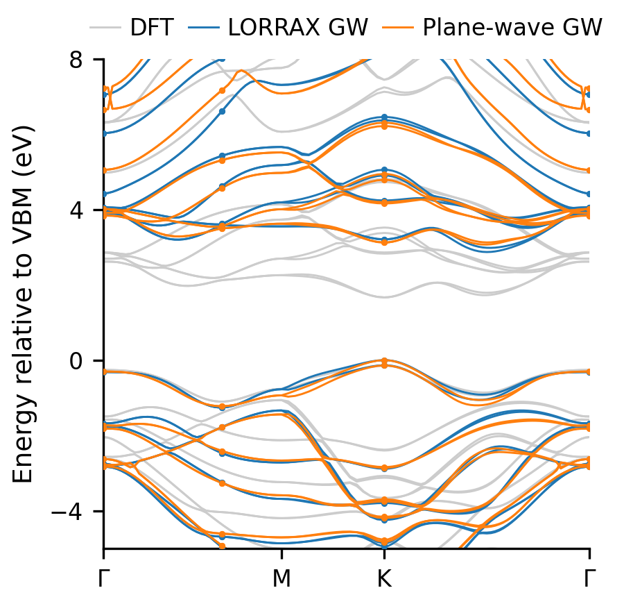
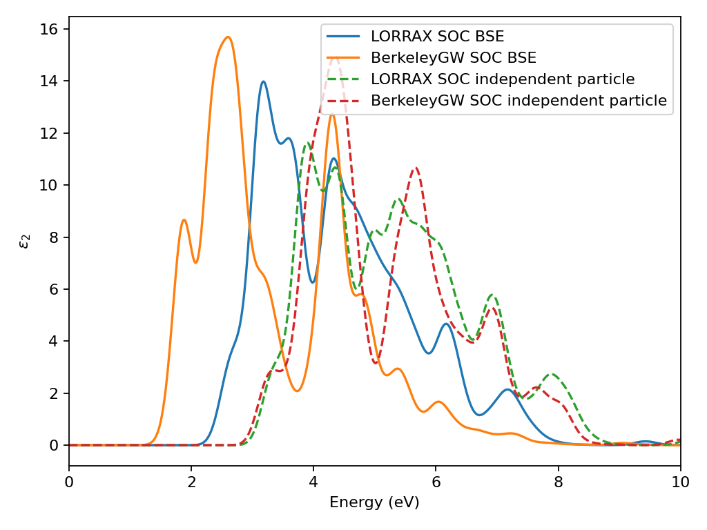

# MoS₂ with spin–orbit coupling

`6a-SOC` Hands-on GW and BSE calculations alongside the BerkeleyGW 2026 workshop.
{: .page-summary }

## Overview {: #overview }

In this exercise, we will compute the quasiparticle band structure and optical
absorption of monolayer MoS₂ with spin–orbit coupling (SOC). We use the fully
relativistic mean field from the [2026 BerkeleyGW workshop](https://workshop.berkeleygw.org/home)
and add parallel LORRAX directories beside its BerkeleyGW calculations. The
link scripts, numbered stages and output filenames follow the original exercise.
The scalar-relativistic track is retained in the download but is not required here.

Both tracks have been executed, interpolating from a 3 × 3 × 1 coarse grid to
a shifted 8 × 8 × 1 fine grid. The saved spectra compare two different
coarse-to-fine methods ([comparison](#results)); no explicit fine-grid GW+BSE
reference was computed for this exercise, so their difference does not establish
which interpolation is more accurate. The workshop's small grids, vacuum and
band counts are teaching settings, not converged predictions for MoS₂.

The [example directory](https://github.com/jackmcarthur/lorrax/tree/main/examples/MoS2_SOC_2026)
contains the LORRAX additions and saved text outputs. Its initialization helper
downloads the original workshop inputs and preserves their README and LICENSE.
The original SOC exercise is by Bradford A. Barker (2022), distributed in the
2026 workshop. Its implementation reference is
[Barker et al., Phys. Rev. B **106**, 115127 (2022)](https://doi.org/10.1103/PhysRevB.106.115127).

## Goals {: #goals }

1. Follow fully relativistic, two-component DFT wavefunctions through GW and BSE.
2. Run LORRAX using a directory layout familiar from the BerkeleyGW workshop.
3. Compare band structures and absorption spectra, separating file compatibility,
   solver convergence and agreement between the two approximations.

## Before starting {: #prerequisites }

Use a [built LORRAX checkout](../using/installation.md) with its `.venv`, both
native FFI libraries and the normal [Perlmutter setup](../using/clusters.md).
The supplied launch scripts were exercised on one 128-core CPU node for Quantum
ESPRESSO and the BerkeleyGW reference, and one four-GPU node for LORRAX.
Calculations run on allocated compute nodes. On another cluster, adapt the
site launchers described in the
[preparation README](https://github.com/jackmcarthur/lorrax/blob/main/examples/MoS2_SOC_2026/perlmutter/README.md).

The main settings are:

| Setting | Value |
|---|---|
| Mean field | Fully relativistic Mo/S ONCV pseudopotentials; two spinor components; 45 Ry wavefunction cutoff |
| Coarse GW grid | 3 × 3 × 1, four stored k-points |
| GW sums | 200 total bands; band extrapolation disabled |
| ISDF points | 1,000 requested, 996 written with complete spatial symmetry orbits |
| QP Hamiltonian | 48 bands: 26 occupied and 22 conduction, including interpolation guards |
| Frequency model | Hybertsen–Louie plasmon pole; full head correction |
| Fine BSE grid | 8 × 8 × 1, shifted by (0.47, 0.37, 0) in grid-step units |
| Fine BSE bands | Six valence and eight conduction; all 3,072 Tamm–Dancoff roots |
| Spectrum | 0.15 eV Gaussian width; 0.01 eV spacing |

## Instructions {: #instructions }

### 1. Prepare the workshop directories {: #download }

Set `LORRAX` to your built checkout and choose a new working directory:

```bash
export LORRAX=/path/to/lorrax
python3 "$LORRAX/examples/MoS2_SOC_2026/perlmutter/prepare_meanfield.py" \
  --tutorial "$SCRATCH/MoS2_SOC_2026/6a-SOC" init
cd "$SCRATCH/MoS2_SOC_2026/6a-SOC"
```

The helper verifies the archive's SHA256 before extracting it and refuses an
existing destination. For an offline initialization, append
`--archive /path/to/6a-SOC.tar.gz` after `init`; the same checksum is required.
The resulting tree includes:

```text
6a-SOC/
├── 1-mf/2-fully_rel/                 # shared fully relativistic mean field
├── 2-gw/
│   ├── 2-fully_rel/                  # original BerkeleyGW track
│   └── 3-lorrax_fully_rel/
│       ├── 01-link_files.sh
│       ├── 1-epsilon/                # centroids and one-body operators
│       ├── 2-sigma/                  # screening, self-energy and EQP files
│       └── 3-bs/                     # band path and plot
├── 3-bse/
│   ├── 2-fully_rel/                  # original BerkeleyGW track
│   └── 3-lorrax_fully_rel/
│       ├── 01-link_files.sh
│       ├── 1-kernel/                 # BerkeleyGW-format kernel export
│       └── 2-absorption/             # native BSE and spectra
├── perlmutter/                      # mean-field and reference launchers
└── 00-run-lorrax.sh
```

### 2. Run the fully relativistic mean field {: #mean-field }

On an allocated CPU node, set `CPU_JOB_ID` and `CPU_NODE` to your active CPU
allocation and node, then run from `6a-SOC`:

```bash
CPU_JOB_ID="$CPU_JOB_ID" CPU_NODE="$CPU_NODE" \
  bash perlmutter/01-run-meanfield.sh all
```

This runs the original SCF and NSCF stages and converts their wavefunctions to
BerkeleyGW files. It also prepares two additional fixed-potential NSCF files:

| Directory | Purpose |
|---|---|
| `2c-Wfn_full` | 40 bands on all nine coarse k-points, supplying the explicit coefficient gauge for kernel export |
| `2d-Wfn_guarded` | 204 bands on the original four k-points, supplying spare states above the 200-band fit window |

The GW sums and right fit window still use 200 bands. The additional states
allow LORRAX to check the upper band boundary. The original BerkeleyGW mean-field
files remain in their original directories. The helper can resume completed
stages; details and the tested QE/BGW modules are in the preparation README.

The workshop uses periodic DFT. LORRAX reads that boundary from the QE XML for
its ionic and Hartree terms, while `sys_dim = 2` selects slab screening in GW/BSE.

### 3. Run the BerkeleyGW reference {: #reference }

Keep the CPU allocation variables set and run:

```bash
CPU_JOB_ID="$CPU_JOB_ID" CPU_NODE="$CPU_NODE" \
  bash perlmutter/03-run-reference-cpu.sh
```

This executes the original fully relativistic epsilon, sigma, inteqp, kernel
and absorption inputs. It supplies the reference files used by the comparison
plots. Its link adapter preserves the completed NSCF metadata; use it rather
than rerunning the upstream global mean-field link script over completed stages.

### 4. Run the LORRAX GW and BSE tracks {: #lorrax }

Enter a four-GPU allocation, retain `LORRAX`, and run from `6a-SOC`:

```bash
bash 00-run-lorrax.sh
```

The top-level script links the inputs, runs each stage in order and plots the
results. To inspect the stages individually, use these equivalent commands:

```bash
bash 2-gw/3-lorrax_fully_rel/01-link_files.sh
bash 2-gw/3-lorrax_fully_rel/1-epsilon/01-run_epsilon.run
bash 2-gw/3-lorrax_fully_rel/2-sigma/01-run_sigma.run
bash 2-gw/3-lorrax_fully_rel/3-bs/01-run_inteqp.run

bash 3-bse/3-lorrax_fully_rel/01-link_files.sh
bash 3-bse/3-lorrax_fully_rel/1-kernel/01-run_kernel.run
bash 3-bse/3-lorrax_fully_rel/2-absorption/01-run_absorption.run
```

Inspect the `gw.in` inputs beside the workshop's `epsilon.inp`, `sigma.inp`,
`kernel.inp` and `absorption.inp`. The
[BerkeleyGW users' guide](../using/berkeleygw-users.md) explains the mapping.
LORRAX computes screening and self-energy together in `2-sigma`; `1-epsilon`
prepares centroids, kinetic/ionic matrices and velocities. The GW script then
exports its computed screening to `eps0mat.h5` and `epsmat.h5`.
The kernel script writes `bsemat.h5` for BerkeleyGW interoperability; the native
BSE applies its Hamiltonian matrix-free from the GW restart.

**Question.** Which workshop parameters describe the same physical approximation
in both codes, and which select different numerical representations?

### 5. Check completion and make the plots {: #checks }

Read each stage's output, including the on-shell Sigma coverage and the BSE
residual/convergence report. The independent read-only validator checks the
completed native and BerkeleyGW files:

```bash
"$LORRAX/.venv/bin/python" validate_tutorial.py --tutorial-root . > validation.json
"$LORRAX/.venv/bin/python" - <<'PY'
import json
with open("validation.json") as stream:
    report = json.load(stream)
print(report["status"], report["format_status"], report["coverage_status"])
assert report["status"] == "PASS", "Inspect validation.json for FAIL or PENDING checks"
PY
```

Inspect the JSON status: the validator itself writes a report even when files
are missing. `PASS` certifies its format, coverage and convergence checks; it
does not assert that the two codes give equal energies. A missing reference
leaves its checks `PENDING`.

If you ran the stages individually, generate the comparison plots with:

```bash
(cd 2-gw/3-lorrax_fully_rel/3-bs && \
  "$LORRAX/.venv/bin/python" 02-plot_bandstructure.py)
(cd 3-bse/3-lorrax_fully_rel/2-absorption && \
  "$LORRAX/.venv/bin/python" 02-plot_absorption.py)
```

The band table uses the workshop's eight-column layout on the 106-point
Γ–M–K–Γ path. The spectra are `absorption_eh.dat` and `absorption_noeh.dat`;
the exciton outputs are `eigenvalues.dat` and `eigenvectors.h5`.

## Executed results {: #results }

The following plots come from the supplied workflow, with an independently
executed BerkeleyGW reference. These are the saved finite-setting results,
not values to enforce by changing inputs.





| Quantity (eV) | LORRAX | BerkeleyGW |
|---|---:|---:|
| Coarse-grid EQP1 minimum gap | 3.208396 | 3.123690 |
| Path EQP1 indirect gap | 2.872913 | 3.071206 |
| Lowest fine-grid BSE state | 2.511020 | 1.591552 |
| Largest interacting spectral peak | 3.18 | 2.60 |

These fine-grid results use different kernel and QP interpolation methods from
the same sparse 3 × 3 × 1 coarse grid. Neither is an explicit GW+BSE calculation
on the 8 × 8 × 1 fine grid, so their difference is not an accuracy verdict on
either method. Judging interpolation accuracy requires that independent
fine-grid calculation with matched physical settings.

The separate [9 × 9 → 12 × 12 MoS₂ benchmark](../theory/w-range-splitting.md#example)
does compare against screening and BSE computed directly on the fine grid,
with the same QP energies in every arm. LORRAX's SR/LR interpolation was closer
to that direct result than BerkeleyGW's dual-grid interpolation. The present
workshop exercise does not repeat that accuracy test.

A separate test in BerkeleyGW accepted the LORRAX-exported coarse kernel:
holding BerkeleyGW QP data fixed, its 3,072 exciton energies differed from the
original BerkeleyGW result by 7.680 meV RMS and at most 9.552 meV. That consumer
still uses BerkeleyGW's interpolation. This tests the exported kernel and
reader while holding the fine-grid method fixed; it is not an independent
test of either interpolation's accuracy. The
[comparison report](https://github.com/jackmcarthur/lorrax/blob/main/examples/MoS2_SOC_2026/results/README.md)
records the scope of the controls.

The [saved text tables and plots](https://github.com/jackmcarthur/lorrax/tree/main/examples/MoS2_SOC_2026/results)
are included in the checkout; initialization does not copy them into a new
calculation. Regenerate the large HDF5 files with the scripts above. The
[validation report](https://github.com/jackmcarthur/lorrax/blob/main/examples/MoS2_SOC_2026/results/validation/OUTPUT_VALIDATION_REPORT.txt)
separates passing execution checks from descriptive comparisons.

**Questions.** Where are the SOC splittings visible along the band path? How do
the quasiparticle corrections affect them? Which changes in the absorption
can be associated with those transitions, and which would require a finer
k-grid or a better-matched numerical treatment to interpret?
