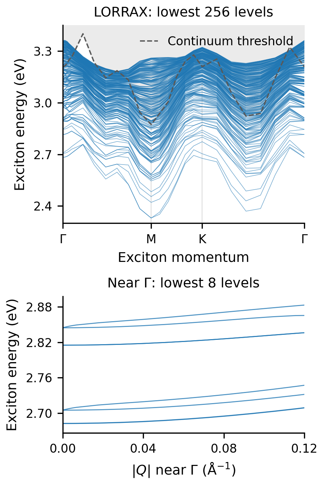

# MoS₂ with spin–orbit coupling

`6a-SOC` Hands-on GW and BSE calculations alongside the BerkeleyGW 2026 workshop.
{: .page-summary }

## Overview {: #overview }

In this exercise, we will compute the quasiparticle band structure and optical
absorption of monolayer MoS₂ with spin–orbit coupling (SOC). We use the fully
relativistic mean field from the [2026 BerkeleyGW workshop](https://workshop.berkeleygw.org/home)
and add parallel LORRAX directories beside its plane-wave calculations. The
link scripts, numbered stages and output filenames follow the original exercise.

Both tracks interpolate from a 3 × 3 × 1 coarse grid to a shifted 8 × 8 × 1
fine grid. This small grid is underconverged, and the screening bases and
plasmon-pole models also differ, as described below. This comparison therefore
does not isolate interpolation. The [denser-grid benchmarks](#interpolation-validation)
show LORRAX interpolation following direct fine-grid calculations closely
with shared QP energies.

The [example directory](https://github.com/jackmcarthur/lorrax/tree/main/examples/MoS2_SOC_2026)
describes the differences between the main plane-wave package and LORRAX.

## Goals {: #goals }

1. Follow fully relativistic, two-component DFT wavefunctions through GW and BSE.
2. Run LORRAX using a directory layout familiar from the BerkeleyGW workshop.
3. Compare band structures and absorption spectra between the two codes.
4. Follow the exciton bands away from Γ with LORRAX.

## Settings {: #prerequisites }

The calculations use a [built LORRAX checkout](../using/installation.md), one
128-core CPU node for Quantum ESPRESSO and the plane-wave reference, and one
four-GPU node for LORRAX.

| Setting | Value |
|---|---|
| Mean field | Fully relativistic Mo/S ONCV pseudopotentials; two spinor components; 45 Ry wavefunction cutoff |
| Coarse GW grid | 3 × 3 × 1, four stored k-points |
| GW sums | 200 total bands; band extrapolation disabled |
| ISDF points | 1,000 requested, 996 written with complete spatial symmetry orbits |
| QP Hamiltonian | 48 bands: 26 occupied and 22 conduction |
| Frequency model | Hybertsen–Louie plasmon pole; full head correction |
| Fine BSE grid | 8 × 8 × 1, shifted by (0.47, 0.37, 0) in grid-step units |
| Fine BSE bands | Six valence and eight conduction; all 3,072 Tamm–Dancoff roots |
| Spectrum | 0.15 eV Gaussian width; 0.01 eV spacing |
| Exciton bands | Γ-centered 24 × 24 × 1 integration grid; six valence and eight conduction bands; 256 roots along the full path and eight in the near-Γ scan |

## Steps {: #instructions }

Copy the workshop inputs and the LORRAX directories into a new working directory:

```bash
export LORRAX=/path/to/lorrax
python3 "$LORRAX/examples/MoS2_SOC_2026/perlmutter/prepare_meanfield.py" \
  --tutorial "$SCRATCH/MoS2_SOC_2026/6a-SOC" init
```

The calculation then runs in four parts. The README in each directory gives its
commands and what to check.

1. **Mean field.** Quantum ESPRESSO SCF and NSCF with the workshop inputs,
   converted to `WFN.h5` (`perlmutter/01-run-meanfield.sh`). Two extra NSCF
   files add spare bands and the full nine-point coarse grid.
2. **Plane-wave reference.** The workshop's own epsilon, sigma, inteqp, kernel
   and absorption steps (`perlmutter/03-run-reference-cpu.sh`), which the
   comparison plots read.
3. **LORRAX GW.** The ISDF points, kinetic/ionic matrix and velocity matrix
   (`2-gw/3-lorrax_fully_rel/1-epsilon`), then screening and self-energy
   together (`2-sigma`), which also exports `eps0mat.h5` and `epsmat.h5`, and
   the band structure by [`htransform`](../utilities/htransform-bands.md) (`3-bs`).
4. **LORRAX BSE.** The `bsemat.h5` export (`3-bse/3-lorrax_fully_rel/1-kernel`)
   and the BSE with its absorption spectra (`2-absorption`), followed by
   finite-momentum exciton bands (`3-exciton-bands`).

`bash 00-run-lorrax.sh` runs parts 3 and 4 in order on a four-GPU allocation
and makes the plots. The [For BerkeleyGW users](../using/berkeleygw-users.md)
page maps the workshop's `.inp` keys to the `gw.in` inputs.

### Plasmon-pole settings {: #plasmon-pole-settings }

Both workshop tracks use the Hybertsen–Louie model. The native decks set
`ppm_invalid_mode = static_limit`: an invalid fitted pole contributes its
static COHSEX limit. The closest BerkeleyGW setting is
`invalid_gpp_mode 3`. The original BerkeleyGW4 input omits that key; its
default already takes the same branch, so the upstream input is preserved.
`perlmutter/03-run-reference-cpu.sh` records the effective policies and input
hashes in `perlmutter/bgw_sigma_policy.json`.

This aligns the treatment of invalid poles. The fitted poles still differ:
LORRAX obtains its HL body moment from the finite-band response at the
200 Ry probe, while BerkeleyGW uses its density sum rule. Invalid fractions
are also basis dependent: the two codes fit centroid-pair and plane-wave-pair
matrix elements. Compare QP energies and convergence rather than equating
those percentages.

### Screening basis {: #screening-basis }

The plane-wave track builds and inverts its dielectric matrix at 9 Ry.
LORRAX screens in the 996-point ISDF basis; its bare-Coulomb and ζ spheres
extend to 45 Ry. `epsmat_ecut = 9.0` restricts the exported inverse dielectric
matrix after screening, rather than rerunning GW in a 9 Ry response basis.
The exported dimensions therefore match, while the screening bases differ.

## Exciton bands {: #exciton-bands }

The final LORRAX stage follows finite-momentum excitons along Γ–M–K–Γ:

```bash
cd 3-bse/3-lorrax_fully_rel/3-exciton-bands
bash 01-run_exciton_bands.run
bash 01-run_exciton_bands.run gw-near-gamma.in near_gamma
source ../../../2-gw/3-lorrax_fully_rel/lorrax_env.sh
lorrax_python 02-plot_exciton_bands.py --near-gamma-prefix near_gamma
```

Both scans retain six valence and eight conduction bands on a Γ-centered
24 × 24 × 1 integration grid. H-transform interpolation supplies the electron
at k + Q; the hole remains at k. Screening and the QP Hamiltonian still come
from the same 3 × 3 × 1 coarse calculation.

The 25-point full path uses 256 roots and a 0.25 meV Davidson residual budget:
four steps from Γ to `(0.05, 0, 0)`, seven to M, six to K and seven back to Γ.
The separate 22-point near-Γ scan keeps eight roots at 0.01 meV: eight steps
to `(0.003, 0, 0)`, twelve more to `(0.06, 0, 0)`, then K for certification.
Coordinates are fractional reciprocal coordinates. The lower panel displays
only |Q| ≤ 0.12 Å⁻¹, excluding the distant K anchor.

Use a regular four-GPU allocation. Allow roughly three hours for the full
path, plus the near-Γ scan, which took 25 min 37 s from a cold launch on
four Frontier GPU ranks. The full-path allowance is a planning estimate;
runtime varies by machine. The companion `exciton_bands_continuum.dat`
records the independent-particle threshold from the same QP transitions at
each Q, so its coverage can be checked against the highest retained level.

Near Γ, the lowest two ordered energies follow a quadratic form over the
measured window; higher levels need a linear component plus curvature,
as permitted by long-range exchange in two dimensions. The smallest
low-level shifts are below solver resolution. Energies alone do not assign
longitudinal/transverse or bright/dark character.

<figure style="width:3in; max-width:100%; margin:1em 0;" markdown="1">

[{ width="288" }](../assets/figures/tutorial-mos2-exciton-bands.png)

<figcaption style="font-size:0.86em; line-height:1.45;" markdown="1">

The dashed line marks the independent-particle continuum from the same QP
transitions. The 256-level window crosses it at 21 of 25 momenta, reaching
152 meV above it at Γ and 113 meV at K. At four points the retained levels
stop below the threshold. The lower panel resolves eight levels near Γ.
[Download the PDF](../assets/figures/tutorial-mos2-exciton-bands.pdf).

</figcaption>
</figure>

These are illustrative results: the lowest eight levels differ by up to
7.65 meV between matched 24 × 24 and 30 × 30 controls. The tutorial uses the
1 meV **visualization** exchange check; the driver's **reference** default
remains unchanged. The [stage README](https://github.com/jackmcarthur/lorrax/blob/main/examples/MoS2_SOC_2026/3-bse/3-lorrax_fully_rel/3-exciton-bands/README.md)
gives the measured fits, residual budgets and certification details. Grid
convergence requires further calculations.

## Results {: #results }

<div style="display:flex; flex-wrap:wrap; gap:24px; align-items:flex-start;" markdown="1">

<figure style="width:3in; max-width:100%; margin:0;" markdown="1">

[{ width="288" }](../assets/figures/tutorial-mos2-soc-bands.png)

<figcaption style="font-size:0.86em; line-height:1.45;" markdown="1">
**Band structure.** Light gray: QE DFT; blue: LORRAX GW; orange: plane-wave GW.
Dots mark the 3 × 3 × 1 coarse k-points on the path, where the QP energies are
computed directly; between them they are interpolated. Each dataset is aligned
to its own VBM.
</figcaption>
</figure>

<figure style="width:3in; max-width:100%; margin:0;" markdown="1">

[{ width="288" }](../assets/figures/tutorial-mos2-soc-absorption.png)

<figcaption style="font-size:0.86em; line-height:1.45;" markdown="1">
**Absorption (0–5 eV).** Blue: LORRAX; orange: plane-wave code. Solid: BSE;
dashed: independent particle. Both use the workshop's shifted 8 × 8 × 1 grid.
</figcaption>
</figure>

</div>

| Quantity (eV) | LORRAX | Plane wave |
|---|---:|---:|
| Coarse-grid EQP1 minimum gap | 3.208396 | 3.123690 |
| Path EQP1 indirect gap | 2.872913 | 3.071206 |
| Lowest fine-grid BSE state | 2.511020 | 1.591552 |
| Largest interacting spectral peak | 3.18 | 2.60 |

Neither workshop spectrum is an explicit GW+BSE calculation on the fine grid, so
the difference between them does not show which interpolation is more accurate.

### Interpolation on converged grids {: #interpolation-validation }

On better-converged coarse grids, with screening and BSE also computed directly
on the fine grid and the QP energies held fixed, LORRAX's interpolated spectra
follow the direct fine-grid calculations closely.

[](../assets/figures/bse-interp-comparison.png)

**Denser-grid validation.** MoS₂ (9 × 9 → 12 × 12) in panels **a, c**, and Si
(4³ → 8³) in **b, d**. Gray: direct coarse grid; green: direct fine grid; light
blue: plane-wave dual-grid interpolation; blue dashed: LORRAX. The lower panels
show residuals relative to the fine-grid spectral peak. Over the lowest 40
excitons the mean absolute offsets from the direct calculation are **2.65 meV
for MoS₂** and **1.41 meV for Si** ([details](../theory/w-range-splitting.md#example)).

The [saved tables and plots](https://github.com/jackmcarthur/lorrax/tree/main/examples/MoS2_SOC_2026/results)
are in the example directory, with a report on the exported screening and
kernel read by the plane-wave code.

**Questions.** Where are the SOC splittings visible along the band path? How do
the quasiparticle corrections affect them? Which changes in the absorption
can be associated with those transitions, and which would require a finer
k-grid to interpret?

## Credits {: #credits }

The original SOC exercise is by Bradford A. Barker (2022), distributed in the
2026 workshop; see [Barker et al., Phys. Rev. B **106**, 115127 (2022)](https://doi.org/10.1103/PhysRevB.106.115127).
