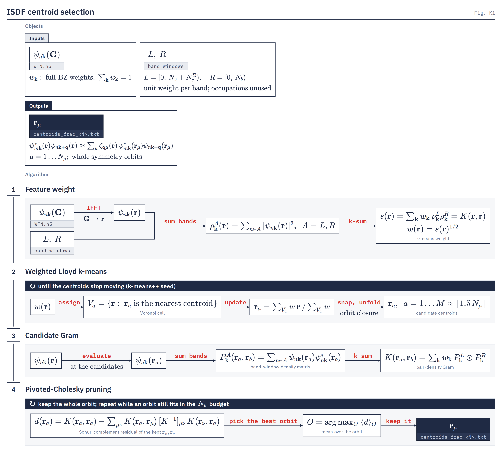

# Centroids utility

`centroid.kmeans_cli` The ISDF interpolation points, selected by weighted k-means and pruned by pivoted Cholesky.
{: .page-summary }

<div class="chain-map" data-driver="centroids" data-page="files"></div>

Selects the $N_\mu$ real-space points $\br_\mu$ in the unit cell that the ISDF fit uses. ISDF samples the wavefunctions $\psi_{n\bk}$ at these points and approximates every pair density by an expansion in interpolating vectors $\zeta_{\bq\mu}(\br)$,
{: .lead }

$$
\psi^*_{m\bk}(\br)\,\psi_{n\bk+\bq}(\br) \approx \sum_\mu \zeta_{\bq\mu}(\br)\,\psi^*_{m\bk}(\br_\mu)\,\psi_{n\bk+\bq}(\br_\mu).
$$

The points are chosen to respect the symmetries of the crystal's space group, so every operation maps the set onto itself. As a result the self-energy keeps the symmetry of the crystal, degenerate quasiparticle levels stay degenerate, and the GW and BSE runs can work on the irreducible wedges of k and q.

The utility reads the wavefunctions from `WFN.h5`. It reads the GW input deck for the band counts that set the fit windows below, and for the name of the wavefunction file. Nothing else in the deck affects the selection. It writes the centroid table that the deck names with `centroids_file`.

<div class="glance" markdown>

Invoke
:   `python -m centroid.kmeans_cli n_centroids -i gw.in`

Reads
:   deck (`-i`), `WFN.h5`

Writes
:   `centroids_frac_<N>.txt`, `kmeans.out`

Channel
:   `scalar` (charge Gram) · `current` (transverse three-current Gram)

</div>

## Left and right band windows {: #windows }

Each pair density in the fit is a product of two wavefunctions, which we call the left and right factors:

$$
\underbrace{\psi^*_{m\bk}(\br)}_{\text{left},\ m\in L}\;\underbrace{\psi_{n\bk+\bq}(\br)}_{\text{right},\ n\in R} \approx \sum_\mu \zeta_{\bq\mu}(\br)\,\psi^*_{m\bk}(\br_\mu)\,\psi_{n\bk+\bq}(\br_\mu)
$$

The two factors are drawn from different sets of bands. To compute the matrix elements of Σ, or to update Σ self-consistently in QSGW, the run needs products of a band in the quasiparticle window with every band of the band sum. The quasiparticle bands therefore go in the left window $L$, and the high conduction bands, which enter only through the sum, go in the right window $R$ together with everything else. Products of two high conduction bands never appear, so the fit does not have to reproduce them, and the basis can be smaller than a fit over all pairs would need.

- **The points respect the crystal's symmetry.** The set is closed under the space group, so Σ and the quasiparticle energies keep the symmetry of the crystal.
- **The fit covers two band windows.** The left window holds the protected bands, which are every occupied band and the low conduction bands that GW corrects. The right window holds every band the band sums reach, by default every band in `WFN.h5`.
- **The basis size sets the cost.** The points become the basis of the whole run. $G^{\gtrless}_\bk(\br_\mu,\br_\nu;t)$ is sampled at them and $W_\bq(\mu,\nu;z)$ is written in the ζ basis, so $N_\mu$ controls the expense of every later step.

## Spinor wavefunctions {: #spinors }

On a two-component (spinor) WFN, each pair density in the fit is the sum of the spin-up and spin-down products,

$$
\psi^\dagger_{m\bk}(\br)\,\psi_{n\bk+\bq}(\br) = \sum_{s=\uparrow,\downarrow}\psi^*_{m\bk s}(\br)\,\psi_{n\bk+\bq\,s}(\br).
$$

This spin-traced density is the charge density that standard GW screens, and the default `--density-mode scalar` selects points for it. The window widths $L$ and $B$ of the rank estimate then count Kramers pairs. A four-component (bispinor) run also screens the transverse current, which needs a second point set selected with `--density-mode current`. That case is more involved and is described on [Centroid selection §5.3](../theory/centroid-selection.md#cs-current).

## How the points are chosen {: #what }

<figure class="flowchart" markdown>
[](../assets/figures/k1.png)
<figcaption><strong>Fig. K1.</strong> The four stages of the selection, left to right in each row: the feature weight $w(\br)$ from the band-window densities, weighted Lloyd k-means for an oversampled candidate pool, the pair-density Gram on the candidates, and the greedy pivoted-Cholesky loop that keeps whole symmetry orbits until the point budget is spent.</figcaption>
</figure>

The weight is the diagonal of the $\bq = 0$ pair-density Gram over the left and right band windows $L$ and $R$, $s(\br) = \sum_\bk w_\bk\,\rho^L_\bk(\br)\,\rho^R_\bk(\br) = K(\br,\br)$, and Lloyd's mass is $w(\br) = s(\br)^{1/2}$; occupations do not enter. Lloyd places $\lceil 1.5\,N_\mu\rceil$ candidates as orbit representatives. Each representative is snapped to the FFT grid and then unfolded by the space group of the decorated atoms, so every orbit lands exactly on grid points. Pivoted Cholesky on $K(\br_a,\br_b)$ then keeps the candidates that add the most independent directions, admitting or rejecting whole orbits, never single points, until $N_\mu$ points are used. The written set is therefore closed under every spatial operation, including improper and nonsymmorphic ones ([Centroid selection §5](../theory/centroid-selection.md#cs-symmetry)). The objective, the Gram and the limits of the method are on [Centroid selection](../theory/centroid-selection.md); the fit that consumes the points is on [ISDF and V(q)](../theory/isdf.md).

!!! note
    The selection must be made against the band window that $\Sigma^c$ and $\chi^0$ consume. The default right window is every band in `WFN.h5`, and the default left window is the occupied bands plus the deck's `ncond` protected conduction bands, so always pass `-i`. For the count, the header's `rank law:` line estimates the $N_\mu$ that gives 1 meV RMS error in $\Sigma^x$, $N_\mu \approx 0.5\min\big(N_\bk L B,\ 445\,L^{0.107}B^{0.322},\ 0.97\,N_\bG(4E_\mathrm{wfc})\big)$, with $L$ and $B$ the window widths (per Kramers pair on a spinor WFN).

## Running {: #run }

=== "Local"
    ```bash
    uv run python -m centroid.kmeans_cli 400 -i gw.in
    ```
=== "Perlmutter"
    ```bash
    srun -n 4 --gpus-per-task=1 --gpu-bind=closest python -m centroid.kmeans_cli 400 -i gw.in
    ```
=== "Frontera"
    ```bash
    $LORRAX_PY -u -m centroid.kmeans_cli 400 -i gw.in
    ```

Run it in the directory of the GW deck: both output files land in the working directory. The deck lines it reads:

```ini
wfn_file   = WFN.h5
sys_dim    = 3
ncond      = 4
```

After the run, set `centroids_file = centroids_frac_<N>.txt` in the GW deck, with `<N>` the count actually written.

## Keywords {: #keywords }

The count goes on the command line, and the deck named with `-i` supplies the deck keys. Defaults are read from the argument parser (`src/centroid/kmeans_cli.py`) and the keyword schema (`src/gw/gw_config.py`).

Required
{: .kw-group }

**Command line**

### `n_centroids` {: .kw data-type="int" data-default="required" }
Number of points to select; positional.

The delivered number of centroids may be slightly below `n_centroids`, because the points are selected in symmetric "orbits of points".
{: .kw-details }

**Deck keys**

The deck passes through the GW reader, so with `-i` an unknown key or a missing `sys_dim` refuses.

### `ncond` {: .kw data-type="int" data-default="required" }
Number of protected conduction bands, the conduction bands whose quasiparticle energies GW corrects. Required unless `number_bands_protected` is given. The default left window ends at $n_\mathrm{val}+\texttt{ncond}$, every occupied band plus the protected conduction bands.

### `sys_dim` {: .kw data-type="int" data-default="required" }
Checked by the deck reader only; the selection does not use it.

Optional
{: .kw-group }

**Band windows**

### `-i`, `--input` {: .kw data-type="path" data-default="unset" }
GW deck. Supplies `wfn_file` and `ncond`, the number of protected conduction bands.

With it the left window is every occupied band plus the protected conduction bands, and the right window every band in `WFN.h5`. Without it the WFN is `./WFN.h5` and the left window widens to every band, with a warning.
{: .kw-details }

### `--fit-window` {: .kw data-type="string" data-default="unset" }
Explicit windows `L0:L1,R0:R1`, 0-based and half-open, for both the weight and the Gram, in place of the windows set by the deck.

Both windows must start at band 0 and reach the occupied-band count.
{: .kw-details }

**Selection**

### `--oversample` {: .kw data-type="float" data-default="1.5" }
Candidate factor: k-means places $\lceil n_{\mathrm{centroids}} \cdot \mathrm{oversample}\rceil$ points before pruning.

`1.0` disables pruning. Without pruning the symmetric unfold can return more than `n_centroids` points.
{: .kw-details }

### `--no-symmetries` {: .kw data-type="flag" data-default="off" }
Select points without imposing the crystal's symmetries.

By default the points respect every spatial symmetry of the decorated atoms whenever there is more than one, improper and nonsymmorphic operations included. Electronic and time-reversal data are not consulted.
{: .kw-details }

### `--seed` {: .kw data-type="int" data-default="0" }
Seed of the k-means++ initialization.

When `n_centroids` exceeds $0.1\,N_r$ ($N_r$ the number of FFT grid points), the start is density-weighted random instead of k-means++.
{: .kw-details }

**Output**

### `--out-suffix` {: .kw data-type="string" data-default="'' or _current" }
Suffix of the table and report names. Default `''` for `scalar`, `_current` for `current`.

**Deck keys**

### `wfn_file` {: .kw data-type="string" data-default="WFN.h5" }
Wavefunction file, relative to the deck directory.

### `memory_per_device_gb` {: .kw data-type="float" data-default="0.0" }
Device budget for the planners' prices; `0` keeps auto-detection.

**Environment**

### `LORRAX_CENTROID_SELECT` {: .kw data-type="env" data-default="deliver" }
What a numerically flat pool does: `deliver` reports the rank shortfall, `strict` refuses.

Any other value refuses.
{: .kw-details }

`deliver` `strict`
{: .kw-values }

### `LORRAX_CENTROID_PC_TOL` {: .kw data-type="env" data-default="sqrt(eps)" }
Pivoted-Cholesky stopping floor, relative to the largest initial Gram diagonal.

**Four-current runs**

### `--density-mode` {: .kw data-type="enum" data-default="scalar" }
Feature family used by both k-means and pruning. `scalar` is the charge density of every GW run.

`current` uses the three stacked Dirac-current rows and the transverse Gram for the second point set of a bispinor run. It needs a two-component WFN, symmetric selection and `--oversample` above 1, and writes the suffix `_current`.
{: .kw-details }

`scalar` `current`
{: .kw-values }

## Output format {: #output }

<div class="file-list" markdown>

`centroids_frac_<N><suffix>.txt`
:   The $N$ written points in fractional crystal coordinates, one point per line and snapped to the FFT grid. A header of `#` lines records the source WFN, the band windows, the requested and written counts, the symmetry closure and the rank estimate of the [note](#what) above. Written in the working directory by rank 0.

`kmeans<suffix>.out`
:   Run report: architecture, the provenance header again, file paths, phase timings and any warnings.

</div>

The GW run hashes the table's contents. A new table, even with the same count, invalidates the ζ file and the restart bundle built from the old one.

## Refusals {: #refusals }

!!! refuses
    - A `--fit-window` that is malformed, empty, beyond the window top, or that does not start at band 0 and reach the occupied-band count.
    - `--density-mode current` with `--no-symmetries`, with `--oversample` at or below 1, or on a WFN with one spinor component.
    - A window that reaches past the bands in `WFN.h5`, or whose top band exceeds half the plane-wave basis ($0.5\,n_{\bG,\max}\,n_\mathrm{spinor}$). Raise the cutoff or lower the band count.
    - A Gram that is not positive semidefinite: the Schur residual falls below minus the noise floor.
    - A pool that runs out of candidates before the request is met, or a point budget smaller than every orbit. Raise `--oversample` or lower `n_centroids`.
    - A rank shortfall under `LORRAX_CENTROID_SELECT=strict`, or any value of that variable other than `deliver` and `strict`.
    - A deck (`-i`) without `sys_dim`, or with an unknown key.

A pool that is numerically flat (fewer certified directions than points) is reported, not refused: the extra points are kept as quadrature points.

