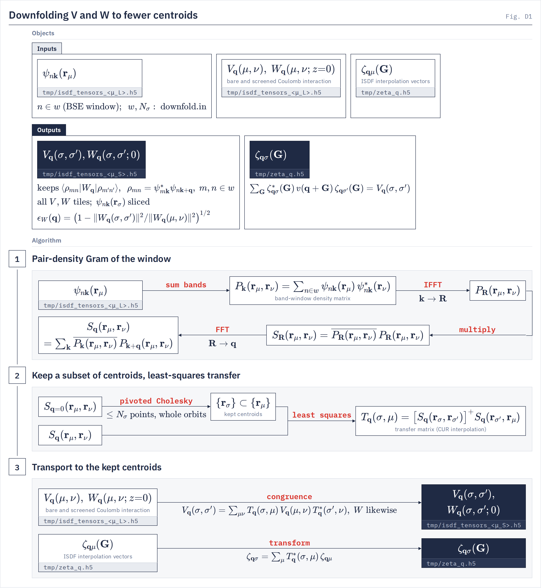

# Downfold utility

`gw.downfold_cli` A finished GW ISDF tensor file compressed onto a subset of its centroids, for the BSE.
{: .page-summary }

<div class="workflow-map" data-driver="downfold" data-page="files"></div>

Compresses the bare and screened interaction $V_\bq(\mu,\nu)$, $W_\bq(\mu,\nu;0)$ of a finished GW run from its $N_\mu$ centroids onto a subset of $N_\sigma$ of them, chosen for a retained band window, and writes an ISDF tensor file in the unchanged format. [`bse.bse_jax`](../drivers/bse/index.md) and [`bse.exciton_bands`](../drivers/exciton-bands/index.md) read it with no flag; every stored $(\mu,\nu)$ tensor shrinks by $(N_\sigma/N_\mu)^2$.
{: .lead }

<div class="glance" markdown>

Invoke
:   `python -m gw.downfold_cli -i downfold.in`

Reads
:   its own `[downfold]` file, `<parent>/tmp/isdf_tensors_<N_μ>.h5`, `<parent>/tmp/zeta_q.h5`, the parent GW input file (`parent_input_file`)

Writes
:   `<output>/tmp/isdf_tensors_<N_σ>.h5`, `tmp/zeta_q.h5`, `tmp/centroids_frac_<N_σ>_downfold.txt`, `tmp/centroids_frac_<N_μ>_parent.txt`

Basis size
:   `mu_small` integer (whole symmetry orbits) · `auto` (the rank ceiling)

</div>

## What it computes {: #what }

<figure class="flowchart" markdown>
[](../assets/figures/d1.png)
<figcaption><strong>Fig. D1.</strong> The pair-density Gram $S_\bq(\br_\mu,\br_\nu)$ of the retained window (1) selects the kept centroids $\br_\sigma$ at $\bq=0$ and gives the least-squares transfer $T_\bq(\sigma,\mu)$ (2), which carries $V$, $W$ and $\zeta$ to the kept centroids (3).</figcaption>
</figure>

<div class="stages" markdown>

1. **Pair-density Gram of the window**
   From the band-window density matrix $P_\bk(\br_\mu,\br_\nu)=\sum_{n\in w}\psi_{n\bk}(\br_\mu)\psi^*_{n\bk}(\br_\nu)$, $S_\bq(\br_\mu,\br_\nu)=\sum_\bk\overline{P_\bk(\br_\mu,\br_\nu)}\,P_{\bk+\bq}(\br_\mu,\br_\nu)$, evaluated as an FFT round trip over $\bk\to\bR\to\bq$. $\psi$ is the parent bundle's ψ at the centroids.
2. **Keep a subset, fit the transfer**
   Pivoted Cholesky on $S_{\bq=0}$ alone keeps at most `mu_small` centroids, in whole symmetry orbits when the parent stores its wedge tables. Per $\bq$, $T_\bq(\sigma,\mu)=[S_\bq(\br_\sigma,\br_{\sigma'})]^{+}S_\bq(\br_{\sigma'},\br_\mu)$, with the pseudo-inverse truncated at `downfold_rcond` and no ridge.
3. **Transport to the kept centroids**
   $V_\bq(\sigma,\sigma')=\sum_{\mu\nu}T_\bq(\sigma,\mu)V_\bq(\mu,\nu)T^*_\bq(\sigma',\nu)$, $W$ and the `_nohead` twins likewise; $\zeta_{\bq\sigma}=\sum_\mu T^*_\bq(\sigma,\mu)\zeta_{\bq\mu}$. ψ at the kept centroids is a column slice; energies, head scalars and the band axis are unchanged.

</div>

The fit preserves $\langle\rho_{mn}|W_\bq|\rho_{m'n'}\rangle$ with $\rho_{mn}=\psi^*_{m\bk}\psi_{n\bk+\bq}$ on the retained window, and is an orthogonal projection there, so the relative error of the downfolded $W$ on the window is exact without a reference:

$$
\epsilon_W(\bq)=\Big(1-\lVert W_\bq(\sigma,\sigma')\rVert^2/\lVert W_\bq(\mu,\nu)\rVert^2\Big)^{1/2},
$$

with both norms taken in the window's pair-density metric. The small set is a subset, not a rotation, so ψ stays a product of single-band factors that every downstream kernel contracts leg by leg.

!!! note
    No number this driver prints is an accuracy gate. `mu_small = auto` sizes by rank, and $\epsilon_W$ near one per cent has accompanied eV-scale BSE errors on a parent that was not over-complete for the window. Solve the same BSE on the parent and on the child and compare the lowest eigenvalues; the run ends by printing that command with its own paths.

## Running {: #run }

=== "Local"
    ```bash
    uv run python -m gw.downfold_cli -i downfold.in
    ```
=== "Perlmutter"
    ```bash
    srun -n 4 python -m gw.downfold_cli -i downfold.in
    ```
=== "Frontera"
    ```bash
    # config/frontera/templates/gw_dev.sbatch, launch line changed to -m gw.downfold_cli
    sbatch downfold.sbatch
    ```

The console script `lorrax-downfold` is the same entry point. `--print-schema` lists every key with its default and exits.

A minimal input file, with a 20-band symmetric window:

```ini
[downfold]
source_restart    = /path/to/the/gw/run
output_restart    = /path/to/the/small/bundle
parent_input_file = /path/to/the/gw/run/gw.in
band_range_left   = 0:20
band_range_right  = 0:20
mu_small          = 189
```

Then point the BSE drivers at `output_restart`.

## Choosing `mu_small` {: #mu-small }

1. Run GW at an $N_\mu$ over-complete for the window to keep. The downfold removes redundancy the parent has; it cannot add any.
2. Run once with `mu_small = auto` to read the ceiling. For a 20-band window it is about 190 at the default `downfold_rcond` (Si 196, hBN 185), stable to 2 % as the candidate pool grows 9–12×. At `downfold_rcond` 1e-8 and 1e-10 the count (693 and 1208 on Si) grows with the pool and is not a ceiling.
3. Sweep `mu_small` down from the ceiling. At each value solve the same BSE, same input file and flags, on the parent and on the child, and keep the smallest value whose lowest $\Omega_S$ agree to the target. If none does, widen the window or build a larger parent.

The child serves the retained-window BSE and exciton bands only. It is not validated for $\Sigma$, and pole models do not transform: a GW run on the small basis starts from `centroids_frac_<N_σ>_downfold.txt` and refits.

## Keywords {: #keywords }

The driver reads its own `[downfold]` file, `key = value`, `#` comments; a GW input file is not accepted. Unknown keys refuse. Defaults are read from the keyword schema (`src/gw/downfold_config.py`) and the driver's argparse (`src/gw/downfold_cli.py`).

Required
{: .kw-group }

**Command line**

### `-i`, `--input` {: .kw data-type="path" data-default="required" }
The `[downfold]` input file.

**Files**

### `source_restart` {: .kw data-type="path" data-default="required" }
The finished GW run: its directory (the driver finds the one `tmp/isdf_tensors_*.h5`) or the `.h5` itself.

Relative paths resolve beside the input file. More than one bundle in the directory refuses; name the file.
{: .kw-details }

### `output_restart` {: .kw data-type="path" data-default="required" }
Directory for the small bundle; the driver writes `<dir>/tmp/isdf_tensors_<N_σ>.h5`. Must differ from `source_restart`.

### `parent_input_file` {: .kw data-type="path" data-default="required" }
The parent GW input file, which authenticates and unfolds the stored wavefunctions.

**Retained band window**

Exactly one spelling of the window is allowed. The window is what the compression is faithful to; bands outside it are not represented.

### `band_range_left`, `band_range_right` {: .kw data-type="str" data-default="required" }
Required unless `n_val` and `n_cond` are given. The two legs $m$, $n$ of $\rho_{mn}=\psi^*_m\psi_n$, as `lo:hi`: half-open, absolute, 0-based band indices into the stored bands.

Both are required in this spelling. Equal legs are the BSE shape; unequal legs are accepted with a warning that no Σ check has been run.
{: .kw-details }

### `n_val`, `n_cond` {: .kw data-type="int" data-default="instead of band_range_left, band_range_right" }
Shorthand for left $=[0,$ `n_val`$)$, right $=[$`n_val`$,$ `n_val + n_cond`$)$.

This window is always asymmetric (valence × conduction), so the run prints the asymmetric-window warning. Both are required in this spelling.
{: .kw-details }

**Basis size and conditioning**

### `mu_small` {: .kw data-type="int | auto" data-default="required" }
$N_\sigma$, a budget in points. With the parent's wedge tables, the driver keeps the largest union of whole orbits, in pivot order, that fits.

`auto` sets it to the ceiling, the eigenvalue rank of $S_{\bq=0}$ at `downfold_rcond`, and warns that this is a rank, not an accuracy. Above the ceiling refuses and prints it. Requested and realized counts are printed and stamped.
{: .kw-details }

Optional
{: .kw-group }

**Files**

### `parent_centroids_file` {: .kw data-type="path" data-default="empty" }
The parent run's centroid table, overriding the one rebuilt from the parent's `zeta_q.h5` header.

The default table is checked against the bundle's `centroids_charge_md5`; a named table is used as given. Needed by `bse.exciton_bands`, which refits ψ in the parent basis.
{: .kw-details }

**Residual check**

### `report_residual` {: .kw data-type="bool" data-default="true" }
Compute and print $\epsilon_W(\bq)$ for `W0_qmunu` and `V_qmunu`.

Costs two GEMMs at $N_\mu$ per $\bq$. With `false`, `residual_refuse_above` is not applied.
{: .kw-details }

### `residual_refuse_above` {: .kw data-type="float" data-default="empty = report only" }
Refuse to write the bundle when the worst $\epsilon_W(\bq)$ over $V$ and $W$ exceeds this value.

**Basis size and conditioning**

### `downfold_rcond` {: .kw data-type="float" data-default="1.1e-6" }
Relative cut $\lambda\le\mathrm{rcond}\,\lambda_{\max}$ of the transfer's pseudo-inverse and of the rank ceiling; the amplification is at most $1/\mathrm{rcond}$. Must lie in (0, 1).

It caps amplification; the pair-density spectrum has no gap to find. Change it only on convergence of an observable.
{: .kw-details }

### `downfold_select_tol` {: .kw data-type="float" data-default="sqrt(eps)" }
Pivoted-Cholesky stopping tolerance, relative to the largest Gram diagonal. Must lie in (0, 1).

A different knob from `downfold_rcond`: at the same nominal value the selection rank is about three times the eigenvalue rank.
{: .kw-details }

**Command line**

### `--px`, `--py` {: .kw data-type="int" data-default="the startup square mesh" }
Device-mesh rows and columns; given together, square meshes only.

### `--print-schema` {: .kw data-type="flag" data-default="off" }
Lists every input-file key with its default, then exits.

**Run**

### `mode` {: .kw data-type="enum" data-default="cur" }
`cur` keeps a subset of the parent's centroids. `refit` (a fresh k-means and ζ fit) refuses.

`cur` `refit`
{: .kw-values }

### `plan` {: .kw data-type="enum" data-default="auto" }
`auto` and `local` are the local plan; `distributed` refuses.

`auto` `local` `distributed`
{: .kw-values }

## Output format {: #output }

All outputs go under `<output_restart>/tmp/`. The bundle is written on the full Brillouin zone, also from a wedge parent.

<div class="file-list" markdown>

`isdf_tensors_<N_σ>.h5`
:   The small ISDF tensor file, in the GW writer's format, plus the `downfold_provenance` group.

`zeta_q.h5`
:   $\zeta_{\bq\sigma}(\bG)$ on the parent's $\bq$ set, which `bse.exciton_bands --vq-mode interp` interpolates. Skipped, with a message, when the parent has no finished `G_flat` ζ.

`centroids_frac_<N_σ>_downfold.txt`
:   The kept rows of the parent table, for a fresh GW run on the small basis; its index hash is stamped on the bundle as `centroids_charge_md5` when the parent's ζ header gives the FFT grid.

`centroids_frac_<N_μ>_parent.txt`
:   The parent table, rebuilt from the parent's ζ header. Not written when `parent_centroids_file` names one; the provenance then records that path.

</div>

### Small ISDF tensor file {: #bundle }

Generated from `_write_small_bundle` and the writers it calls (`write_restart_state_to_h5`, `write_parent_wavefunctions`, `write_head_scalars_to_h5`, `_stamp_downfold_provenance`, `_stamp_isdf_basis`). Small root datasets are written by SlabIO's `write_attr` as datasets, not HDF5 attributes. Entries in brackets are conditional: `@centroids_charge_md5` is stamped only when the parent's `zeta_q.h5` header gives the FFT grid; every other bracketed entry is copied only when the parent carries it.

```tree
isdf_tensors_<N_σ>.h5
  [@centroids_charge_md5]        str          kept-table index hash
  lorrax_io_committed            int          = 1 once written
  restart_format_version         int64        = 2
  kgrid                          int64[3]
  n_rmu_logical                  int64        N_σ
  coulomb_policy                 bytes        inherited from the parent
  band_window_schema             int64
  band_window                    int64[5]     inherited
  band_window_carrier            int64[5]
  band_window_split              int64[2]
  [qp_state_source_provenance]   bytes        inherited
  V_qmunu                        complex[N_q, N_σ, N_σ]   @V_ready
  W0_qmunu                       complex[N_q, N_σ, N_σ]   @W0_ready
  [V_qmunu_nohead]               complex[N_q, N_σ, N_σ]   parent's only; gw writes none
  [W0_qmunu_nohead]              complex[N_q, N_σ, N_σ]   parent's only; gw writes none
  [G0_mu_nu]                     complex[N_σ]             ζ(q=0, G=0)
  enk_full                       float[N_k, N_b]          unchanged
  psi_parent_y                   complex[N_k, N_b, n_s, N_σ]   @psi_layout = "axis"
  psi_parent_y_mun               complex[N_k, n_s, N_σ, N_b]   @psi_layout = "axis"
  psi_parent_k_rows              int64[N_k]
  [vhead]                        complex
  [whead]                        complex[n_ω]   @omega_grid
  [S_cart_head]                  complex[3, 3]
  downfold_provenance/
    @downfold_provenance_version int64      = 3
    @mode  @plan                 str
    @parent_file                 str
    @parent_mu  @mu_small  @mu_small_requested   int64
    @downfold_rcond  @downfold_select_tol        float64
    @window                      int64[4]   left lo, hi, right lo, hi
    @eigen_rank_pool  @select_rank  @eigen_rank_kept   int64
    @selection_granularity       str        orbit | point
    @[n_orbits_kept  n_orbits_pool  orbit_select_rank]   int64
    @[parent_centroids_charge_md5]                      str
    @[parent_centroids_file  parent_centroids_md5  centroids_file  zeta_file]   str
    @r19_anchor                  str
    keep_idx                     int64[N_σ]   parent rows kept
    retained_rank_per_q          int64[N_q]
    kappa_eff_per_q              float64[N_q]
    eps_w_W0_qmunu               float64[N_q]
    eps_w_V_qmunu                float64[N_q]
    [parent_orbit_sizes]         int64[n_orbits]
    [child_unfold_tables/]       sym_perm, L_table, q_irr_full_idx; @covariance_verdict, @covariance_tol
```

Not copied from the parent: `zeta_fit_windows` (the BSE falls back on `band_window`), `charge_zeta_identity`, `@charge_representation`, the transverse (bispinor) family, `W0_lr/` (so `w_head_densify = srlr` refuses on a downfolded bundle), `@screening_diagrams` and the tangential members. `W0_qmunu` is written directly, with `W0_ready` true.

### Transported ζ {: #zeta }

```tree
zeta_q.h5
  mf_header/                     copied from the parent zeta_q.h5
  isdf_header/
    centroids/r_mu_fft_idx       int[N_σ, 3]   kept rows
    centroids/r_mu_crystal       float[N_σ, 3]
    density  zeta_layout         bytes         zeta_layout = G_flat
    vertex_mu_L                  int32
    gvec_components  ngk  zeta_cutoff_ry       parent's
    zeta_is_done                 bool          = true
  zeta_q_G                       complex128[N_q(parent), N_σ, ngkmax]
```


The run checks $\zeta_{\bq=0,\sigma}(\bG{=}0)$ against the separately transported `G0_mu_nu` and prints the verdict.

## Refusals {: #refusals }

!!! refuses
    - An input file with no section, a section other than `[downfold]` (for example a GW input file's `[cohsex]`), an unknown key, or INI syntax errors.
    - `source_restart`, `output_restart` or `parent_input_file` unset; `mu_small` unset, or neither an integer nor `auto`.
    - `source_restart` neither a file nor a directory; no `isdf_tensors_*.h5` under it; more than one. Name the file.
    - `output_restart` equal to `source_restart`. Give the output its own directory.
    - No window; both spellings set; only one of `n_val`/`n_cond` or of the two `band_range_*` keys; a range that is not `lo:hi` or is empty; a window past the bundle's band count.
    - `downfold_rcond` or `downfold_select_tol` outside (0, 1).
    - `mode = refit`, any other `mode`; `plan = distributed`, any other `plan`.
    - `mu_small` below 1, above the parent's $N_\mu$, or above the rank ceiling (the message prints the ceiling).
    - In orbit mode: a budget below the smallest orbit, or below the first orbit in pivot order (the message lists the legal point counts); a $\bq=0$ Gram with no certified orbit.
    - A selection the pivoted-Cholesky certificate does not support.
    - Worst $\epsilon_W$ above `residual_refuse_above`: the bundle is not written. Raise `mu_small` or widen the window.
    - A `parent_centroids_file` that does not exist or has fewer rows than the kept indices reach.
    - A parent `zeta_q.h5` with fewer centroids than the kept indices reach, $\bq$ labels off the bundle's grid or duplicated, or a wedge ζ whose $\bq$ are unlabelled.
    - Parent wedge tables that do not describe the bundle's centroid set, give more than one representative per wedge slot, or lack a centroid action.

