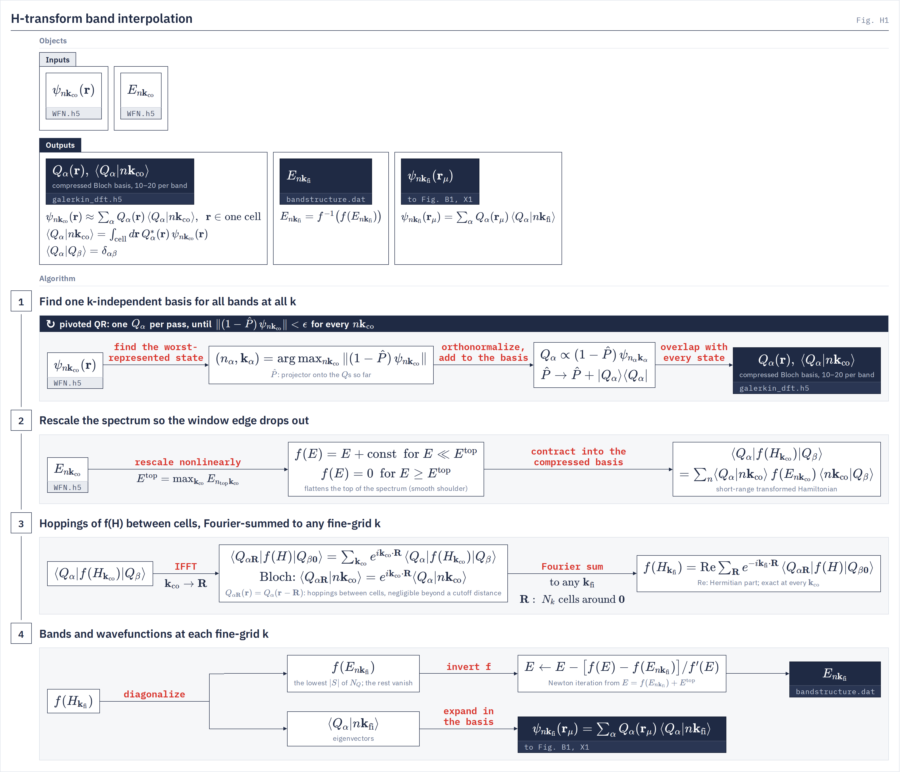

# H-transform utility

`bandstructure.htransform` Band energies and states at any $\bk$ from a coarse-grid calculation, by the Hamiltonian transformation of Wu *et al.*
{: .page-summary }

<div class="chain-map" data-driver="htransform" data-page="files"></div>

The H-transform is the Hamiltonian transformation method of Kai Wu, Yingzhou Li, Wentiao Wu, Lin Lin, Wei Hu and Jinlong Yang, published in *npj Computational Materials* ([1](#refs)). LORRAX implements their method, and the construction, the transform function and the error analysis summarized on this page are theirs.
{: .lead }

The utility interpolates both the eigenvalues and the eigenvectors of a coarse-grid calculation. LORRAX uses it to draw band structures along a path in the Brillouin zone ([Band structures](htransform-bands.md)) and to fill the fine k grid of a BSE calculation from the coarse grid of the GW run ([Fine grids](htransform-fine-grid.md)).

We prefer it to the usual alternatives for three reasons.

- **It carries quasiparticle states.** The method interpolates the eigenvectors of whatever Hamiltonian it is given, so the rotated orbitals of a self-consistent QSGW run reach the fine grid intact. BerkeleyGW's interpolation starts from a one-shot $G_0W_0$ calculation, whose states are still the DFT states, and expands the fine-grid states in DFT wavefunctions.
- **It needs no extra DFT calculations.** The path and the fine grid are reached from the coarse-grid `WFN.h5` alone.
- **It does the job of Wannier interpolation with fewer knobs.** The authors found it faster to construct than maximally localized Wannier functions, since it has no localization step, and more accurate for entangled bands in their tests.

!!! warning "Interpolate every band from the bottom"
    The window must start at the lowest valence band and run up to the highest conduction band you need, with a few guard bands above it. Wannier interpolation usually works with a few valence and a few conduction bands, but the H-transform needs all of the valence bands. The standalone driver refuses a window that cuts the occupied manifold and adds 4 guard bands by default ([`--guard-bands`](#-guard-bands)). Inside the BSE drivers no guard bands are added, so the deck's band count must leave at least four bands above the bands the BSE uses.

<div class="glance" markdown>

Invoke
:   `python -m bandstructure.htransform -i ht.in`

Reads
:   deck, `WFN.h5` (or `WFN_qp.h5`), `centroids_file`; optionally `eqp1.dat`, `qp_wfn_rotations.h5`, `galerkin_dft.h5`

Writes
:   `bandstructure.dat`, `htransform.out`, `galerkin_dft.h5`

Energies
:   WFN eigenvalues · `--eqp-file` (diagonal QP) · `--qp-rotations` (full QP Hamiltonian)

</div>

The two methods compare as follows.

| | H-transform | Wannier interpolation |
|---|---|---|
| Bands | every band from the lowest valence band up, plus guard bands | a chosen set, often a few valence and a few conduction bands |
| Basis | a $\bk$-independent numerical basis from randomized QR with column pivoting | localized Wannier functions from initial projections |
| Optimization | none | spread minimization, and disentanglement for entangled bands |
| Interpolated object | the transformed Hamiltonian $f(H)$ | the Hamiltonian in the Wannier basis |
| Main parameters | `htransform_qr_eps`, guard bands, shoulder width $a$ | projections, energy windows, iteration counts |

## How it works {: #how }

The Hamiltonian restricted to a band window is not smooth in $\bk$, because the window projector kinks wherever the top band of the window meets the next band up. Its Fourier series in $\bR$ is then long-ranged, and a Fourier interpolation of it converges slowly. The authors show that, as with Wannier functions, a small subspace of the Hamiltonian can be compressed so that it is short-ranged in real space, after which it can be Fourier-transformed to any $\bk$. In outline the method has four steps.

1. **Compress.** A randomized QR with column pivoting picks, from the coarse-grid states of the window, a small $\bk$-independent basis $Q_\alpha$. It plays the part of Wannier functions but is built without any localization procedure.
2. **Transform.** A function $f$, defined implicitly through a smooth shoulder at the top of the window, rescales the spectrum of the compressed Hamiltonian so that the window edge drops out. $f(H)$ is short-ranged where $H$ is not.
3. **Interpolate.** $f(H)$ is Fourier-transformed to hoppings between the cells of the coarse supercell and summed back at any $\bk_{\mathrm{fi}}$.
4. **Recover.** The subspace Hamiltonian can be diagonalized at any $\bk$. Its eigenvectors give the states, and inverting $f$ gives the energies.

This is a heuristic summary. The construction of the basis, the choice of $f$ and the error analysis are set out in the paper ([1](#refs)), and we encourage readers to consult it before tuning the keys below.

<figure class="flowchart" markdown>
[](../assets/figures/h1.png)
<figcaption><strong>Fig. H1.</strong> The coarse-grid states $\psi_{n\bk_{\mathrm{co}}}$ are compressed into one $\bk$-independent basis $Q_\alpha$ (1), the spectrum is rescaled by $f$ (2), the hoppings of $f(H)$ are Fourier-summed to any $\bk_{\mathrm{fi}}$ (3), and diagonalization plus Newton inversion of $f$ return $E_{n\bk_{\mathrm{fi}}}$ and $\psi_{n\bk_{\mathrm{fi}}}(\br_\mu)$ (4).</figcaption>
</figure>

??? note "Implementation details in LORRAX"
    <div class="stages" markdown>

    1. **One $\bk$-independent basis for all bands at all $\bk$**
       Every state of the fitted window $S$ at every $\bk_{\mathrm{co}}$ is taken by IFFT to the real-space grid of one unit cell, Bloch phase $e^{i\bk\cdot\br}$ included, and unit-normalized. Pivoted QR then adds one orthonormal function per pass, built from the state the basis so far represents worst, until every candidate satisfies $\|(1-\hat P)\,\psi_{n\bk_{\mathrm{co}}}\|\le\epsilon$, with $\epsilon$ = `htransform_qr_eps`:

        $$
        (n_\alpha,\bk_\alpha)=\arg\max_{n\bk_{\mathrm{co}}}\big\|(1-\hat P)\,\psi_{n\bk_{\mathrm{co}}}\big\|,\qquad
        Q_\alpha\propto(1-\hat P)\,\psi_{n_\alpha\bk_\alpha},\qquad
        \hat P\to\hat P+|Q_\alpha\rangle\langle Q_\alpha| .
        $$

        $\hat P$ is the projector onto the $Q$s chosen so far. Bloch states at different $\bk$ are not orthogonal over one cell, so the set compresses: the paper reports 10–20 functions per band, independent of $N_k$. The code runs the loop as a pivoted Cholesky of the Gram of a Gaussian sketch of $1.5N_s$ random candidate states, and stores only $Q_\alpha(\br_\mu)$ and $\langle Q_\alpha|n\bk_{\mathrm{co}}\rangle$.

    2. **Rescale the spectrum so the window edge drops out**
       $f$ is a rigid shift deep in the window, exactly zero at and above $E^{\mathrm{top}}$, and an erf shoulder of width $a$ between. With $y=E-E^{\mathrm{top}}$ and $n=3$, $f(E)=y+a/2$ for $y\le-a$, $f(E)=0$ for $y\ge0$, and on the shoulder

        $$
        f'(E)=\frac12-\frac{\mathrm{erf}\big(n(\tfrac12+y/a)\big)}{2\,\mathrm{erf}(n/2)},
        $$

        with $f$ and $f'$ continuous at both ends. $E^{\mathrm{top}}$ is the maximum over $\bk_{\mathrm{co}}$ of the top fitted band, and $a$ is four times the $\bk$-bandwidth of band $b_a$ (`--a-band`). The short-range transformed Hamiltonian in the compressed basis is

        $$
        \langle Q_\alpha|f(H_{\bk_{\mathrm{co}}})|Q_\beta\rangle=\sum_{n\in S}\langle Q_\alpha|n\bk_{\mathrm{co}}\rangle\,f(E_{n\bk_{\mathrm{co}}})\,\langle n\bk_{\mathrm{co}}|Q_\beta\rangle .
        $$

        It is gauge-invariant: no gauge fixing or disentanglement is needed.

    3. **Hoppings of $f(H)$ between cells, Fourier-summed to any $\bk_{\mathrm{fi}}$**
       With $Q_{\alpha\bR}(\br)=Q_\alpha(\br-\bR)$ and the Bloch identity $\langle Q_{\alpha\bR}|n\bk\rangle=e^{i\bk\cdot\bR}\langle Q_\alpha|n\bk\rangle$, an IFFT over $\bk_{\mathrm{co}}$ gives the hoppings and a phase sum gives $f(H)$ at any $\bk_{\mathrm{fi}}$:

        $$
        \langle Q_{\alpha\bR}|f(H)|Q_{\beta\mathbf 0}\rangle=\frac{1}{N_k}\sum_{\bk_{\mathrm{co}}}e^{i\bk_{\mathrm{co}}\cdot\bR}\langle Q_\alpha|f(H_{\bk_{\mathrm{co}}})|Q_\beta\rangle,\qquad
        f(H_{\bk_{\mathrm{fi}}})=\sum_{\bR}e^{-i\bk_{\mathrm{fi}}\cdot\bR}\langle Q_{\alpha\bR}|f(H)|Q_{\beta\mathbf 0}\rangle .
        $$

        $\bR$ runs over the $N_k$ lattice vectors of the coarse Born–von Kármán supercell centred on $\mathbf 0$, each with weight 1 (no Wigner–Seitz degeneracy weights), and the result is Hermitized, $\tfrac12(M+M^\dagger)$. The second sum is a dense phase sum, not an FFT, so its cost grows with the number of $\bk_{\mathrm{fi}}$. Hoppings beyond the supercell are dropped: the coarse grid sets the cutoff, and no key does. The interpolant is exact at every $\bk_{\mathrm{co}}$. Fig. H1 omits the $1/N_k$.

    4. **Diagonalize, then invert $f$**
       $f(H_{\bk_{\mathrm{fi}}})$ is $N_Q\times N_Q$ with rank at most $|S|$: its $|S|$ lowest eigenvalues are $f(E_{n\bk_{\mathrm{fi}}})$ and the rest vanish. Newton iteration recovers the energies:

        $$
        E\leftarrow E-\frac{f(E)-f(E_{n\bk_{\mathrm{fi}}})}{f'(E)},\qquad E_{\mathrm{start}}=f(E_{n\bk_{\mathrm{fi}}})+E^{\mathrm{top}},
        $$

        each step clipped to $|\Delta E|\le a/2$, at most 50 steps, converged at $10^{-12}$ Ry. The eigenvectors give the states at the centroids, $\psi_{n\bk_{\mathrm{fi}}}(\br_\mu)=\sum_\alpha Q_\alpha(\br_\mu)\langle Q_\alpha|n\bk_{\mathrm{fi}}\rangle$, which the BSE drivers consume.

    </div>

!!! note
    Because $f'\to0$ at $E^{\mathrm{top}}$, the top fitted bands are compressed and, at the $\bk$ where they reach $E^{\mathrm{top}}$, absent from $f(H)$. The driver therefore fits `--guard-bands` (default 4) bands above the returned window and never returns them. A returned band that touches the flat part of $f$ refuses.

## Running {: #run }

The utility runs on its own to draw a band structure, described on [Band structures](htransform-bands.md). The BSE and exciton-bands drivers call the same engine in memory to fill their fine grids, described on [Fine grids](htransform-fine-grid.md). Both read the keys below.

## Keywords {: #keywords }

Deck keys are `[cohsex]` keys, written `key = value`, energies in Ry; flags are those of `python -m bandstructure.htransform`. Unknown deck keys refuse. Defaults are read from the keyword schema (`src/gw/gw_config.py`) and the driver's argparse (`src/bandstructure/htransform.py`).

Required
{: .kw-group }

**Files and run**

### `-i`, `--input` {: .kw data-type="path" data-default="required" }
The deck. Relative output paths resolve beside it.

### `centroids_file` {: .kw data-type="path" data-default="required" }
Centroid table $\br_\mu$ at which $Q_\alpha$ and $\psi_{n\bk_{\mathrm{fi}}}$ are evaluated.

Always read; the basis is selected without it. On a downfolded restart the BSE drivers substitute the parent's table.
{: .kw-details }

**Band window and basis**

### `nval` {: .kw data-type="int" data-default="required" }
Required unless `number_bands_protected` is given. Bands below the occupied edge $n_{\mathrm{occ}}$; the window starts at band $n_{\mathrm{occ}}-$`nval`.

The standalone driver requires `nval` $=n_{\mathrm{occ}}$: a lower edge that cuts the occupied manifold reproduces the grid and rings between grid points. The BSE drivers do not apply this gate.
{: .kw-details }

### `ncond` {: .kw data-type="int" data-default="required" }
Required unless `number_bands_protected` is given. Returned conduction bands. Returned window: $[n_{\mathrm{occ}}-$`nval`$,\ n_{\mathrm{occ}}+$`ncond`$)$.

On the BSE routes this is the whole $f(H)$ window, with no automatic guard bands.
{: .kw-details }

### `number_bands` {: .kw data-type="int" data-default="required" }
Bands loaded from the WFN; above it ψ is zero-padded. Alias `nband`.

With guard bands the driver raises it to $n_{\mathrm{occ}}+$`ncond`$+N_{\mathrm{guard}}$. On the BSE routes it must cover the deck window.
{: .kw-details }

**Shared keys**

### `sys_dim` {: .kw data-type="int" data-default="required" }
Not used by the interpolation; stamped for the BSE consumers. A deck without it refuses.

Optional
{: .kw-group }

**Files and run**

### `-wfn`, `--wfn-file` {: .kw data-type="path" data-default="the deck's wfn_file" }
Another WFN, for example `WFN_qp.h5` for QSGW bands.

A QP WFN combined with `--eqp-file` or `--qp-rotations` refuses.
{: .kw-details }

### `wfn_file` {: .kw data-type="path" data-default="WFN.h5" }
Coarse-grid wavefunctions and energies $\psi_{n\bk_{\mathrm{co}}}$, $E_{n\bk_{\mathrm{co}}}$, BerkeleyGW format.

### `--report-file` {: .kw data-type="path" data-default="htransform.out" }
Text report.

**QP energies**

The default energies are the WFN's eigenvalues: DFT, or QP for a `WFN_qp.h5`. The three routes exclude each other.

### `--eqp-file` {: .kw data-type="path" data-default="none" }
Diagonal QP: the window's $E_{n\bk_{\mathrm{co}}}$ are replaced by the GW run's wedge `eqp1.dat` (eV), unfolded by symmetry.

The states are unchanged, so off-diagonal QP mixing is absent. A missing or unparsable file refuses.
{: .kw-details }

### `qp_rotations_file` {: .kw data-type="path" data-default="none" }
Full QP Hamiltonian from `qp_wfn_rotations.h5`: $f(H^{\mathrm{QP}})=U\,f(E^{\mathrm{QP}})\,U^\dagger$ in the same DFT basis.

The QP block must lie inside the fitted window, start at its lower edge and contain the returned window; source-WFN fingerprint, bands, grid and $\bk$ coordinates must match.
{: .kw-details }

**Band window and basis**

### `--guard-bands` {: .kw data-type="int" data-default="4" }
$N_{\mathrm{guard}}$: bands fitted above the returned window and not returned.

Fitted window $S=[n_{\mathrm{occ}}-$`nval`$,\ n_{\mathrm{occ}}+$`ncond`$+N_{\mathrm{guard}})$. `0` is kept as a reproduction arm and normally refuses at the f-shoulder gate.
{: .kw-details }

### `htransform_qr_eps` {: .kw data-type="float" data-default="1e-3" }
$\epsilon$ of stage 1, the only rank-revealing tolerance. Must lie in (0, 1).

Pivoting stops when every sketched, unit-normalized candidate has $\|(1-\hat P)\psi\|^2\le\epsilon^2$. Smaller $\epsilon$ gives a larger basis.
{: .kw-details }

### `htransform_rank_multiplier` {: .kw data-type="float" data-default="20.0" }
$m$: search ceiling $N_s=\min(\lceil m|S|\rceil,\ N_kN_{|S|},\ n_sN_r)$; $1.5N_s$ random candidates are sketched.

A rank above $0.9N_s$ refuses unless the ceiling spans every state; then raise $m$. `0` reads as `20`; values in (0, 1) refuse. The rank is set by `htransform_qr_eps`, and silently capped at 2500.
{: .kw-details }

### `htransform_qrcp_seed` {: .kw data-type="int" data-default="0" }
Seed of the candidate shuffle and the Gaussian sketch. Must fit in uint32.

Pivot ties within $10^{-8}$ go to the lowest index, so the basis does not depend on the process count.
{: .kw-details }

**Transformation**

### `--a-band` {: .kw data-type="int" data-default="top fitted band" }
Band $b_a$ (window-relative, 0-based) whose $\bk$-bandwidth $W$ sets the shoulder width $a=4W$.

Set it to the highest band that must be accurate when the top fitted band is very flat or very wide. $E^{\mathrm{top}}$, $n=3$ and a $10^{-14}$ Ry floor on $W$ are fixed.
{: .kw-details }

**Shared keys**

### `memory_per_device_gb` {: .kw data-type="float" data-default="0.0 = auto" }
Device budget of the basis fit's planner.

### `bispinor` {: .kw data-type="bool" data-default="false" }
Ignored for the basis: the canonical spinor WFN is always the interpolation basis.

**Environment**

### `LORRAX_FI_FSHOULDER_TOL` {: .kw data-type="env" data-default="0.0" }
Floor of $\min_{\bk}|f(E_{n\bk_{\mathrm{co}}})|/\max|f|$ over returned bands in the f-shoulder gate. Negative disables the gate.

### `LORRAX_EXTRA_RANK_PAD` {: .kw data-type="env" data-default="0" }
Test only: extra exact-null basis directions for pad-invariance tests.

## Output format {: #output }

<div class="file-list" markdown>

`htransform.out`
:   Report: windows, $a$ and $E^{\mathrm{top}}$, basis rank and projection receipt, locality receipt, coarse-point check, timings.

`galerkin_dft.h5`
:   The compressed basis. Published once beside the deck and never overwritten; reused only on an exact provenance match, otherwise refitted in memory.

</div>

The band table `bandstructure.dat` and the band-character files are described on [Band structures](htransform-bands.md#output).

The locality receipt in `htransform.out` is the outer-shell weight of the hoppings, $\big(\sum_{\bR\in\text{outer shell}}\|f(H)_\bR\|^2/\sum_\bR\|f(H)_\bR\|^2\big)^{1/2}$. A large value means the coarse grid does not resolve $f(H)$. Agreement at the coarse points is not evidence of accuracy: the interpolant returns its input there.

### galerkin_dft.h5 {: #galerkin }

Written by `isdf.galerkin.write_galerkin_basis`. $N_Q$ is the physical rank and $N_S=|S|$; text fields are stored as int32 code arrays.

```tree
galerkin_dft.h5
  galerkin_ctilde              complex[N_k, N_S, N_Q]    ⟨Q_α|n k_co⟩
  galerkin_basis_at_nodes      complex[N_Q, n_spinor, N_μ]   Q_α(r_μ)
  galerkin_selection_factor    complex[N_Q, N_Q]         Cholesky factor L
  galerkin_format              int32[1]                  = 2
  galerkin_rank                int32[1]
  galerkin_band_range          int32[2]
  galerkin_nk_nb_nspinor       int32[3]
  galerkin_fft_grid            int32[3]
  galerkin_kgrid               int32[3]
  galerkin_bispinor            int32[1]
  galerkin_centroid_shape      int32[2]
  galerkin_qrcp_raw_search     int32[2]
  galerkin_selected            int32[N_Q]                pivot states
  galerkin_qrcp_controls       float64[2]                rank_multiplier, qr_eps
  galerkin_qrcp_seed           int64[1]
  galerkin_centroid_hash       text
  galerkin_wfn_hash            text
  galerkin_wfn_scheme          text
  galerkin_transform_scheme    text
  galerkin_qrcp_rng            text
  galerkin_candidate_hash      text
  galerkin_pivot_hash          text
  galerkin_complete            int32[1]                  = 1
```


## Refusals {: #refusals }

!!! refuses
    - `nval` below the number of occupied bands (standalone driver). Set `nval` to the occupied count.
    - A guard band above the WFN's band count. Rerun the WFN with more bands, or lower `--guard-bands`.
    - A returned band with $f(E_{n\bk_{\mathrm{co}}})=0$ at some $\bk_{\mathrm{co}}$ (f-shoulder gate). Add guard bands or set `--a-band`.
    - Newton inversion not converged in 50 steps. Add guard bands or set `--a-band`.
    - A basis rank above $0.9N_s$ when the ceiling does not span every state. Raise `htransform_rank_multiplier`.
    - `htransform_qr_eps` outside (0, 1); `htransform_rank_multiplier` in (0, 1); `htransform_qrcp_seed` outside uint32.
    - `--eqp-file` together with `--qp-rotations`, or either with a QP WFN (`-wfn WFN_qp.h5`).
    - An `--eqp-file` that is missing or not a wedge `eqp1.dat`.
    - A `qp_rotations_file` file whose QP block does not start at the fitted window's lower edge inside it, or whose WFN fingerprint, bands, grid or $\bk$ coordinates differ.
    - A deck without `sys_dim`, or with an unknown key.

The refusals of the path and of the fine grid are on their own pages.

## References {: #refs }

1. K. Wu, Y. Li, W. Wu, L. Lin, W. Hu and J. Yang, "Hamiltonian transformation for accurate and efficient band structure interpolation", npj Computational Materials; preprint [arXiv:2211.02846](https://arxiv.org/abs/2211.02846).

