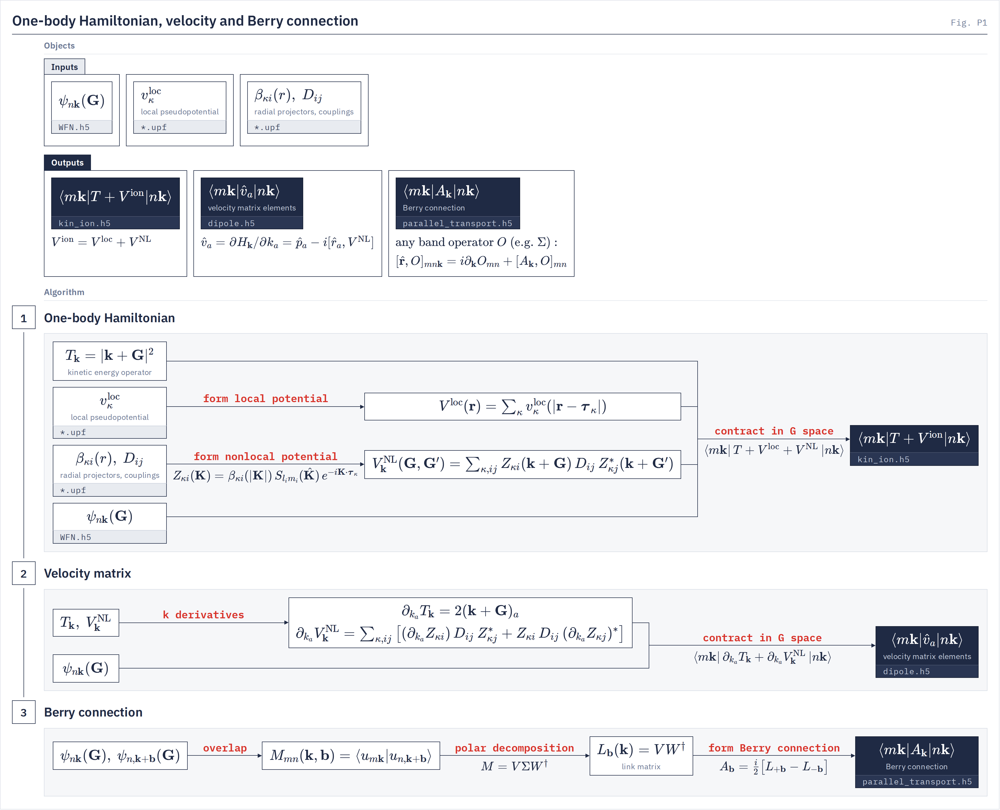

# Kin-ion utility

`gw.kin_ion_io` The mean-field one-body matrix $\langle m\bk|T+V^{\mathrm{ion}}|n\bk\rangle$ in the DFT band basis.
{: .page-summary }

<div class="chain-map" data-driver="kin-ion" data-page="files"></div>

Writes the kinetic plus ionic part of the mean-field Hamiltonian, $\langle m\bk|T + V^{\mathrm{loc}} + V^{\mathrm{NL}}_\bk|n\bk\rangle$, to `kin_ion.h5` for the protected bands, every occupied band plus the `ncond` protected conduction bands whose quasiparticle energies GW corrects.
{: .lead }

The DFT and quasiparticle Hamiltonians share this part and differ in what is added to it,

$$
H^{\mathrm{DFT}} = T + V^{\mathrm{ion}} + V^{\mathrm H} + V^{xc}, \qquad H^{\mathrm{QP}}(\omega) = T + V^{\mathrm{ion}} + V^{\mathrm H} + \Sigma^{xc}(\omega).
$$

LORRAX recomputes $V^{\mathrm H}$ at run time because it changes when the orbitals are updated self-consistently, so the file stores only $T + V^{\mathrm{ion}}$, which stays fixed.

<div class="glance" markdown>

Invoke
:   `python -m gw.kin_ion_io -i gw.in`

Reads
:   deck (`-i`), `WFN.h5`, `*.upf`

Writes
:   `kin_ion.h5`, `kin_ion.out`

Hartree
:   not included; GW builds $V^{\mathrm H}$ at run time

</div>

## What it computes {: #what }

<figure class="flowchart" markdown>
[](../assets/figures/p1.png)
<figcaption><strong>Fig. P1.</strong> The three one-body operators built from the lattice, the atomic positions and the pseudopotentials. This utility is stage 1, the one-body Hamiltonian $T + V^{\mathrm{ion}}$; stages 2 and 3 belong to the <a href="../dipole/">dipole utility</a>.</figcaption>
</figure>

On the plane-wave sphere of each $\bk$, $T$ is $|\bk+\bG|^2$ (Ry), $V^{\mathrm{loc}}$ is the sum of the ionic local potentials, applied in real space, and $V^{\mathrm{NL}}_\bk$ is the separable projector sum of the UPF files, $j$-resolved when Quantum ESPRESSO's `<spinorbit>` record says so. With `sys_dim = 2` the long-range ionic tail of $V^{\mathrm{loc}}$ carries the slab Coulomb cutoff, so `kin_ion.h5` fixes the truncation for the whole GW run. No density enters: the operators commute with the space group and time reversal, so the matrix is computed on the star wedge and unfolded on read. The projectors and their $\bk$-derivative are described on [Velocity operator](../theory/velocity-operator.md).

!!! note
    `kin_ion.h5` holds no Hartree term. GW builds $V^{\mathrm H}$ from the density at run time, and on self-consistent decks from the current orbitals ([Physics overview](../theory/physics.md)). A file in the retired format with $V^{\mathrm H}$ folded in (`has_hartree = true`) refuses in GW.

## Running {: #run }

=== "Local"
    ```bash
    uv run python -m gw.kin_ion_io -i gw.in
    ```
=== "Perlmutter"
    ```bash
    srun -n 4 --gpus-per-task=1 --gpu-bind=closest python -m gw.kin_ion_io -i gw.in
    ```
=== "Frontera"
    ```bash
    $LORRAX_PY -u -m gw.kin_ion_io -i gw.in
    ```

Use the GW deck itself. Every physical setting, the system dimension, the protected band window and the spinor model, is taken from it, and a command-line flag may only confirm it. The deck lines it reads:

```ini
wfn_file      = WFN.h5
sys_dim       = 3
nval          = 4
ncond         = 4
number_bands  = 200
```

## Keywords {: #keywords }

Defaults are read from the argument parser (`src/gw/kin_ion_io.py`) and the keyword schema (`src/gw/gw_config.py`). Every physical setting comes from the GW deck, and the file covers the protected bands, every occupied band plus the `ncond` protected conduction bands.

Required
{: .kw-group }

**Command line**

### `-i`, `--input` {: .kw data-type="path" data-default="required" }
The GW deck.

**Deck keys**

The deck passes through the GW reader, so an unknown key or a missing `sys_dim` refuses.

### `sys_dim` {: .kw data-type="int" data-default="required" }
`3` bulk, `2` slab with vacuum along $c$, `0` molecule.

`2` puts the slab cutoff on the long-range part of $V^{\mathrm{loc}}$. The value is stamped, and GW refuses a file whose stamp differs from its deck.
{: .kw-details }

`0` `2` `3`
{: .kw-values }

### `nval` {: .kw data-type="int" data-default="required" }
Valence bands of the quasiparticle window, resolved as GW resolves it. Required unless `number_bands_protected` is given. Stamped; the file always starts at band 0.

### `ncond` {: .kw data-type="int" data-default="required" }
Number of protected conduction bands, the conduction bands whose quasiparticle energies GW corrects. Required unless `number_bands_protected` is given. The file holds the bands $[0,\ n_\mathrm{occ}+\texttt{ncond})$, every occupied band plus the protected conduction bands.

### `number_bands_protected` {: .kw data-type="int" data-default="instead of nval, ncond" }
Alternative request for the same window: every occupied band plus protected conduction bands up to this total.

Resolved here exactly as in GW, giving `nval` = $n_\mathrm{occ}$ and `ncond` = total − $n_\mathrm{occ}$ protected conduction bands. Giving it beside `nval` or `ncond` refuses (`GATE band_request_forms`). Must lie between $n_\mathrm{occ}$ and `number_bands`.
{: .kw-details }

Optional
{: .kw-group }

**Command line**

### `-o`, `--output` {: .kw data-type="path" data-default="kin_ion.h5" }
Output file; by default `kin_ion.h5` in the deck directory.

GW reads the file named by its `kin_ion_file` key.
{: .kw-details }

### `--report-file` {: .kw data-type="path" data-default="kin_ion.out" }
Run report; by default `kin_ion.out` beside the output file.

### `--pseudo_dir` {: .kw data-type="path" data-default="deck directory" }
Directory scanned for `*.upf`.

When it holds none, `../qe/scf` and then `../qe/nscf`, relative to the deck, are tried.
{: .kw-details }

### `--sys_dim` {: .kw data-type="int" data-default="the deck's" }
System dimension; may only confirm the deck's `sys_dim`. A contradiction refuses.

**Deck keys**

### `number_bands` {: .kw data-type="int" data-default="GW deck" }
Top of the $\chi^0$ and $\Sigma$ band sums of the GW run. Alias `nband`. Kin-ion only stamps it, because the quasiparticle Hamiltonian needs the one-body matrix on the protected bands alone.

### `wfn_file` {: .kw data-type="string" data-default="WFN.h5" }
Wavefunction file, relative to the deck directory.

### `bispinor` {: .kw data-type="bool" data-default="false" }
Four-component run. Stamped; GW refuses a file whose stamp differs.

### `bispinor_gw` {: .kw data-type="enum" data-default="bare_transverse" }
Four-current screening model; here only checked: `full_static_cohsex` refuses without `bispinor = true`.

`bare_transverse` `full_tangential` `full_static_cohsex`
{: .kw-values }

## Output format {: #output }

<div class="file-list" markdown>

`kin_ion.h5`
:   $\langle m\bk|T+V^{\mathrm{ion}}|n\bk\rangle$ in Ry on the star wedge, with the two unfold tables and the provenance stamps. Written collectively through SlabIO from the band shards.

`kin_ion.out`
:   Run report: bands, pseudopotentials, Coulomb treatment, k-set, timings and the degeneracy check.

</div>

### kin_ion.h5

Generated from `file_io.kin_ion.write_kin_ion` and `gw.kin_ion_io._kin_ion_provenance`. $n_\mathrm{rk}$ is the number of stored star-wedge rows, $n_\bk$ the full-BZ count.

```tree
kin_ion.h5
  kin_ion                     complex128[n_rk, nb, nb]
    @k_storage                str         "ibz"
    @k_storage_version        int         1
    @n_sym_spatial            int
    @description              str
    @nk                       int         full-BZ k count
    @nrk                      int         stored rows
    @k_set_computed           str         "ibz"
    @nb                       int
    @nval                     int
    @ncond                    int
    @nband_input              int
    @nelec_bands              int
    @sys_dim                  int
    @truncation_2d            bool
    @bispinor                 bool
    @nspinor                  int
    @soc                      bool
    @soc_provenance           str
    @pseudopotentials         str
    @input_file               str
    @wfn_file                 str
    @wfn_fingerprint          str
    @wfn_fingerprint_scheme   str
    @fft_grid                 int32[3]
    @ngkmax                   int
    @generator_commit         str
  irr_idx_k                   int32[nk]
  sym_idx_k                   int32[nk]
```

The reader (`file_io.restart_bundle.load_kin_ion_submatrix`) unfolds the stored rows to all $n_\bk$ points through `irr_idx_k` and `sym_idx_k`, conjugating the time-reversed rows. After writing, the utility checks that on every degenerate DFT manifold the written block is a multiple of the identity and reports any block that is not.

Before reading the slab GW refuses a file that is in the folded-Hartree format, has no `bispinor` stamp or a different one, or whose `sys_dim`, `nspinor`, full-BZ count or band extent does not match the run. The fix is to rerun this utility with the run's deck. The `wfn_fingerprint`, `input_file` and `pseudopotentials` stamps are recorded but not compared: a file built from another WFN with the same shape is read.

## Refusals {: #refusals }

!!! refuses
    - A deck without `sys_dim`, or with an unknown key.
    - `--sys_dim` that contradicts the deck's `sys_dim`. Fix the deck.
    - `bispinor_gw = full_static_cohsex` without `bispinor = true`.
    - `number_bands_protected` below the occupied-band count or above `number_bands`.
    - A `WFN.h5` with fewer bands than $n_\mathrm{occ} + \texttt{ncond}$.
    - A `WFN.h5` whose `grid_rho` differs from the wavefunction FFT box.
    - No `*.upf` found, or pseudopotentials that do not cover every species. Stage the files beside the deck or pass `--pseudo_dir`.
    - `sys_dim` other than `0`, `2` or `3`.
    - Fully relativistic pseudopotentials on a two-component WFN with no `<spinorbit>` record, or `<spinorbit>` true on a one-component WFN.

